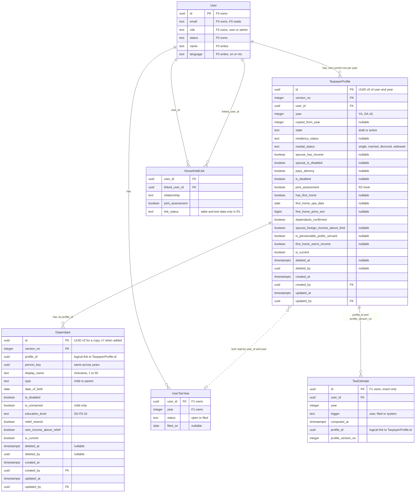

# ERD-F0: User profile: data model for phase 1 (R1)

| Item | Value |
| --- | --- |
| Document ID | ERD-F0 |
| Document type | ERD (entity relationship diagram: the data of one feature) |
| Product | Tax Relief Manager (TRM), Malaysia tax relief system (PWA) |
| Version | 0.1 |
| Status | Proposed (waits for review by the other developer and approval by the owner) |
| Date | 2026-11-24 (first written 2026-11-24) |
| Owner | Champs (product owner) |
| PRD reference | PRD-TRM section 3.1 (F0 user profile), FR-0.1 to FR-0.8, section 5 (data) |
| Source | URS-SRS-F0 section B2.1 (fields F0 writes and reads) and SRS-F0-04, SRS-F0-08, SRS-F0-17; DA-02, DA-12, DA-16 to DA-20, DA-26; ADR-004 (approved 23/11/2026); owner prompts P-87 to P-90 |
| Change tracking | [REG-01 History log](../../../registers/REG_01_History_Log.md); detail in [REG-02](../../../registers/REG_02_URS_SRS_Change_Log.md) |
| Scope | Feature F0 only, phase 1 (R1). The other features get their own ERD later, by the owner's decision (P-88) |

## 1. What this is

The tables that F0 writes, and the tables it reads from F1 and F5, drawn from the F0 specification. It is a reference for the first migrations. It is **not** the final schema: column types, indexes and the order of deletion are written when the project is created ([ADR-004](../../../decisions/ADR_004_Database.md)).

If this document and the specification differ, the specification is right and the difference is a finding (section 5).

The picture also exists as an SVG file: [erd_f0.svg](erd_f0.svg), made from the text file [erd_f0.mmd](erd_f0.mmd) (section 7).

## 2. The diagram



How to read it: a line with `||` and a crow's foot is one-to-many. A dotted line is a link by value, with no foreign key. `PK` is a key column, `FK` is a link to another table. Two `PK` rows in one table mean a **combined key**. Every column marked "nullable" may be empty, because an unanswered question stays empty (DA-20). Types follow ADR-004: `uuid`, `bigint` for money in sen, `date`, and times in UTC (`timestamptz`).

## 3. The tables

| Table | Owner | F0 access | Source | Rows |
| --- | --- | --- | --- | --- |
| User | F5 | Writes `name` and `language`; reads the rest | B2.1, IF-18, SD-F5-13 | One per account |
| TaxpayerProfile | F0 | Writes | B2.1, DA-16, SRS-F0-04, SRS-F0-08 | One **current** row per user and year, and every earlier version of it |
| Dependant | F0 | Writes | B2.1, DA-17, SRS-F0-07 | One current row per dependant and profile, plus versions. At most 20 per YA |
| HouseholdLink | F0 | Structure only | B2.1, SD-F0-07 | The table and test data in R1. No screen until R2 |
| UserTaxYear | F1 | Reads (the lock for a filed year) | DA-12, SRS-F0-10 | One per user and year |
| TaxEstimate | F1 | Reads, through IF-16 | DA-18, SRS-F1-19 | Insert only |

Not drawn, to keep the picture readable: the audit columns of User and UserTaxYear, the links from `created_by` and `updated_by` to User, the other columns of TaxEstimate (the figures), and the F2 tables (TaxYear and the rule tables). F0 does not link to F2 by a key: `year` is a plain number, so a profile can exist for a YA that has no rule set yet.

## 4. Rules that the database should hold

These come from the specification. Whether each becomes an index or a check is decided when the migrations are written.

| # | Rule | Source |
| --- | --- | --- |
| 1 | One current TaxpayerProfile per user and year: a unique index on (`user_id`, `year`) where `is_current` is true | B2.1, ADR-004 item 4 |
| 2 | One current Dependant per profile and `person_key`: a unique index on (`profile_id`, `person_key`) where `is_current` is true | DA-17, SRS-F0-08 |
| 3 | Every save inserts a new row with `version_no` + 1 and sets the old row's `is_current` to false. Nothing is updated in place, except `is_current` | SRS-F0-08 |
| 4 | A profile row id is a UUID v5 of the text `profile:{user_id}:{year}`, so two offline devices create the same row. A dependant copy gets the UUID v5 of `{profile_id}:{person_key}`. A dependant added by the user gets a UUID v7 | SRS-F0-17, SD-F0-09, DA-02 |
| 5 | A copy to a new YA sets `copied_from_year`, `state` = draft and `dependants_confirmed` = false. New dependants get new ids and the same `person_key` | SRS-F0-04 |
| 6 | Deletes are soft (`deleted_at`, `deleted_by`) while the user has the data. The erase is a hard delete in a planned order (ADR-004 item 6, SRS-F0-19) | B2.1, ADR-004 |
| 7 | Money is whole sen. Dates are `date`. `language` is `en` or `ms` | NFR-11, ADR-004 |
| 8 | A filed YA locks the profile: a write is refused. The lock is read from UserTaxYear by (`user_id`, `year`), not by a key | SRS-F0-10 |

## 5. Findings from drawing it

These are not decided. **The specification and the ADRs are not changed.** The owner decides.

| # | Finding | Why it matters |
| --- | --- | --- |
| 1 | **UUID v5 against ADR-004.** ADR-004 item 3 says the server accepts only a valid UUID v7 for the tables whose records are made on the device. SRS-F0-17 and SD-F0-09 make profile ids UUID v5 (and dependant copies too) | One of them must change, or the rule must name the exception. If the server checks for v7 only, every profile save would be refused |
| 2 | **The id is the same on every version.** A profile id is fixed by user and year, but every save inserts a new row. So `id` alone cannot be the primary key. I drew a combined key (`id`, `version_no`). TaxEstimate already stores `profile_id` and `profile_version_no`, which fits it. The same holds for a dependant copy (id from profile and `person_key`) | ADR-004 item 3 says "primary keys are `uuid`". The combined key needs a decision. It also means `Dependant.profile_id` and `TaxEstimate.profile_id` cannot be database foreign keys to one row |
| 3 | **HouseholdLink has no key.** B2.1 lists five columns and no id | A key is needed for the table. R1 has no screen, so it can wait, but the migration cannot |
| 4 | **The SYSTEM user.** `created_by` and `updated_by` are SYSTEM for a copy (SRS-F0-04), and F5 says the system acts as the SYSTEM user, but no User row for it is specified | A foreign key from `created_by` to User needs that row. F5 must create it |
| 5 | **Text columns without a value list.** B2.1 lists the values of `marital_status`, `state`, `type` and `language`, but not of `residency_status` (Q1 allows Yes and No, and No is not accepted in R1), and `education_level` points to SD-F0-10 | A check constraint needs the list. I drew `text` |
| 6 | **User.status and role** are F5's; I show them only as read columns | Nothing to decide for F0 |
| 7 | **No link from `year` to TaxYear.** See section 3 | A reading: a profile may exist for a year without rules. Confirm |
| 8 | **Counts.** TaxpayerProfile has 27 columns in the diagram and Dependant has 19. Counted by script from the diagram, not copied from the specification | If a column is added to B2.1, this diagram needs the same change |

## 6. What comes next

When F1 is started, an ERD for F1 is made the same way, in `docs/data/phase-1_R1/F1_Tax_Calculator/`. Which of the findings above become specification changes is for the owner to say.

## 7. How the picture was made

The diagram text is in `erd_f0.mmd`. The SVG was made on 24/11/2026 with the image `minlag/mermaid-cli:12.0.1` (digest in [GDE-001](../../../guides/GDE_001_Docker_Setup.md)), from this folder:

```bash
docker run --rm -v "$PWD:/data" minlag/mermaid-cli:12.0.1 -p /puppeteer-config.json -i /data/erd_f0.mmd -o /data/erd_f0.svg -b white -q
```

The command worked on macOS with Apple silicon. It was not tried on Windows or Linux; on Linux the folder must be writable by the container user. GitHub also draws the diagram in section 2 by itself.
