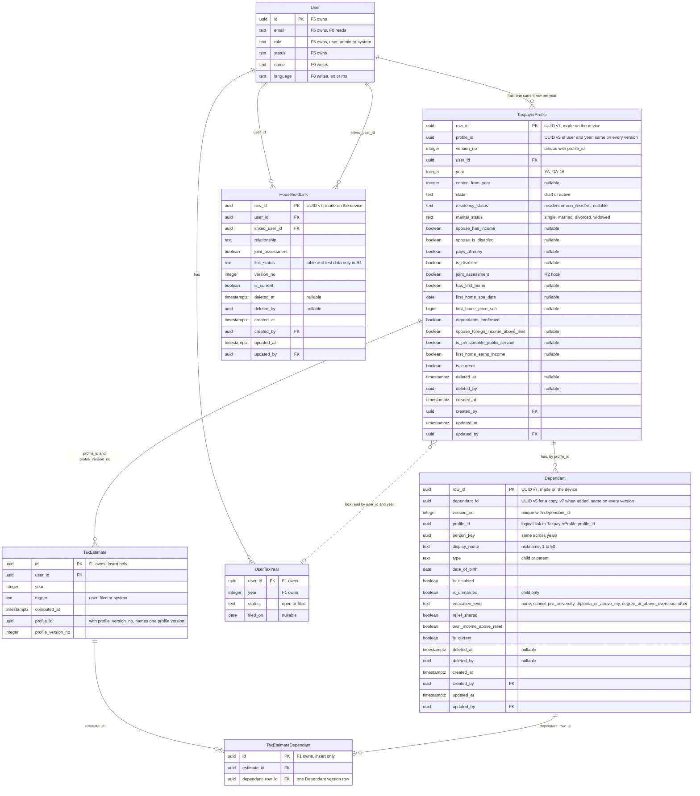

# ERD-F0: User profile: data model for phase 1 (R1)

| Item | Value |
| --- | --- |
| Document ID | ERD-F0 |
| Document type | ERD (entity relationship diagram: the data of one feature) |
| Product | Tax Relief Manager (TRM), Malaysia tax relief system (PWA) |
| Version | 1.1 |
| Status | Approved by the owner on 26/11/2026 (version 1.1 follows the owner's decisions of 26/11/2026 on the open findings) |
| Date | 2026-11-26 (first written 2026-11-24) |
| Owner | Champs (product owner) |
| PRD reference | PRD-TRM section 3.1 (F0 user profile), FR-0.1 to FR-0.8, section 5 (data) |
| Source | URS-SRS-F0 section B2.1 (fields F0 writes and reads) and SRS-F0-04, SRS-F0-08, SRS-F0-17; DA-02, DA-12, DA-16 to DA-20, DA-26; ADR-004 (approved 23/11/2026); URS-SRS-F0 version 0.13 (SD-F0-15 to SD-F0-20, DA-28 to DA-30) and URS-SRS-F5 version 0.13 (SD-F5-20); owner prompts P-87 to P-90, P-101 to P-107, P-117 and P-119; PRD-TRM revision 54 |
| Change tracking | [REG-01 History log](../../../registers/REG_01_History_Log.md); detail in [REG-02](../../../registers/REG_02_URS_SRS_Change_Log.md) |
| Decided by | Owner, 26/11/2026 (P-117, P-119) |
| Scope | Feature F0 only, phase 1 (R1). The other features get their own ERD later, by the owner's decision (P-88) |

## 1. What this is

The tables that F0 writes, and the tables it reads from F1 and F5, drawn from the F0 specification. It is a reference for the first migrations. It is **not** the final schema: column types, indexes and the order of deletion are written when the project is created ([ADR-004](../../../decisions/ADR_004_Database.md)).

If this document and the specification differ, the specification is right and the difference is a finding (section 5).

The picture also exists as an SVG file: [erd_f0.svg](erd_f0.svg), made from the text file [erd_f0.mmd](erd_f0.mmd) (section 7).

## 2. The diagram



How to read it: a line with `||` and a crow's foot is one-to-many. A dotted line is a link by value, with no foreign key. `PK` is a key column, `FK` is a link to another table. Every column marked "nullable" may be empty, because an unanswered question stays empty (DA-20). Types follow ADR-004: `uuid`, `bigint` for money in sen, `date`, and times in UTC (`timestamptz`).

## 3. The tables

| Table | Owner | F0 access | Source | Rows |
| --- | --- | --- | --- | --- |
| User | F5 | Writes `name` and `language`; reads the rest | B2.1, IF-18, SD-F5-13, SD-F5-20 | One per account, and one reserved SYSTEM row (role `system`, status `disabled`, no Credential) seeded by the first migration |
| TaxpayerProfile | F0 | Writes | B2.1, DA-16, DA-28, SRS-F0-04, SRS-F0-08 | One **current** row per user and year, and every earlier version of it. `row_id` is the primary key; (`profile_id`, `version_no`) is unique |
| Dependant | F0 | Writes | B2.1, DA-17, DA-28, SRS-F0-07 | One current row per dependant and profile, plus versions. At most 20 per YA. `row_id` is the primary key; (`dependant_id`, `version_no`) is unique |
| HouseholdLink | F0 | Structure only | B2.1, SD-F0-07, SD-F0-20, DA-30 | The table and test data in R1. No screen until R2. `row_id` is the primary key; one current row for each (`user_id`, `linked_user_id`) |
| UserTaxYear | F1 | Reads (the lock for a filed year) | DA-12, SRS-F0-10 | One per user and year |
| TaxEstimate | F1 | Reads, through IF-16 | DA-18, SRS-F1-19 | Insert only |
| TaxEstimateDependant | F1 | Reads, through IF-16 | DA-29, SRS-F1-19, SD-F0-16 | Insert only. One row for each dependant version row that a saved calculation used |

Not drawn, to keep the picture readable: the audit columns of User and UserTaxYear, the links from `created_by` and `updated_by` to User, the other columns of TaxEstimate (the figures), and the F2 tables (TaxYear and the rule tables). F0 does not link to F2 by a key: `year` is a plain number, because TaxYear is versioned and `year` is not unique there. F0 creates a profile only for a YA that has a rule set (SD-F0-19), checked in code.

## 4. Rules that the database should hold

These come from the specification. Whether each becomes an index or a check is decided when the migrations are written.

| # | Rule | Source |
| --- | --- | --- |
| 1 | One current TaxpayerProfile per user and year: a unique index on (`user_id`, `year`) where `is_current` is true | B2.1, ADR-004 item 4 |
| 2 | One current Dependant per profile and `person_key`: a unique index on (`profile_id`, `person_key`) where `is_current` is true. Each dependant version is unique by (`dependant_id`, `version_no`) | DA-17, SRS-F0-08 |
| 3 | Every save inserts a new row with its own `row_id` and `version_no` + 1, and sets the old row's `is_current` to false. Nothing is updated in place, except `is_current`. A profile save and a dependant save each move only their own `version_no` (SD-F0-16). (`profile_id`, `version_no`) is unique | SRS-F0-08, SD-F0-16 |
| 4 | `row_id` is a UUID v7 made on the device and is the primary key, so ADR-004 and DA-02 hold. `profile_id` is a UUID v5 of the text `profile:{user_id}:{year}` and is the same on every version, so two offline devices create the same profile. `dependant_id` is the UUID v5 of `{profile_id}:{person_key}` for a copy and a UUID v7 for a dependant the user adds | SRS-F0-17, SD-F0-09, SD-F0-15, DA-02, DA-28 |
| 5 | A copy to a new YA sets `copied_from_year`, `state` = draft and `dependants_confirmed` = false. Each copied dependant gets a new `row_id`, a new `dependant_id` and the same `person_key` | SRS-F0-04 |
| 6 | Deletes are soft (`deleted_at`, `deleted_by`) while the user has the data. The erase is a hard delete in a planned order (ADR-004 item 6, SRS-F0-19) | B2.1, ADR-004 |
| 7 | Money is whole sen. Dates are `date`. `language` is `en` or `ms` | NFR-11, ADR-004 |
| 8 | A filed YA locks the profile: a write is refused. The lock is read from UserTaxYear by (`user_id`, `year`), not by a key | SRS-F0-10 |
| 9 | A saved calculation names the profile version (`profile_id`, `profile_version_no`) and, in TaxEstimateDependant, the `row_id` of each dependant row it used. A unique index on (`estimate_id`, `dependant_row_id`). The profile of a filed YA is read from these rows | SRS-F0-12, SRS-F1-19, SD-F0-16, DA-29 |
| 10 | The server refuses a profile row whose `profile_id` is not the UUID v5 of its user and year, and any row whose `row_id` is not a UUID v7. A clash on (`profile_id`, `version_no`) takes the next free number. **Approved by the owner on 26/11/2026** | SRS-F0-17, SD-F0-17 |
| 11 | One current HouseholdLink for each (`user_id`, `linked_user_id`): a unique index where `is_current` is true | SD-F0-20, DA-30, ADR-004 item 4 |
| 12 | Check constraints for the text columns with a fixed list: `state` (draft, active), `marital_status` (single, married, divorced, widowed), `residency_status` (resident, non_resident; the app refuses non_resident in R1), `type` (child, parent), `education_level` (none, school, pre_university, diploma_or_above_my, degree_or_above_overseas, other), `language` (en, ms), `role` (user, admin, system) | B2.1, SD-F0-04, SD-F0-10, SD-F0-18 |
| 13 | One reserved SYSTEM row in User, written by the first migration: a fixed id, role `system`, status `disabled`, no Credential. `created_by` and `updated_by` of a copy, a seed and a sync job point to it | SRS-F0-04, SD-F5-20 |
| 14 | F0 creates a TaxpayerProfile only for a YA that has a rule set; `year` has no foreign key | SD-F0-19 |

## 5. Findings from drawing it

The owner decided findings 1, 2 and 9 on 25/11/2026 (SD-F0-15, SD-F0-16, DA-28, DA-29), finding 10 on 26/11/2026 (SD-F0-17) and findings 3, 4, 5, 7 and 11 on 26/11/2026 (SD-F0-18 to SD-F0-20, SD-F5-20, DA-30, PRD revision 54). ADR-004 and DA-02 are **not changed**: the primary key is a UUID v7. Findings 6, 8 and 12 need no decision, or only a confirmation.

| # | Finding | Why it matters |
| --- | --- | --- |
| 1 | **Resolved 25/11/2026 (SD-F0-15).** UUID v5 against ADR-004: ADR-004 item 3 says the server accepts only a valid UUID v7 for the tables whose records are made on the device, and SRS-F0-17 made the profile ids UUID v5 | The primary key is now `row_id`, a UUID v7, so the ADR holds. The UUID v5 is the column `profile_id`, which is not a key |
| 2 | **Resolved 25/11/2026 (SD-F0-15).** The id is the same on every version, so it cannot be the primary key alone | `row_id` is the single primary key; (`profile_id`, `version_no`) and (`dependant_id`, `version_no`) are unique. `Dependant.profile_id` stays a link by value, with no foreign key, because `profile_id` is not unique across versions. `TaxEstimate` can use a composite foreign key on (`profile_id`, `profile_version_no`) |
| 3 | **Resolved 26/11/2026 (SD-F0-20, DA-30).** HouseholdLink had no key | `row_id` (UUID v7) is the primary key; one current row for each pair of users. The PRD marks HouseholdLink as versioned, so it carries the version and audit columns too (my reading, confirmed with the decision) |
| 4 | **Resolved 26/11/2026 (SD-F5-20).** The SYSTEM user had no User row | One reserved row (role `system`, status `disabled`, no Credential), seeded by the first migration, hidden from lists, export and erase. PRD section 5 already had the role `system`; the F5 specification now agrees |
| 5 | **Resolved 26/11/2026 (SD-F0-18; SD-F0-10 for education_level).** Text columns without a value list | `residency_status` is resident or non_resident (the app refuses non_resident in R1). The check constraints are in section 4 rule 12 |
| 6 | **User.status and role** are F5's; I show them only as read columns | Nothing to decide for F0 |
| 7 | **Resolved 26/11/2026 (SD-F0-19).** No link from `year` to TaxYear | No foreign key (TaxYear is versioned). F0 creates a profile only for a YA that has a rule set |
| 8 | **Counts.** TaxpayerProfile has 28 columns in the diagram, Dependant has 20, HouseholdLink has 14 and TaxEstimateDependant has 3. Counted by script from the diagram, not copied from the specification | If a column is added to B2.1, this diagram needs the same change |
| 9 | **Resolved 25/11/2026 (SD-F0-16, DA-29).** A saved calculation named the profile version but not the dependant versions | The table TaxEstimateDependant (F1 owns, insert only) holds the `row_id` of each dependant row used. The profile of a filed YA is read from it |
| 10 | **Resolved 26/11/2026 (SD-F0-17).** The server refuses a wrong `profile_id` and a `row_id` that is not a UUID v7; two devices that send the same `profile_id` and `version_no` get the next free version number | Without the first rule the server would accept any UUID as a profile id |
| 11 | **Resolved 26/11/2026 (PRD revision 54).** The PRD data model had no row ids, no TaxEstimateDependant and no HouseholdLink key | The PRD and the F0 specification agree on the data model again |
| 12 | **TaxEstimateDependant has its own `id` (UUID v7) and a unique pair.** B2.1 of F1 lists it that way: my reading, to keep one UUID primary key on every table as ADR-004 says | A pair of columns would also work as the key. Confirm |

## 6. What comes next

When F1 is started, an ERD for F1 is made the same way, in `docs/data/phase-1_R1/F1_Tax_Calculator/`. Which of the findings above become specification changes is for the owner to say.

## 7. How the picture was made

The diagram text is in `erd_f0.mmd`. Version 0.1 of the SVG was made on 24/11/2026 on macOS with the image `minlag/mermaid-cli:12.0.1` (digest in [GDE-001](../../../guides/GDE_001_Docker_Setup.md)), from this folder:

```bash
docker run --rm -v "$PWD:/data" minlag/mermaid-cli:12.0.1 -p /puppeteer-config.json -i /data/erd_f0.mmd -o /data/erd_f0.svg -b white -q
```

Version 0.2 of the SVG was made on 25/11/2026 on Windows, where Docker is not installed. It used the npm package `@mermaid-js/mermaid-cli` 12.0.0 (the closest release: npm has no 12.0.1) with Microsoft Edge as the browser, and the picture was checked by eye. Version 1.1 of the SVG was made on 26/11/2026 the same way. Use the Docker command above when Docker is available, so the picture stays the same on every machine. The two versions may differ in small details of the drawing. The command used on Windows:

```bash
PUPPETEER_SKIP_DOWNLOAD=1 npm install @mermaid-js/mermaid-cli@12.0.0
npx mmdc -p puppeteer-config.json -i erd_f0.mmd -o erd_f0.svg -b white -q
```

where `puppeteer-config.json` holds `{"executablePath": "C:/Program Files (x86)/Microsoft/Edge/Application/msedge.exe", "args": ["--no-sandbox"]}`. On Linux the folder must be writable by the container user. GitHub also draws the diagram in section 2 by itself.
