# DES-F0: User profile and tax-year history: screens for phase 1 (R1)

| Item | Value |
| --- | --- |
| Document ID | DES-F0 |
| Document type | DES (design: look, screens and how they behave) |
| Product | Tax Relief Manager (TRM), Malaysia tax relief system (PWA) |
| Version | 1.0 |
| Status | Approved on 23/11/2026 (the findings in section 3 are open) |
| Date | 2026-11-23 (first written 2026-11-23) |
| Owner | Champs (product owner) |
| PRD reference | PRD-TRM section 3.5, FR-0.1 to FR-0.8 |
| Source | URS-SRS-F0 B4 screen behaviour and SRS-F0-01 to SRS-F0-18; DES-000; owner prompts P-80 to P-86 |
| Change tracking | [REG-01 History log](../../../registers/REG_01_History_Log.md); detail in [REG-02](../../../registers/REG_02_URS_SRS_Change_Log.md) |
| Decided by | Owner approved this document on 23/11/2026 (P-85, P-86) |

## 1. What this is

The look of the seven F0 screens before any code is written, built from the F0 specification with the design system [DES-000](../../DES_000_Design_System.md) (direction A). Each screen is a throwaway HTML page with test data, shown on a phone (360 px) and on a desktop (1280 px), in English and in Bahasa Malaysia: 28 screenshots.

The specification wins. If a screen and the specification differ, the specification is right, and the difference is a finding (section 3).

## 2. The screens

| # | Screen | Specification | Pages |
| --- | --- | --- | --- |
| 1 | Guided creation | SRS-F0-01, SRS-F0-02 | [English](mockups/en/01_guided_creation.html), [Bahasa Malaysia](mockups/ms/01_guided_creation.html) |
| 2 | Gate screen (shown by F1 to F4) | SRS-F0-03 | [English](mockups/en/02_gate_screen.html), [Bahasa Malaysia](mockups/ms/02_gate_screen.html) |
| 3 | Profile screen | SRS-F0-05 | [English](mockups/en/03_profile_screen.html), [Bahasa Malaysia](mockups/ms/03_profile_screen.html) |
| 4 | Dependant form | SRS-F0-07 | [English](mockups/en/04_dependant_form.html), [Bahasa Malaysia](mockups/ms/04_dependant_form.html) |
| 5 | Apply a change to later years | SRS-F0-09 | [English](mockups/en/05_apply_to_later_years.html), [Bahasa Malaysia](mockups/ms/05_apply_to_later_years.html) |
| 6 | Tax-year history | SRS-F0-11 | [English](mockups/en/06_tax_year_history.html), [Bahasa Malaysia](mockups/ms/06_tax_year_history.html) |
| 7 | Admin support mode | SRS-F0-16 | [English](mockups/en/07_admin_support_mode.html), [Bahasa Malaysia](mockups/ms/07_admin_support_mode.html) |

### Guided creation

Covers SRS-F0-01, SRS-F0-02; URS-F0-01, URS-F0-02, URS-F0-15; tests TC-F0-01, TC-F0-02, TC-F0-26.

One question per screen, with Back and Next. **No answer is preselected**, so Next stays off until the user chooses (SRS-F0-02). The help line names the reliefs the answer affects. On desktop the seven steps show as a list on the left. There is no Skip.

| Phone, English | Desktop, English |
| --- | --- |
| 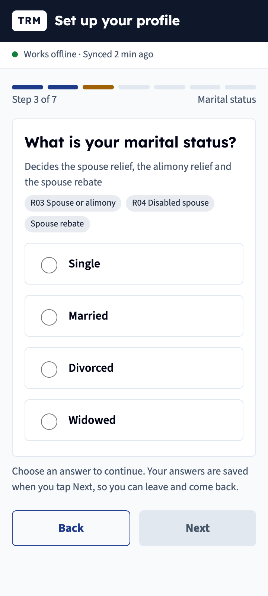 | 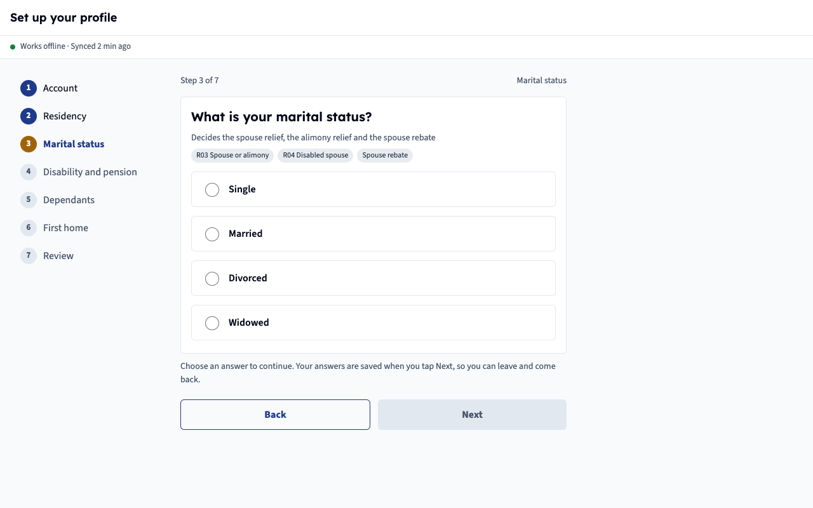 |

Bahasa Malaysia: [phone](screenshots/mobile/ms/01_guided_creation.png), [desktop](screenshots/desktop/ms/01_guided_creation.png). Pages: [English](mockups/en/01_guided_creation.html), [Bahasa Malaysia](mockups/ms/01_guided_creation.html).

### Gate screen (shown by F1 to F4)

Covers SRS-F0-03; URS-F0-15; tests TC-F0-26.

Replaces the calculator, reliefs, spending and dashboard for a year whose profile is incomplete. It shows the progress, the open questions and one button. It also says what stays open: Profile, Tax-year history and Settings.

| Phone, English | Desktop, English |
| --- | --- |
| 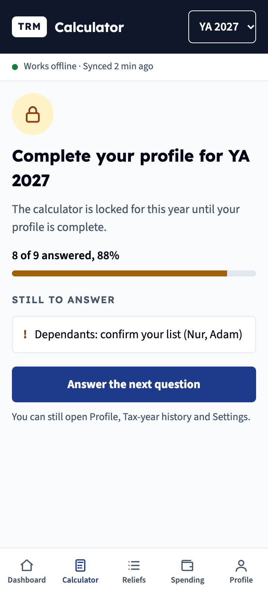 | 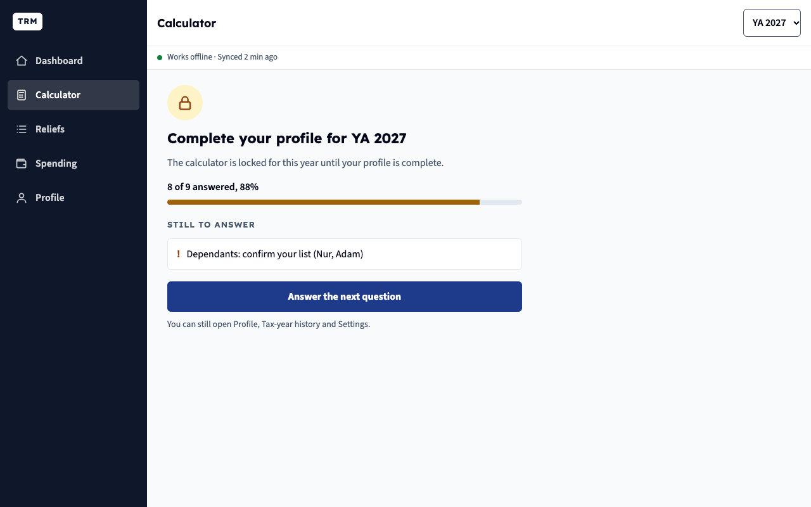 |

Bahasa Malaysia: [phone](screenshots/mobile/ms/02_gate_screen.png), [desktop](screenshots/desktop/ms/02_gate_screen.png). Pages: [English](mockups/en/02_gate_screen.html), [Bahasa Malaysia](mockups/ms/02_gate_screen.html).

### Profile screen

Covers SRS-F0-05; URS-F0-04, URS-F0-09; tests TC-F0-03, TC-F0-12.

From the top: year selector with a Draft, Active or Filed badge, the completeness card, a notice that the profile was copied, then About you, Dependants and First home. Each answer shows the reliefs it affects. On desktop the card and links sit in a left column.

| Phone, English | Desktop, English |
| --- | --- |
| 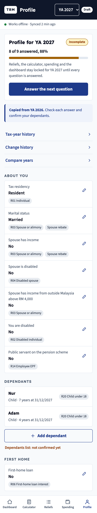 | 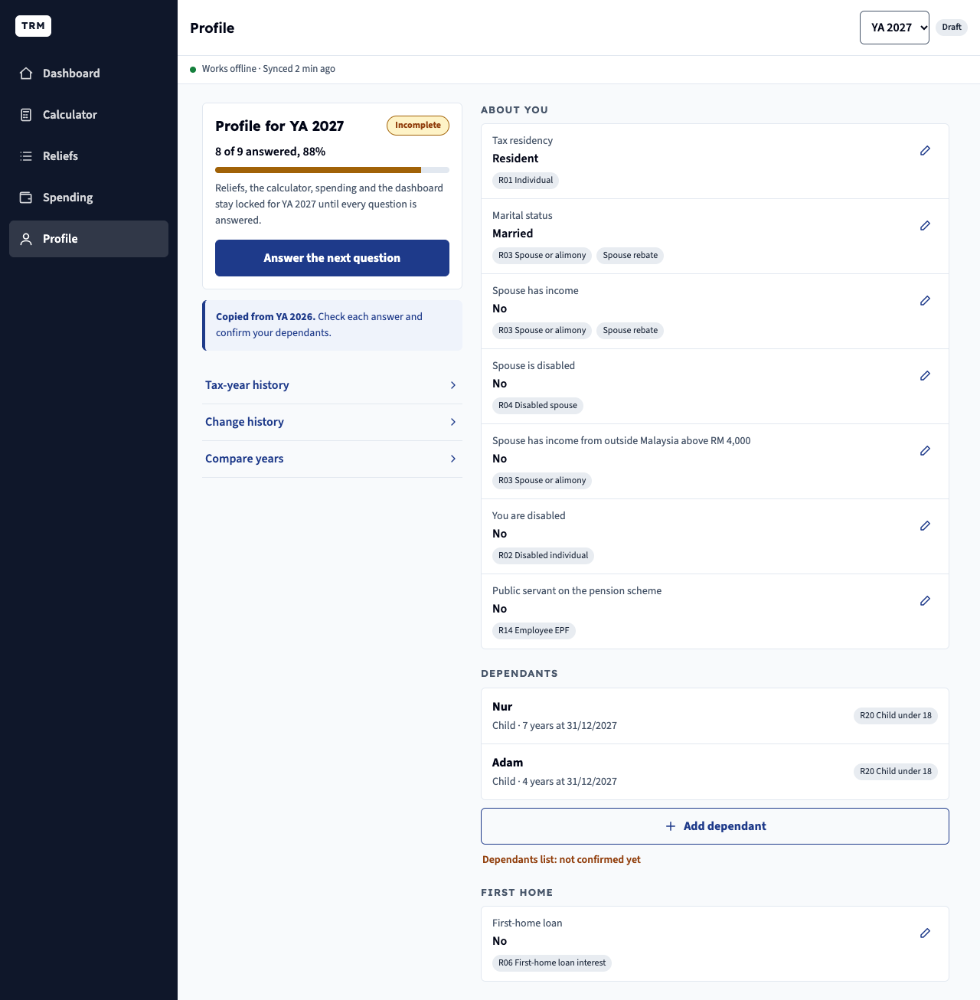 |

Bahasa Malaysia: [phone](screenshots/mobile/ms/03_profile_screen.png), [desktop](screenshots/desktop/ms/03_profile_screen.png). Pages: [English](mockups/en/03_profile_screen.html), [Bahasa Malaysia](mockups/ms/03_profile_screen.html).

### Dependant form

Covers SRS-F0-07; URS-F0-03; tests TC-F0-05, TC-F0-06.

Shown in an error state: the date of birth is in the future, so the error sits beside the field and the age line waits for a valid date. Every field is mandatory. The Yes and No choices start empty. The nickname help text tells the user not to enter an identity number.

| Phone, English | Desktop, English |
| --- | --- |
| 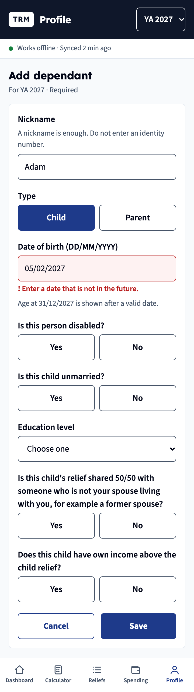 | 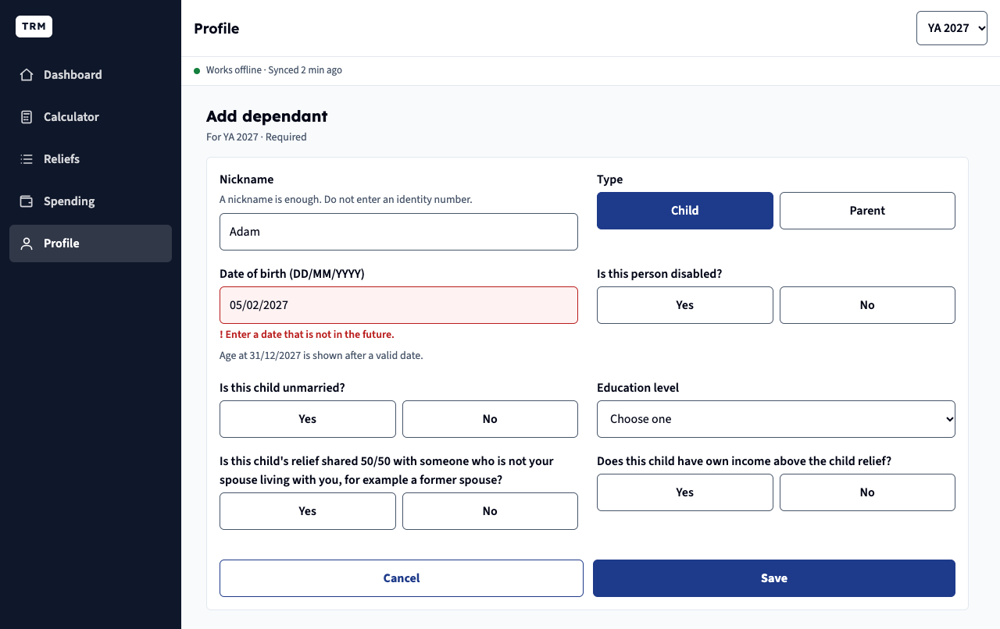 |

Bahasa Malaysia: [phone](screenshots/mobile/ms/04_dependant_form.png), [desktop](screenshots/desktop/ms/04_dependant_form.png). Pages: [English](mockups/en/04_dependant_form.html), [Bahasa Malaysia](mockups/ms/04_dependant_form.html).

### Apply a change to later years

Covers SRS-F0-09; URS-F0-06; tests TC-F0-09, TC-F0-10.

A bottom sheet on a phone and a centred dialog on desktop, over the profile of the edited year (YA 2026). The later year is ticked by default. Cancel keeps the change for the edited year only.

| Phone, English | Desktop, English |
| --- | --- |
| 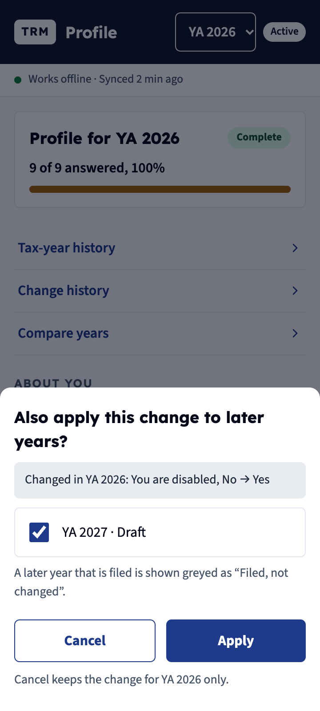 | 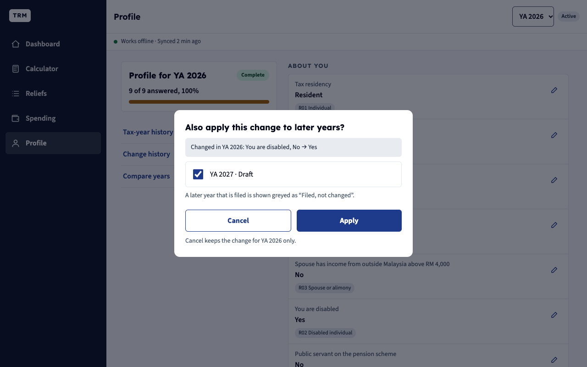 |

Bahasa Malaysia: [phone](screenshots/mobile/ms/05_apply_to_later_years.png), [desktop](screenshots/desktop/ms/05_apply_to_later_years.png). Pages: [English](mockups/en/05_apply_to_later_years.html), [Bahasa Malaysia](mockups/ms/05_apply_to_later_years.html).

### Tax-year history

Covers SRS-F0-11; URS-F0-07; tests TC-F0-14, TC-F0-16.

Cards on a phone and a table on desktop. A filed year shows the final figures with the label Final. A calculated year shows an estimate with the note that only the months entered so far are used. Support never sees this screen.

| Phone, English | Desktop, English |
| --- | --- |
| 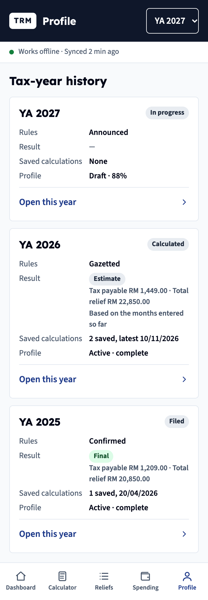 | 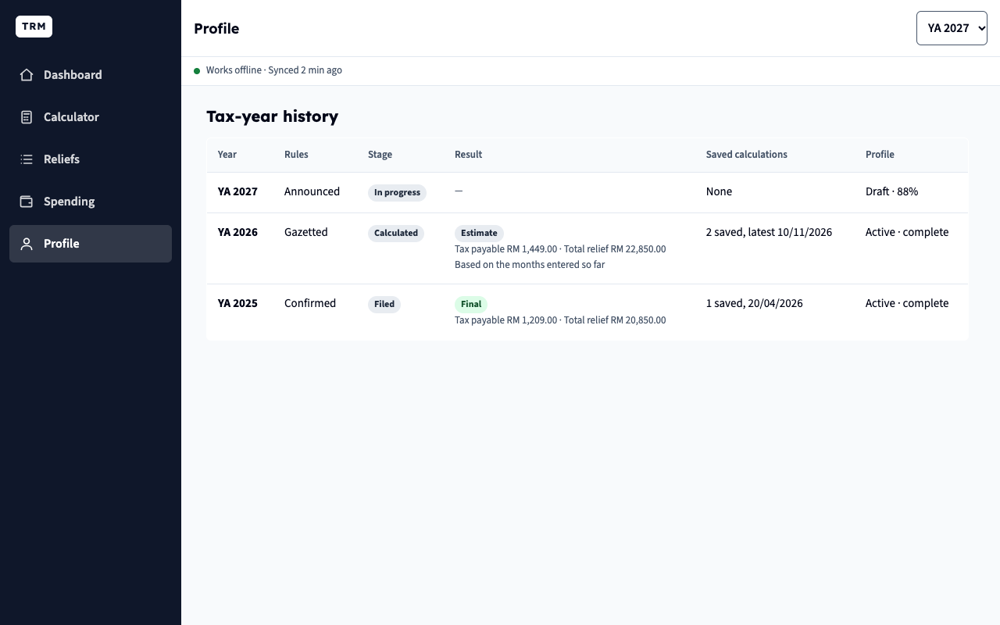 |

Bahasa Malaysia: [phone](screenshots/mobile/ms/06_tax_year_history.png), [desktop](screenshots/desktop/ms/06_tax_year_history.png). Pages: [English](mockups/en/06_tax_year_history.html), [Bahasa Malaysia](mockups/ms/06_tax_year_history.html).

### Admin support mode

Covers SRS-F0-16; URS-F0-12; tests TC-F0-19.

A banner says whose profile is being edited and for which year. The year list shows the rule status, the profile state, the completeness and a lock flag for a filed year, and **no stage, result or saved calculation** (SRS-F0-16). Support cannot change the email or the password. The edited year is marked.

| Phone, English | Desktop, English |
| --- | --- |
| 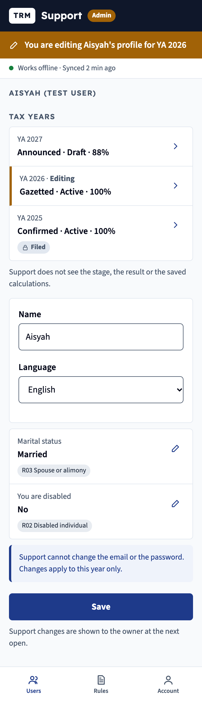 | 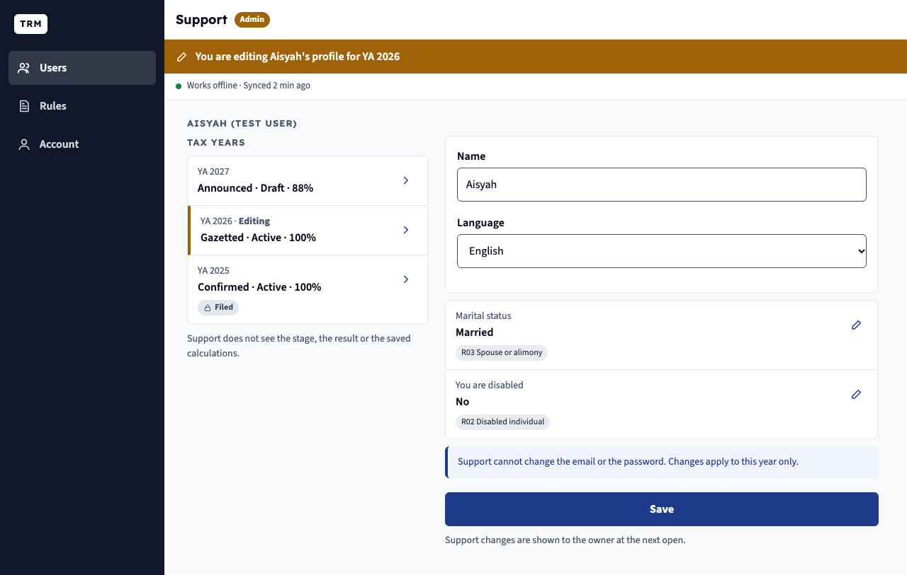 |

Bahasa Malaysia: [phone](screenshots/mobile/ms/07_admin_support_mode.png), [desktop](screenshots/desktop/ms/07_admin_support_mode.png). Pages: [English](mockups/en/07_admin_support_mode.html), [Bahasa Malaysia](mockups/ms/07_admin_support_mode.html).

## 3. Findings from the design work

These come from drawing the screens. **The F0 specification is not changed.** The owner decides which become a specification change.

| # | Finding | Where |
| --- | --- | --- |
| 1 | **Settings has no place.** FR-5.8 asks for one Settings screen, but the five tabs have no Settings tab. Proposal: Settings opens from the Profile tab | F5 SRS-F5-13, design D6 |
| 2 | **The admin navigation is not specified.** I used Users, Rules and Account | F5 SRS-F5-17, F2 rules manager |
| 3 | **The status line ("Works offline · Synced 2 min ago") is my proposal.** The specification names an Offline badge in F4 only | F4 SRS-F4-10 |
| 4 | **Type is preselected as Child** in the dependant form. SRS-F0-02 says no Yes or No answer is preselected; type is not a Yes or No question, so I kept it. Confirm | SRS-F0-07 |
| 5 | **A filed later year in the "apply to later years" dialog** cannot be shown with the R1 test data, because the later year is not filed. Its greyed row is described in the specification only | SRS-F0-09 |
| 6 | **The gate screen's list can be short.** A copied profile has one open question (confirm the dependants), so the list has one line. A first-time user has many | SRS-F0-03, SRS-F0-04 |
| 7 | **Not drawn:** tax-year detail, compare two years and change history (the spec's other three screens). A later pass | SRS-F0-12 to SRS-F0-14 |
| 8 | **The date format hint is written with Malay letters in Bahasa Malaysia.** It needs a decision on whether to keep them or show the same letters as in English | NFR-11 |

## 4. Review

The owner approved this document on 23/11/2026 (P-85, P-86). The other developer can still review it in the pull request. The findings above are not decided: the owner has not said which become specification changes. The Bahasa Malaysia text is a draft ([DES-000](../../DES_000_Design_System.md) rule D3). The screens of F1 to F5 are not designed, by the owner's decision (P-84).
