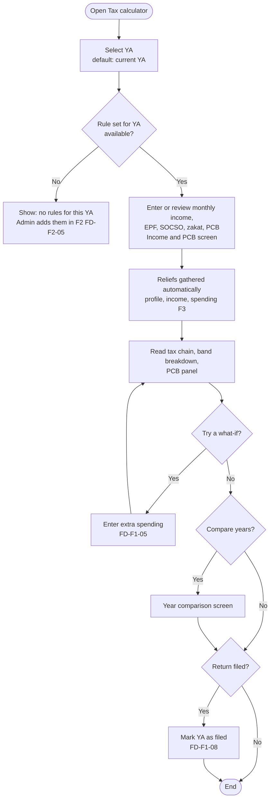
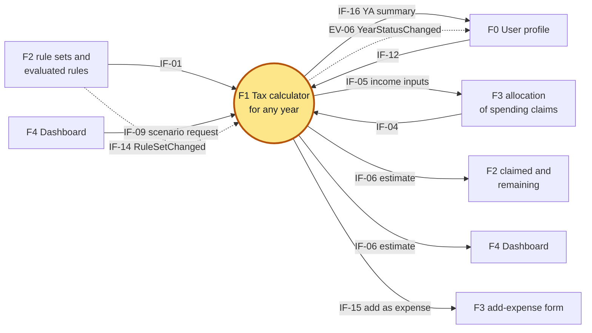
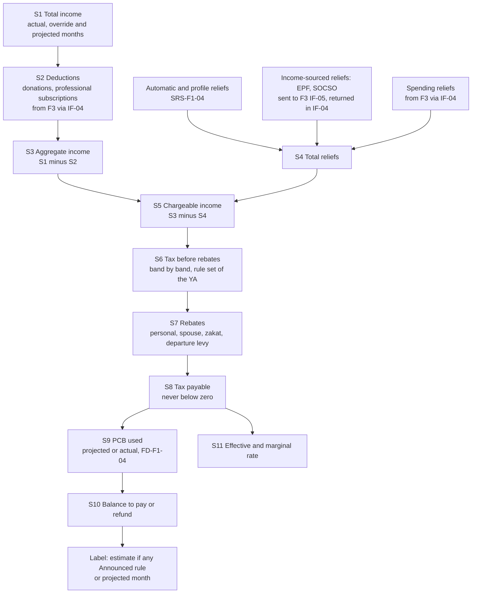
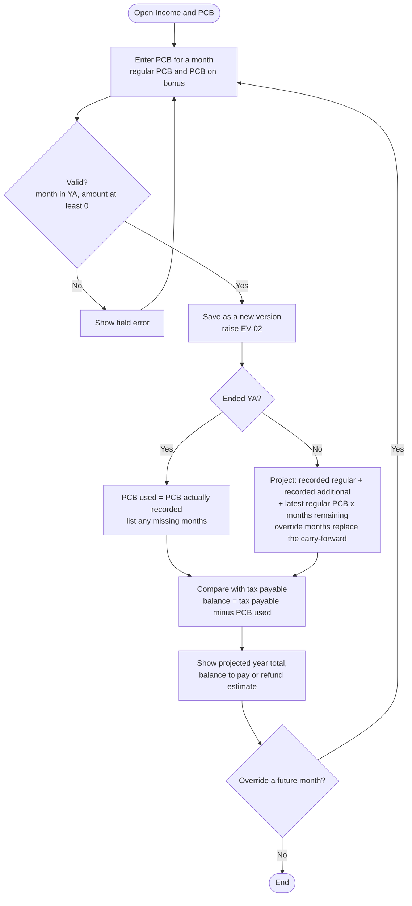
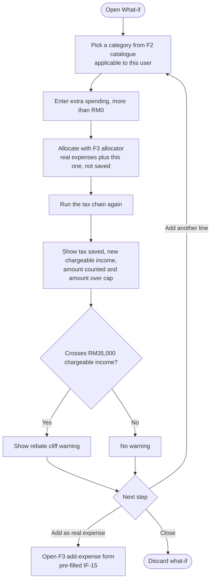
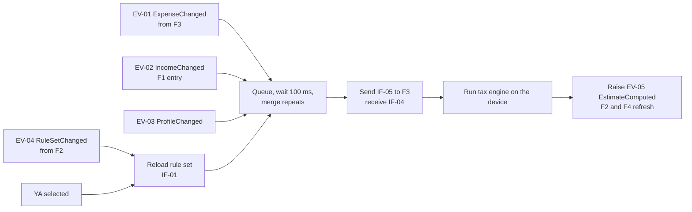
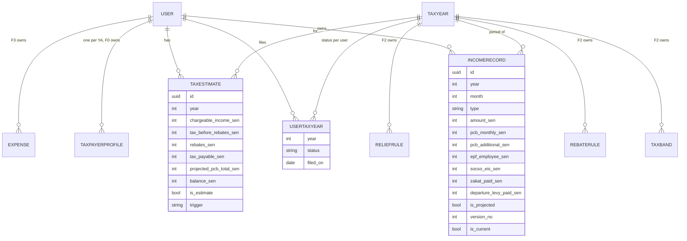
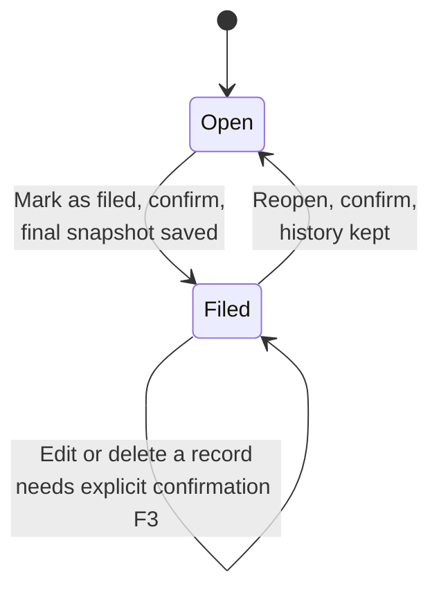
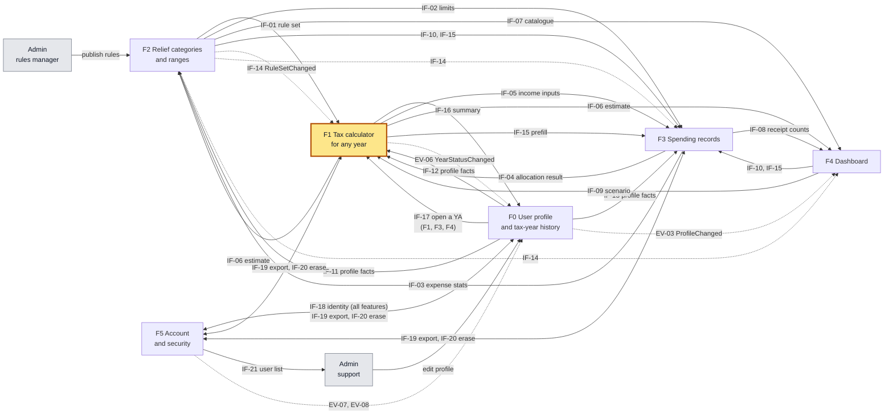
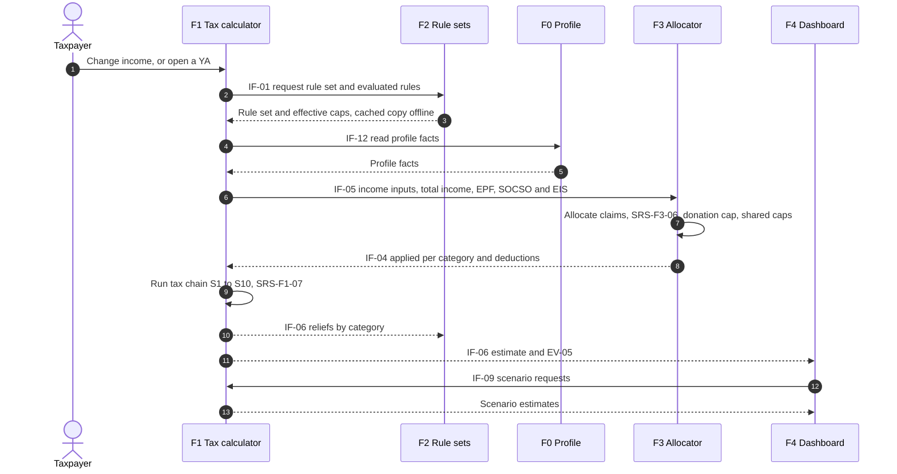

# URS-SRS-F1: Tax calculator for any year

| Item | Value |
| --- | --- |
| Document ID | URS-SRS-F1 |
| Document type | URS and SRS (user and system requirements) |
| Product | Tax Relief Manager (TRM), Malaysia tax relief system (PWA) |
| Version | 0.6 |
| Status | Draft (for owner review) |
| Date | 2026-11-23 (first written 2026-11-13) |
| Owner | Champs (product owner) |
| PRD reference | PRD-TRM section 3.1 "Tax calculator for any year", FR-1.1 to FR-1.11 (includes PCB) |
| Source | PRD-TRM (written from revision 37; names checked against revision 48); owner prompts P-16 and P-38 |
| Change tracking | [REG-02 URS and SRS change log](../registers/REG_02_URS_SRS_Change_Log.md); work history in [REG-01 History log](../registers/REG_01_History_Log.md); short forms in [REG-03 Acronyms](../registers/REG_03_Acronyms.md) |

## 0. Conventions shared by all six documents

### 0.1 The document set

| Doc | File | Feature (name from the PRD) | PRD requirements covered |
| --- | --- | --- | --- |
| F0 | [URS_SRS_F0_User_Profile.md](URS_SRS_F0_User_Profile.md) | User profile and tax-year history | PRD sections 5, 7, 8; FR-2.3 depends on it (no FR block yet, F-032) |
| F1 | [URS_SRS_F1_Tax_Calculator.md](URS_SRS_F1_Tax_Calculator.md) | Tax calculator for any year (PRD section 3.1, includes PCB) | FR-1.1 to FR-1.11 |
| F2 | [URS_SRS_F2_Relief_Categories.md](URS_SRS_F2_Relief_Categories.md) | Relief categories and ranges (PRD section 3.2, includes the rule sets and the rules admin) | FR-2.1 to FR-2.7 |
| F3 | [URS_SRS_F3_Spending_Records.md](URS_SRS_F3_Spending_Records.md) | Spending records (PRD section 3.3) | FR-3.1 to FR-3.7 |
| F4 | [URS_SRS_F4_Dashboard.md](URS_SRS_F4_Dashboard.md) | Dashboard (PRD section 3.4) | FR-4.1 to FR-4.8 |
| F5 | [URS_SRS_F5_Account_Security.md](URS_SRS_F5_Account_Security.md) | Account and security | NFR-6, NFR-7, NFR-8; PRD sections 7 and 8 (sign in, settings, roles); no FR block yet |

Source: PRD-TRM, the PRD "Malaysia Tax Relief System (PWA)" ([PRD_TRM_Malaysia_Tax_Relief_System.md](../prd/PRD_TRM_Malaysia_Tax_Relief_System.md)), written from revision 37 and checked against revision 48. The PRD is the master for feature names and IDs (AGENTS.md section 6); F0 and F5 have no PRD feature section yet. Logs: [REG_01_History_Log.md](../registers/REG_01_History_Log.md) is the main log of our work; [REG_02_URS_SRS_Change_Log.md](../registers/REG_02_URS_SRS_Change_Log.md) records every detail change to these six documents.

### 0.2 How to read the IDs

| Prefix | Meaning | Where |
| --- | --- | --- |
| URS-Fn-nn | User requirement (n is 0 for the profile document, 1 to 4 for the core features, 5 for account and security), in the owner's terms ("what the user must be able to do") | Part A of the feature document |
| FD-Fn-nn | Flow or state diagram drawn for the URS | Part A |
| SRS-Fn-nn | System requirement: exactly how the application behaves | Part B |
| SQ-Fn-nn | Sequence diagram that shows a specification across features | Part B |
| TC-Fn-nn | Test case with exact inputs and expected outputs | Part B |
| IF-nn | Interface: data one feature passes to another (same list in all six documents) | Section A5 |
| EV-nn | Event that tells other features to refresh | Section A5 |
| FR, BR, NFR | Requirement and rule IDs from the PRD | PRD |
| SD-Fn-nn | **Specification decision**: a detail the PRD does not state, which I filled in. Needs the owner's confirmation. | Part B |
| DA-nn | **Data addition**: a field or table the PRD data model does not have but the specification needs (same list in all six documents, in Part B2 under Data additions) | Part B |
| OI-Fn-nn | Open item: unresolved question | Part B |

Every SRS row has a **Basis** column: the PRD ID it comes from, or SD, DA or OI where I added or could not settle something. Every SRS row has a **Flow** column naming the URS diagram it works from.

### 0.3 Shared terms and rules

| Term | Exact meaning in all six documents |
| --- | --- |
| YA | Year of Assessment. YA 2026 covers income and spending dated 1 Jan to 31 Dec 2026. |
| Current YA | The YA whose period contains today's date. |
| Ended YA | A YA whose period end is before today. |
| Money | Stored as whole sen (integer). RM 1,449.00 is 144900. Displayed as "RM 1,449.00". |
| Rule set | All published, current rows for one YA: TaxYear, TaxBand, RebateRule, ReliefCategory, ReliefRule, SubLimit and (DA-05) RuleTier. |
| Actual spend | The amount the user paid, before any cap. |
| Applied (claimable) | The part of an amount that counts toward relief after sub-limits, category cap, shared cap and claim-frequency rules. |
| Over cap | Actual spend minus applied. |
| Effective cap | The most this user can apply in one category for one YA: fixed cap, cap per dependant times the number of eligible dependants, or the tier that matches the user's facts. |
| Room | Effective cap minus applied, never below zero. A shared-cap group has one room, counted once. |
| Estimate | Any tax figure built on a rule with status Announced, or on projected months. It is labelled "estimate". |
| Soft delete | deleted_at and deleted_by are set on the current version row. Nothing is removed. |
| Versioned edit | An edit inserts a new row with the next version_no, sets is_current to false on the old row. created_by and updated_by hold the acting user, or the SYSTEM user for system actions. |
| Profile year | The TaxpayerProfile row, with its dependants, that belongs to one YA (DA-16). A user has one current profile per YA. |
| Age at YA end | Whole years completed on the YA's period end (31 December). The default reference date for every age test ([OI-F1-01](URS_SRS_F1_Tax_Calculator.md#oi-f1-01)). |
| Locked profile | The profile of a YA whose UserTaxYear.status is filed. Nobody can change it until the YA is reopened. Derived, not stored ([SD-F0-12](URS_SRS_F0_User_Profile.md#sd-f0-12)). |
| Tax-year history | The list of stored YAs with the stage of each (Not started, In progress, Calculated, Filed), owned by F0. |
| Rounding | Each band's tax is rounded half-up to the nearest sen, then summed ([SD-F1-05](URS_SRS_F1_Tax_Calculator.md#sd-f1-05)). |
| Session | One signed-in period on one browser or device. It ends by sign-out, expiry or revoke (F5). |
| Fresh sign-in | A sign-in within the last 10 minutes. It is asked for again before a sensitive action such as a password change, an export or a deletion ([SD-F5-06](URS_SRS_F5_Account_Security.md#sd-f5-06)). |
| Grace period | The 14 days between a deletion request and the erase. The user can cancel in this time ([SD-F5-08](URS_SRS_F5_Account_Security.md#sd-f5-08)). |
| Retention period | 7 years from the end of the YA (NFR-8), the time the taxpayer should keep records. |
| Release | R1 to R4, the releases of PRD section 9.1: R1 is built in PRD phase 1, R2 in phase 3, R3 in phase 4, R4 in phase 5. R1 is the MVP for the product owner's personal use. R2 items are reserved here only where R1 must leave a hook. |
| Phase | Only a phase of the PRD roadmap (section 9.1): phase 0 Discovery, 1 R1 build, 2 Personal use, 3 R2, 4 R3, 5 R4, then the public launch gate. |
| Basic account | The part of F5 built in R1: the simple account ([SD-F5-17](URS_SRS_F5_Account_Security.md#sd-f5-17)). Called Phase 1 until 23/11/2026. |
| Launch account | The part of F5 held until before the public launch: lockout, emailed links, staying signed in, two-factor login, deletion of the whole account ([SD-F5-17](URS_SRS_F5_Account_Security.md#sd-f5-17)). Called Phase 2 until 23/11/2026. |


---

# Part A. User Requirements Specification (URS)

## A1. Purpose and scope

**Purpose.** F1 lets the taxpayer see the estimated income tax for any Year of Assessment (YA) from salary income and claimed reliefs, and see how much PCB (monthly tax deduction) is deducted over the year against that tax.

**In scope (R1):** monthly income entry; calculation from the selected YA's rule set; the full tax chain and band breakdown; year comparison including announced rules; instant and offline recalculation; what-if; PCB records, annual PCB projection and PCB against tax; marking a YA as filed.

**Reserved (R2):** PCB estimate from salary (FR-1.11). R1 leaves a slot for it ([SRS-F1-22](URS_SRS_F1_Tax_Calculator.md#srs-f1-22)).

**Out of scope:** non-resident tax, business income (Form B), submission to MyTax.

## A2. Users and roles

| User | What they do in F1 |
| --- | --- |
| Taxpayer (primary) | Enters income and PCB, reads the estimate, tries what-if, compares years, marks a YA as filed |
| Admin | Can open the calculator on the admin's own account. Cannot open any other user's income, PCB or estimate (confidential data, PRD section 8). |

## A3. User requirements

| ID | The taxpayer must be able to | PRD source | Flow |
| --- | --- | --- | --- |
| <a id="urs-f1-01"></a>URS-F1-01 | Enter, for any YA and month, salary, bonus, allowances, benefits-in-kind, employee EPF, SOCSO/EIS, zakat paid, departure levy paid and optional other income | FR-1.1 | [FD-F1-01](URS_SRS_F1_Tax_Calculator.md#fd-f1-01) |
| <a id="urs-f1-02"></a>URS-F1-02 | See estimated tax for a chosen YA, calculated with the rules announced for that YA, with nothing hard-coded | FR-1.2, BR-1 | [FD-F1-03](URS_SRS_F1_Tax_Calculator.md#fd-f1-03) |
| <a id="urs-f1-03"></a>URS-F1-03 | See the full chain: total income, deductions, reliefs by category, chargeable income, tax before rebates, rebates, tax payable, PCB paid and projected, balance or refund, effective rate and marginal rate | FR-1.3 | [FD-F1-03](URS_SRS_F1_Tax_Calculator.md#fd-f1-03) |
| <a id="urs-f1-04"></a>URS-F1-04 | See how the tax was reached band by band | FR-1.4 | [FD-F1-03](URS_SRS_F1_Tax_Calculator.md#fd-f1-03) |
| <a id="urs-f1-05"></a>URS-F1-05 | Compare the stored YAs side by side, with announced rules labelled, and see what one YA's data would give under another YA's rules | FR-1.5 | [FD-F1-01](URS_SRS_F1_Tax_Calculator.md#fd-f1-01) |
| <a id="urs-f1-06"></a>URS-F1-06 | See every figure change instantly when anything changes, with or without a connection | FR-1.6 | [FD-F1-06](URS_SRS_F1_Tax_Calculator.md#fd-f1-06) |
| <a id="urs-f1-07"></a>URS-F1-07 | Try extra spending in a category and see the tax saved, including a warning at the RM35,000 rebate cliff | FR-1.7, BR-6 | [FD-F1-05](URS_SRS_F1_Tax_Calculator.md#fd-f1-05) |
| <a id="urs-f1-08"></a>URS-F1-08 | Record the PCB deducted each month from the payslip, with PCB on a bonus or other extra pay as a separate line | FR-1.8 | [FD-F1-04](URS_SRS_F1_Tax_Calculator.md#fd-f1-04) |
| <a id="urs-f1-09"></a>URS-F1-09 | See the PCB projected for the whole year, and override any future month | FR-1.9 | [FD-F1-04](URS_SRS_F1_Tax_Calculator.md#fd-f1-04) |
| <a id="urs-f1-10"></a>URS-F1-10 | See projected PCB beside estimated tax payable, with the expected balance to pay or refund, updated whenever reliefs change | FR-1.10, BR-9 | [FD-F1-04](URS_SRS_F1_Tax_Calculator.md#fd-f1-04) |
| <a id="urs-f1-11"></a>URS-F1-11 | Have reliefs picked up automatically from the profile, from income records and from spending records, so each relief is counted once and within its cap | FR-1.3, FR-2.x, FR-3.3 | [FD-F1-02](URS_SRS_F1_Tax_Calculator.md#fd-f1-02), [FD-F1-03](URS_SRS_F1_Tax_Calculator.md#fd-f1-03) |
| <a id="urs-f1-12"></a>URS-F1-12 | Know when a figure is an estimate (announced rules or projected months) and that LHDN's assessment prevails | BR-1, NFR-14 | [FD-F1-03](URS_SRS_F1_Tax_Calculator.md#fd-f1-03) |
| <a id="urs-f1-13"></a>URS-F1-13 | Mark a YA as filed and reopen it, so records behind a filed return are protected | FR-3.7 (needs it) | [FD-F1-08](URS_SRS_F1_Tax_Calculator.md#fd-f1-08) |
| <a id="urs-f1-14"></a>URS-F1-14 | See the history of every change to an income or PCB entry | NFR-9 | [FD-F1-07](URS_SRS_F1_Tax_Calculator.md#fd-f1-07) |
| <a id="urs-f1-15"></a>URS-F1-15 | (R2) Estimate the monthly PCB from salary to compare with the payslip | FR-1.11 | not drawn (R2) |
| <a id="urs-f1-16"></a>URS-F1-16 | Have my income, PCB and saved calculations included in my data export and deleted when I delete my account | PRD sections 7 and 8, NFR-7 | [FD-F5-09](URS_SRS_F5_Account_Security.md#fd-f5-09), [FD-F5-10](URS_SRS_F5_Account_Security.md#fd-f5-10) |

## A4. Flow diagrams

<a id="fd-f1-01"></a>
**[FD-F1-01](URS_SRS_F1_Tax_Calculator.md#fd-f1-01). User flow in the calculator**



<a id="fd-f1-02"></a>
**[FD-F1-02](URS_SRS_F1_Tax_Calculator.md#fd-f1-02). What F1 receives from and gives to other features**



<a id="fd-f1-03"></a>
**[FD-F1-03](URS_SRS_F1_Tax_Calculator.md#fd-f1-03). Calculation chain** (each box is a numbered step in [SRS-F1-07](URS_SRS_F1_Tax_Calculator.md#srs-f1-07))



<a id="fd-f1-04"></a>
**[FD-F1-04](URS_SRS_F1_Tax_Calculator.md#fd-f1-04). PCB record, projection and comparison with tax**



<a id="fd-f1-05"></a>
**[FD-F1-05](URS_SRS_F1_Tax_Calculator.md#fd-f1-05). What-if**



<a id="fd-f1-06"></a>
**[FD-F1-06](URS_SRS_F1_Tax_Calculator.md#fd-f1-06). What makes F1 recalculate**



<a id="fd-f1-07"></a>
**[FD-F1-07](URS_SRS_F1_Tax_Calculator.md#fd-f1-07). Data used by F1 and the entities it connects to** (entities of other features are marked)



<a id="fd-f1-08"></a>
**[FD-F1-08](URS_SRS_F1_Tax_Calculator.md#fd-f1-08). A YA's filing status**



## A5. Relationship with other features

<a id="fd-00"></a>
**FD-00. System map of the profile (F0), the four core features and account and security (F5) (identical in all six documents; the feature of this document is highlighted)**



Reading the map: a solid arrow is data a feature reads or receives; a dashed arrow is an event. F0 owns the profile and the profile of every YA; the four core features only read it. F5 owns the account and the sign-in; it tells every feature who is signed in (IF-18, drawn once, to F0), asks F0, F1 and F3 for their part of a data export (IF-19) and tells them to erase (IF-20). F2 and F4 own no user data, so they take part only through IF-18. F1 and F3 depend on each other, so the order of calculation is fixed: F1 sends income inputs (IF-05), F3 allocates claims (IF-04), then F1 finishes the tax chain. That order is drawn in [SQ-F1-01](URS_SRS_F1_Tax_Calculator.md#sq-f1-01).


**Interfaces (identical in all six documents).** "Provider spec" is the SRS row that builds the data; "Consumer spec" is the SRS row that uses it.

| ID | From | To | Data carried | Trigger | Provider spec | Consumer spec |
| --- | --- | --- | --- | --- | --- | --- |
| IF-01 | F2 | F1 | Rule set of the selected YA plus, for this user, the evaluated rules: per category applicable or not, effective cap, tier, sub-limits, shared group, claim frequency | YA selected; EV-03; EV-04 | [SRS-F2-13](URS_SRS_F2_Relief_Categories.md#srs-f2-13) | [SRS-F1-01](URS_SRS_F1_Tax_Calculator.md#srs-f1-01) |
| IF-02 | F2 | F3 | Categories open to this user for the YA, with limits, sub-limits, shared group, frequency, required documents, beneficiary rule | Expense form opened; YA changed; EV-04 | [SRS-F2-13](URS_SRS_F2_Relief_Categories.md#srs-f2-13) | [SRS-F3-02](URS_SRS_F3_Spending_Records.md#srs-f3-02) |
| IF-03 | F3 | F2 | Per category: expense count, actual spend, applied, over cap, expenses missing a receipt | Category detail opened; EV-01 | [SRS-F3-14](URS_SRS_F3_Spending_Records.md#srs-f3-14) | [SRS-F2-06](URS_SRS_F2_Relief_Categories.md#srs-f2-06) |
| IF-04 | F3 | F1 | Allocation result: applied amount per category (spending and income-sourced), deductions applied, aggregate income before donations | Any change to expenses, income, profile or rules | [SRS-F3-14](URS_SRS_F3_Spending_Records.md#srs-f3-14) | [SRS-F1-06](URS_SRS_F1_Tax_Calculator.md#srs-f1-06) |
| IF-05 | F1 | F3 | Income inputs: total income for the YA, and the amount already counted by income-sourced categories (employee EPF, SOCSO and EIS) | EV-02 | [SRS-F1-05](URS_SRS_F1_Tax_Calculator.md#srs-f1-05) | [SRS-F3-07](URS_SRS_F3_Spending_Records.md#srs-f3-07) |
| IF-06 | F1 | F2, F4 | Estimate: full tax chain, reliefs by category (applied, effective cap, room, source), PCB figures, labels | Every recalculation (EV-05) | [SRS-F1-07](URS_SRS_F1_Tax_Calculator.md#srs-f1-07), [SRS-F1-13](URS_SRS_F1_Tax_Calculator.md#srs-f1-13) | [SRS-F2-05](URS_SRS_F2_Relief_Categories.md#srs-f2-05), [SRS-F4-02](URS_SRS_F4_Dashboard.md#srs-f4-02) |
| IF-07 | F2 | F4 | Catalogue summary (category, group, status, effective cap), TaxYear dates (period, filing deadline) | YA selected; EV-04 | [SRS-F2-13](URS_SRS_F2_Relief_Categories.md#srs-f2-13) | [SRS-F4-02](URS_SRS_F4_Dashboard.md#srs-f4-02) |
| IF-08 | F3 | F4 | Receipt counts per category and in total: with receipt, missing, pending upload; expense counts | EV-01 | [SRS-F3-14](URS_SRS_F3_Spending_Records.md#srs-f3-14) | [SRS-F4-04](URS_SRS_F4_Dashboard.md#srs-f4-04), [SRS-F4-08](URS_SRS_F4_Dashboard.md#srs-f4-08) |
| IF-09 | F4 | F1 | Scenario request (as recorded for any YA, no reliefs, use room of listed categories, use all room) and the scenario estimate | Dashboard load; EV-05 | [SRS-F1-18](URS_SRS_F1_Tax_Calculator.md#srs-f1-18) | [SRS-F4-05](URS_SRS_F4_Dashboard.md#srs-f4-05), [SRS-F4-06](URS_SRS_F4_Dashboard.md#srs-f4-06) |
| IF-10 | F2, F4 | F3 | Navigate to the spending list with a filter: YA, category, receipt status | User taps a count or alert | [SRS-F3-15](URS_SRS_F3_Spending_Records.md#srs-f3-15) | [SRS-F2-06](URS_SRS_F2_Relief_Categories.md#srs-f2-06), [SRS-F4-11](URS_SRS_F4_Dashboard.md#srs-f4-11) |
| IF-11 | F0 | F2 | Profile facts of the selected YA: marital status, spouse income and disability, own disability, dependants with date of birth, education level and disability, first-home facts, whether the dependants list is confirmed, and whether the profile is complete | EV-03 | [SRS-F0-15](URS_SRS_F0_User_Profile.md#srs-f0-15) | [SRS-F2-04](URS_SRS_F2_Relief_Categories.md#srs-f2-04) |
| IF-12 | F0 | F1 | The same profile facts and the complete flag | EV-03 | [SRS-F0-15](URS_SRS_F0_User_Profile.md#srs-f0-15) | [SRS-F1-04](URS_SRS_F1_Tax_Calculator.md#srs-f1-04) |
| IF-13 | F0 | F3 | The same profile facts and the complete flag of the YA the expense falls in, used to check eligibility and the beneficiary | EV-03 | [SRS-F0-15](URS_SRS_F0_User_Profile.md#srs-f0-15) | [SRS-F3-02](URS_SRS_F3_Spending_Records.md#srs-f3-02), [SRS-F3-03](URS_SRS_F3_Spending_Records.md#srs-f3-03) |
| IF-14 | F2 | F1, F3, F4 | RuleSetChanged event: YA and new rule version | Admin publishes ([SRS-F2-11](URS_SRS_F2_Relief_Categories.md#srs-f2-11)) | [SRS-F2-11](URS_SRS_F2_Relief_Categories.md#srs-f2-11) | [SRS-F1-15](URS_SRS_F1_Tax_Calculator.md#srs-f1-15), [SRS-F3-14](URS_SRS_F3_Spending_Records.md#srs-f3-14), [SRS-F4-10](URS_SRS_F4_Dashboard.md#srs-f4-10) |
| IF-15 | F1, F2, F4 | F3 | Open the add-expense form pre-filled: YA, category, optional sub-limit, optional amount | User taps "Add as expense" | [SRS-F3-15](URS_SRS_F3_Spending_Records.md#srs-f3-15) | [SRS-F1-16](URS_SRS_F1_Tax_Calculator.md#srs-f1-16), [SRS-F2-06](URS_SRS_F2_Relief_Categories.md#srs-f2-06), [SRS-F4-11](URS_SRS_F4_Dashboard.md#srs-f4-11) |
| IF-16 | F1 | F0 | Tax-year summary for every stored YA: status and filed date, whether income exists, the live estimate (tax payable, total reliefs, chargeable income, labels) and the saved calculations (id, trigger, date, figures, profile id and profile version used) | History list or detail opened; EV-05; EV-06 | [SRS-F1-23](URS_SRS_F1_Tax_Calculator.md#srs-f1-23) | [SRS-F0-11](URS_SRS_F0_User_Profile.md#srs-f0-11), [SRS-F0-12](URS_SRS_F0_User_Profile.md#srs-f0-12) |
| IF-17 | F0 | F1, F3, F4 | Open a feature for a chosen YA, with an optional filter (F3: receipt status) | User taps an action on a tax year | [SRS-F0-12](URS_SRS_F0_User_Profile.md#srs-f0-12) | [SRS-F1-01](URS_SRS_F1_Tax_Calculator.md#srs-f1-01), [SRS-F3-15](URS_SRS_F3_Spending_Records.md#srs-f3-15), [SRS-F4-01](URS_SRS_F4_Dashboard.md#srs-f4-01) |
| IF-18 | F5 | F0, F1, F3 (F2 and F4 read the role only, [OI-F5-05](URS_SRS_F5_Account_Security.md#oi-f5-05)) | Signed-in identity: user id, role (user or admin), language, session expiry, device id, whether two-factor login is on | App start; sign-in; session refresh; EV-07; EV-08 | [SRS-F5-18](URS_SRS_F5_Account_Security.md#srs-f5-18) | [SRS-F0-19](URS_SRS_F0_User_Profile.md#srs-f0-19), [SRS-F1-24](URS_SRS_F1_Tax_Calculator.md#srs-f1-24), [SRS-F3-18](URS_SRS_F3_Spending_Records.md#srs-f3-18) |
| IF-19 | F0, F1, F3 | F5 | Export part: every row the feature owns for the user, all versions, as records, plus the list of files (F3) | The export job runs ([SRS-F5-14](URS_SRS_F5_Account_Security.md#srs-f5-14)) | [SRS-F0-19](URS_SRS_F0_User_Profile.md#srs-f0-19), [SRS-F1-24](URS_SRS_F1_Tax_Calculator.md#srs-f1-24), [SRS-F3-18](URS_SRS_F3_Spending_Records.md#srs-f3-18) | [SRS-F5-14](URS_SRS_F5_Account_Security.md#srs-f5-14) |
| IF-20 | F5 | F0, F1, F3 | Erase request: delete every row and file of the user, or, when the request names a YA, only the rows and files of that YA, and answer with the counts | The user confirms the deletion of a YA past its 7 years ([SRS-F5-21](URS_SRS_F5_Account_Security.md#srs-f5-21)); in the launch account also when the grace period ends ([SRS-F5-16](URS_SRS_F5_Account_Security.md#srs-f5-16)) | [SRS-F5-16](URS_SRS_F5_Account_Security.md#srs-f5-16), [SRS-F5-21](URS_SRS_F5_Account_Security.md#srs-f5-21) | [SRS-F0-19](URS_SRS_F0_User_Profile.md#srs-f0-19), [SRS-F1-24](URS_SRS_F1_Tax_Calculator.md#srs-f1-24), [SRS-F3-18](URS_SRS_F3_Spending_Records.md#srs-f3-18) |
| IF-21 | F5 | F0 | User list for support: user id, name, email, status, role, two-factor flag, last sign-in date; no tax data | An admin opens the user list | [SRS-F5-17](URS_SRS_F5_Account_Security.md#srs-f5-17) | [SRS-F0-16](URS_SRS_F0_User_Profile.md#srs-f0-16) |

**Events**

| ID | Event | Raised by | Heard by |
| --- | --- | --- | --- |
| EV-01 | ExpenseChanged (ya, expense ids) | F3, after every local save, edit, delete or sync | F1, F2, F4 |
| EV-02 | IncomeChanged (ya) | F1, after every income or PCB save | F3 (refresh IF-05), F4 |
| EV-03 | ProfileChanged (ya, profile id, version) | F0, after every profile or dependant save, copy to a new YA, or apply to later YAs | F1, F2, F3, F4 |
| EV-04 | RuleSetChanged (ya, version) = IF-14 | F2 | F1, F3, F4 |
| EV-05 | EstimateComputed (ya) | F1, after every recalculation | F2, F4 |
| EV-06 | YearStatusChanged (ya, status filed or open) | F1, after mark as filed or reopen ([SRS-F1-21](URS_SRS_F1_Tax_Calculator.md#srs-f1-21)) | F0, F4 |
| EV-07 | AccountStatusChanged (user, status active, disabled or deletion_pending) | F5, after an admin disables or enables the account, a deletion request or its cancel ([SRS-F5-15](URS_SRS_F5_Account_Security.md#srs-f5-15), [SRS-F5-17](URS_SRS_F5_Account_Security.md#srs-f5-17)) | F0, F1, F3 |
| EV-08 | SessionEnded (user, device, reason: signed out, expired, revoked, password changed) | F5, whenever a session ends ([SRS-F5-08](URS_SRS_F5_Account_Security.md#srs-f5-08), [SRS-F5-09](URS_SRS_F5_Account_Security.md#srs-f5-09)) | F0, F1, F3 |


**Data ownership (identical in all six documents).** O = owns and writes; R = reads; Agg = reads only aggregated results through an interface; none = no access. Export and erase mean the feature supplies its part to F5 (IF-19) and deletes it on request (IF-20). "Admin" can touch the profile (while its YA is not filed), the account's name and language, and file names only.

| Entity | F0 | F1 | F2 | F3 | F4 | F5 | Admin |
| --- | --- | --- | --- | --- | --- | --- | --- |
| User.name, User.language, TaxpayerProfile (one per YA, DA-16), Dependant, HouseholdLink | O | R (IF-12) | R (IF-11) | R (IF-13) | none | Export, erase | Manage name, language and profile fields of a YA that is not filed |
| User.email, role, status; Credential, Session, ConsentRecord, Invitation, DataRequest, SecurityEvent (DA-21 to DA-24) | R (IF-18) | R (IF-18) | R (IF-18, role) | R (IF-18) | R (IF-18, role) | O | Invite, disable, enable, send a reset email. No password, no email change, no two-factor off |
| IncomeRecord | none | O | none | Agg (IF-05) | Agg (IF-06) | Export, erase | none |
| UserTaxYear (DA-12: filed status per user) | R (lock follows status) | O | none | R | R | Export, erase | none |
| TaxEstimate | Agg (IF-16) | O | Agg (IF-06) | none | R | Export, erase | none |
| TaxYear, TaxBand, RebateRule | none | R (IF-01) | O | none | R (IF-07) | none | Create and edit |
| ReliefCategory, ReliefRule, SubLimit, RuleTier | none | R (IF-01) | O | R (IF-02) | R (IF-07) | none | Create and edit |
| Expense, ExpenseAllocation | none | Agg (IF-04) | Agg (IF-03) | O | Agg (IF-08) | Export, erase | none (amounts and descriptions are confidential) |
| Receipt | none | none | none | O | Agg (IF-08) | Export, erase | File name and type only; upload, download, delete on request ([OI-F3-01](URS_SRS_F3_Spending_Records.md#oi-f3-01)) |


**A5.4 Inter-related data for F1**

| Data | Direction | Other feature | What F1 uses it for | Interface | If it is missing or late |
| --- | --- | --- | --- | --- | --- |
| Rule set and evaluated rules of the YA | in | F2 | Bands, rebates, caps, effective caps, applicable categories | IF-01 | No rule set: calculation is disabled and the screen says so ([SRS-F1-01](URS_SRS_F1_Tax_Calculator.md#srs-f1-01)). A cached rule set is used offline. |
| Profile facts of the selected YA | in | F0 | Individual, spouse, disabled and child reliefs; spouse rebate | IF-12 | Profile Incomplete: F1 shows the gate and computes nothing ([SRS-F0-03](URS_SRS_F0_User_Profile.md#srs-f0-03)) |
| Tax-year summary: status, live estimate, saved calculations with the profile version used | out | F0 | Tax-year history list and detail | IF-16 | Not applicable |
| YearStatusChanged (ya, status) | out | F0, F4 | Lock or unlock the YA's profile; refresh the Filed badge | EV-06 | Not applicable |
| Allocation result (applied per category, deductions) | in | F3 | Spending reliefs and deductions in S2 and S4 | IF-04 | F3 not ready: the last result is used and the screen shows "updating" until it arrives |
| Income inputs | out | F3 | F3 needs total income (donation cap) and the amounts already counted by EPF and SOCSO/EIS | IF-05 | Not applicable: F1 always sends it before F3 allocates |
| Estimate with reliefs by category | out | F2, F4 | F2 shows claimed and remaining; F4 shows cards, bars, PCB panel and trend | IF-06 | Not applicable |
| Scenario request | in | F4 | "No reliefs", "use room" and "use all room" estimates | IF-09 | Not applicable |
| Add-as-expense prefill | out | F3 | From what-if to a real expense | IF-15 | Not applicable |
| RuleSetChanged | in | F2 | Reload rules and recalculate | IF-14 | Not applicable |
| Signed-in identity: user id, role | in | F5 | Decide whose data F1 reads and writes; refuse an admin session | IF-18 | Offline, the identity stored at the last sign-in is used until the session expires ([SRS-F5-09](URS_SRS_F5_Account_Security.md#srs-f5-09)) |
| Export part of the income and calculation data | out | F5 | The user's data export | IF-19 | Not applicable |
| Erase request | in | F5 | Delete the user's income, filed status and saved calculations when the grace period ends | IF-20 | F5 repeats the request until F1 confirms ([SRS-F5-16](URS_SRS_F5_Account_Security.md#srs-f5-16)) |
| AccountStatusChanged, SessionEnded | in | F5 | Stop sending the outbox | EV-07, EV-08 | F1 learns on the next server call, which is refused with the same notice |

## A6. Assumptions and constraints

1. The tax engine is one pure function, so the same code runs in the browser (offline) and on the server (verification) (PRD section 7).
2. Only resident individuals with employment income are supported (PRD section 1).
3. Joint assessment is not calculated in R1. The household data exists, the calculation is R2 (PRD decision 2).
4. Values on rules with status Announced can change before they become law (PRD risk register).

---

# Part B. System Requirements Specification (SRS)

## B1. Functional specifications

How to read: **Flow** names the diagram in Part A that the behaviour works from. **Basis** is the PRD ID, or SD, DA or OI where this document adds or cannot settle a detail.

### B1.1 Year, rules and income entry

| ID | Specification | Basis | URS | Flow | Test |
| --- | --- | --- | --- | --- | --- |
| <a id="srs-f1-01"></a>SRS-F1-01 | **YA selection and rule loading.** 1. The YA selector lists every TaxYear that has a published, current rule set. In R1 that is 2025, 2026 and 2027. 2. The default is the current YA; if none matches, the latest YA. The choice is kept until the app closes. 3. On selection, F1 requests IF-01. The reply is cached in IndexedDB; offline, F1 uses the cached copy. 4. The screen shows the rule status of the YA (Announced, Gazetted or Confirmed, the worst status among the rows used). 5. If no rule set exists for the YA, F1 disables calculation, shows "No rules for YA {year}", and shows a link to the Rules manager only to an admin. The same screen also opens on a YA chosen in the tax-year history of F0 (IF-17). | FR-1.2, BR-1, [SD-F1-01](URS_SRS_F1_Tax_Calculator.md#sd-f1-01) | [URS-F1-02](URS_SRS_F1_Tax_Calculator.md#urs-f1-02) | [FD-F1-01](URS_SRS_F1_Tax_Calculator.md#fd-f1-01), [FD-F1-02](URS_SRS_F1_Tax_Calculator.md#fd-f1-02) | [TC-F1-14](URS_SRS_F1_Tax_Calculator.md#tc-f1-14) |
| <a id="srs-f1-02"></a>SRS-F1-02 | **Income and PCB screen.** A 12-month grid for the selected YA, one column per month. Rows: salary, allowance, bonus, benefits-in-kind, other income, employee EPF, SOCSO/EIS, zakat paid, departure levy paid (DA-09), regular PCB, PCB on bonus or extra pay. Rules: 1. A cell holds RM with up to 2 decimals; it is stored as sen. 2. A month without a payslip stays empty; empty is not the same as 0. 3. Actions: "Copy previous month" and "Fill remaining months with this month" (these create projected rows, [SRS-F1-03](URS_SRS_F1_Tax_Calculator.md#srs-f1-03)). 4. Each cell shows a small mark if it has more than one version (opens [SRS-F1-20](URS_SRS_F1_Tax_Calculator.md#srs-f1-20)). | FR-1.1, FR-1.8, DA-09 | [URS-F1-01](URS_SRS_F1_Tax_Calculator.md#urs-f1-01), [URS-F1-08](URS_SRS_F1_Tax_Calculator.md#urs-f1-08) | [FD-F1-01](URS_SRS_F1_Tax_Calculator.md#fd-f1-01), [FD-F1-04](URS_SRS_F1_Tax_Calculator.md#fd-f1-04) | [TC-F1-12](URS_SRS_F1_Tax_Calculator.md#tc-f1-12) |
| <a id="srs-f1-03"></a>SRS-F1-03 | **Validation and storage of income entries.** 1. Amount: 0 or more, at most 2 decimals, at most RM 99,999,999.99. 2. Month: 1 to 12 inside the YA. 3. Actual rows (is_projected = false) may only be entered for months up to the current month of the current YA, or any month of an ended YA. Future months accept only projected rows (DA-03). 4. One current row per user, YA, month, type and is_projected (unique key on those fields with is_current = true). Saving again to the same key is a versioned edit ([SRS-F1-20](URS_SRS_F1_Tax_Calculator.md#srs-f1-20)). 5. Warnings, not blocks: regular PCB larger than the month's salary; EPF larger than 30% of the month's salary; the YA is filed (asks to confirm, [SRS-F1-21](URS_SRS_F1_Tax_Calculator.md#srs-f1-21)). 6. The row id is a client-generated UUID v7 (DA-02), so saving offline and syncing later never creates a duplicate. | FR-1.1, NFR-2, DA-02, DA-03, [SD-F1-02](URS_SRS_F1_Tax_Calculator.md#sd-f1-02) | [URS-F1-01](URS_SRS_F1_Tax_Calculator.md#urs-f1-01) | [FD-F1-04](URS_SRS_F1_Tax_Calculator.md#fd-f1-04) | [TC-F1-12](URS_SRS_F1_Tax_Calculator.md#tc-f1-12) |
| <a id="srs-f1-04"></a>SRS-F1-04 | **Automatic and profile-derived reliefs.** F1 computes the reliefs whose DA-07 amount source is automatic (A) or profile (P), using the evaluated rules from IF-01 and the profile facts from IF-12 for the selected YA (that YA's own profile, F0 [SRS-F0-15](URS_SRS_F0_User_Profile.md#srs-f0-15); a Complete draft profile is used like an active one). R01: effective cap, if residency is resident. R02: cap, if the user is disabled. R03: cap, if married and spouse_has_income is false (joint assessment is R2). R04: cap, if R03 applies and spouse_is_disabled (DA-13). R20, R21, R22: for each unmarried dependant child that meets the rule's eligibility_rule (DA-04), the per-child cap or the matching tier (DA-05); the age is tested on the rule's reference date, which defaults to the YA's period_end ([OI-F1-01](URS_SRS_F1_Tax_Calculator.md#oi-f1-01)). F1 computes only when the profile of the YA is Complete (IF-12, complete = true). When it is Incomplete, F1 shows the gate "Complete your profile for YA {y}" ([SRS-F0-03](URS_SRS_F0_User_Profile.md#srs-f0-03)) in place of the income grid, the calculator and the what-if, and computes nothing. Every fact is answered, so a relief is applicable or not applicable, never unknown. Each amount is capped at the rule's effective cap. | FR-1.3, FR-2.3, BR-11, DA-04, DA-05, DA-13, [OI-F1-01](URS_SRS_F1_Tax_Calculator.md#oi-f1-01) | [URS-F1-11](URS_SRS_F1_Tax_Calculator.md#urs-f1-11) | [FD-F1-02](URS_SRS_F1_Tax_Calculator.md#fd-f1-02), [FD-F1-03](URS_SRS_F1_Tax_Calculator.md#fd-f1-03) | [TC-F1-05](URS_SRS_F1_Tax_Calculator.md#tc-f1-05), [TC-F1-18](URS_SRS_F1_Tax_Calculator.md#tc-f1-18) |
| <a id="srs-f1-05"></a>SRS-F1-05 | **Income-sourced reliefs and IF-05.** F1 builds the inputs for F3: total_income (S1) and prior_amounts: employee EPF total for the YA against R14, SOCSO/EIS total against R18. EPF and SOCSO/EIS totals add up every actual month and, when projection is on, every projected month. F1 sends IF-05 on every EV-02 and on YA selection, before F3 allocates. F1 does not cap these two reliefs itself; the capped amount returns in IF-04 ([SRS-F1-06](URS_SRS_F1_Tax_Calculator.md#srs-f1-06)). | FR-1.3, BR-3, BR-4 | [URS-F1-11](URS_SRS_F1_Tax_Calculator.md#urs-f1-11) | [FD-F1-02](URS_SRS_F1_Tax_Calculator.md#fd-f1-02), [FD-F1-03](URS_SRS_F1_Tax_Calculator.md#fd-f1-03) | [TC-F1-05](URS_SRS_F1_Tax_Calculator.md#tc-f1-05) |
| <a id="srs-f1-06"></a>SRS-F1-06 | **Receive the allocation result.** F1 accepts IF-04: applied amount per category (spending and income-sourced), donations applied, professional subscriptions applied, aggregate income before donations. F1 adds the applied amounts of categories with amount source I or S to the automatic and profile reliefs. If the YA differs from the selected YA, or the rule version differs from the one F1 loaded, F1 discards the result and requests it again. | FR-1.3, FR-3.3 | [URS-F1-11](URS_SRS_F1_Tax_Calculator.md#urs-f1-11) | [FD-F1-03](URS_SRS_F1_Tax_Calculator.md#fd-f1-03) | [TC-F1-05](URS_SRS_F1_Tax_Calculator.md#tc-f1-05) |

### B1.2 Calculation and display

| ID | Specification | Basis | URS | Flow | Test |
| --- | --- | --- | --- | --- | --- |
| <a id="srs-f1-07"></a>SRS-F1-07 | **Calculation chain.** All amounts are integer sen. S1 total_income = sum of salary, allowance, bonus, benefits-in-kind and other income, over actual rows, projected override rows and (when projection is on) derived projected months ([SD-F1-02](URS_SRS_F1_Tax_Calculator.md#sd-f1-02)). S2 deductions = donations applied + professional subscriptions applied (IF-04). S3 aggregate_income = max(0, S1 minus S2). S4 total_reliefs = sum of applied relief over every category ([SRS-F1-04](URS_SRS_F1_Tax_Calculator.md#srs-f1-04) and [SRS-F1-06](URS_SRS_F1_Tax_Calculator.md#srs-f1-06)). S5 chargeable_income = max(0, S3 minus S4). S6 tax_before_rebates = sum over bands of (rate x max(0, min(CI, U) minus L)), each band rounded half-up to the sen ([SD-F1-05](URS_SRS_F1_Tax_Calculator.md#sd-f1-05)). L is the band's lower threshold (for example 5,000.00 for the 1% band) and U its upper limit; the top band has no U. S7 rebates: see [SRS-F1-08](URS_SRS_F1_Tax_Calculator.md#srs-f1-08). S8 tax_payable = max(0, S6 minus S7). S9 and S10: [SRS-F1-13](URS_SRS_F1_Tax_Calculator.md#srs-f1-13). S11: [SRS-F1-10](URS_SRS_F1_Tax_Calculator.md#srs-f1-10). The result also carries reliefs_by_category [category, applied, effective cap, room, source] for IF-06. | FR-1.2, FR-1.3, BR-7, BR-10 | [URS-F1-02](URS_SRS_F1_Tax_Calculator.md#urs-f1-02), [URS-F1-03](URS_SRS_F1_Tax_Calculator.md#urs-f1-03) | [FD-F1-03](URS_SRS_F1_Tax_Calculator.md#fd-f1-03) | [TC-F1-01](URS_SRS_F1_Tax_Calculator.md#tc-f1-01) to [TC-F1-06](URS_SRS_F1_Tax_Calculator.md#tc-f1-06) |
| <a id="srs-f1-08"></a>SRS-F1-08 | **Rebates.** 1. PERSONAL: RebateRule amount (RM 400.00) if chargeable_income is at or below the rule's income_threshold (RM 35,000.00). 2. SPOUSE: the rule's amount (RM 400.00) if the same threshold test passes and R03 applied (> 0). 3. ZAKAT: total zakat_paid of actual rows (never projected), ringgit for ringgit. 4. DEPARTURE_LEVY: total departure_levy_paid of actual rows. 5. total_rebates = sum. Tax payable cannot go below zero; any rebate that was not used (total_rebates minus S6, when positive) is shown as "unused rebate" and is not refunded. | FR-1.3, BR-6, DA-09 | [URS-F1-03](URS_SRS_F1_Tax_Calculator.md#urs-f1-03) | [FD-F1-03](URS_SRS_F1_Tax_Calculator.md#fd-f1-03) | [TC-F1-02](URS_SRS_F1_Tax_Calculator.md#tc-f1-02), [TC-F1-03](URS_SRS_F1_Tax_Calculator.md#tc-f1-03), [TC-F1-04](URS_SRS_F1_Tax_Calculator.md#tc-f1-04), [TC-F1-08](URS_SRS_F1_Tax_Calculator.md#tc-f1-08), [TC-F1-09](URS_SRS_F1_Tax_Calculator.md#tc-f1-09) |
| <a id="srs-f1-09"></a>SRS-F1-09 | **Band breakdown.** A table with one row per band of the YA: range, rate, amount of chargeable income in the band, tax for the band (rounded as in [SRS-F1-07](URS_SRS_F1_Tax_Calculator.md#srs-f1-07)). Bands with no income in them are shown greyed. Below the table: tax before rebates, each rebate line, tax payable. The sum of the band rows must equal S6; if not, the engine reports an internal error and does not show a figure. | FR-1.4 | [URS-F1-04](URS_SRS_F1_Tax_Calculator.md#urs-f1-04) | [FD-F1-03](URS_SRS_F1_Tax_Calculator.md#fd-f1-03) | [TC-F1-01](URS_SRS_F1_Tax_Calculator.md#tc-f1-01) |
| <a id="srs-f1-10"></a>SRS-F1-10 | **Effective and marginal rate; rebate cliff.** Effective rate = tax_payable divided by total_income (S1), shown as a percentage to 2 decimals; 0.00% when S1 is 0. Marginal rate = the rate of the band that contains the last sen of chargeable income (chargeable income minus 1 sen); 0% when chargeable income is 0. This is the tax saved per extra ringgit of relief. When chargeable income is from RM 35,000.01 to RM 36,000.00 the screen shows "Rebate cliff: lowering chargeable income to RM 35,000.00 or less gains a rebate of RM {rebate total}" (BR-6). | FR-1.3, BR-6, [SD-F1-03](URS_SRS_F1_Tax_Calculator.md#sd-f1-03) | [URS-F1-03](URS_SRS_F1_Tax_Calculator.md#urs-f1-03) | [FD-F1-03](URS_SRS_F1_Tax_Calculator.md#fd-f1-03) | [TC-F1-02](URS_SRS_F1_Tax_Calculator.md#tc-f1-02), [TC-F1-03](URS_SRS_F1_Tax_Calculator.md#tc-f1-03) |
| <a id="srs-f1-14"></a>SRS-F1-14 | **Estimate label and disclaimer.** 1. If any band, rebate or relief rule used in the result has status Announced, a banner reads "Estimate: based on announced rules" and lists the rows. 2. If the result includes derived or override projected months, a banner reads "Includes projected months: {n}". 3. Every estimate screen shows the fixed text "This is an estimate. LHDN's assessment prevails." 4. TaxEstimate.is_estimate (DA-10) is true when (1) or (2) applies. | BR-1, NFR-14, DA-10 | [URS-F1-12](URS_SRS_F1_Tax_Calculator.md#urs-f1-12) | [FD-F1-03](URS_SRS_F1_Tax_Calculator.md#fd-f1-03) | [TC-F1-13](URS_SRS_F1_Tax_Calculator.md#tc-f1-13) |
| <a id="srs-f1-15"></a>SRS-F1-15 | **Recalculation.** 1. F1 recalculates on EV-01, EV-02, EV-03 (for the YA in the event only), EV-04 and on YA selection. 2. Repeated events within 100 ms are merged into one run. 3. Order of a run: build IF-05, send it to F3, wait for IF-04, run the engine, raise EV-05 ([SQ-F1-01](URS_SRS_F1_Tax_Calculator.md#sq-f1-01)). 4. The engine runs on the device from cached data, so it works offline. 5. Result visible within 200 ms of the last event for up to 2,000 expenses and 120 income rows (NFR-5). 6. While IF-04 is outstanding the screen keeps the previous figures and shows "Updating". 7. A run never writes a TaxEstimate row (see [SRS-F1-19](URS_SRS_F1_Tax_Calculator.md#srs-f1-19)). | FR-1.6, NFR-5, NFR-2 | [URS-F1-06](URS_SRS_F1_Tax_Calculator.md#urs-f1-06) | [FD-F1-06](URS_SRS_F1_Tax_Calculator.md#fd-f1-06) | [TC-F1-15](URS_SRS_F1_Tax_Calculator.md#tc-f1-15), [TC-F1-16](URS_SRS_F1_Tax_Calculator.md#tc-f1-16) |

### B1.3 PCB

| ID | Specification | Basis | URS | Flow | Test |
| --- | --- | --- | --- | --- | --- |
| <a id="srs-f1-11"></a>SRS-F1-11 | **PCB records.** 1. Regular PCB is stored in IncomeRecord.pcb_monthly on the salary row of the month. 2. PCB on a bonus or other extra pay is stored in pcb_additional on the bonus or other row of the month, so it stays a separate line. 3. A month that has a regular PCB value of 0 entered is "recorded as 0"; an empty month is "not recorded". 4. A month that is not recorded between two recorded months is listed as a missing month on the PCB panel; it is not filled in automatically ([SD-F1-04](URS_SRS_F1_Tax_Calculator.md#sd-f1-04)). | FR-1.8, [SD-F1-04](URS_SRS_F1_Tax_Calculator.md#sd-f1-04) | [URS-F1-08](URS_SRS_F1_Tax_Calculator.md#urs-f1-08) | [FD-F1-04](URS_SRS_F1_Tax_Calculator.md#fd-f1-04) | [TC-F1-07](URS_SRS_F1_Tax_Calculator.md#tc-f1-07) |
| <a id="srs-f1-12"></a>SRS-F1-12 | **Annual PCB projection.** Let M be the latest month with a recorded regular PCB, and L its amount. recorded_regular = sum of regular PCB of actual rows. recorded_additional = sum of pcb_additional of actual rows, counted once. For each month m after M: pcb_m = the override row's pcb_monthly if one exists (is_projected = true), otherwise L. projected_additional = sum of pcb_additional of override rows. **projected_annual_pcb = recorded_regular + recorded_additional + sum of pcb_m + projected_additional.** The PRD sentence "PCB recorded so far + latest monthly PCB x months remaining + PCB on bonuses already recorded" would count bonus PCB twice if "recorded so far" includes it, so this specification counts it once ([OI-F1-02](URS_SRS_F1_Tax_Calculator.md#oi-f1-02)). If no regular PCB is recorded, only override rows count and a notice says "No PCB recorded". For an ended YA there is no carry-forward: projected_annual_pcb equals the recorded total. | FR-1.9, [OI-F1-02](URS_SRS_F1_Tax_Calculator.md#oi-f1-02) | [URS-F1-09](URS_SRS_F1_Tax_Calculator.md#urs-f1-09) | [FD-F1-04](URS_SRS_F1_Tax_Calculator.md#fd-f1-04) | [TC-F1-07](URS_SRS_F1_Tax_Calculator.md#tc-f1-07), [TC-F1-08](URS_SRS_F1_Tax_Calculator.md#tc-f1-08) |
| <a id="srs-f1-13"></a>SRS-F1-13 | **PCB against tax, balance.** S9 pcb_used = projected_annual_pcb for an open or current YA; = recorded total for an ended YA ([OI-F1-03](URS_SRS_F1_Tax_Calculator.md#oi-f1-03) defines "closed"). S10 balance = tax_payable minus pcb_used. If balance is above 0 the label is "Balance to pay"; below 0 it is "Refund estimate" with the absolute amount; 0 shows "No balance". The PCB panel shows recorded to date, projected year total, tax payable, balance, missing months, and the override list. It updates on every EV-05. | FR-1.10, BR-9, [OI-F1-03](URS_SRS_F1_Tax_Calculator.md#oi-f1-03) | [URS-F1-10](URS_SRS_F1_Tax_Calculator.md#urs-f1-10) | [FD-F1-04](URS_SRS_F1_Tax_Calculator.md#fd-f1-04) | [TC-F1-07](URS_SRS_F1_Tax_Calculator.md#tc-f1-07), [TC-F1-08](URS_SRS_F1_Tax_Calculator.md#tc-f1-08) |

### B1.4 What-if, comparison, scenarios, snapshots, audit

| ID | Specification | Basis | URS | Flow | Test |
| --- | --- | --- | --- | --- | --- |
| <a id="srs-f1-16"></a>SRS-F1-16 | **What-if.** 1. The user picks a category from the F2 catalogue (applicable to the user) and enters an amount above RM 0. Up to 10 lines may be added. 2. F1 calls the F3 allocator ([SRS-F3-06](URS_SRS_F3_Spending_Records.md#srs-f3-06)) with the real expenses plus the what-if lines (not saved) and runs the engine again. 3. Output per line and in total: new chargeable income, new tax payable, tax saved (baseline tax_payable minus scenario tax_payable), amount counted, amount over cap, and which cap limited it. 4. Cliff warning: if baseline chargeable income is above RM 35,000.00 and the scenario's is at or below it, or the other way round, show "This crosses the RM 35,000 line: the rebate of RM {amount} {gained or lost}". 5. "Add as real expense" opens the F3 form pre-filled (IF-15). 6. Nothing is stored; closing the screen discards the lines. | FR-1.7, BR-6, BR-3 | [URS-F1-07](URS_SRS_F1_Tax_Calculator.md#urs-f1-07) | [FD-F1-05](URS_SRS_F1_Tax_Calculator.md#fd-f1-05) | [TC-F1-10](URS_SRS_F1_Tax_Calculator.md#tc-f1-10), [TC-F1-11](URS_SRS_F1_Tax_Calculator.md#tc-f1-11) |
| <a id="srs-f1-17"></a>SRS-F1-17 | **Year comparison.** Mode A: one column per stored YA, each with that YA's own data: total income, deductions, total reliefs, chargeable income, tax before rebates, rebates, tax payable, PCB used, balance, effective rate. Each column header shows the rule status; a column built on Announced rules is shaded and labelled "announced". Mode B ("same data, other rules"): the user picks a data YA and a rules YA; F1 runs the engine with the data YA's income, profile and expenses against the rules YA's rule set and shows the difference. In mode B the date test on expenses is skipped. A YA with no data is shown as "no data", not as zero. | FR-1.5, [SD-F1-06](URS_SRS_F1_Tax_Calculator.md#sd-f1-06) | [URS-F1-05](URS_SRS_F1_Tax_Calculator.md#urs-f1-05) | [FD-F1-01](URS_SRS_F1_Tax_Calculator.md#fd-f1-01) | [TC-F1-05](URS_SRS_F1_Tax_Calculator.md#tc-f1-05), [TC-F1-06](URS_SRS_F1_Tax_Calculator.md#tc-f1-06) |
| <a id="srs-f1-18"></a>SRS-F1-18 | **Scenario service (IF-09).** Request: ya, scenario = as_recorded (the estimate for any stored YA, used by the F4 trend), no_reliefs, use_room (list of category ids, a shared group counts as one id) or use_all_room. Response: the same shape as an estimate, with scenario = true, never stored. no_reliefs: total_reliefs = 0, deductions kept, rebates recomputed from the new chargeable income. use_room: each listed category's room (defined in [SRS-F2-05](URS_SRS_F2_Relief_Categories.md#srs-f2-05)) is added to its applied amount, through the allocator, so shared caps and sub-limits still hold. use_all_room: every category with room above 0. Calls are answered from device data; no network is needed. | FR-4.4, FR-4.5, FR-4.2 | [URS-F1-07](URS_SRS_F1_Tax_Calculator.md#urs-f1-07) | [FD-F1-02](URS_SRS_F1_Tax_Calculator.md#fd-f1-02), [FD-F1-05](URS_SRS_F1_Tax_Calculator.md#fd-f1-05) | [TC-F1-17](URS_SRS_F1_Tax_Calculator.md#tc-f1-17) |
| <a id="srs-f1-19"></a>SRS-F1-19 | **Estimate snapshots.** A TaxEstimate row is inserted (never updated) when: 1. the user taps "Save estimate" (trigger = user); 2. the user marks the YA as filed (trigger = filed, the final snapshot); 3. at the end of each calendar month for a current YA, by a system job (trigger = system, created_by = SYSTEM user). Each row stores the chain, projected PCB total, balance, is_estimate, include_projection and computed_at (DA-10), and the profile it used: profile_id and profile_version_no of the YA's profile at that moment (DA-18). Snapshots feed the tax-year history (F0) and the F4 trend; the live estimate does not need them. | PRD section 5, DA-10, [SD-F1-07](URS_SRS_F1_Tax_Calculator.md#sd-f1-07) | [URS-F1-05](URS_SRS_F1_Tax_Calculator.md#urs-f1-05) | [FD-F1-07](URS_SRS_F1_Tax_Calculator.md#fd-f1-07) | [TC-F1-19](URS_SRS_F1_Tax_Calculator.md#tc-f1-19), [TC-F0-13](URS_SRS_F0_User_Profile.md#tc-f0-13) |
| <a id="srs-f1-20"></a>SRS-F1-20 | **Audit and versions of income entries.** Every IncomeRecord edit inserts a new row: version_no + 1, is_current = true, the old row is_current = false; updated_at and updated_by are set to the time and the acting user; a system action uses the SYSTEM user id. A delete is soft (deleted_at, deleted_by). The cell's history list shows, for each version: version_no, who, when, old and new amount. History is read-only. | NFR-9, PRD section 5 | [URS-F1-14](URS_SRS_F1_Tax_Calculator.md#urs-f1-14) | [FD-F1-07](URS_SRS_F1_Tax_Calculator.md#fd-f1-07) | [TC-F1-12](URS_SRS_F1_Tax_Calculator.md#tc-f1-12) |
| <a id="srs-f1-21"></a>SRS-F1-21 | **Mark YA as filed and reopen.** 1. "Mark as filed" asks for confirmation, then sets UserTaxYear.status = filed and filed_on = today (DA-12), inserts the final snapshot ([SRS-F1-19](URS_SRS_F1_Tax_Calculator.md#srs-f1-19)) and raises EV-02 and EV-06 (YA status changed; F0 locks the YA's profile). 2. While filed, any edit to income or PCB and any edit or delete in F3 for that YA needs an explicit confirmation. 3. "Reopen" asks for confirmation, sets status = open and raises EV-06; every earlier version and the final snapshot stay. 4. Both actions are versioned edits. | FR-3.7, DA-12, [SD-F1-08](URS_SRS_F1_Tax_Calculator.md#sd-f1-08) | [URS-F1-13](URS_SRS_F1_Tax_Calculator.md#urs-f1-13) | [FD-F1-08](URS_SRS_F1_Tax_Calculator.md#fd-f1-08) | [TC-F1-20](URS_SRS_F1_Tax_Calculator.md#tc-f1-20) |
| <a id="srs-f1-22"></a>SRS-F1-22 | **(R2) PCB estimate from salary, reserved.** R1 builds nothing. R1 leaves: a collapsed "PCB estimate (R2)" panel slot on the PCB panel that is hidden in R1, and the engine's extension point `estimatePcb(salary, declarations, ruleSet)` that returns "not available" in R1. The method must be checked against LHDN's PCB specification before it is built. | FR-1.11 | [URS-F1-15](URS_SRS_F1_Tax_Calculator.md#urs-f1-15) | not drawn | none in R1 |
| <a id="srs-f1-23"></a>SRS-F1-23 | **Tax-year summary for the history (IF-16).** For every stored YA F1 returns: ya; status (open or filed) and filed_on from UserTaxYear; has_income (true when at least one actual or projected IncomeRecord exists for the YA); live (the IF-09 scenario as_recorded for that YA: tax_payable, total_reliefs, chargeable_income, is_estimate, include_projection, rule status), present only when has_income is true and otherwise empty, never zero; snapshots [id, trigger (user, filed, system), computed_at, tax_payable, total_reliefs, chargeable_income, is_estimate, profile_id, profile_version_no], newest first; and, for a filed YA, the id of the final snapshot (trigger = filed). F1 reads device data, writes nothing, and refuses the request from an admin session (F0 [SRS-F0-16](URS_SRS_F0_User_Profile.md#srs-f0-16)). F0 shows these figures and never calculates them. | [SD-F1-10](URS_SRS_F1_Tax_Calculator.md#sd-f1-10), DA-18 | [URS-F0-07](URS_SRS_F0_User_Profile.md#urs-f0-07), [URS-F1-05](URS_SRS_F1_Tax_Calculator.md#urs-f1-05) | [FD-F0-06](URS_SRS_F0_User_Profile.md#fd-f0-06) | [TC-F1-21](URS_SRS_F1_Tax_Calculator.md#tc-f1-21) |
| <a id="srs-f1-24"></a>SRS-F1-24 | **Identity, export and erase (links to F5).** 1. **Identity (IF-18).** F1 reads the signed-in user id and role. Every request is for the signed-in user's own data; a request from an admin session is refused ([SRS-F0-16](URS_SRS_F0_User_Profile.md#srs-f0-16) item 6). 2. **Export part (IF-19).** When F5 asks, F1 returns every IncomeRecord version (actual, projected and soft-deleted rows, with version fields), every UserTaxYear row, and every TaxEstimate snapshot with its profile id and profile version, as records. 3. **Erase (IF-20).** When F5 asks, F1 hard deletes the user's IncomeRecord, UserTaxYear and TaxEstimate rows, including those of a filed YA (the filed lock does not apply to an erase; the warning is in [SRS-F5-15](URS_SRS_F5_Account_Security.md#srs-f5-15)), and answers with the number of rows deleted per entity. The device cache is removed at the next sign-in. If the request names a YA (ya, [SRS-F5-21](URS_SRS_F5_Account_Security.md#srs-f5-21)), F1 deletes only the IncomeRecord, UserTaxYear and TaxEstimate rows of that YA, a filed YA included. 4. **Events.** On EV-07 with status disabled or deletion_pending, and on EV-08, F1 stops sending its outbox. Calculation keeps working on device data until the session expires ([SRS-F5-09](URS_SRS_F5_Account_Security.md#srs-f5-09)). | NFR-6, NFR-7, [SD-F5-08](URS_SRS_F5_Account_Security.md#sd-f5-08), DA-21 | [URS-F1-16](URS_SRS_F1_Tax_Calculator.md#urs-f1-16), [URS-F5-08](URS_SRS_F5_Account_Security.md#urs-f5-08), [URS-F5-09](URS_SRS_F5_Account_Security.md#urs-f5-09) | [FD-F5-09](URS_SRS_F5_Account_Security.md#fd-f5-09), [FD-F5-10](URS_SRS_F5_Account_Security.md#fd-f5-10) | [TC-F1-22](URS_SRS_F1_Tax_Calculator.md#tc-f1-22) |

## B2. Data specification

### B2.1 Fields F1 writes and reads

| Entity | F1 access | Fields used | Notes |
| --- | --- | --- | --- |
| IncomeRecord | write | id (UUID v7), user_id, year, month, type (salary, allowance, bonus, bik, other), amount_sen, pcb_monthly_sen, pcb_additional_sen, epf_employee_sen, socso_eis_sen, zakat_paid_sen, departure_levy_paid_sen (DA-09), is_projected (DA-03), version_no, is_current, deleted_at, deleted_by, created_at, created_by, updated_at, updated_by | EPF, SOCSO, zakat, levy and PCB columns sit on the row of the month's salary type; PCB on extra pay sits on the bonus or other row |
| UserTaxYear (DA-12) | write | user_id, year, status, filed_on, plus audit and version fields | |
| TaxEstimate | insert only | user_id, year, chargeable_income_sen, tax_before_rebates_sen, rebates_sen, tax_payable_sen, projected_pcb_total_sen, balance_sen, computed_at, is_estimate, include_projection, trigger (DA-10), profile_id, profile_version_no (DA-18), created_at, created_by | Insert-only (PRD) |
| TaxYear, TaxBand, RebateRule | read (IF-01) | year, period_start, period_end, filing_deadline; band lower threshold, upper limit, rate; rebate type, amount, income_threshold; status, source_url, confirmed_on | Bands: store the lower **threshold** (5,000.00), not the displayed start (5,001); [SD-F1-09](URS_SRS_F1_Tax_Calculator.md#sd-f1-09) |
| ReliefCategory, ReliefRule, SubLimit, RuleTier | read (IF-01) | evaluated per user | Owned by F2 |
| TaxpayerProfile, Dependant | read (IF-12) | the profile of the selected YA (DA-16): marital_status, spouse_has_income, spouse_is_disabled, is_disabled, pays_alimony, residency_status; dependants with date of birth | Owned by F0; nothing is written |

### B2.2 Data additions

<a id="da-list"></a>
**DA-01 to DA-24: data additions the specification needs (identical in all six documents).** None of these is in the PRD data model yet. They stay "proposed" until the owner approves them; then the PRD is updated. On 13/11/2026 the owner approved DA-16 and DA-19. On 14/11/2026 he approved DA-20 with a change: every question is mandatory.

| ID | Entity and field | Why it is needed | Used by | Status |
| --- | --- | --- | --- | --- |
| DA-01 | Expense.do_not_claim (boolean, default false) | BR-2: the user can mark an expense "do not claim" | F3, F1, F4 | Proposed |
| DA-02 | Every offline-created entity takes a client-generated UUID v7 as its primary key | Offline sync without duplicates (risk register); gives a stable, time-ordered tie-break for claim order | F3, F1 | Proposed |
| DA-03 | IncomeRecord.is_projected (boolean, default false) | Holds a user's planned or overridden future month (income and PCB) apart from actual records | F1, F4 | Proposed |
| DA-04 | ReliefRule.eligibility_rule (structured JSON test) next to the human-readable eligibility text | FR-2.3 filters by profile, so the test must be machine-readable | F2, F1, F3 | Proposed |
| DA-05 | ReliefRule.cap_basis (fixed, per_dependant, tiered, percent_of_aggregate), ReliefRule.cap_percent_bp (for percent_of_aggregate; 10% = 1000) and new entity RuleTier (rule_id, tier_name, condition, cap) | Caps per child, caps that depend on a fact (first-home price band, education level) and the donation cap of 10% of aggregate income | F2, F1 | Proposed |
| DA-06 | ReliefRule.claim_frequency (annual, once_every_n_ya, once_in_period), frequency_n, period_from_year, period_to_year, max_claim_years | BR-5 and the "up to 3 consecutive YAs" and "once within YA 2026 to YA 2027" conditions | F2, F3 | Proposed |
| DA-07 | ReliefCategory.kind (relief, deduction) and ReliefCategory.amount_source (automatic, profile, income, spending) | Tells the system which feature supplies the amount | F2, F1, F3 | Proposed |
| DA-08 | publish_state (draft, published) and change_set_id on TaxBand, ReliefRule, SubLimit, RuleTier, RebateRule, TaxYear | Publish gate (NFR-10): a change set is validated and tested as one unit | F2 | Proposed |
| DA-09 | IncomeRecord.departure_levy_paid (money) | The departure-levy rebate has no input field in the PRD | F1 | Proposed |
| DA-10 | TaxEstimate.is_estimate, include_projection, trigger (user, filed, system) | Reproduce and label snapshots | F1, F4 | Proposed |
| DA-11 | Receipt.file_name, Receipt.file_size, Receipt.upload_state (pending, uploaded, failed) | Admin works by file name and type only (PRD roles table); a receipt waiting to upload must still count as attached | F3 | Proposed |
| DA-12 | New entity UserTaxYear (user_id, year, status open or filed, filed_on) | TaxYear is shared by all users, so "filed" cannot live there; FR-3.7 needs it per user | F1, F3, F4, F0 | Proposed |
| DA-13 | TaxpayerProfile.spouse_is_disabled, TaxpayerProfile.pays_alimony | Disabled-spouse and alimony reliefs cannot be decided without them | F1, F2 | Proposed |
| DA-14 | ReliefRule.needs_confirmation (boolean), notes (text), retired_on (date) | Mark unresolved values (decision 4); retire a rule instead of deleting it | F2 | Proposed |
| DA-15 | ExpenseAllocation.beneficiary_dependant_id (nullable) | Parents' medical care and childcare depend on who the expense is for | F3, F2 | Proposed |
| DA-16 | TaxpayerProfile.year (integer), copied_from_year (nullable integer), state (draft, active). One current row per user per YA. Dependants follow through Dependant.profile_id | The PRD holds one profile per user, but marital status, children and disability change between years and each YA must keep the facts it was calculated with (F-033) | F0, F1, F2, F3, F4 | Approved 13/11/2026 |
| DA-17 | Dependant.person_key (UUID shared by every yearly copy of the same person), Dependant.display_name (text; a nickname is enough) | History can follow one child across years, and an expense can name its beneficiary | F0, F3 | Proposed |
| DA-18 | TaxEstimate.profile_id, TaxEstimate.profile_version_no | A saved calculation must show exactly which profile version it used | F1, F0 | Proposed |
| DA-19 | TaxpayerProfile.first_home_price (money, nullable) | R06 has two tiers by home price (up to 500,000 and up to 750,000) and no field holds the price (F-036) | F0, F2 | Approved 13/11/2026 |
| DA-20 | TaxpayerProfile.has_first_home and dependants_confirmed (boolean). Every fact on TaxpayerProfile, and Dependant.is_disabled, is_unmarried and education_level, is null only while its question is open or not shown; every visible question is mandatory ([SD-F0-14](URS_SRS_F0_User_Profile.md#sd-f0-14)) | A profile is either Incomplete or Complete, and F1 to F4 stay behind the gate until it is Complete, so an unanswered fact is never read as "No" | F0, F1, F2, F3, F4 | Approved 14/11/2026 (changed from the proposal) |
| DA-21 | User.status (active, disabled, deletion_pending), User.email_verified_at, User.deletion_requested_at, User.deletion_due_on, User.last_sign_in_at | Email verification before first use, admin disable, the deletion grace period (NFR-6, NFR-7) | F5, F0 | Proposed |
| DA-22 | New entity Credential (user_id, password_hash, hash_algorithm, password_changed_at, failed_attempts, locked_until, totp_secret_encrypted, totp_enabled, recovery_codes_hash) and new entity Session (id, user_id, device_label, remembered, created_at, last_seen_at, expires_at, revoked_at, revoked_reason) | Password, two-factor login, the list of signed-in devices and session timeout (NFR-6) | F5 | Proposed |
| DA-23 | New entity ConsentRecord (id, user_id, purpose, text_version, language, accepted_at, withdrawn_at) and new entity Invitation (id, code_hash, created_by, created_at, expires_at, used_by, used_at) | PDPA consent recorded at sign-up (NFR-7); invitation-only sign-up in R1 ([SD-F5-01](URS_SRS_F5_Account_Security.md#sd-f5-01)) | F5 | Proposed |
| DA-24 | New entity DataRequest (id, user_id, type export, delete or delete_ya, ya, status, requested_at, ready_at, due_on, expires_at, file_ref) and new entity SecurityEvent (id, user_id, type, at, device_label, actor_id, reason, ip_address kept 30 days) | Export and deletion on request (NFR-7); the user's list of security events; the trail of admin actions on accounts | F5 | Proposed |


### B2.3 Category codes

<a id="seed-catalogue"></a>
**Category codes (identical in all six documents; used by tests and by the category picker).** Caps are in RM. "Src" is the DA-07 amount source: A automatic, P profile, I income, S spending. Basis is the DA-05 cap basis. YA 2027 values are Announced.

| Code | Category | Group | Src | YA 2025 | YA 2026 | YA 2027 | Basis and sub-limits | Frequency |
| --- | --- | --- | --- | --- | --- | --- | --- | --- |
| R01 | Individual and dependent relatives | Personal and family | A | 9,000 | 9,000 | 12,000 | fixed | annual |
| R02 | Disabled individual | Personal and family | P | 7,000 | 7,000 | 7,000 | fixed | annual |
| R03 | Spouse or alimony | Personal and family | P | 4,000 | 4,000 | 4,000 | fixed | annual |
| R04 | Disabled spouse | Personal and family | P | 6,000 | 6,000 | 6,000 | fixed | annual |
| R05 | Education fees (self) | Education | S | 7,000 | 7,000 | 7,000 | fixed; sub-limit SKILLS 2,000 | annual |
| R06 | First-home loan interest | Housing | S | 7,000 or 5,000 | 7,000 or 5,000 | 7,000 or 5,000 | tiered by home price (profile fact first_home_price, DA-19): up to 500,000 gives 7,000; 500,001 to 750,000 gives 5,000 | up to 3 consecutive YAs |
| R07 | Medical (self, spouse, child) | Medical and health | S | 10,000 | 10,000 | 10,000 | fixed; sub-limits VACC 1,000, DENTAL 1,000, CHECKUP 1,000, CHILD_LD (6,000 in YA 2025, 10,000 after), POSTNATAL 3,000 (YA 2027 only) | annual |
| R08 | Parents or grandparents (medical and care) | Medical and health | S | 8,000 | 8,000 | 8,000 | fixed; sub-limit CHECKUP_VACC 1,000 | annual |
| R09 | Supporting equipment for disabled person | Medical and health | S | 6,000 | 6,000 | 6,000 | fixed | annual |
| R10 | Lifestyle | Lifestyle | S | 2,500 | 2,500 | 2,500 | fixed | annual |
| R11 | Sports (additional lifestyle) | Lifestyle | S | 1,000 | 1,000 | 1,000 | fixed; sub-limit SHOES 300 (YA 2027, inside the cap) | annual |
| R12 | EV charging, food waste composter, home CCTV | Green and safety | S | 2,500 | 2,500 | 2,500 | fixed | once within YA 2026 to YA 2027 |
| R13 | Domestic tourism | Lifestyle | S | none | 1,000 | none announced | fixed | annual |
| R14 | Employee EPF | Insurance and savings | I | 7,000 shared | 7,000 shared | 7,000 shared | member of group GRP-INS-EPF (group cap 7,000); category cap 4,000 for mandatory contributions (LHDN YA 2023 to YA 2025) | annual |
| R15 | Life insurance and takaful | Insurance and savings | S | 7,000 shared | 7,000 shared | 7,000 shared | member of group GRP-INS-EPF (group cap 7,000); category cap 3,000 for life insurance, family takaful and additional voluntary EPF (LHDN YA 2023 to YA 2025) | annual |
| R16 | PRS and deferred annuity | Insurance and savings | S | 3,000 | 3,000 | 3,000 | fixed | annual |
| R17 | Education and medical insurance | Insurance and savings | S | 4,000 (LHDN) | 4,000 (carried forward) | 4,000 (carried forward) | fixed; LHDN gives 4,000 for YA 2025 and 3,000 for YA 2018 to YA 2024; needs_confirmation = true for YA 2026 and YA 2027 | annual |
| R18 | SOCSO and EIS | Insurance and savings | I and S | 350 | 350 | 500 | fixed; YA 2027 sub-limits MANDATORY 350, VOLUNTARY 150 | annual |
| R19 | SSPN net savings | Insurance and savings | S | 8,000 | 8,000 | 8,000 | fixed; deposits minus withdrawals ([OI-F3-03](URS_SRS_F3_Spending_Records.md#oi-f3-03)) | annual |
| R20 | Child under 18 | Personal and family | P | 2,000 per child | 2,000 per child | 2,000 per child | per_dependant | annual |
| R21 | Child 18 and above, full-time education | Personal and family | P | 2,000 or 8,000 per child | 2,000 or 8,000 per child | 2,000 or 8,000 per child | per_dependant and tiered by education level (8,000 for diploma and above in Malaysia, degree and above overseas) | annual |
| R22 | Disabled child | Personal and family | P | 8,000 per child | 8,000 per child | 8,000 per child | per_dependant; tier HIGHER_EDU adds 8,000 for a child 18 and above in higher education | annual |
| R23 | Childcare or kindergarten fees | Childcare | S | 3,000 (child up to 6) | 3,000 (child up to 12) | 3,000 (child up to 12) | fixed; beneficiary must be a child within the age limit | annual |
| R24 | Breastfeeding equipment | Childcare | S | 1,000 | 1,000 | 1,000 | fixed; beneficiary child 2 and below | once every 2 YAs |
| D01 | Approved donations | Deductions | S | 10% of aggregate income | 10% of aggregate income | 10% of aggregate income | percent_of_aggregate, 10% of aggregate income before donations ([OI-F3-02](URS_SRS_F3_Spending_Records.md#oi-f3-02)) | annual |
| D02 | Professional body subscriptions | Deductions | S | no cap | no cap | no cap | actual cost | annual |

LHDN values for R14, R15 and R17 were read on 2026-11-12 from the hasil.gov.my tax reliefs page and its "Maximise your tax relief" leaflet; they are printed up to YA 2025. Rebates are not categories. They are RebateRule rows: PERSONAL RM400 (chargeable income RM35,000 or below), SPOUSE RM400 (same threshold, when R03 applies), ZAKAT (ringgit for ringgit), DEPARTURE_LEVY (ringgit for ringgit).


## B3. Calculation specification

**B3.1 Band table used by the tests** (sen thresholds; the rate is applied to the part of chargeable income inside the band).

| Band | Lower threshold (RM) | Upper limit (RM) | YA 2025 and YA 2026 | YA 2027 |
| --- | --- | --- | --- | --- |
| 1 | 0 | 5,000 | 0% | 0% |
| 2 | 5,000 | 20,000 | 1% | 1% |
| 3 | 20,000 | 35,000 | 3% | 3% |
| 4 | 35,000 | 50,000 | 6% | 6% |
| 5 | 50,000 | 70,000 | 11% | 11% |
| 6 | 70,000 | 100,000 | 19% | 18% |
| 7 | 100,000 | 150,000 | 25% | 24% |
| 8 | 150,000 | 400,000 | 25% | 25% |
| 9 | 400,000 | 1,000,000 | 26% | 26% |
| 10 | 1,000,000 | 2,000,000 | 28% | 30% |
| 11 | 2,000,000 | none | 30% | 30% |

**B3.2 Pseudocode** (the engine; every number is an integer in sen).

```
function band_tax(ci, bands):
    total = 0
    for b in bands:
        top = ci if b.upper is null else min(ci, b.upper)
        inside = max(0, top - b.lower)
        total += round_half_up(inside * b.rate_bp / 10000)   # rate_bp: 11% is 1100
    return total

function estimate(rules, profile, income, alloc):             # alloc is IF-04
    s1 = total_income(income, projection_on)
    s2 = alloc.donations_applied + alloc.prof_subs_applied
    s3 = max(0, s1 - s2)
    s4 = auto_profile_reliefs(rules, profile) + alloc.applied_total
    ci = max(0, s3 - s4)
    s6 = band_tax(ci, rules.bands)
    s7 = rebates(rules, ci, profile, income)
    s8 = max(0, s6 - s7.total)
    pcb = projected_pcb(income) if not ended_ya else recorded_pcb(income)
    return {ci, s6, s7, s8, pcb, balance: s8 - pcb, ...}
```

**B3.3 Worked example (YA 2026 rules)** from PRD section 6; every figure was re-computed by script on 2026-11-12 and matches.

| Step | Amount (RM) |
| --- | --- |
| S1 total income (6,000 x 12) | 72,000.00 |
| S4 total reliefs: individual 9,000 + EPF 4,000 and life insurance 3,000 (their LHDN limits, 7,000 together) + SOCSO 350 + lifestyle 2,500 + medical 1,600 + education and medical insurance 2,400 | 22,850.00 |
| S5 chargeable income | 49,150.00 |
| S6 tax before rebates: 600.00 on the first 35,000 + 849.00 (14,150 x 6%) | 1,449.00 |
| S7 rebates (chargeable income above 35,000) | 0.00 |
| S8 tax payable | 1,449.00 |
| S9 PCB (RM 125 x 12, projected) | 1,500.00 |
| S10 balance | -51.00, "Refund estimate RM 51.00" |
| Marginal rate | 6% |
| Effective rate | 2.01% (1,449 / 72,000) |

Same taxpayer under YA 2027 rules: reliefs 25,850.00, chargeable income 46,150.00, tax payable 1,269.00.

**B3.4 Order of work across features**

<a id="sq-f1-01"></a>
**[SQ-F1-01](URS_SRS_F1_Tax_Calculator.md#sq-f1-01). One recalculation across F1, F2, F0 (profile), F3 and F4** (works from [FD-F1-02](URS_SRS_F1_Tax_Calculator.md#fd-f1-02), [FD-F1-03](URS_SRS_F1_Tax_Calculator.md#fd-f1-03) and [FD-F1-06](URS_SRS_F1_Tax_Calculator.md#fd-f1-06))



## B4. Screen behaviour

| Screen | Content, top to bottom | States |
| --- | --- | --- |
| Tax calculator | YA selector and rule status; banners ([SRS-F1-14](URS_SRS_F1_Tax_Calculator.md#srs-f1-14)); tax chain with each figure and its source feature; band breakdown ([SRS-F1-09](URS_SRS_F1_Tax_Calculator.md#srs-f1-09)); PCB panel ([SRS-F1-13](URS_SRS_F1_Tax_Calculator.md#srs-f1-13)); buttons What-if, Compare years, Save estimate, Mark as filed | Gate (profile Incomplete, [SRS-F0-03](URS_SRS_F0_User_Profile.md#srs-f0-03)); Loading (first open only): skeleton. No rules: message and disabled. Updating: previous figures with "Updating". Offline: badge "Offline, using saved rules". Filed: badge "Filed on {date}" |
| Income and PCB | 12-month grid ([SRS-F1-02](URS_SRS_F1_Tax_Calculator.md#srs-f1-02)); totals column; missing-month list; override list | Empty: "Add your first month". Error: red border and message under the cell, never a pop-up |
| What-if | Line list; result card; cliff warning; Add as expense | Empty list: "Pick a category" |
| Year comparison | Mode switch A or B; table; labels | One YA only: "Add data for another YA to compare" |

Widths: usable one-handed at 360 px (NFR-12). Amounts right-aligned; negative balance in words ("Refund estimate"), not only by colour.

## B5. Non-functional requirements that bind F1

| PRD ID | How it applies to F1 |
| --- | --- |
| NFR-2 | Income and PCB writes go to the device first; the outbox syncs later ([SRS-F3-13](URS_SRS_F3_Spending_Records.md#srs-f3-13) describes the shared mechanism) |
| NFR-5 | Result in under 200 ms after any change ([SRS-F1-15](URS_SRS_F1_Tax_Calculator.md#srs-f1-15)) |
| NFR-6 | Role check: an admin cannot read another user's IncomeRecord, UserTaxYear or TaxEstimate; identity comes from F5 ([SRS-F1-24](URS_SRS_F1_Tax_Calculator.md#srs-f1-24)) |
| NFR-7 | Export and erase of income and calculation data: [SRS-F1-24](URS_SRS_F1_Tax_Calculator.md#srs-f1-24); no tax figure in a log: [SRS-F5-19](URS_SRS_F5_Account_Security.md#srs-f5-19) |
| NFR-9 | [SRS-F1-20](URS_SRS_F1_Tax_Calculator.md#srs-f1-20) |
| NFR-10 | The tests [TC-F1-01](URS_SRS_F1_Tax_Calculator.md#tc-f1-01) to [TC-F1-06](URS_SRS_F1_Tax_Calculator.md#tc-f1-06) are the publish-gate tests F2 runs ([SRS-F2-11](URS_SRS_F2_Relief_Categories.md#srs-f2-11)) |
| NFR-11 | Amounts in RM, dates DD/MM/YYYY, English and Bahasa Malaysia labels |
| NFR-14 | [SRS-F1-14](URS_SRS_F1_Tax_Calculator.md#srs-f1-14) |

## B6. Traceability matrix

| URS | SRS | Flow | PRD | Tests |
| --- | --- | --- | --- | --- |
| <a id="urs-f1-01"></a>URS-F1-01 | [SRS-F1-02](URS_SRS_F1_Tax_Calculator.md#srs-f1-02), [SRS-F1-03](URS_SRS_F1_Tax_Calculator.md#srs-f1-03) | [FD-F1-01](URS_SRS_F1_Tax_Calculator.md#fd-f1-01) | FR-1.1 | [TC-F1-12](URS_SRS_F1_Tax_Calculator.md#tc-f1-12) |
| <a id="urs-f1-02"></a>URS-F1-02 | [SRS-F1-01](URS_SRS_F1_Tax_Calculator.md#srs-f1-01), [SRS-F1-07](URS_SRS_F1_Tax_Calculator.md#srs-f1-07) | [FD-F1-03](URS_SRS_F1_Tax_Calculator.md#fd-f1-03) | FR-1.2, BR-1 | [TC-F1-01](URS_SRS_F1_Tax_Calculator.md#tc-f1-01), [TC-F1-05](URS_SRS_F1_Tax_Calculator.md#tc-f1-05), [TC-F1-14](URS_SRS_F1_Tax_Calculator.md#tc-f1-14) |
| <a id="urs-f1-03"></a>URS-F1-03 | [SRS-F1-07](URS_SRS_F1_Tax_Calculator.md#srs-f1-07), [SRS-F1-08](URS_SRS_F1_Tax_Calculator.md#srs-f1-08), [SRS-F1-10](URS_SRS_F1_Tax_Calculator.md#srs-f1-10) | [FD-F1-03](URS_SRS_F1_Tax_Calculator.md#fd-f1-03) | FR-1.3 | [TC-F1-02](URS_SRS_F1_Tax_Calculator.md#tc-f1-02) to [TC-F1-06](URS_SRS_F1_Tax_Calculator.md#tc-f1-06) |
| <a id="urs-f1-04"></a>URS-F1-04 | [SRS-F1-09](URS_SRS_F1_Tax_Calculator.md#srs-f1-09) | [FD-F1-03](URS_SRS_F1_Tax_Calculator.md#fd-f1-03) | FR-1.4 | [TC-F1-01](URS_SRS_F1_Tax_Calculator.md#tc-f1-01) |
| <a id="urs-f1-05"></a>URS-F1-05 | [SRS-F1-17](URS_SRS_F1_Tax_Calculator.md#srs-f1-17), [SRS-F1-19](URS_SRS_F1_Tax_Calculator.md#srs-f1-19), [SRS-F1-23](URS_SRS_F1_Tax_Calculator.md#srs-f1-23) | [FD-F1-01](URS_SRS_F1_Tax_Calculator.md#fd-f1-01) | FR-1.5 | [TC-F1-05](URS_SRS_F1_Tax_Calculator.md#tc-f1-05), [TC-F1-06](URS_SRS_F1_Tax_Calculator.md#tc-f1-06), [TC-F1-19](URS_SRS_F1_Tax_Calculator.md#tc-f1-19), [TC-F1-21](URS_SRS_F1_Tax_Calculator.md#tc-f1-21) |
| <a id="urs-f1-06"></a>URS-F1-06 | [SRS-F1-15](URS_SRS_F1_Tax_Calculator.md#srs-f1-15) | [FD-F1-06](URS_SRS_F1_Tax_Calculator.md#fd-f1-06) | FR-1.6 | [TC-F1-15](URS_SRS_F1_Tax_Calculator.md#tc-f1-15), [TC-F1-16](URS_SRS_F1_Tax_Calculator.md#tc-f1-16) |
| <a id="urs-f1-07"></a>URS-F1-07 | [SRS-F1-16](URS_SRS_F1_Tax_Calculator.md#srs-f1-16), [SRS-F1-18](URS_SRS_F1_Tax_Calculator.md#srs-f1-18) | [FD-F1-05](URS_SRS_F1_Tax_Calculator.md#fd-f1-05) | FR-1.7 | [TC-F1-10](URS_SRS_F1_Tax_Calculator.md#tc-f1-10), [TC-F1-11](URS_SRS_F1_Tax_Calculator.md#tc-f1-11), [TC-F1-17](URS_SRS_F1_Tax_Calculator.md#tc-f1-17) |
| <a id="urs-f1-08"></a>URS-F1-08 | [SRS-F1-02](URS_SRS_F1_Tax_Calculator.md#srs-f1-02), [SRS-F1-11](URS_SRS_F1_Tax_Calculator.md#srs-f1-11) | [FD-F1-04](URS_SRS_F1_Tax_Calculator.md#fd-f1-04) | FR-1.8 | [TC-F1-07](URS_SRS_F1_Tax_Calculator.md#tc-f1-07) |
| <a id="urs-f1-09"></a>URS-F1-09 | [SRS-F1-12](URS_SRS_F1_Tax_Calculator.md#srs-f1-12) | [FD-F1-04](URS_SRS_F1_Tax_Calculator.md#fd-f1-04) | FR-1.9 | [TC-F1-07](URS_SRS_F1_Tax_Calculator.md#tc-f1-07), [TC-F1-08](URS_SRS_F1_Tax_Calculator.md#tc-f1-08) |
| <a id="urs-f1-10"></a>URS-F1-10 | [SRS-F1-13](URS_SRS_F1_Tax_Calculator.md#srs-f1-13) | [FD-F1-04](URS_SRS_F1_Tax_Calculator.md#fd-f1-04) | FR-1.10 | [TC-F1-07](URS_SRS_F1_Tax_Calculator.md#tc-f1-07), [TC-F1-08](URS_SRS_F1_Tax_Calculator.md#tc-f1-08) |
| <a id="urs-f1-11"></a>URS-F1-11 | [SRS-F1-04](URS_SRS_F1_Tax_Calculator.md#srs-f1-04), [SRS-F1-05](URS_SRS_F1_Tax_Calculator.md#srs-f1-05), [SRS-F1-06](URS_SRS_F1_Tax_Calculator.md#srs-f1-06) | [FD-F1-02](URS_SRS_F1_Tax_Calculator.md#fd-f1-02), [FD-F1-03](URS_SRS_F1_Tax_Calculator.md#fd-f1-03) | FR-1.3 | [TC-F1-05](URS_SRS_F1_Tax_Calculator.md#tc-f1-05), [TC-F1-18](URS_SRS_F1_Tax_Calculator.md#tc-f1-18) |
| <a id="urs-f1-12"></a>URS-F1-12 | [SRS-F1-14](URS_SRS_F1_Tax_Calculator.md#srs-f1-14) | [FD-F1-03](URS_SRS_F1_Tax_Calculator.md#fd-f1-03) | BR-1, NFR-14 | [TC-F1-13](URS_SRS_F1_Tax_Calculator.md#tc-f1-13) |
| <a id="urs-f1-13"></a>URS-F1-13 | [SRS-F1-21](URS_SRS_F1_Tax_Calculator.md#srs-f1-21) | [FD-F1-08](URS_SRS_F1_Tax_Calculator.md#fd-f1-08) | FR-3.7 | [TC-F1-20](URS_SRS_F1_Tax_Calculator.md#tc-f1-20) |
| <a id="urs-f1-14"></a>URS-F1-14 | [SRS-F1-20](URS_SRS_F1_Tax_Calculator.md#srs-f1-20) | [FD-F1-07](URS_SRS_F1_Tax_Calculator.md#fd-f1-07) | NFR-9 | [TC-F1-12](URS_SRS_F1_Tax_Calculator.md#tc-f1-12) |
| <a id="urs-f1-15"></a>URS-F1-15 | [SRS-F1-22](URS_SRS_F1_Tax_Calculator.md#srs-f1-22) | not drawn | FR-1.11 | none in R1 |
| <a id="urs-f1-16"></a>URS-F1-16 | [SRS-F1-24](URS_SRS_F1_Tax_Calculator.md#srs-f1-24) | [FD-F5-09](URS_SRS_F5_Account_Security.md#fd-f5-09), [FD-F5-10](URS_SRS_F5_Account_Security.md#fd-f5-10) | PRD sections 7 and 8, NFR-7 | [TC-F1-22](URS_SRS_F1_Tax_Calculator.md#tc-f1-22) |

## B7. Test cases

Expected values for [TC-F1-01](URS_SRS_F1_Tax_Calculator.md#tc-f1-01) to [TC-F1-06](URS_SRS_F1_Tax_Calculator.md#tc-f1-06) were computed by script on 2026-11-12 from the band table in B3.1.

| ID | Inputs | Expected | Checks |
| --- | --- | --- | --- |
| <a id="tc-f1-01"></a>TC-F1-01 | YA 2026, chargeable income RM 100,000.00 | Tax before rebates 9,400.00; payable 9,400.00. Band rows: 0, 150, 450, 900, 2,200, 5,700 | [SRS-F1-07](URS_SRS_F1_Tax_Calculator.md#srs-f1-07), [SRS-F1-09](URS_SRS_F1_Tax_Calculator.md#srs-f1-09) |
| <a id="tc-f1-02"></a>TC-F1-02 | YA 2026, chargeable income RM 35,000.00 | Before rebates 600.00; rebate 400.00; payable 200.00; cliff notice shown | [SRS-F1-08](URS_SRS_F1_Tax_Calculator.md#srs-f1-08), [SRS-F1-10](URS_SRS_F1_Tax_Calculator.md#srs-f1-10) |
| <a id="tc-f1-03"></a>TC-F1-03 | YA 2026, chargeable income RM 35,001.00 | Before rebates 600.06; no rebate; payable 600.06 | [SRS-F1-08](URS_SRS_F1_Tax_Calculator.md#srs-f1-08) |
| <a id="tc-f1-04"></a>TC-F1-04 | YA 2026, chargeable income RM 20,000.00 | Before rebates 150.00; rebate 400.00; payable 0.00; unused rebate 250.00 | [SRS-F1-08](URS_SRS_F1_Tax_Calculator.md#srs-f1-08) |
| <a id="tc-f1-05"></a>TC-F1-05 | YA 2026, the worked example in B3.3 (single, resident, no children; EPF 7,920 counted up to its 4,000 limit and insurance 3,500 counted up to its 3,000 limit, inside one shared group of 7,000; SOCSO 504; lifestyle 3,000; check-up 600; vaccination 1,200; education and medical insurance 2,400) | Reliefs 22,850.00; chargeable income 49,150.00; payable 1,449.00 | [SRS-F1-04](URS_SRS_F1_Tax_Calculator.md#srs-f1-04) to [SRS-F1-07](URS_SRS_F1_Tax_Calculator.md#srs-f1-07) |
| <a id="tc-f1-06"></a>TC-F1-06 | Same data as [TC-F1-05](URS_SRS_F1_Tax_Calculator.md#tc-f1-05), rules of YA 2027 (mode B) | Reliefs 25,850.00; chargeable income 46,150.00; payable 1,269.00; YA 2027 column labelled announced | [SRS-F1-17](URS_SRS_F1_Tax_Calculator.md#srs-f1-17) |
| <a id="tc-f1-07"></a>TC-F1-07 | PCB RM 125 recorded January to October, no bonus, YA 2026 current, tax payable 1,449.00 | Projected annual PCB 1,500.00; balance -51.00, "Refund estimate RM 51.00" | [SRS-F1-12](URS_SRS_F1_Tax_Calculator.md#srs-f1-12), [SRS-F1-13](URS_SRS_F1_Tax_Calculator.md#srs-f1-13) |
| <a id="tc-f1-08"></a>TC-F1-08 | Same as [TC-F1-07](URS_SRS_F1_Tax_Calculator.md#tc-f1-07) plus PCB on bonus RM 300 in March (pcb_additional) | Projected 1,250 + 300 + 250 = 1,800.00 (bonus PCB counted once); balance 1,449 minus 1,800 = -351.00 | [SRS-F1-12](URS_SRS_F1_Tax_Calculator.md#srs-f1-12) |
| <a id="tc-f1-09"></a>TC-F1-09 | Tax before rebates 1,449.00, zakat paid 2,000.00 | Payable 0.00; unused rebate 551.00; no refund of the unused part | [SRS-F1-08](URS_SRS_F1_Tax_Calculator.md#srs-f1-08) |
| <a id="tc-f1-10"></a>TC-F1-10 | [TC-F1-05](URS_SRS_F1_Tax_Calculator.md#tc-f1-05) plus what-if sports (R11) RM 1,000.00 | Chargeable income 48,150.00; payable 1,389.00; tax saved 60.00; no cliff warning | [SRS-F1-16](URS_SRS_F1_Tax_Calculator.md#srs-f1-16) |
| <a id="tc-f1-11"></a>TC-F1-11 | Chargeable income 36,000.00 plus what-if relief RM 2,000.00 | Scenario chargeable income 34,000.00; tax before rebates 570.00, rebate 400.00, payable 170.00; baseline payable 660.00; tax saved 490.00 (includes the 400.00 rebate); cliff warning shows the rebate gained | [SRS-F1-16](URS_SRS_F1_Tax_Calculator.md#srs-f1-16) |
| <a id="tc-f1-12"></a>TC-F1-12 | Enter salary RM 6,000.00 for January, then change it to RM 6,200.00 | Two versions: version 1 not current, version 2 current; history shows both with user and time; total income uses 6,200.00 | [SRS-F1-03](URS_SRS_F1_Tax_Calculator.md#srs-f1-03), [SRS-F1-20](URS_SRS_F1_Tax_Calculator.md#srs-f1-20) |
| <a id="tc-f1-13"></a>TC-F1-13 | YA 2027 selected | Banner "Estimate: based on announced rules" listing the Announced rows; disclaimer text visible | [SRS-F1-14](URS_SRS_F1_Tax_Calculator.md#srs-f1-14) |
| <a id="tc-f1-14"></a>TC-F1-14 | A YA with no rule set | "No rules for YA {year}"; calculation disabled | [SRS-F1-01](URS_SRS_F1_Tax_Calculator.md#srs-f1-01) |
| <a id="tc-f1-15"></a>TC-F1-15 | Network off, change salary | New estimate in under 200 ms; offline badge | [SRS-F1-15](URS_SRS_F1_Tax_Calculator.md#srs-f1-15) |
| <a id="tc-f1-16"></a>TC-F1-16 | Change 3 inputs within 100 ms | One recalculation, one EV-05 | [SRS-F1-15](URS_SRS_F1_Tax_Calculator.md#srs-f1-15) |
| <a id="tc-f1-17"></a>TC-F1-17 | Scenario no_reliefs on [TC-F1-05](URS_SRS_F1_Tax_Calculator.md#tc-f1-05) | Chargeable income 72,000.00; payable 4,080.00 | [SRS-F1-18](URS_SRS_F1_Tax_Calculator.md#srs-f1-18) |
| <a id="tc-f1-18"></a>TC-F1-18 | Profile: 2 unmarried children under 18 | R20 relief 4,000.00 | [SRS-F1-04](URS_SRS_F1_Tax_Calculator.md#srs-f1-04) |
| <a id="tc-f1-19"></a>TC-F1-19 | Mark YA 2026 as filed | One TaxEstimate row with trigger filed; no row is changed later | [SRS-F1-19](URS_SRS_F1_Tax_Calculator.md#srs-f1-19) |
| <a id="tc-f1-20"></a>TC-F1-20 | Edit a salary in a filed YA | A confirmation is required; after confirming, a new version is saved; the YA stays filed | [SRS-F1-21](URS_SRS_F1_Tax_Calculator.md#srs-f1-21) |
| <a id="tc-f1-21"></a>TC-F1-21 | Stored YAs: 2025 filed on 20/04/2026 (final snapshot: chargeable income 45,150.00, reliefs 20,850.00, tax payable 1,209.00); 2026 the worked example with 2 snapshots (31/10/2026 system, 10/11/2026 user); 2027 with no income. IF-16 request from the owner, then from an admin | Owner: three entries. 2025: status filed, filed_on 20/04/2026, final snapshot id. 2026: open, has_income true, live tax payable 1,449.00, total reliefs 22,850.00, chargeable income 49,150.00, 2 snapshots with profile_id and profile_version_no. 2027: has_income false, live empty, no snapshots. Admin: refused | [SRS-F1-23](URS_SRS_F1_Tax_Calculator.md#srs-f1-23) |
| <a id="tc-f1-22"></a>TC-F1-22 | Aisyah's data: YA 2025 filed with its final snapshot, YA 2026 with 2 snapshots and projected months; she exports, then deletes her account; an admin session asks for her tax-year summary (IF-16) | The export part holds every income version (projected and deleted rows included), the three snapshots with their profile versions and the UserTaxYear rows. After the grace period F1 deletes all income, UserTaxYear and snapshot rows, the filed YA 2025 included, and returns counts equal to the rows exported. The admin request is refused | [SRS-F1-24](URS_SRS_F1_Tax_Calculator.md#srs-f1-24) |

## B8. Specification decisions and open items

**Specification decisions (SD): details the PRD does not state. Need the owner's yes or no.**

| ID | Decision | Why |
| --- | --- | --- |
| <a id="sd-f1-01"></a>SD-F1-01 | The YA selector defaults to the current YA each time the app opens; the choice is kept only until the app closes | FR-4.1 sets the default for the dashboard; F1 follows it |
| <a id="sd-f1-02"></a>SD-F1-02 | Income for months with no record is projected (carry forward the latest salary, allowance, EPF and SOCSO/EIS; never bonus, other income, zakat or levy) when the YA is current and "Include projection" is on (default on). A user override row replaces the carry-forward for its month. | The PRD example assumes 12 months of income while PCB is recorded only to October; without projection a mid-year estimate would be too low |
| <a id="sd-f1-03"></a>SD-F1-03 | Marginal rate = rate of the band holding the last sen of chargeable income | "Marginal rate" is not defined in the PRD; this is the tax saved per extra ringgit of relief |
| <a id="sd-f1-04"></a>SD-F1-04 | A month missing between two recorded months is flagged, not filled | Prevents silently inventing PCB |
| <a id="sd-f1-05"></a>SD-F1-05 | Each band's tax is rounded half-up to the sen, then summed | PRD says tax is shown to the sen (BR-10) but not how to round |
| <a id="sd-f1-06"></a>SD-F1-06 | Year comparison has two modes (own data, same data under other rules) | FR-1.5 and the PRD worked example both need it |
| <a id="sd-f1-07"></a>SD-F1-07 | Snapshots are saved on "Save estimate", on "Mark as filed" and at each month-end by the SYSTEM user | PRD says snapshots are insert-only but not when they are taken |
| <a id="sd-f1-08"></a>SD-F1-08 | A filed YA can be reopened; filing and reopening are versioned | The PRD protects filed YAs but gives no way to mark one |
| <a id="sd-f1-09"></a>SD-F1-09 | Bands store the lower threshold (5,000.00), not the displayed start (5,001.00) | The PRD formula uses L = 5,000; the PRD table shows 5,001 |
| <a id="sd-f1-10"></a>SD-F1-10 | IF-16 gives F0 the live figure of each stored YA through the scenario as_recorded, and the saved figures through the snapshot list; F0 never calculates | The PRD has no tax-year history; F0 must show results without a second copy of the tax engine |

**Open items (OI): unresolved questions.**

| ID | Question | Proposed default until answered | Who |
| --- | --- | --- | --- |
| <a id="oi-f1-01"></a>OI-F1-01 | On which date is a child's age tested (period end, period start or the date of expense)? BR-11 says to follow LHDN. | Period end of the YA, held as a rule parameter so it can change without code | Owner, from LHDN |
| <a id="oi-f1-02"></a>OI-F1-02 | Confirm the PCB projection counts bonus PCB once ([SRS-F1-12](URS_SRS_F1_Tax_Calculator.md#srs-f1-12)) | Count once | Owner |
| <a id="oi-f1-03"></a>OI-F1-03 | BR-9 says "once the year is closed". Does closed mean the YA has ended, or that it is filed? | Closed = the YA has ended (today after period_end) | Owner |
| <a id="oi-f1-04"></a>OI-F1-04 | Departure levy needs an input field (DA-09) | Add the column on IncomeRecord | Owner |
