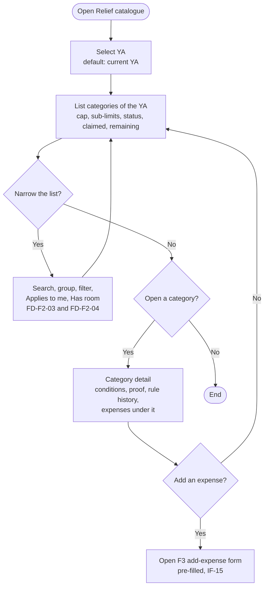
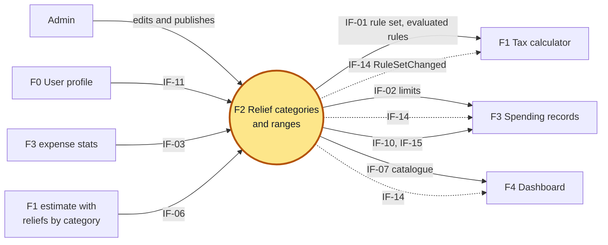
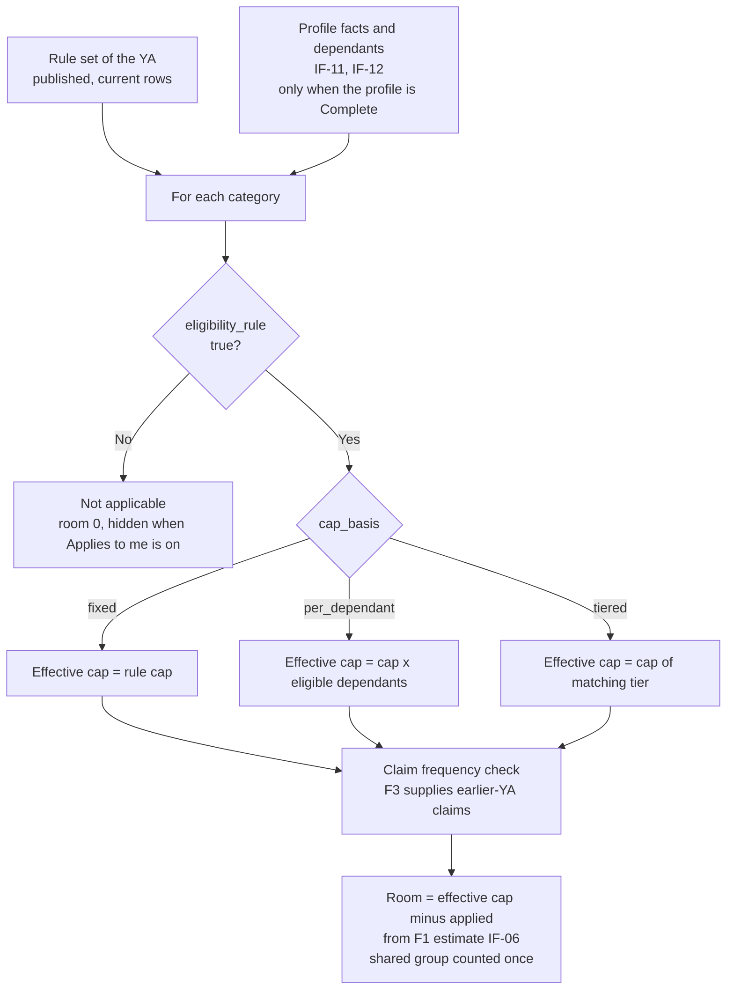
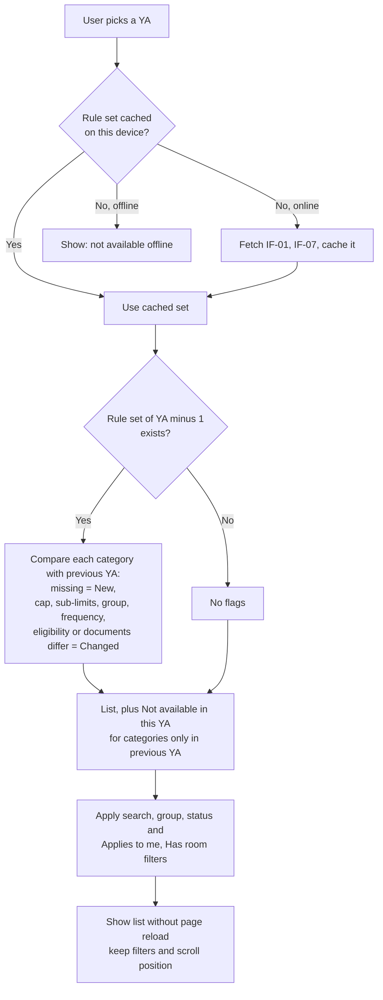
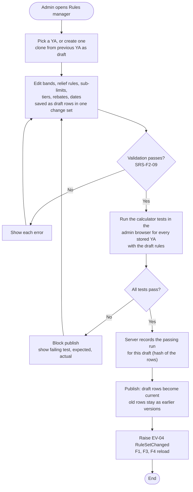
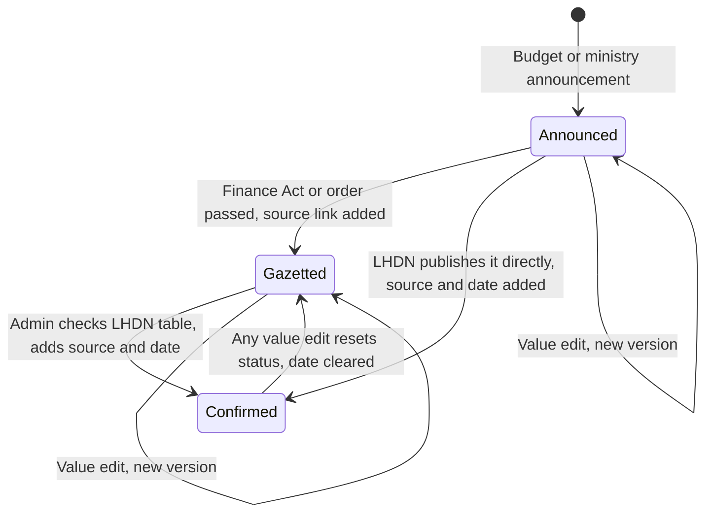
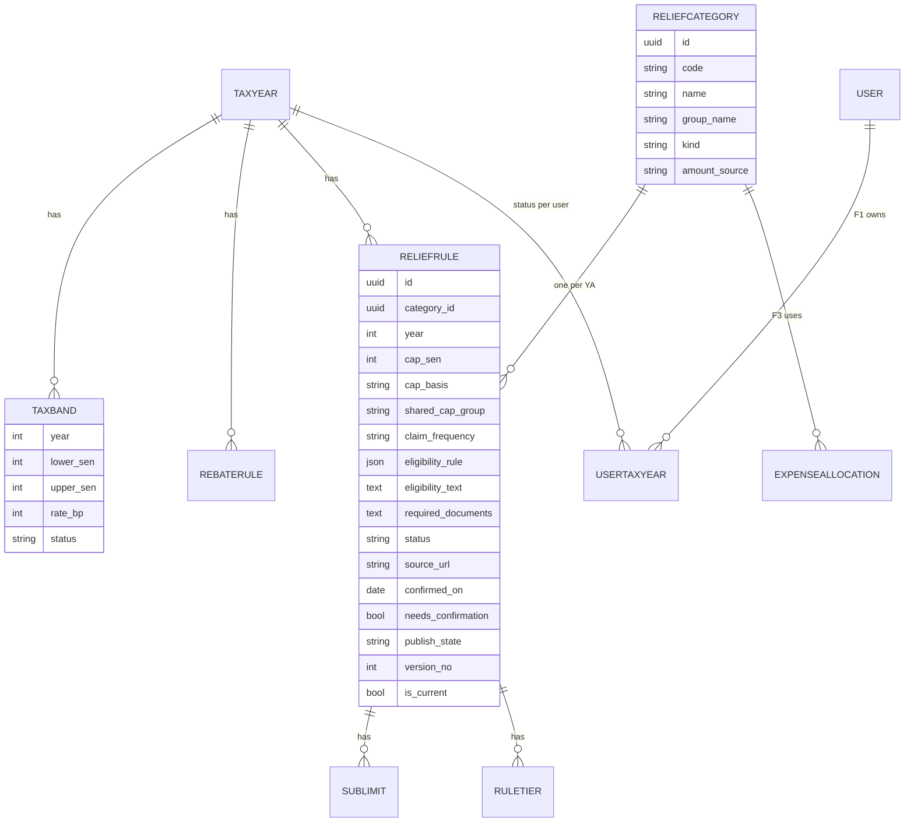
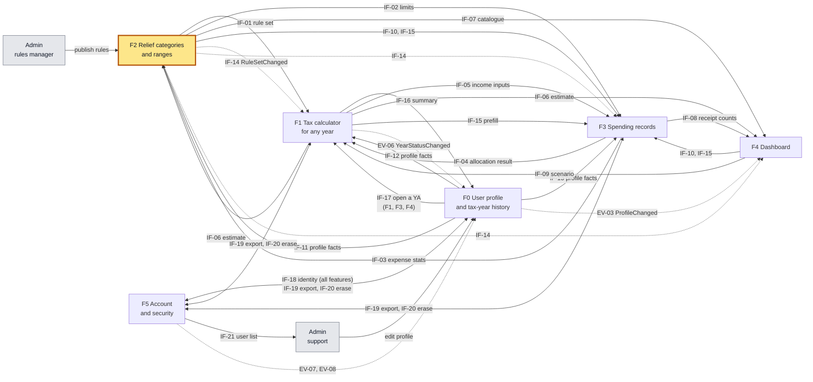

# URS-SRS-F2: Relief categories and ranges

| Item | Value |
| --- | --- |
| Document ID | URS-SRS-F2 |
| Document type | URS and SRS (user and system requirements) |
| Product | Tax Relief Manager (TRM), Malaysia tax relief system (PWA) |
| Version | 0.14 |
| Status | Draft (for owner review) |
| Date | 2026-11-26 (first written 2026-11-13) |
| Owner | Champs (product owner) |
| PRD reference | PRD-TRM section 3.2 "Relief categories and ranges", FR-2.1 to FR-2.7, including the yearly rules admin (PRD-TRM sections 2.5 and 4) |
| Source | PRD-TRM (written from revision 37; names checked against revision 48); owner prompts P-16, P-38, P-42, P-44 and P-46; rules checked in RES-002 and RES-003; owner answers to the PRD items (P-60 to P-67); PRD revision 53; stack decisions of P-68 to P-71 (ADR-001); owner decisions of 25/11/2026 on the profile ids and the dependants of a saved calculation (P-101 to P-107); owner decision of 26/11/2026 on the key of HouseholdLink (P-119) |
| Change tracking | [REG-02 URS and SRS change log](../registers/REG_02_URS_SRS_Change_Log.md); work history in [REG-01 History log](../registers/REG_01_History_Log.md); short forms in [REG-03 Acronyms](../registers/REG_03_Acronyms.md) |

## 0. Conventions shared by all six documents

### 0.1 The document set

| Doc | File | Feature (name from the PRD) | PRD requirements covered |
| --- | --- | --- | --- |
| F0 | [URS_SRS_F0_User_Profile.md](URS_SRS_F0_User_Profile.md) | User profile and tax-year history | PRD sections 5, 7, 8; FR-2.3 depends on it (no FR block yet, F-032) |
| F1 | [URS_SRS_F1_Tax_Calculator.md](URS_SRS_F1_Tax_Calculator.md) | Tax calculator for any year (PRD section 3.1, includes PCB) | FR-1.1 to FR-1.11 |
| F2 | [URS_SRS_F2_Relief_Categories.md](URS_SRS_F2_Relief_Categories.md) | Relief categories and ranges (PRD section 3.2, includes the rule sets and the rules admin) | FR-2.1 to FR-2.7 |
| F3 | [URS_SRS_F3_Spending_Records.md](URS_SRS_F3_Spending_Records.md) | Spending records (PRD section 3.3) | FR-3.1 to FR-3.7 |
| F4 | [URS_SRS_F4_Dashboard.md](URS_SRS_F4_Dashboard.md) | Dashboard (PRD section 3.4) | FR-4.1 to FR-4.8 |
| F5 | [URS_SRS_F5_Account_Security.md](URS_SRS_F5_Account_Security.md) | Account and security | NFR-6, NFR-7, NFR-8; PRD sections 7 and 8 (sign in, settings, roles); no FR block yet |

Source: PRD-TRM, the PRD "Malaysia Tax Relief System (PWA)" ([PRD_TRM_Malaysia_Tax_Relief_System.md](../prd/PRD_TRM_Malaysia_Tax_Relief_System.md)), written from revision 37 and checked against revision 48. The PRD is the master for feature names and IDs (AGENTS.md section 6); F0 and F5 have no PRD feature section yet. Logs: [REG_01_History_Log.md](../registers/REG_01_History_Log.md) is the main log of our work; [REG_02_URS_SRS_Change_Log.md](../registers/REG_02_URS_SRS_Change_Log.md) records every detail change to these six documents.

### 0.2 How to read the IDs

| Prefix | Meaning | Where |
| --- | --- | --- |
| URS-Fn-nn | User requirement (n is 0 for the profile document, 1 to 4 for the core features, 5 for account and security), in the owner's terms ("what the user must be able to do") | Part A of the feature document |
| FD-Fn-nn | Flow or state diagram drawn for the URS | Part A |
| SRS-Fn-nn | System requirement: exactly how the application behaves | Part B |
| SQ-Fn-nn | Sequence diagram that shows a specification across features | Part B |
| TC-Fn-nn | Test case with exact inputs and expected outputs | Part B |
| IF-nn | Interface: data one feature passes to another (same list in all six documents) | Section A5 |
| EV-nn | Event that tells other features to refresh | Section A5 |
| FR, BR, NFR | Requirement and rule IDs from the PRD | PRD |
| SD-Fn-nn | **Specification decision**: a detail the PRD does not state, which I filled in. Needs the owner's confirmation. | Part B |
| DA-nn | **Data addition**: a field or table the PRD data model does not have but the specification needs (same list in all six documents, in Part B2 under Data additions) | Part B |
| OI-Fn-nn | Open item: unresolved question | Part B |

Every SRS row has a **Basis** column: the PRD ID it comes from, or SD, DA or OI where I added or could not settle something. Every SRS row has a **Flow** column naming the URS diagram it works from.

### 0.3 Shared terms and rules

| Term | Exact meaning in all six documents |
| --- | --- |
| YA | Year of Assessment. YA 2026 covers income and spending dated 1 Jan to 31 Dec 2026. |
| Current YA | The YA whose period contains today's date. |
| Ended YA | A YA whose period end is before today. |
| Money | Stored as whole sen (integer). RM 1,449.00 is 144900. Displayed as "RM 1,449.00". |
| Rule set | All published, current rows for one YA: TaxYear, TaxBand, RebateRule, ReliefCategory, ReliefRule, SubLimit and (DA-05) RuleTier. |
| Actual spend | The amount the user paid, before any cap. |
| Applied (claimable) | The part of an amount that counts toward relief after sub-limits, category cap, shared cap and claim-frequency rules. |
| Over cap | Actual spend minus applied. |
| Effective cap | The most this user can apply in one category for one YA: fixed cap, cap per dependant times the number of eligible dependants, or the tier that matches the user's facts. |
| Room | Effective cap minus applied, never below zero. A shared-cap group has one room, counted once. |
| Estimate | Any tax figure built on a rule with status Announced, or for a YA that has not ended (it uses only the months entered so far). It is labelled "estimate". |
| Soft delete | deleted_at and deleted_by are set on the current version row. Nothing is removed. |
| Versioned edit | An edit inserts a new row with the next version_no, sets is_current to false on the old row. created_by and updated_by hold the acting user, or the SYSTEM user for system actions. |
| Profile year | The TaxpayerProfile row, with its dependants, that belongs to one YA (DA-16). A user has one current profile per YA. |
| Age at YA end | Whole years completed on the YA's period end (31 December). The default reference date for every age test ([OI-F1-01](URS_SRS_F1_Tax_Calculator.md#oi-f1-01)). |
| Locked profile | The profile of a YA whose UserTaxYear.status is filed. Nobody can change it until the YA is reopened. Derived, not stored ([SD-F0-12](URS_SRS_F0_User_Profile.md#sd-f0-12)). |
| Tax-year history | The list of stored YAs with the stage of each (Not started, In progress, Calculated, Filed), owned by F0. |
| Rounding | Each band's tax is rounded half-up to the nearest sen, then summed ([SD-F1-05](URS_SRS_F1_Tax_Calculator.md#sd-f1-05)). |
| Session | One signed-in period on one browser or device. It ends by sign-out, expiry or revoke (F5). |
| Fresh sign-in | A sign-in within the last 10 minutes. It is asked for again before a sensitive action such as a password change, an export or a deletion ([SD-F5-06](URS_SRS_F5_Account_Security.md#sd-f5-06)). |
| Grace period | The 14 days between a deletion request and the erase. The user can cancel in this time ([SD-F5-08](URS_SRS_F5_Account_Security.md#sd-f5-08)). |
| Retention period | 7 years from the end of the YA (NFR-8), the time the taxpayer should keep records. |
| Release | R1 to R4, the releases of PRD section 9.1: R1 is built in PRD phase 1, R2 in phase 3, R3 in phase 4, R4 in phase 5. R1 is the MVP for the product owner's personal use. R2 items are reserved here only where R1 must leave a hook. |
| Phase | Only a phase of the PRD roadmap (section 9.1): phase 0 Discovery, 1 R1 build, 2 Personal use, 3 R2, 4 R3, 5 R4, then the public launch gate. |
| Basic account | The part of F5 built in R1: the simple account ([SD-F5-17](URS_SRS_F5_Account_Security.md#sd-f5-17)). Called Phase 1 until 23/11/2026. |
| Launch account | The part of F5 held until before the public launch: lockout, emailed links, staying signed in, two-factor login, deletion of the whole account ([SD-F5-17](URS_SRS_F5_Account_Security.md#sd-f5-17)). Called Phase 2 until 23/11/2026. |

---

# Part A. User Requirements Specification (URS)

## A1. Purpose and scope

**Purpose.** F2 holds every rule that depends on the Year of Assessment (YA): tax bands, rebates, relief categories with caps, sub-limits, conditions and proof. It shows the taxpayer which reliefs apply to them and how much room is left, and it lets an admin add or correct a YA's rules without a code release. F2 is the source of rules for F1, F3 and F4.

**In scope (R1):** relief catalogue per YA; grouping, search and filter; New and Changed flags; filter by profile; cap, claimed and remaining per category; rule sets for YA 2025, YA 2026 and YA 2027; admin rules manager with status, source and confirmation date; publish gate with tests; tax bands, rebates and filing deadline per YA.

**Reserved (R2):** consolidated rule change log view (the per-rule history is R1).

**Out of scope:** reading rules from LHDN automatically; rule sets for non-residents.

## A2. Users and roles

| User | What they do in F2 |
| --- | --- |
| Taxpayer | Browses the catalogue, filters by profile, sees cap, claimed and remaining |
| Admin | Creates and edits rules per YA, sets status, source and confirmation date, publishes. Sees rule history. Cannot see any user's income, spending or estimates. |
| System | Seeds rule sets (created_by = SYSTEM user) |

## A3. User requirements

| ID | The user must be able to | PRD source | Flow |
| --- | --- | --- | --- |
| URS-F2-01 | See every relief category of a YA with name, group, annual cap, sub-limits, shared-cap group, conditions, required documents and claim frequency | FR-2.1 | [FD-F2-01](URS_SRS_F2_Relief_Categories.md#fd-f2-01) |
| URS-F2-02 | Group, search and filter categories, and see which are New or Changed against the previous YA | FR-2.2 | [FD-F2-04](URS_SRS_F2_Relief_Categories.md#fd-f2-04) |
| URS-F2-03 | See only the reliefs that apply to my profile (marital status, children and ages, disability, first-home purchase) | FR-2.3, BR-11 | [FD-F2-03](URS_SRS_F2_Relief_Categories.md#fd-f2-03) |
| URS-F2-04 | See, on each category, the cap, the amount claimed and the amount remaining | FR-2.4 | [FD-F2-01](URS_SRS_F2_Relief_Categories.md#fd-f2-01), [FD-F2-02](URS_SRS_F2_Relief_Categories.md#fd-f2-02) |
| URS-F2-05 | Open the app with complete rules for YA 2025, YA 2026 and YA 2027 already loaded | FR-2.5, FR-2.7 | [FD-F2-05](URS_SRS_F2_Relief_Categories.md#fd-f2-05) |
| URS-F2-06 | (Admin) Add or edit bands, relief rules, sub-limits, rebates and dates for a YA without a code release | FR-2.5, PRD section 4 | [FD-F2-05](URS_SRS_F2_Relief_Categories.md#fd-f2-05) |
| URS-F2-07 | See on every rule its status (Announced, Gazetted, Confirmed), source link and confirmation date | FR-2.6 | [FD-F2-06](URS_SRS_F2_Relief_Categories.md#fd-f2-06) |
| URS-F2-08 | Switch the YA and see caps and bands change at once, without reloading data | FR-2.7 acceptance | [FD-F2-04](URS_SRS_F2_Relief_Categories.md#fd-f2-04) |
| URS-F2-09 | (Admin) Maintain tax bands, rebates, filing deadline and the YA period | PRD sections 2.4, 4 | [FD-F2-05](URS_SRS_F2_Relief_Categories.md#fd-f2-05) |
| URS-F2-10 | (Admin) Be stopped from publishing a rule change that breaks a calculator test | NFR-10 | [FD-F2-05](URS_SRS_F2_Relief_Categories.md#fd-f2-05) |
| URS-F2-11 | (Admin) See the history of every change to a rule | NFR-9, PRD section 8 roles | [FD-F2-07](URS_SRS_F2_Relief_Categories.md#fd-f2-07) |
| URS-F2-12 | Open the expenses recorded under a category, or add one, from the category | FR-2.4 (usage) | [FD-F2-01](URS_SRS_F2_Relief_Categories.md#fd-f2-01) |

## A4. Flow diagrams

**[FD-F2-01](URS_SRS_F2_Relief_Categories.md#fd-f2-01). User flow in the relief catalogue**

**[FD-F2-02](URS_SRS_F2_Relief_Categories.md#fd-f2-02). What F2 receives from and gives to other features**

**[FD-F2-03](URS_SRS_F2_Relief_Categories.md#fd-f2-03). How the rules are evaluated for one user** (the rule evaluator, [SRS-F2-04](URS_SRS_F2_Relief_Categories.md#srs-f2-04) and [SRS-F2-05](URS_SRS_F2_Relief_Categories.md#srs-f2-05))

**[FD-F2-04](URS_SRS_F2_Relief_Categories.md#fd-f2-04). Filtering, New and Changed flags, and switching the YA**

**[FD-F2-05](URS_SRS_F2_Relief_Categories.md#fd-f2-05). Admin edit, test and publish**

**[FD-F2-06](URS_SRS_F2_Relief_Categories.md#fd-f2-06). Status of a rule**

**[FD-F2-07](URS_SRS_F2_Relief_Categories.md#fd-f2-07). Data held by F2 and the entities it connects to**

## A5. Relationship with other features

**FD-00. System map of the profile (F0), the four core features and account and security (F5) (identical in all six documents; the feature of this document is highlighted)**

Reading the map: a solid arrow is data a feature reads or receives; a dashed arrow is an event. F0 owns the profile and the profile of every YA; the four core features only read it. F5 owns the account and the sign-in; it tells every feature who is signed in (IF-18, drawn once, to F0), asks F0, F1 and F3 for their part of a data export (IF-19) and tells them to erase (IF-20). F2 and F4 own no user data, so they take part only through IF-18. F1 and F3 depend on each other, so the order of calculation is fixed: F1 sends income inputs (IF-05), F3 allocates claims (IF-04), then F1 finishes the tax chain. That order is drawn in [SQ-F1-01](URS_SRS_F1_Tax_Calculator.md#sq-f1-01).

**Interfaces (identical in all six documents).** "Provider spec" is the SRS row that builds the data; "Consumer spec" is the SRS row that uses it.

| ID | From | To | Data carried | Trigger | Provider spec | Consumer spec |
| --- | --- | --- | --- | --- | --- | --- |
| IF-01 | F2 | F1 | Rule set of the selected YA plus, for this user, the evaluated rules: per category applicable or not, effective cap, tier, sub-limits, shared group, claim frequency | YA selected; EV-03; EV-04 | [SRS-F2-13](URS_SRS_F2_Relief_Categories.md#srs-f2-13) | [SRS-F1-01](URS_SRS_F1_Tax_Calculator.md#srs-f1-01) |
| IF-02 | F2 | F3 | Categories open to this user for the YA, with limits, sub-limits, shared group, frequency, required documents, beneficiary rule | Expense form opened; YA changed; EV-04 | [SRS-F2-13](URS_SRS_F2_Relief_Categories.md#srs-f2-13) | [SRS-F3-02](URS_SRS_F3_Spending_Records.md#srs-f3-02) |
| IF-03 | F3 | F2 | Per category: expense count, actual spend, applied, over cap, expenses missing a receipt | Category detail opened; EV-01 | [SRS-F3-14](URS_SRS_F3_Spending_Records.md#srs-f3-14) | [SRS-F2-06](URS_SRS_F2_Relief_Categories.md#srs-f2-06) |
| IF-04 | F3 | F1 | Allocation result: applied amount per category (spending and income-sourced), deductions applied, aggregate income before donations | Any change to expenses, income, profile or rules | [SRS-F3-14](URS_SRS_F3_Spending_Records.md#srs-f3-14) | [SRS-F1-06](URS_SRS_F1_Tax_Calculator.md#srs-f1-06) |
| IF-05 | F1 | F3 | Income inputs: total income for the YA, and the amount already counted by income-sourced categories (employee EPF, SOCSO and EIS) | EV-02 | [SRS-F1-05](URS_SRS_F1_Tax_Calculator.md#srs-f1-05) | [SRS-F3-07](URS_SRS_F3_Spending_Records.md#srs-f3-07) |
| IF-06 | F1 | F2, F4 | Estimate: full tax chain, reliefs by category (applied, effective cap, room, source), PCB figures, labels | Every recalculation (EV-05) | [SRS-F1-07](URS_SRS_F1_Tax_Calculator.md#srs-f1-07), [SRS-F1-13](URS_SRS_F1_Tax_Calculator.md#srs-f1-13) | [SRS-F2-05](URS_SRS_F2_Relief_Categories.md#srs-f2-05), [SRS-F4-02](URS_SRS_F4_Dashboard.md#srs-f4-02) |
| IF-07 | F2 | F4 | Catalogue summary (category, group, status, effective cap), TaxYear dates (period, filing deadline) | YA selected; EV-04 | [SRS-F2-13](URS_SRS_F2_Relief_Categories.md#srs-f2-13) | [SRS-F4-02](URS_SRS_F4_Dashboard.md#srs-f4-02) |
| IF-08 | F3 | F4 | Receipt counts per category and in total: with receipt, missing, pending upload; expense counts | EV-01 | [SRS-F3-14](URS_SRS_F3_Spending_Records.md#srs-f3-14) | [SRS-F4-04](URS_SRS_F4_Dashboard.md#srs-f4-04), [SRS-F4-08](URS_SRS_F4_Dashboard.md#srs-f4-08) |
| IF-09 | F4 | F1 | Scenario request (as recorded for any YA, no reliefs, use room of listed categories, use all room) and the scenario estimate | Dashboard load; EV-05 | [SRS-F1-18](URS_SRS_F1_Tax_Calculator.md#srs-f1-18) | [SRS-F4-05](URS_SRS_F4_Dashboard.md#srs-f4-05), [SRS-F4-06](URS_SRS_F4_Dashboard.md#srs-f4-06) |
| IF-10 | F2, F4 | F3 | Navigate to the spending list with a filter: YA, category, receipt status | User taps a count or alert | [SRS-F3-15](URS_SRS_F3_Spending_Records.md#srs-f3-15) | [SRS-F2-06](URS_SRS_F2_Relief_Categories.md#srs-f2-06), [SRS-F4-11](URS_SRS_F4_Dashboard.md#srs-f4-11) |
| IF-11 | F0 | F2 | Profile facts of the selected YA: marital status, spouse income and disability, own disability, dependants with date of birth, education level and disability, first-home facts, whether the dependants list is confirmed, and whether the profile is complete | EV-03 | [SRS-F0-15](URS_SRS_F0_User_Profile.md#srs-f0-15) | [SRS-F2-04](URS_SRS_F2_Relief_Categories.md#srs-f2-04) |
| IF-12 | F0 | F1 | The same profile facts and the complete flag | EV-03 | [SRS-F0-15](URS_SRS_F0_User_Profile.md#srs-f0-15) | [SRS-F1-04](URS_SRS_F1_Tax_Calculator.md#srs-f1-04) |
| IF-13 | F0 | F3 | The same profile facts and the complete flag of the YA the expense falls in, used to check eligibility and the beneficiary | EV-03 | [SRS-F0-15](URS_SRS_F0_User_Profile.md#srs-f0-15) | [SRS-F3-02](URS_SRS_F3_Spending_Records.md#srs-f3-02), [SRS-F3-03](URS_SRS_F3_Spending_Records.md#srs-f3-03) |
| IF-14 | F2 | F1, F3, F4 | RuleSetChanged event: YA and new rule version | Admin publishes ([SRS-F2-11](URS_SRS_F2_Relief_Categories.md#srs-f2-11)) | [SRS-F2-11](URS_SRS_F2_Relief_Categories.md#srs-f2-11) | [SRS-F1-15](URS_SRS_F1_Tax_Calculator.md#srs-f1-15), [SRS-F3-14](URS_SRS_F3_Spending_Records.md#srs-f3-14), [SRS-F4-10](URS_SRS_F4_Dashboard.md#srs-f4-10) |
| IF-15 | F1, F2, F4 | F3 | Open the add-expense form pre-filled: YA, category, optional sub-limit, optional amount | User taps "Add as expense" | [SRS-F3-15](URS_SRS_F3_Spending_Records.md#srs-f3-15) | [SRS-F1-16](URS_SRS_F1_Tax_Calculator.md#srs-f1-16), [SRS-F2-06](URS_SRS_F2_Relief_Categories.md#srs-f2-06), [SRS-F4-11](URS_SRS_F4_Dashboard.md#srs-f4-11) |
| IF-16 | F1 | F0 | Tax-year summary for every stored YA: status and filed date, whether income exists, the live estimate (tax payable, total reliefs, chargeable income, labels) and the saved calculations (id, trigger, date, figures, profile id and profile version used, and the row ids of the dependants used) | History list or detail opened; EV-05; EV-06 | [SRS-F1-23](URS_SRS_F1_Tax_Calculator.md#srs-f1-23) | [SRS-F0-11](URS_SRS_F0_User_Profile.md#srs-f0-11), [SRS-F0-12](URS_SRS_F0_User_Profile.md#srs-f0-12) |
| IF-17 | F0 | F1, F3, F4 | Open a feature for a chosen YA, with an optional filter (F3: receipt status) | User taps an action on a tax year | [SRS-F0-12](URS_SRS_F0_User_Profile.md#srs-f0-12) | [SRS-F1-01](URS_SRS_F1_Tax_Calculator.md#srs-f1-01), [SRS-F3-15](URS_SRS_F3_Spending_Records.md#srs-f3-15), [SRS-F4-01](URS_SRS_F4_Dashboard.md#srs-f4-01) |
| IF-18 | F5 | F0, F1, F3 (F2 and F4 read the role only, [OI-F5-05](URS_SRS_F5_Account_Security.md#oi-f5-05)) | Signed-in identity: user id, role (user or admin), language, session expiry, device id, whether two-factor login is on | App start; sign-in; session refresh; EV-07; EV-08 | [SRS-F5-18](URS_SRS_F5_Account_Security.md#srs-f5-18) | [SRS-F0-19](URS_SRS_F0_User_Profile.md#srs-f0-19), [SRS-F1-24](URS_SRS_F1_Tax_Calculator.md#srs-f1-24), [SRS-F3-18](URS_SRS_F3_Spending_Records.md#srs-f3-18) |
| IF-19 | F0, F1, F3 | F5 | Export part: every row the feature owns for the user, all versions, as records, plus the list of files (F3) | The export job runs ([SRS-F5-14](URS_SRS_F5_Account_Security.md#srs-f5-14)) | [SRS-F0-19](URS_SRS_F0_User_Profile.md#srs-f0-19), [SRS-F1-24](URS_SRS_F1_Tax_Calculator.md#srs-f1-24), [SRS-F3-18](URS_SRS_F3_Spending_Records.md#srs-f3-18) | [SRS-F5-14](URS_SRS_F5_Account_Security.md#srs-f5-14) |
| IF-20 | F5 | F0, F1, F3 | Erase request: delete every row and file of the user, or, when the request names a YA, only the rows and files of that YA, and answer with the counts | The user confirms the deletion of a YA past its 7 years ([SRS-F5-21](URS_SRS_F5_Account_Security.md#srs-f5-21)); in the launch account also when the grace period ends ([SRS-F5-16](URS_SRS_F5_Account_Security.md#srs-f5-16)) | [SRS-F5-16](URS_SRS_F5_Account_Security.md#srs-f5-16), [SRS-F5-21](URS_SRS_F5_Account_Security.md#srs-f5-21) | [SRS-F0-19](URS_SRS_F0_User_Profile.md#srs-f0-19), [SRS-F1-24](URS_SRS_F1_Tax_Calculator.md#srs-f1-24), [SRS-F3-18](URS_SRS_F3_Spending_Records.md#srs-f3-18) |
| IF-21 | F5 | F0 | User list for support: user id, name, email, status, role, two-factor flag, last sign-in date; no tax data | An admin opens the user list | [SRS-F5-17](URS_SRS_F5_Account_Security.md#srs-f5-17) | [SRS-F0-16](URS_SRS_F0_User_Profile.md#srs-f0-16) |

**Events**

| ID | Event | Raised by | Heard by |
| --- | --- | --- | --- |
| EV-01 | ExpenseChanged (ya, expense ids) | F3, after every local save, edit, delete or sync | F1, F2, F4 |
| EV-02 | IncomeChanged (ya) | F1, after every income or PCB save | F3 (refresh IF-05), F4 |
| EV-03 | ProfileChanged (ya, profile id, version) | F0, after every profile or dependant save, copy to a new YA, or apply to later YAs | F1, F2, F3, F4 |
| EV-04 | RuleSetChanged (ya, version) = IF-14 | F2 | F1, F3, F4 |
| EV-05 | EstimateComputed (ya) | F1, after every recalculation | F2, F4 |
| EV-06 | YearStatusChanged (ya, status filed or open) | F1, after mark as filed or reopen ([SRS-F1-21](URS_SRS_F1_Tax_Calculator.md#srs-f1-21)) | F0, F4 |
| EV-07 | AccountStatusChanged (user, status active, disabled or deletion_pending) | F5, after an admin disables or enables the account, a deletion request or its cancel ([SRS-F5-15](URS_SRS_F5_Account_Security.md#srs-f5-15), [SRS-F5-17](URS_SRS_F5_Account_Security.md#srs-f5-17)) | F0, F1, F3 |
| EV-08 | SessionEnded (user, device, reason: signed out, expired, revoked, password changed) | F5, whenever a session ends ([SRS-F5-08](URS_SRS_F5_Account_Security.md#srs-f5-08), [SRS-F5-09](URS_SRS_F5_Account_Security.md#srs-f5-09)) | F0, F1, F3 |

**Data ownership (identical in all six documents).** O = owns and writes; R = reads; Agg = reads only aggregated results through an interface; none = no access. Export and erase mean the feature supplies its part to F5 (IF-19) and deletes it on request (IF-20). "Admin" can touch the profile (while its YA is not filed), the account's name and language, and file names only.

| Entity | F0 | F1 | F2 | F3 | F4 | F5 | Admin |
| --- | --- | --- | --- | --- | --- | --- | --- |
| User.name, User.language, TaxpayerProfile (one per YA, DA-16), Dependant, HouseholdLink | O | R (IF-12) | R (IF-11) | R (IF-13) | none | Export, erase | Manage name, language and profile fields of a YA that is not filed |
| User.email, role, status; Credential, Session, ConsentRecord, Invitation, DataRequest, SecurityEvent (DA-21 to DA-24) | R (IF-18) | R (IF-18) | R (IF-18, role) | R (IF-18) | R (IF-18, role) | O | Invite, disable, enable, send a reset email. No password, no email change, no two-factor off |
| IncomeRecord | none | O | none | Agg (IF-05) | Agg (IF-06) | Export, erase | none |
| UserTaxYear (DA-12: filed status per user) | R (lock follows status) | O | none | R | R | Export, erase | none |
| TaxEstimate, TaxEstimateDependant (DA-29) | Agg (IF-16) | O | Agg (IF-06) | none | R | Export, erase | none |
| TaxYear, TaxBand, RebateRule | none | R (IF-01) | O | none | R (IF-07) | none | Create and edit |
| RuleTestRun (DA-27) | none | none | O | none | none | none | Runs the tests in the browser; no edit |
| ReliefCategory, ReliefRule, SubLimit, RuleTier | none | R (IF-01) | O | R (IF-02) | R (IF-07) | none | Create and edit |
| Expense, ExpenseAllocation | none | Agg (IF-04) | Agg (IF-03) | O | Agg (IF-08) | Export, erase | none (amounts and descriptions are confidential) |
| Receipt | none | none | none | O | Agg (IF-08) | Export, erase | File name and type only; upload, download, delete on request ([OI-F3-01](URS_SRS_F3_Spending_Records.md#oi-f3-01)) |

**A5.4 Inter-related data for F2**

| Data | Direction | Other feature | What F2 uses it for, or gives it for | Interface | If it is missing or late |
| --- | --- | --- | --- | --- | --- |
| Rule set and evaluated rules | out | F1 | Bands, rebates, caps, effective caps | IF-01 | F1 shows "No rules" ([SRS-F1-01](URS_SRS_F1_Tax_Calculator.md#srs-f1-01)) |
| Category limits and eligibility | out | F3 | Category picker, caps, sub-limits, frequency, documents | IF-02 | F3 shows "Rules not loaded" and blocks saving |
| Catalogue summary and TaxYear dates | out | F4 | Per-category bars, reliefs to claim, filing deadline | IF-07 | F4 shows the last cached catalogue with its age |
| Expense statistics per category | in | F3 | Expense count, actual spend, missing receipts on category detail | IF-03 | Detail shows "Spending data updating" |
| Estimate with reliefs by category | in | F1 | Claimed and remaining for every category, including profile and income-sourced reliefs | IF-06 | Claimed shows "updating" |
| Profile facts of the selected YA | in | F0 | Applies-to-me filter, effective caps | IF-11 | Profile Incomplete: the gate, no evaluation ([SRS-F0-03](URS_SRS_F0_User_Profile.md#srs-f0-03)) |
| RuleSetChanged | out | F1, F3, F4 | Tells them to reload | IF-14 | Not applicable |
| Navigation to spending list and add-expense | out | F3 | From a category to its expenses, or to a pre-filled new expense | IF-10, IF-15 | Not applicable |

## A6. Assumptions and constraints

1. Rules are data: a new Budget means new rows, not new code (PRD section 5).
2. The values loaded in R1 come from secondary sources and stay unverified until an admin confirms each one against LHDN (PRD verification note, Phase 0).
3. R17 (education and medical insurance) is loaded at RM 4,000, which LHDN gives from YA 2025 (RM 3,000 applied to YA 2018 to YA 2024) and confirms for YA 2026 in Public Ruling 5/2026; Budget 2027 does not change it (RES-002).
4. The rule evaluator is one pure function shared by F1, F3 and F4 so every feature reads the same effective caps.

---

# Part B. System Requirements Specification (SRS)

## B1. Functional specifications

### B1.1 Catalogue and filters

| ID | Specification | Basis | URS | Flow | Test |
| --- | --- | --- | --- | --- | --- |
| SRS-F2-01 | **Catalogue list.** For the selected YA, list every published, current ReliefRule joined with its ReliefCategory, not retired (retired_on empty or after the YA). Each row shows: code, name, group, kind (relief or deduction), cap in words by cap_basis (for example "RM 9,000", "RM 2,000 per child", "RM 7,000 or RM 5,000 by home price"), sub-limits with caps, shared-cap group name, eligibility text, required documents, claim frequency in words, status badge, source link, confirmed_on date, the "Needs confirmation" badge when needs_confirmation is true, and the New or Changed badge ([SRS-F2-03](URS_SRS_F2_Relief_Categories.md#srs-f2-03)). Default order: group order from section B2.3, then name. The header shows the number of categories listed. Rebates and bands are shown in a separate "Tax bands and rebates" tab of the same screen. | FR-2.1, FR-2.6, DA-14 | [URS-F2-01](URS_SRS_F2_Relief_Categories.md#urs-f2-01), [URS-F2-07](URS_SRS_F2_Relief_Categories.md#urs-f2-07) | [FD-F2-01](URS_SRS_F2_Relief_Categories.md#fd-f2-01) | [TC-F2-01](URS_SRS_F2_Relief_Categories.md#tc-f2-01), [TC-F2-02](URS_SRS_F2_Relief_Categories.md#tc-f2-02) |
| SRS-F2-02 | **Group, search, filter.** 1. Group: collapsible sections by group. 2. Search: a text box matching name, code, eligibility text, sub-limit names and required documents, case-insensitive, substring, applied 200 ms after the last keystroke. 3. Filters, which combine with AND: group (multi-select), kind, status, New or Changed, "Applies to me" (default on), "Has room" (room above 0). 4. Sort: name, cap high to low, room high to low. 5. An empty result shows "No category matches" and a "Clear filters" button. | FR-2.2 | [URS-F2-02](URS_SRS_F2_Relief_Categories.md#urs-f2-02) | [FD-F2-04](URS_SRS_F2_Relief_Categories.md#fd-f2-04) | [TC-F2-05](URS_SRS_F2_Relief_Categories.md#tc-f2-05), [TC-F2-06](URS_SRS_F2_Relief_Categories.md#tc-f2-06) |
| SRS-F2-03 | **New and Changed flags.** Compare the category's current row in YA n with its row in YA n minus 1. New: no published row in n minus 1. Changed: both exist and any of cap, cap_basis, sub-limit set or caps, tiers, shared-cap group, claim frequency, eligibility_rule or required_documents differ. The Changed badge expands to a line per difference, for example "Cap: RM 9,000 to RM 12,000". A category present in n minus 1 and absent in n is listed under "Not available in YA n" with the text "Not announced for this YA". The lowest YA in the system has no flags and shows "No earlier YA to compare". | FR-2.2 | [URS-F2-02](URS_SRS_F2_Relief_Categories.md#urs-f2-02) | [FD-F2-04](URS_SRS_F2_Relief_Categories.md#fd-f2-04) | [TC-F2-03](URS_SRS_F2_Relief_Categories.md#tc-f2-03), [TC-F2-04](URS_SRS_F2_Relief_Categories.md#tc-f2-04) |
| SRS-F2-04 | **Profile relevance and the eligibility test.** The rule evaluator reads each rule's eligibility_rule (DA-04), a JSON test: `{"all":[ ... ]}`, `{"any":[ ... ]}` or a leaf `{"fact":"<name>","op":<operator>,"value":<v>}` where the operator is one of eq, ne, gt, gte, lt, lte, in, exists. Facts available (those of the selected YA's own profile, F0 [SRS-F0-15](URS_SRS_F0_User_Profile.md#srs-f0-15); the evaluator runs only when the profile is Complete): marital_status, spouse_has_income, spouse_is_disabled, pays_alimony, is_disabled, residency_status, has_first_home, first_home_spa_date, first_home_price, dependants_confirmed (DA-20), and for each dependant: type, age_at(reference_date), is_unmarried, is_disabled, education_level. A group test `{"count_dependants":{"where":[...],"op":"gte","value":1}}` counts dependants; the evaluator never runs while dependants_confirmed is false, because the profile is then Incomplete ([SRS-F0-03](URS_SRS_F0_User_Profile.md#srs-f0-03)). Result per category: **applicable** (true) or **not applicable** (false). When the profile of the YA is Incomplete, F2 shows the gate "Complete your profile for YA {y}" ([SRS-F0-03](URS_SRS_F0_User_Profile.md#srs-f0-03)) in place of the catalogue and returns no result. With "Applies to me" on, not applicable is hidden and applicable is shown. Example, R03: `{"all":[{"fact":"marital_status","op":"eq","value":"married"},{"fact":"spouse_has_income","op":"eq","value":false}]}`. Example, R20: `{"count_dependants":{"where":[{"fact":"type","op":"eq","value":"child"},{"fact":"is_unmarried","op":"eq","value":true},{"fact":"age_at","op":"lt","value":18}],"op":"gte","value":1}}`, with reference_date defaulting to the YA's period_end ([OI-F1-01](URS_SRS_F1_Tax_Calculator.md#oi-f1-01)). | FR-2.3, BR-11, DA-04 | [URS-F2-03](URS_SRS_F2_Relief_Categories.md#urs-f2-03) | [FD-F2-03](URS_SRS_F2_Relief_Categories.md#fd-f2-03) | [TC-F2-07](URS_SRS_F2_Relief_Categories.md#tc-f2-07), [TC-F2-08](URS_SRS_F2_Relief_Categories.md#tc-f2-08), [TC-F2-24](URS_SRS_F2_Relief_Categories.md#tc-f2-24), [TC-F2-26](URS_SRS_F2_Relief_Categories.md#tc-f2-26) |
| SRS-F2-05 | **Effective cap, claimed, remaining, room.** *Effective cap* by cap_basis: fixed = rule cap; per_dependant = rule cap x the sum of the dependants that pass the rule's test, where a dependant with relief_shared = Yes counts 0.5 and a dependant with own_income_above_relief = Yes counts 0 (DA-26; LHDN Form BE notes, G16); tiered = cap of the RuleTier whose condition is true for the user (R06 tests the profile fact first_home_price, DA-19; R21 and R22 test education_level, F0 [SD-F0-10](URS_SRS_F0_User_Profile.md#sd-f0-10)) (none true: 0 and the notice "No tier matches"). A rule in a shared-cap group also has the group cap. *Claimed* = applied amount for the category from the F1 estimate (IF-06 reliefs_by_category), so it already includes caps, frequency and shared caps. *Remaining* = effective cap minus claimed, never below 0. *Room* = remaining; for a shared group, room = group cap minus the sum of applied amounts of all members, shown once on the group and on each member as "shares RM x with {group}". A category that is not applicable, or blocked by claim frequency (reason from F3), has room 0 and shows the reason. A deduction with a percentage cap (D01) has room = 10% of aggregate income before donations minus applied; D02 has no cap and no room. Every category row shows: cap, claimed, remaining, and a progress bar with the percentage as text. | FR-2.4, BR-3, BR-4, BR-5 | [URS-F2-04](URS_SRS_F2_Relief_Categories.md#urs-f2-04) | [FD-F2-03](URS_SRS_F2_Relief_Categories.md#fd-f2-03) | [TC-F2-09](URS_SRS_F2_Relief_Categories.md#tc-f2-09), [TC-F2-10](URS_SRS_F2_Relief_Categories.md#tc-f2-10), [TC-F2-11](URS_SRS_F2_Relief_Categories.md#tc-f2-11), [TC-F2-25](URS_SRS_F2_Relief_Categories.md#tc-f2-25) |
| SRS-F2-06 | **Category detail.** Opens from a row. Shows all fields of [SRS-F2-01](URS_SRS_F2_Relief_Categories.md#srs-f2-01), the sub-limits and tiers, the rule's version list (admin only: [SRS-F2-16](URS_SRS_F2_Relief_Categories.md#srs-f2-16)), then "Your spending" from IF-03: expense count, actual spend, applied, over cap, expenses missing a receipt. Buttons: "View expenses" (IF-10, opens F3 list filtered by YA and category) and "Add expense" (IF-15, opens the F3 form with YA and category filled). | FR-2.4, FR-2.1 | [URS-F2-12](URS_SRS_F2_Relief_Categories.md#urs-f2-12) | [FD-F2-01](URS_SRS_F2_Relief_Categories.md#fd-f2-01) | [TC-F2-12](URS_SRS_F2_Relief_Categories.md#tc-f2-12) |
| SRS-F2-07 | **Switching the YA.** The YA selector changes the list, caps, bands and badges from the cached rule set without a page reload and without a new network call when the set is cached; target under 300 ms. Filters and scroll position are kept. A YA that is not cached and the device is offline shows "This YA's rules are not saved on this device". The last selected YA is not remembered; the default is the current YA ([SD-F2-02](URS_SRS_F2_Relief_Categories.md#sd-f2-02)). | FR-2.7 acceptance | [URS-F2-08](URS_SRS_F2_Relief_Categories.md#urs-f2-08) | [FD-F2-04](URS_SRS_F2_Relief_Categories.md#fd-f2-04) | [TC-F2-13](URS_SRS_F2_Relief_Categories.md#tc-f2-13) |

### B1.2 Rule sets, admin, status, publishing

| ID | Specification | Basis | URS | Flow | Test |
| --- | --- | --- | --- | --- | --- |
| SRS-F2-08 | **Seed data.** A seed file loads the rule sets of YA 2025, YA 2026 and YA 2027 from section B2.3 (categories, caps, sub-limits, tiers, frequency), the bands of B3.1 in F1, the rebates and the TaxYear rows (period 1 Jan to 31 Dec; filing_deadline 30/04/2026 and efiling_deadline 15/05/2026 for YA 2025 from LHDN's filing programme for 2026, empty for YA 2026 and YA 2027 until published, [SD-F2-03](URS_SRS_F2_Relief_Categories.md#sd-f2-03), DA-26). All seeded rows: created_by and updated_by = the SYSTEM user, publish_state = published, version_no = 1, is_current = true. Initial status: YA 2025 and YA 2026 rows = Gazetted; YA 2027 rows = Announced; confirmed_on empty. No row has needs_confirmation = true after the check of 23/11/2026 (RES-002). R13 has rows for YA 2026 and YA 2027 only. R24 has no YA 2027 row: from YA 2027 breastfeeding equipment is the sub-limit BREASTFEEDING of R07. Re-running the seed never overwrites an existing row; it only inserts missing ones. | FR-2.5, FR-2.7, PRD section 2.5, [SD-F2-04](URS_SRS_F2_Relief_Categories.md#sd-f2-04) | [URS-F2-05](URS_SRS_F2_Relief_Categories.md#urs-f2-05) | [FD-F2-05](URS_SRS_F2_Relief_Categories.md#fd-f2-05) | [TC-F2-01](URS_SRS_F2_Relief_Categories.md#tc-f2-01), [TC-F2-02](URS_SRS_F2_Relief_Categories.md#tc-f2-02), [TC-F2-14](URS_SRS_F2_Relief_Categories.md#tc-f2-14) |
| SRS-F2-09 | **Admin rules manager.** Tabs per YA: Bands, Relief rules (with sub-limits and tiers), Rebates, Dates. Edits are saved as draft rows (publish_state = draft, is_current = false, same change_set_id, DA-08). "New YA" copies the previous YA's current rows as drafts. Validation before publish, each failure shown against its field: 1. Bands: the first lower threshold is 0; every lower equals the previous upper; the last upper is empty; rates 0.00 to 100.00 (stored as basis points, 11% = 1100). 2. Caps are 0 or more, whole sen; a sub-limit cap is at most its rule cap; members of one shared group carry the same group cap. 3. cap_basis tiered needs at least one tier; per_dependant needs an eligibility_rule that selects dependants. 4. Status Gazetted needs source_url; Confirmed needs source_url and confirmed_on. 5. TaxYear: period_start before period_end; filing_deadline not before period_end. 6. Every eligibility_rule parses and uses only the facts in [SRS-F2-04](URS_SRS_F2_Relief_Categories.md#srs-f2-04). 7. Percentages and amounts have no decimals beyond sen. | FR-2.5, PRD section 4, [SD-F2-05](URS_SRS_F2_Relief_Categories.md#sd-f2-05) | [URS-F2-06](URS_SRS_F2_Relief_Categories.md#urs-f2-06), [URS-F2-09](URS_SRS_F2_Relief_Categories.md#urs-f2-09) | [FD-F2-05](URS_SRS_F2_Relief_Categories.md#fd-f2-05) | [TC-F2-15](URS_SRS_F2_Relief_Categories.md#tc-f2-15), [TC-F2-16](URS_SRS_F2_Relief_Categories.md#tc-f2-16) |
| SRS-F2-10 | **Status, source and confirmation.** Allowed transitions are in [FD-F2-06](URS_SRS_F2_Relief_Categories.md#fd-f2-06): Announced to Gazetted; Gazetted to Confirmed; Announced to Confirmed when a source and date are given. Any edit to a value (cap, band rate, sub-limit, frequency, eligibility, documents) on a Confirmed rule sets its status to Gazetted and clears confirmed_on, so a verified value is never left marked verified after a change. A status change alone is also a versioned edit. Backward moves other than that reset are not allowed. The rules screen shows the worst status of the YA (Announced beats Gazetted beats Confirmed). | FR-2.6, [SD-F2-06](URS_SRS_F2_Relief_Categories.md#sd-f2-06) | [URS-F2-07](URS_SRS_F2_Relief_Categories.md#urs-f2-07) | [FD-F2-06](URS_SRS_F2_Relief_Categories.md#fd-f2-06) | [TC-F2-17](URS_SRS_F2_Relief_Categories.md#tc-f2-17) |
| SRS-F2-11 | **Publish gate and RuleSetChanged.** The tax engine runs only in the browser ([SD-F1-11](URS_SRS_F1_Tax_Calculator.md#sd-f1-11)), so the gate has three parts. 1. "Run tests" and "Publish" first validate ([SRS-F2-09](URS_SRS_F2_Relief_Categories.md#srs-f2-09)). 2. The browser runs the calculator tests for every stored YA with the TypeScript engine, using the draft rows in place of the current rows of the YA being changed: the F1 tests [TC-F1-01](URS_SRS_F1_Tax_Calculator.md#tc-f1-01) to [TC-F1-06](URS_SRS_F1_Tax_Calculator.md#tc-f1-06), plus generated band tests for the changed YA (tax at 0 is 0; tax never decreases as income rises; for every band boundary the tax equals the independent formula in F1 B3.2). 3. If any test fails, publish is refused and the screen lists the failing test id, expected and actual; there is no override. 4. If all pass, the browser sends the result with the change set id, a hash of the draft rows and the engine version, and the server stores it as a RuleTestRun (DA-27). 5. The server accepts "Publish" only when a passing RuleTestRun exists for the change set and its hash equals the hash of the draft rows at that moment; a later edit changes the hash and needs a new run. The server does not re-run the tests ([SD-F2-10](URS_SRS_F2_Relief_Categories.md#sd-f2-10)). 6. One transaction makes the draft rows current (previous rows get is_current = false, kept as versions) and raises EV-04 (IF-14) with the YA and new version. 7. F1, F3 and F4 reload the rule set and recalculate. 8. The same tests also run in CI on every change to the engine or the seed rules, before each deploy. | NFR-10, IF-14, [SD-F2-07](URS_SRS_F2_Relief_Categories.md#sd-f2-07), [SD-F2-10](URS_SRS_F2_Relief_Categories.md#sd-f2-10), [SD-F1-11](URS_SRS_F1_Tax_Calculator.md#sd-f1-11), DA-27 | [URS-F2-10](URS_SRS_F2_Relief_Categories.md#urs-f2-10) | [FD-F2-05](URS_SRS_F2_Relief_Categories.md#fd-f2-05) | [TC-F2-18](URS_SRS_F2_Relief_Categories.md#tc-f2-18), [TC-F2-19](URS_SRS_F2_Relief_Categories.md#tc-f2-19), [TC-F2-27](URS_SRS_F2_Relief_Categories.md#tc-f2-27) |
| SRS-F2-12 | **Delete and retire.** A rule cannot be deleted if any ExpenseAllocation in that YA uses its category; the action shows how many expenses use it (a count only, no user data). Instead, "Retire" sets retired_on (DA-14): the category no longer appears in the F3 picker but stays visible on existing expenses and reports. A rule with no expenses can be soft-deleted (deleted_at, deleted_by). Bands and rebates used in any TaxEstimate cannot be deleted. | PRD section 5 data rules, DA-14 | [URS-F2-06](URS_SRS_F2_Relief_Categories.md#urs-f2-06) | [FD-F2-05](URS_SRS_F2_Relief_Categories.md#fd-f2-05) | [TC-F2-20](URS_SRS_F2_Relief_Categories.md#tc-f2-20) |
| SRS-F2-13 | **Serving rules to other features (IF-01, IF-02, IF-07).** F2 returns, for a YA and a user: the rule set (bands, rebates, rules, sub-limits, tiers, TaxYear dates) and the evaluated rules (category id, applicable, effective cap, tier, sub-limits, shared group, frequency, required documents, beneficiary rule). The reply carries a version tag (the highest version_no in the set). Clients cache it in IndexedDB and ask again only on EV-03, EV-04 or when the tag is older than 7 days and the device is online. The same evaluator code runs on the device and on the server. | NFR-2, IF-01, IF-02, IF-07 | [URS-F2-05](URS_SRS_F2_Relief_Categories.md#urs-f2-05), [URS-F2-08](URS_SRS_F2_Relief_Categories.md#urs-f2-08) | [FD-F2-02](URS_SRS_F2_Relief_Categories.md#fd-f2-02), [FD-F2-03](URS_SRS_F2_Relief_Categories.md#fd-f2-03) | [TC-F2-13](URS_SRS_F2_Relief_Categories.md#tc-f2-13), [TC-F2-21](URS_SRS_F2_Relief_Categories.md#tc-f2-21) |
| SRS-F2-14 | **Shared-cap groups and claim frequency (configuration).** A shared-cap group is a name, a group cap and a list of member categories; each member has its own cap inside the group; for GRP-INS-EPF, R14 (EPF) 4,000 and R15 (life insurance) 3,000 inside a group cap of 7,000 ([OI-F2-02](URS_SRS_F2_Relief_Categories.md#oi-f2-02), answered). Claim frequency values (DA-06): annual (no restriction), once_every_n_ya (n = frequency_n; a claim in YA y blocks YA y+1 to y+n-1), once_in_period (a claim in one YA of period_from_year to period_to_year blocks the others), and max_claim_years (for example 3 consecutive YAs for R06). F2 stores the configuration; F3 applies it ([SRS-F3-08](URS_SRS_F3_Spending_Records.md#srs-f3-08)). | BR-4, BR-5, DA-06 | [URS-F2-01](URS_SRS_F2_Relief_Categories.md#urs-f2-01) | [FD-F2-03](URS_SRS_F2_Relief_Categories.md#fd-f2-03) | [TC-F2-22](URS_SRS_F2_Relief_Categories.md#tc-f2-22) |
| SRS-F2-15 | **Bands, rebates and TaxYear.** Per YA the admin maintains: bands ([SRS-F2-09](URS_SRS_F2_Relief_Categories.md#srs-f2-09) rules), RebateRule rows (PERSONAL, SPOUSE, ZAKAT, DEPARTURE_LEVY, each with amount or "ringgit for ringgit", and income_threshold where it applies), and TaxYear (year, period_start, period_end, filing_deadline, status). Bands and rebates carry the same status, source_url and confirmed_on as relief rules. F1 reads them through IF-01; F4 reads the dates through IF-07. | PRD sections 2.2, 2.4, 4 | [URS-F2-09](URS_SRS_F2_Relief_Categories.md#urs-f2-09) | [FD-F2-05](URS_SRS_F2_Relief_Categories.md#fd-f2-05) | [TC-F2-15](URS_SRS_F2_Relief_Categories.md#tc-f2-15) |
| SRS-F2-16 | **Audit and rule history.** Every row in F2's entities carries created_at, created_by, updated_at, updated_by and the version fields. A rule edit inserts a new version (version_no + 1); the old row is_current = false; seed and system rows use the SYSTEM user. The admin's category detail shows the version list: version_no, who, when, status, publish state, and the fields that changed. A taxpayer sees only "Last changed on {date}". | NFR-9, PRD section 8, [SD-F2-08](URS_SRS_F2_Relief_Categories.md#sd-f2-08) | [URS-F2-11](URS_SRS_F2_Relief_Categories.md#urs-f2-11) | [FD-F2-07](URS_SRS_F2_Relief_Categories.md#fd-f2-07) | [TC-F2-23](URS_SRS_F2_Relief_Categories.md#tc-f2-23) |
| SRS-F2-17 | **(R2) Consolidated rule change log, reserved.** R1 has the per-rule history of [SRS-F2-16](URS_SRS_F2_Relief_Categories.md#srs-f2-16). R2 adds one view across rules, grouped by YA and announcement, read from the version rows. R1 stores a free-text `change_reason` on every rule version so R2 has the data ([SD-F2-08](URS_SRS_F2_Relief_Categories.md#sd-f2-08)). | PRD section 4 | [URS-F2-11](URS_SRS_F2_Relief_Categories.md#urs-f2-11) | [FD-F2-07](URS_SRS_F2_Relief_Categories.md#fd-f2-07) | none in R1 |

## B2. Data specification

### B2.1 Fields F2 writes and reads

| Entity | F2 access | Fields | Notes |
| --- | --- | --- | --- |
| TaxYear | write (admin, seed) | year, period_start, period_end, filing_deadline, status, publish_state (DA-08), audit and version fields | Status open or filed is **not** here; it is per user in UserTaxYear (DA-12) |
| TaxBand | write | year, lower_sen, upper_sen (null for the top band), rate_bp, status, source_url, confirmed_on, publish_state, change_set_id, audit and version fields | [SD-F1-09](URS_SRS_F1_Tax_Calculator.md#sd-f1-09) |
| RuleTestRun (DA-27) | write | id, change_set_id, rows_hash, engine_version, passed, failed_tests, run_at, run_by | Insert only; one per run |
| RebateRule | write | year, type, amount_sen, income_threshold_sen, status, source_url, confirmed_on, publish_state, audit and version fields | |
| ReliefCategory | write | id, code, name, group_name, kind, amount_source (DA-07), audit and version fields | Stable across years |
| ReliefRule | write | category_id, year, cap_sen, cap_basis (DA-05), shared_cap_group, group_cap_sen, claim_frequency, frequency_n, period_from_year, period_to_year, max_claim_years (DA-06), eligibility_rule (DA-04), eligibility_text, required_documents, status, source_url, confirmed_on, needs_confirmation, notes, retired_on (DA-14), publish_state, change_set_id, change_reason, audit and version fields | One row per category per YA |
| SubLimit, RuleTier | write | rule_id, name, cap_sen; tier_name, condition, cap_sen | |
| TaxpayerProfile, Dependant | read (IF-11) | the facts listed in [SRS-F2-04](URS_SRS_F2_Relief_Categories.md#srs-f2-04), for the selected YA | Owned by F0 |
| TaxEstimate (as IF-06) | read | reliefs_by_category | Not stored by F2 |
| Expense statistics (as IF-03) | read | counts and totals per category | Not stored by F2 |

### B2.2 Data additions

**DA-01 to DA-30: data additions the specification needs (identical in all six documents).** Each stays "proposed" until the owner approves it; then the PRD is updated. Since PRD revision 53 (23/11/2026) every one of them is approved and in the PRD data model, except DA-03, which is removed. On 13/11/2026 the owner approved DA-16 and DA-19. On 14/11/2026 he approved DA-20 with a change: every question is mandatory. On 23/11/2026 he approved DA-01 to DA-15 (PRD items 1 and 2); DA-03 is removed and DA-10 loses include_projection, because he chose no projection ([SD-F1-02](URS_SRS_F1_Tax_Calculator.md#sd-f1-02)). Later on 23/11/2026 he approved DA-17, DA-18 and DA-21 to DA-24; the account tables are built by phase (basic account in R1, the rest with the launch account and R3). On 25/11/2026 he approved DA-28 and DA-29 (ids of the profile rows and the dependants of a saved calculation) and on 26/11/2026 DA-30 (the key of HouseholdLink); all three are in the PRD data model since revision 54.

| ID | Entity and field | Why it is needed | Used by | Status |
| --- | --- | --- | --- | --- |
| DA-01 | Expense.do_not_claim (boolean, default false) | BR-2: the user can mark an expense "do not claim" | F3, F1, F4 | Approved 23/11/2026 |
| DA-02 | Every offline-created entity takes a client-generated UUID v7 as its primary key | Offline sync without duplicates (risk register); gives a stable, time-ordered tie-break for claim order | F3, F1 | Approved 23/11/2026 |
| DA-03 | (Removed) IncomeRecord.is_projected | Was for planned or overridden future months; not needed, because months not entered are never projected ([SD-F1-02](URS_SRS_F1_Tax_Calculator.md#sd-f1-02)) | none | Removed 23/11/2026 |
| DA-04 | ReliefRule.eligibility_rule (structured JSON test) next to the human-readable eligibility text | FR-2.3 filters by profile, so the test must be machine-readable | F2, F1, F3 | Approved 23/11/2026 |
| DA-05 | ReliefRule.cap_basis (fixed, per_dependant, tiered, percent_of_aggregate), ReliefRule.cap_percent_bp (for percent_of_aggregate; 10% = 1000) and new entity RuleTier (rule_id, tier_name, condition, cap) | Caps per child, caps that depend on a fact (first-home price band, education level) and the donation cap of 10% of aggregate income | F2, F1 | Approved 23/11/2026 |
| DA-06 | ReliefRule.claim_frequency (annual, once_every_n_ya, once_in_period), frequency_n, period_from_year, period_to_year, max_claim_years | BR-5 and the "up to 3 consecutive YAs" and "once within YA 2026 to YA 2027" conditions | F2, F3 | Approved 23/11/2026 |
| DA-07 | ReliefCategory.kind (relief, deduction) and ReliefCategory.amount_source (automatic, profile, income, spending) | Tells the system which feature supplies the amount | F2, F1, F3 | Approved 23/11/2026 |
| DA-08 | publish_state (draft, published) and change_set_id on TaxBand, ReliefRule, SubLimit, RuleTier, RebateRule, TaxYear | Publish gate (NFR-10): a change set is validated and tested as one unit | F2 | Approved 23/11/2026 |
| DA-09 | IncomeRecord.departure_levy_paid (money) | The departure-levy rebate has no input field in the PRD | F1 | Approved 23/11/2026 |
| DA-10 | TaxEstimate.is_estimate, trigger (user, filed, system) | Reproduce and label snapshots | F1, F4 | Approved 23/11/2026 (include_projection removed) |
| DA-11 | Receipt.file_name, Receipt.file_size, Receipt.upload_state (pending, uploaded, failed) | Admin works by file name and type only (PRD roles table); a receipt waiting to upload must still count as attached | F3 | Approved 23/11/2026 |
| DA-12 | New entity UserTaxYear (user_id, year, status open or filed, filed_on) | TaxYear is shared by all users, so "filed" cannot live there; FR-3.7 needs it per user | F1, F3, F4, F0 | Approved 23/11/2026 |
| DA-13 | TaxpayerProfile.spouse_is_disabled, TaxpayerProfile.pays_alimony | Disabled-spouse and alimony reliefs cannot be decided without them | F1, F2 | Approved 23/11/2026 |
| DA-14 | ReliefRule.needs_confirmation (boolean), notes (text), retired_on (date) | Mark unresolved values (decision 4); retire a rule instead of deleting it | F2 | Approved 23/11/2026 |
| DA-15 | ExpenseAllocation.beneficiary_dependant_id (nullable) | Parents' medical care and childcare depend on who the expense is for | F3, F2 | Approved 23/11/2026 |
| DA-16 | TaxpayerProfile.year (integer), copied_from_year (nullable integer), state (draft, active). One current row per user per YA. Dependants follow through Dependant.profile_id | The PRD holds one profile per user, but marital status, children and disability change between years and each YA must keep the facts it was calculated with (F-033) | F0, F1, F2, F3, F4 | Approved 13/11/2026 |
| DA-17 | Dependant.person_key (UUID shared by every yearly copy of the same person), Dependant.display_name (text; a nickname is enough) | History can follow one child across years, and an expense can name its beneficiary | F0, F3 | Approved 23/11/2026 |
| DA-18 | TaxEstimate.profile_id, TaxEstimate.profile_version_no | A saved calculation must show exactly which profile version it used | F1, F0 | Approved 23/11/2026 |
| DA-19 | TaxpayerProfile.first_home_price (money, nullable) | R06 has two tiers by home price (up to 500,000 and up to 750,000) and no field holds the price (F-036) | F0, F2 | Approved 13/11/2026 |
| DA-20 | TaxpayerProfile.has_first_home and dependants_confirmed (boolean). Every fact on TaxpayerProfile, and Dependant.is_disabled, is_unmarried and education_level, is null only while its question is open or not shown; every visible question is mandatory ([SD-F0-14](URS_SRS_F0_User_Profile.md#sd-f0-14)) | A profile is either Incomplete or Complete, and F1 to F4 stay behind the gate until it is Complete, so an unanswered fact is never read as "No" | F0, F1, F2, F3, F4 | Approved 14/11/2026 (changed from the proposal) |
| DA-21 | User.status (active, disabled, deletion_pending), User.email_verified_at, User.deletion_requested_at, User.deletion_due_on, User.last_sign_in_at | Email verification before first use, admin disable, the deletion grace period (NFR-6, NFR-7) | F5, F0 | Approved 23/11/2026 (deletion dates built with the launch account) |
| DA-22 | New entity Credential (user_id, password_hash, hash_algorithm, password_changed_at, failed_attempts, locked_until, totp_secret_encrypted, totp_enabled, recovery_codes_hash) and new entity Session (id, user_id, device_label, remembered, created_at, last_seen_at, expires_at, revoked_at, revoked_reason) | Password, two-factor login, the list of signed-in devices and session timeout (NFR-6) | F5 | Approved 23/11/2026 (R1: password and session fields; lock, two-factor and remembered with the launch account; device_label with R3) |
| DA-23 | New entity ConsentRecord (id, user_id, purpose, text_version, language, accepted_at, withdrawn_at) and new entity Invitation (id, code_hash, created_by, created_at, expires_at, used_by, used_at) | PDPA consent recorded at sign-up (NFR-7); invitation-only sign-up in R1 ([SD-F5-01](URS_SRS_F5_Account_Security.md#sd-f5-01)) | F5 | Approved 23/11/2026 (built in R1) |
| DA-24 | New entity DataRequest (id, user_id, type export, delete or delete_ya, ya, status, requested_at, ready_at, due_on, expires_at, file_ref) and new entity SecurityEvent (id, user_id, type, at, device_label, actor_id, reason, ip_address kept 30 days) | Export and deletion on request (NFR-7); the user's list of security events; the trail of admin actions on accounts | F5 | Approved 23/11/2026 (built with the launch account and R3) |
| DA-25 | SubLimit.eligibility_rule (structured test, as DA-04) and SubLimit.claim_frequency, frequency_n, period_from_year, period_to_year (as DA-06) | Some rules apply to one item of a category: once-only items in R12, the child's age by type of centre in R23, breastfeeding inside R07 from YA 2027 ([OI-F2-04](URS_SRS_F2_Relief_Categories.md#oi-f2-04)) | F2, F3 | Approved 23/11/2026 |
| DA-26 | TaxpayerProfile.spouse_foreign_income_above_limit, is_pensionable_public_servant, first_home_earns_income (booleans); Dependant.relief_shared, own_income_above_relief (booleans); TaxYear.efiling_deadline (date) | LHDN eligibility conditions for R03, R14, R06 and R20 to R22, and the e-Filing deadline next to the filing deadline (RES-003) | F0, F2 | Approved 23/11/2026 |
| DA-27 | New entity RuleTestRun (id, change_set_id, rows_hash, engine_version, passed, failed_tests, run_at, run_by) | The server has no tax engine, so it stores the result of the publish-gate tests that ran in the admin's browser and accepts Publish only for a passing run of the same draft ([SRS-F2-11](URS_SRS_F2_Relief_Categories.md#srs-f2-11), [SD-F2-10](URS_SRS_F2_Relief_Categories.md#sd-f2-10)) | F2 | Proposed (the gate design is approved, [SD-F2-10](URS_SRS_F2_Relief_Categories.md#sd-f2-10); the field list waits) |
| DA-28 | TaxpayerProfile.row_id and Dependant.row_id (UUID v7 made on the device; the primary key of every version row); TaxpayerProfile.profile_id (UUID v5 of the user and the YA, the same on every version) takes the place of TaxpayerProfile.id; Dependant.dependant_id (the same on every version of one dependant) takes the place of Dependant.id. ExpenseAllocation.beneficiary_dependant_id (DA-15) holds Dependant.dependant_id | A profile and a dependant keep one row for each version, so one id cannot be the primary key; the primary key stays a UUID v7 as DA-02 and ADR-004 say, and the UUID v5 lets two offline devices agree on one profile for a YA (F-086) | F0, F1, F3 | Approved 25/11/2026 (in the PRD since revision 54) |
| DA-29 | New entity TaxEstimateDependant (id, estimate_id, dependant_row_id, created_at, created_by), insert only: one row for each dependant row that a saved calculation used | DA-18 names the profile version of a saved calculation, but a dependant changes under its own version number; the exact dependant rows make the profile of a filed YA reproducible (F-087) | F1, F0 | Approved 25/11/2026 (in the PRD since revision 54) |
| DA-30 | HouseholdLink.row_id (UUID v7, primary key); HouseholdLink also carries version_no, is_current, deleted_at and deleted_by as the other versioned entities do; one current row for each (user_id, linked_user_id) | The table had no key (F-086); the PRD marks HouseholdLink as versioned | F0 | Approved 26/11/2026 (in the PRD since revision 54) |

### B2.3 Category codes and seed values

**Category codes (identical in all six documents; used by tests and by the category picker).** Caps are in RM. "Src" is the DA-07 amount source: A automatic, P profile, I income, S spending. Basis is the DA-05 cap basis. YA 2025 and YA 2026 values are Gazetted (Finance Act 2025) or Confirmed by LHDN (Public Ruling 5/2026); YA 2027 values are Announced (Budget 2027; Finance Bill 2026, first reading 16/11/2026). Checked on 23/11/2026 (RES-002). Item-level rules use sub-limit rows (DA-25, [OI-F2-04](URS_SRS_F2_Relief_Categories.md#oi-f2-04)).

| Code | Category | Group | Src | YA 2025 | YA 2026 | YA 2027 | Basis and sub-limits | Frequency |
| --- | --- | --- | --- | --- | --- | --- | --- | --- |
| R01 | Individual and dependent relatives | Personal and family | A | 9,000 | 9,000 | 12,000 | fixed | annual |
| R02 | Disabled individual | Personal and family | P | 7,000 | 7,000 | 7,000 | fixed | annual |
| R03 | Spouse or alimony | Personal and family | P | 4,000 | 4,000 | 4,000 | fixed; not applicable when a non-disabled spouse has income from outside Malaysia above 4,000 (Q11, DA-26) | annual |
| R04 | Disabled spouse | Personal and family | P | 6,000 | 6,000 | 6,000 | fixed | annual |
| R05 | Education fees (self); from YA 2027 Education and Skills Training Fees | Education | S | 7,000 | 7,000 | 7,000 | fixed; sub-limit SKILLS 2,000 (YA 2025, YA 2026); from YA 2027 sub-limits TVET 3,000 (self or spouse) and COURSES_CLASSES 2,000 (non-employment courses for self or spouse and children's STEM, arts, language or religion classes) | annual |
| R06 | First-home loan interest | Housing | S | 7,000 or 5,000 | 7,000 or 5,000 | 7,000 or 5,000 | tiered by home price (profile fact first_home_price, DA-19): up to 500,000 gives 7,000; 500,001 to 750,000 gives 5,000; one unit only; not applicable when the home earns income (Q13, DA-26) | up to 3 consecutive YAs |
| R07 | Medical (self, spouse, child); from YA 2027 Health and Well-being | Medical and health | S | 10,000 | 10,000 | 10,000 | fixed; sub-limits VACC 1,000 (any NPRA-registered vaccine from YA 2026), DENTAL 1,000, CHECKUP 1,000, CHILD_LD (6,000 in YA 2025, 10,000 after), POSTNATAL 3,000 (YA 2027 only), BREASTFEEDING 1,000 (YA 2027 only, child 2 and below, once every 2 YAs, self or spouse) | annual |
| R08 | Parents or grandparents (medical and care) | Medical and health | S | 8,000 | 8,000 | 8,000 | fixed; sub-limit CHECKUP_VACC 1,000; YA 2027 covers all types of care | annual |
| R09 | Supporting equipment for disabled person | Medical and health | S | 6,000 | 6,000 | 6,000 | fixed | annual |
| R10 | Lifestyle | Lifestyle | S | 2,500 | 2,500 | 2,500 | fixed; YA 2027 moves skills courses to R05 and adds AI subscriptions and pet adoption, vaccination and neutering | annual |
| R11 | Sports (additional lifestyle) | Lifestyle | S | 1,000 | 1,000 | 1,000 | fixed; sub-limit SHOES 300 (YA 2027, inside the cap) | annual |
| R12 | EV charging, food waste composter or grinder, home CCTV | Green and safety | S | 2,500 | 2,500 | 2,500 | fixed; sub-limit rows (DA-25): EV_CHARGING (YA 2025 to YA 2027), COMPOSTER (once in YA 2025 to YA 2027), GRINDER and CCTV (from YA 2026, each once in YA 2026 or YA 2027) | per sub-limit (DA-25) |
| R13 | Domestic tourism | Lifestyle | S | none | 1,000 | 1,000 | fixed; YA 2026 and YA 2027 only (YA 2027 extension announced in Budget 2027) | annual |
| R14 | Employee EPF | Insurance and savings | I | 7,000 shared | 7,000 shared | 7,000 shared | member of group GRP-INS-EPF (group cap 7,000); category cap 4,000 for mandatory contributions (LHDN YA 2023 to YA 2025); not applicable to a pensionable public servant (Q12, DA-26), who keeps the R15 3,000 | annual |
| R15 | Life insurance and takaful | Insurance and savings | S | 7,000 shared | 7,000 shared | 7,000 shared | member of group GRP-INS-EPF (group cap 7,000); category cap 3,000 for life insurance, family takaful and additional voluntary EPF (LHDN YA 2023 to YA 2025; Finance Act 2025 for YA 2026); from YA 2026 a policy on the life of the individual's child counts | annual |
| R16 | PRS and deferred annuity | Insurance and savings | S | 3,000 | 3,000 | 3,000 | fixed | annual |
| R17 | Education and medical insurance | Insurance and savings | S | 4,000 (LHDN) | 4,000 (LHDN) | 4,000 (unchanged) | fixed; LHDN gives 4,000 from YA 2025 (3,000 for YA 2018 to YA 2024), confirmed for YA 2026 in Public Ruling 5/2026 | annual |
| R18 | SOCSO and EIS | Insurance and savings | I and S | 350 | 350 | 500 | fixed; YA 2027 sub-limits MANDATORY 350 (now also mandatory Lindung Kendiri), VOLUNTARY 150 (Lindung 24 Jam and the other Lindung Kendiri sectors) | annual |
| R19 | SSPN net savings | Insurance and savings | S | 8,000 | 8,000 | 8,000 | fixed; deposits minus withdrawals ([OI-F3-03](URS_SRS_F3_Spending_Records.md#oi-f3-03)) | annual |
| R20 | Child under 18 | Personal and family | P | 2,000 per child | 2,000 per child | 2,000 per child | per_dependant; a child with relief_shared counts 0.5 and a child with own_income_above_relief counts 0 (DA-26) | annual |
| R21 | Child 18 and above, full-time education | Personal and family | P | 2,000 or 8,000 per child | 2,000 or 8,000 per child | 2,000 or 8,000 per child | per_dependant and tiered by education level (8,000 for diploma and above in Malaysia, degree and above overseas); a child with relief_shared counts 0.5 and a child with own_income_above_relief counts 0 (DA-26) | annual |
| R22 | Disabled child | Personal and family | P | 8,000 per child | 8,000 per child | 8,000 per child | per_dependant; tier HIGHER_EDU adds 8,000 for a child 18 and above in higher education; a child with relief_shared counts 0.5 and a child with own_income_above_relief counts 0 (DA-26) | annual |
| R23 | Childcare or kindergarten fees | Childcare | S | 3,000 (child up to 6) | 3,000 (child up to 6, or 12 at a care centre) | 3,000 (child up to 6, or 12 at a care centre) | fixed; sub-limit rows (DA-25): TASKA_TADIKA (child 6 and below) and CARE_CENTRE (from YA 2026, child 12 and below, centre registered under the Care Centres Act 1993) | annual |
| R24 | Breastfeeding equipment | Childcare | S | 1,000 | 1,000 | none (moved into R07) | fixed; beneficiary child 2 and below; working mothers only; from YA 2027 the R07 sub-limit BREASTFEEDING | once every 2 YAs |
| D01 | Approved donations | Deductions | S | 10% of aggregate income | 10% of aggregate income | 10% of aggregate income | percent_of_aggregate, 10% of aggregate income before donations ([OI-F3-02](URS_SRS_F3_Spending_Records.md#oi-f3-02)) | annual |
| D02 | Professional body subscriptions | Deductions | S | no cap | no cap | no cap | actual cost | annual |

LHDN values for R14, R15 and R17 were read on 2026-11-12 from the hasil.gov.my tax reliefs page and its "Maximise your tax relief" leaflet (up to YA 2025). Every row was checked on 2026-11-23 against the Finance Act 2025, LHDN Public Ruling 5/2026 and the Budget 2027 tax measures (RES-002). Rebates are not categories. They are RebateRule rows: PERSONAL RM400 (chargeable income RM35,000 or below), SPOUSE RM400 (same threshold, when R03 applies), ZAKAT (ringgit for ringgit), DEPARTURE_LEVY (ringgit for ringgit).

Group order for [SRS-F2-01](URS_SRS_F2_Relief_Categories.md#srs-f2-01): Personal and family, Medical and health, Education, Lifestyle, Housing, Insurance and savings, Childcare, Green and safety, Deductions ([SD-F2-01](URS_SRS_F2_Relief_Categories.md#sd-f2-01)).

## B3. Specification details

**B3.1 Evaluator output shape** (what IF-01, IF-02 and IF-07 carry per category)

| Field | Type | Meaning |
| --- | --- | --- |
| category_id, code, name, group_name, kind, amount_source | text | Identity |
| applicable | applicable, not_applicable (no result while the profile is Incomplete) | [SRS-F2-04](URS_SRS_F2_Relief_Categories.md#srs-f2-04) |
| effective_cap_sen | integer | [SRS-F2-05](URS_SRS_F2_Relief_Categories.md#srs-f2-05) |
| tier_name | text or null | The matching tier |
| sub_limits | list of name and cap_sen | |
| shared_cap_group, group_cap_sen | text, integer | Null when not shared |
| claim_frequency block | values of DA-06 | |
| required_documents, eligibility_text | text | |
| beneficiary_rule | JSON test or null | Used by F3 to check who an expense is for ([SRS-F3-03](URS_SRS_F3_Spending_Records.md#srs-f3-03)) |
| status, source_url, confirmed_on, needs_confirmation | | Shown in labels |

**B3.2 Claimed and room for the worked example (YA 2026)** (F1 [TC-F1-05](URS_SRS_F1_Tax_Calculator.md#tc-f1-05), single, resident, no children)

| Category | Effective cap (RM) | Claimed (RM) | Room (RM) |
| --- | --- | --- | --- |
| R01 Individual | 9,000 | 9,000 | 0 |
| R14 (4,000) and R15 (3,000), group GRP-INS-EPF | 7,000 | 7,000 (EPF 7,920 counted to 4,000; insurance 3,500 counted to 3,000) | 0 |
| R18 SOCSO and EIS | 350 | 350 | 0 |
| R10 Lifestyle | 2,500 | 2,500 | 0 |
| R07 Medical | 10,000 | 1,600 | 8,400 |
| R17 Education and medical insurance | 4,000 (LHDN, YA 2025) | 2,400 | 1,600 |
| R11 Sports | 1,000 | 0 | 1,000 |
| R05 Education fees | 7,000 | 0 | 7,000 |

## B4. Screen behaviour

| Screen | Content | States |
| --- | --- | --- |
| Relief catalogue | YA selector; counts; search box; filters; grouped list of category rows with progress bars; "Not available in YA n" list; tab "Tax bands and rebates" | Loading first time: skeleton. Offline and not cached: message ([SRS-F2-07](URS_SRS_F2_Relief_Categories.md#srs-f2-07)). Empty filter result: message and Clear filters. Profile Incomplete: the gate screen instead of the list |
| Category detail | Fields ([SRS-F2-01](URS_SRS_F2_Relief_Categories.md#srs-f2-01)), your spending (IF-03), buttons, version list for admin | Spending updating: placeholder |
| Admin rules manager | YA list; tabs; draft marker on edited rows; Validate, Run tests, Publish buttons; test result list | Draft unsaved: warning on leave. Publish refused: failing tests listed. Admin without admin role: not shown |

Accessibility: progress bars have text values and an ARIA progressbar role; status is a text badge, not colour alone (NFR-12).

## B5. Non-functional requirements that bind F2

| PRD ID | How it applies to F2 |
| --- | --- |
| NFR-2 | Rule sets are cached on the device and work offline |
| NFR-5 | YA switch under 300 ms from cache; evaluator run under 50 ms for the full catalogue |
| NFR-6 | Role check: only admin can write rules; only the owner reads user-level evaluated results |
| NFR-9 | [SRS-F2-16](URS_SRS_F2_Relief_Categories.md#srs-f2-16) |
| NFR-10 | [SRS-F2-11](URS_SRS_F2_Relief_Categories.md#srs-f2-11) |
| NFR-11 | Category names and conditions held in English and Bahasa Malaysia text fields ([SD-F2-09](URS_SRS_F2_Relief_Categories.md#sd-f2-09)) |
| NFR-12 | Accessible badges and bars |

## B6. Traceability matrix

| URS | SRS | Flow | PRD | Tests |
| --- | --- | --- | --- | --- |
| URS-F2-01 | [SRS-F2-01](URS_SRS_F2_Relief_Categories.md#srs-f2-01), [SRS-F2-14](URS_SRS_F2_Relief_Categories.md#srs-f2-14) | [FD-F2-01](URS_SRS_F2_Relief_Categories.md#fd-f2-01) | FR-2.1 | [TC-F2-01](URS_SRS_F2_Relief_Categories.md#tc-f2-01), [TC-F2-02](URS_SRS_F2_Relief_Categories.md#tc-f2-02), [TC-F2-22](URS_SRS_F2_Relief_Categories.md#tc-f2-22) |
| URS-F2-02 | [SRS-F2-02](URS_SRS_F2_Relief_Categories.md#srs-f2-02), [SRS-F2-03](URS_SRS_F2_Relief_Categories.md#srs-f2-03) | [FD-F2-04](URS_SRS_F2_Relief_Categories.md#fd-f2-04) | FR-2.2 | [TC-F2-03](URS_SRS_F2_Relief_Categories.md#tc-f2-03) to [TC-F2-06](URS_SRS_F2_Relief_Categories.md#tc-f2-06) |
| URS-F2-03 | [SRS-F2-04](URS_SRS_F2_Relief_Categories.md#srs-f2-04) | [FD-F2-03](URS_SRS_F2_Relief_Categories.md#fd-f2-03) | FR-2.3, BR-11 | [TC-F2-07](URS_SRS_F2_Relief_Categories.md#tc-f2-07), [TC-F2-08](URS_SRS_F2_Relief_Categories.md#tc-f2-08), [TC-F2-24](URS_SRS_F2_Relief_Categories.md#tc-f2-24), [TC-F2-26](URS_SRS_F2_Relief_Categories.md#tc-f2-26) |
| URS-F2-04 | [SRS-F2-05](URS_SRS_F2_Relief_Categories.md#srs-f2-05) | [FD-F2-03](URS_SRS_F2_Relief_Categories.md#fd-f2-03) | FR-2.4 | [TC-F2-09](URS_SRS_F2_Relief_Categories.md#tc-f2-09) to [TC-F2-11](URS_SRS_F2_Relief_Categories.md#tc-f2-11), [TC-F2-25](URS_SRS_F2_Relief_Categories.md#tc-f2-25) |
| URS-F2-05 | [SRS-F2-08](URS_SRS_F2_Relief_Categories.md#srs-f2-08), [SRS-F2-13](URS_SRS_F2_Relief_Categories.md#srs-f2-13) | [FD-F2-05](URS_SRS_F2_Relief_Categories.md#fd-f2-05) | FR-2.5, FR-2.7 | [TC-F2-01](URS_SRS_F2_Relief_Categories.md#tc-f2-01), [TC-F2-02](URS_SRS_F2_Relief_Categories.md#tc-f2-02), [TC-F2-14](URS_SRS_F2_Relief_Categories.md#tc-f2-14), [TC-F2-21](URS_SRS_F2_Relief_Categories.md#tc-f2-21) |
| URS-F2-06 | [SRS-F2-09](URS_SRS_F2_Relief_Categories.md#srs-f2-09), [SRS-F2-12](URS_SRS_F2_Relief_Categories.md#srs-f2-12) | [FD-F2-05](URS_SRS_F2_Relief_Categories.md#fd-f2-05) | FR-2.5 | [TC-F2-15](URS_SRS_F2_Relief_Categories.md#tc-f2-15), [TC-F2-16](URS_SRS_F2_Relief_Categories.md#tc-f2-16), [TC-F2-20](URS_SRS_F2_Relief_Categories.md#tc-f2-20) |
| URS-F2-07 | [SRS-F2-01](URS_SRS_F2_Relief_Categories.md#srs-f2-01), [SRS-F2-10](URS_SRS_F2_Relief_Categories.md#srs-f2-10) | [FD-F2-06](URS_SRS_F2_Relief_Categories.md#fd-f2-06) | FR-2.6 | [TC-F2-17](URS_SRS_F2_Relief_Categories.md#tc-f2-17) |
| URS-F2-08 | [SRS-F2-07](URS_SRS_F2_Relief_Categories.md#srs-f2-07), [SRS-F2-13](URS_SRS_F2_Relief_Categories.md#srs-f2-13) | [FD-F2-04](URS_SRS_F2_Relief_Categories.md#fd-f2-04) | FR-2.7 | [TC-F2-13](URS_SRS_F2_Relief_Categories.md#tc-f2-13) |
| URS-F2-09 | [SRS-F2-09](URS_SRS_F2_Relief_Categories.md#srs-f2-09), [SRS-F2-15](URS_SRS_F2_Relief_Categories.md#srs-f2-15) | [FD-F2-05](URS_SRS_F2_Relief_Categories.md#fd-f2-05) | PRD 2.2, 2.4, 4 | [TC-F2-15](URS_SRS_F2_Relief_Categories.md#tc-f2-15) |
| URS-F2-10 | [SRS-F2-11](URS_SRS_F2_Relief_Categories.md#srs-f2-11) | [FD-F2-05](URS_SRS_F2_Relief_Categories.md#fd-f2-05) | NFR-10 | [TC-F2-18](URS_SRS_F2_Relief_Categories.md#tc-f2-18), [TC-F2-19](URS_SRS_F2_Relief_Categories.md#tc-f2-19), [TC-F2-27](URS_SRS_F2_Relief_Categories.md#tc-f2-27) |
| URS-F2-11 | [SRS-F2-16](URS_SRS_F2_Relief_Categories.md#srs-f2-16), [SRS-F2-17](URS_SRS_F2_Relief_Categories.md#srs-f2-17) | [FD-F2-07](URS_SRS_F2_Relief_Categories.md#fd-f2-07) | NFR-9 | [TC-F2-23](URS_SRS_F2_Relief_Categories.md#tc-f2-23) |
| URS-F2-12 | [SRS-F2-06](URS_SRS_F2_Relief_Categories.md#srs-f2-06) | [FD-F2-01](URS_SRS_F2_Relief_Categories.md#fd-f2-01) | FR-2.4 | [TC-F2-12](URS_SRS_F2_Relief_Categories.md#tc-f2-12) |

## B7. Test cases

| ID | Inputs | Expected | Checks |
| --- | --- | --- | --- |
| TC-F2-01 | Open the catalogue for YA 2025 | R01 shows RM 9,000; R13 domestic tourism is not listed | [SRS-F2-01](URS_SRS_F2_Relief_Categories.md#srs-f2-01), [SRS-F2-08](URS_SRS_F2_Relief_Categories.md#srs-f2-08) |
| TC-F2-02 | YA 2026, then YA 2027 | YA 2026: R01 RM 9,000 and R13 RM 1,000. YA 2027: R01 RM 12,000, status Announced; R13 RM 1,000, status Announced; R24 not listed | [SRS-F2-01](URS_SRS_F2_Relief_Categories.md#srs-f2-01), [SRS-F2-08](URS_SRS_F2_Relief_Categories.md#srs-f2-08) |
| TC-F2-03 | YA 2027 flags against YA 2026 | Changed: R01 (cap 9,000 to 12,000), R05 (sub-limits TVET 3,000 and COURSES_CLASSES 2,000 replace SKILLS 2,000), R07 (POSTNATAL and BREASTFEEDING sub-limits added), R08 (scope), R10 (scope), R11 (SHOES sub-limit added), R18 (cap 350 to 500). Not available in YA 2027: R24 (moved into R07) | [SRS-F2-03](URS_SRS_F2_Relief_Categories.md#srs-f2-03) |
| TC-F2-04 | YA 2025 | No flags; note "No earlier YA to compare" | [SRS-F2-03](URS_SRS_F2_Relief_Categories.md#srs-f2-03) |
| TC-F2-05 | Search "vaccin" | R07 and R08 listed (their conditions mention vaccination) | [SRS-F2-02](URS_SRS_F2_Relief_Categories.md#srs-f2-02) |
| TC-F2-06 | Filter Has room on, with the F1 worked example | R07, R17, R11 and R05 listed, together with any other applicable category that still has room (for example R12, R13, R16, R19, D01); R01, R10, R18 and the insurance-EPF group not listed | [SRS-F2-02](URS_SRS_F2_Relief_Categories.md#srs-f2-02), [SRS-F2-05](URS_SRS_F2_Relief_Categories.md#srs-f2-05) |
| TC-F2-07 | Profile: single, no children, not disabled; Applies to me on | R03, R04, R20 to R22, R02 hidden; R01 shown | [SRS-F2-04](URS_SRS_F2_Relief_Categories.md#srs-f2-04) |
| TC-F2-08 | The marital status question is open (profile Incomplete) | The catalogue shows the gate "Complete your profile for YA {y}"; no category is evaluated | [SRS-F2-04](URS_SRS_F2_Relief_Categories.md#srs-f2-04) |
| TC-F2-09 | Profile: 2 unmarried children aged 5 and 9 | R20 effective cap RM 4,000 (per child 2,000 x 2) | [SRS-F2-05](URS_SRS_F2_Relief_Categories.md#srs-f2-05) |
| TC-F2-10 | Group GRP-INS-EPF, EPF applied 4,000 and life insurance applied 3,000 | Group shows one room of RM 0; R14 and R15 each show room 0 and "shares RM 0 with GRP-INS-EPF" | [SRS-F2-05](URS_SRS_F2_Relief_Categories.md#srs-f2-05) |
| TC-F2-11 | R06 first-home loan, profile first_home_price RM 600,000 (DA-19) | Tier "RM 500,001 to 750,000" gives effective cap RM 5,000 | [SRS-F2-05](URS_SRS_F2_Relief_Categories.md#srs-f2-05) |
| TC-F2-12 | Open R10 detail with 3 expenses | IF-03 counts shown; View expenses opens F3 filtered; Add expense opens F3 with R10 | [SRS-F2-06](URS_SRS_F2_Relief_Categories.md#srs-f2-06) |
| TC-F2-13 | Switch YA 2026 to 2027, network off | Caps and bands change under 300 ms, no reload, filters kept | [SRS-F2-07](URS_SRS_F2_Relief_Categories.md#srs-f2-07) |
| TC-F2-14 | Run the seed twice | Second run inserts nothing; no existing row changed | [SRS-F2-08](URS_SRS_F2_Relief_Categories.md#srs-f2-08) |
| TC-F2-15 | Band set with a gap (20,000 to 30,000 then 35,000 to 50,000) | Validation error on the band; draft cannot be tested | [SRS-F2-09](URS_SRS_F2_Relief_Categories.md#srs-f2-09) |
| TC-F2-16 | Status Confirmed without confirmed_on | Validation error | [SRS-F2-09](URS_SRS_F2_Relief_Categories.md#srs-f2-09) |
| TC-F2-17 | Edit cap on a Confirmed rule | Status becomes Gazetted; confirmed_on cleared; new version | [SRS-F2-10](URS_SRS_F2_Relief_Categories.md#srs-f2-10) |
| TC-F2-18 | Draft YA 2026 band 4 rate changed 6% to 7% | Publish refused; [TC-F1-01](URS_SRS_F1_Tax_Calculator.md#tc-f1-01), [TC-F1-05](URS_SRS_F1_Tax_Calculator.md#tc-f1-05) fail with expected and actual shown | [SRS-F2-11](URS_SRS_F2_Relief_Categories.md#srs-f2-11) |
| TC-F2-19 | Valid draft that keeps all tests passing | Published; EV-04 raised; F1, F3, F4 reload; old rows kept as versions | [SRS-F2-11](URS_SRS_F2_Relief_Categories.md#srs-f2-11) |
| TC-F2-20 | Delete R10 YA 2026 with 3 expenses | Refused: "Used by 3 expenses"; Retire offered | [SRS-F2-12](URS_SRS_F2_Relief_Categories.md#srs-f2-12) |
| TC-F2-21 | Online device with tag older than 7 days | Rule set requested again; cache replaced | [SRS-F2-13](URS_SRS_F2_Relief_Categories.md#srs-f2-13) |
| TC-F2-22 | Breastfeeding R24 claimed in YA 2025 (data in F3) | Evaluator marks R24 for YA 2026 as blocked by frequency, room 0 | [SRS-F2-14](URS_SRS_F2_Relief_Categories.md#srs-f2-14) |
| TC-F2-23 | Admin edits R10 cap twice | Three versions listed with who and when; taxpayer sees only "Last changed on" | [SRS-F2-16](URS_SRS_F2_Relief_Categories.md#srs-f2-16) |
| TC-F2-24 | Profile of YA 2027 copied from YA 2026 (Aisyah, F0 B3.2), dependants_confirmed false; evaluate R20 for YA 2027; then the user confirms the list | Before: the catalogue shows the gate "Complete your profile for YA 2027" and gives no R20 result. After: R20 applicable, effective cap RM 2,000.00 (only Aina, age 17 at 31/12/2027, is under 18) | [SRS-F2-04](URS_SRS_F2_Relief_Categories.md#srs-f2-04) |
| TC-F2-25 | YA 2026, three unmarried children: aged 5 with relief_shared Yes; aged 9 with own_income_above_relief Yes; aged 12 with both No | R20 effective cap RM 3,000 (2,000 x 0.5 + 0 + 2,000 x 1) | [SRS-F2-05](URS_SRS_F2_Relief_Categories.md#srs-f2-05) |
| TC-F2-26 | YA 2026: (a) married, spouse not disabled, Q11 Yes; (b) Q12 public servant Yes; (c) Q13 first home earns income Yes | (a) R03 not applicable and no spouse rebate. (b) R14 not applicable; R15 still has its RM 3,000. (c) R06 not applicable | [SRS-F2-04](URS_SRS_F2_Relief_Categories.md#srs-f2-04) |
| TC-F2-27 | A Publish request reaches the server (a) with no RuleTestRun for the change set, (b) with a passing run, after which one cap in the draft was edited, (c) with a passing run for the same draft | (a) and (b) refused: "Run the tests again"; (c) published, EV-04 raised | [SRS-F2-11](URS_SRS_F2_Relief_Categories.md#srs-f2-11) |

## B8. Specification decisions and open items

**Specification decisions (SD). Need the owner's yes or no.**

| ID | Decision | Why |
| --- | --- | --- |
| SD-F2-01 | Nine groups in a fixed order (B2.3) | The PRD says "group" but lists no groups |
| SD-F2-02 | The YA selector always starts on the current YA and is not remembered | Same as [SD-F1-01](URS_SRS_F1_Tax_Calculator.md#sd-f1-01) |
| SD-F2-03 | filing_deadline stays empty until published; F4 shows "Deadline not published" | PRD 2.4: the YA 2026 deadline was not in the sources. YA 2025 is published: due 30/04/2026, e-Filing to 15/05/2026 (RES-003, owner approval of 23/11/2026) |
| SD-F2-04 | Seed status: YA 2025 and YA 2026 Gazetted, YA 2027 Announced, none Confirmed until an admin verifies | PRD 2.5 says "Confirmed after verification" |
| SD-F2-05 | Draft rows and change sets for admin edits | The PRD's versioned rows had no draft state |
| SD-F2-06 | A value edit on a Confirmed rule resets it to Gazetted | Keeps "Confirmed" meaning "checked against LHDN" |
| SD-F2-07 | No override on the publish gate; band tests are generated for new YAs | NFR-10 says a failing test blocks publish; new YAs have no worked example yet |
| SD-F2-08 | **Approved by the owner on 23/11/2026 (P-64, P-67).** Per-rule history in R1; the combined log view is R2. A taxpayer sees only "Last changed on"; a change_reason text is stored on every rule version | PRD roles: only admin views rule history; R2 log needs the reason |
| SD-F2-09 | Bilingual name and condition fields on categories | NFR-11 asks for Bahasa Malaysia; the data model has one name |
| SD-F2-10 | **Approved by the owner on 23/11/2026 (P-70, option A).** The publish gate runs the tests in the admin's browser; the server stores the passing run with a hash of the draft rows and accepts Publish only for that hash; the same tests run in CI before each deploy | The server has no tax engine ([SD-F1-11](URS_SRS_F1_Tax_Calculator.md#sd-f1-11)). Accepted risk: the server cannot re-check the result; only an admin can publish, and in R1 the admins are the two developers |

**Open items (OI).**

| ID | Question | Proposed default until answered | Who |
| --- | --- | --- | --- |
| OI-F2-01 | **Answered 2026-11-12 (version 0.2); YA 2026 confirmed 2026-11-23 (version 0.7, LHDN Public Ruling 5/2026, RES-002).** Decision 4, education and medical insurance cap. LHDN's tax reliefs page gives RM 4,000 for YA 2025 and RM 3,000 for YA 2018 to YA 2024. YA 2026 and YA 2027 are not printed there. | RM 4,000 for YA 2025 and YA 2026 (Confirmed); YA 2027 unchanged by Budget 2027 (Announced) | Admin, at verification |
| OI-F2-02 | **Answered 2026-11-12 (version 0.2).** Decision 5, EPF and life insurance. LHDN gives a total of RM 7,000 with a limit of RM 4,000 for mandatory (EPF or approved scheme) contributions and RM 3,000 for life insurance, family takaful and additional voluntary EPF, for YA 2023 to YA 2025. The worked example still gives RM 7,000. EPF 2,000 and insurance 6,000 now gives RM 5,000, not RM 7,000. | R14 cap 4,000 and R15 cap 3,000 inside group cap 7,000; YA 2026 and YA 2027 carried forward | Admin, at verification |
| OI-F2-03 | Which YA 2027 changes are Gazetted yet (Finance Act)? | All YA 2027 rows stay Announced; the Finance Bill 2026 had its first reading on 16/11/2026 (RES-002). Re-check every YA 2027 row when the Finance Act 2026 is gazetted | Admin, at verification |
| OI-F2-04 | **Answered 2026-11-23 (version 0.8): held as sub-limits (DA-25).** Some rules apply to one item inside a category, not to the whole category: R12 has a once-only rule for the composter, the grinder and the CCTV but not for EV charging; R23 allows a child up to 12 only at a care centre (6 at a TASKA or TADIKA); from YA 2027 breastfeeding equipment is a sub-limit of R07 with its own once-every-2-YAs rule. How are these held? | Each item is a SubLimit row with its own eligibility test and claim frequency (DA-25); F3 asks for the sub-limit when the expense is recorded. **Approved by the owner on 23/11/2026** ("let make it a sub-limit"). The YA 2027 detail (breastfeeding inside R07 keeping once every 2 YAs) is kept in view until YA 2027 is in focus | Owner |
