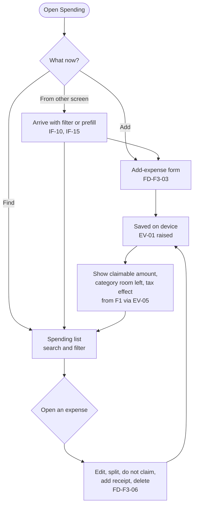
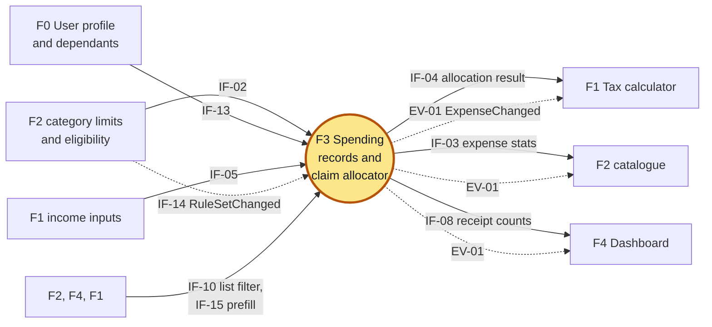
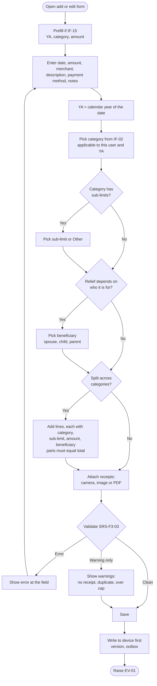
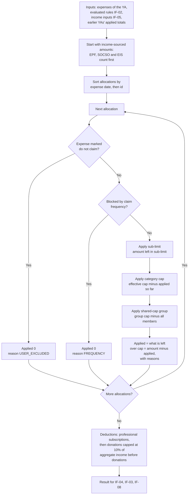
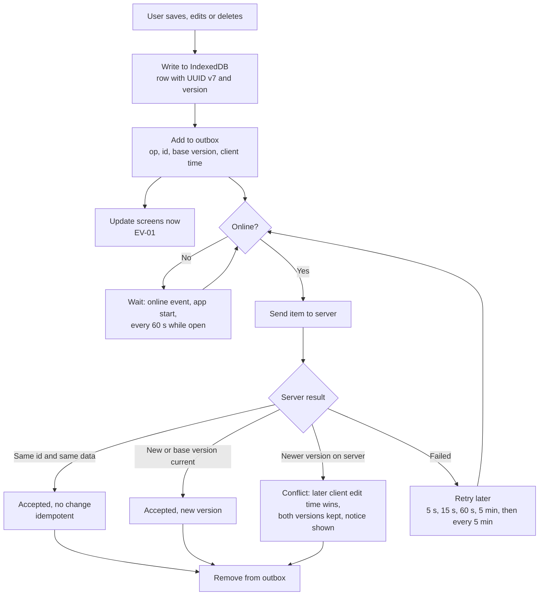
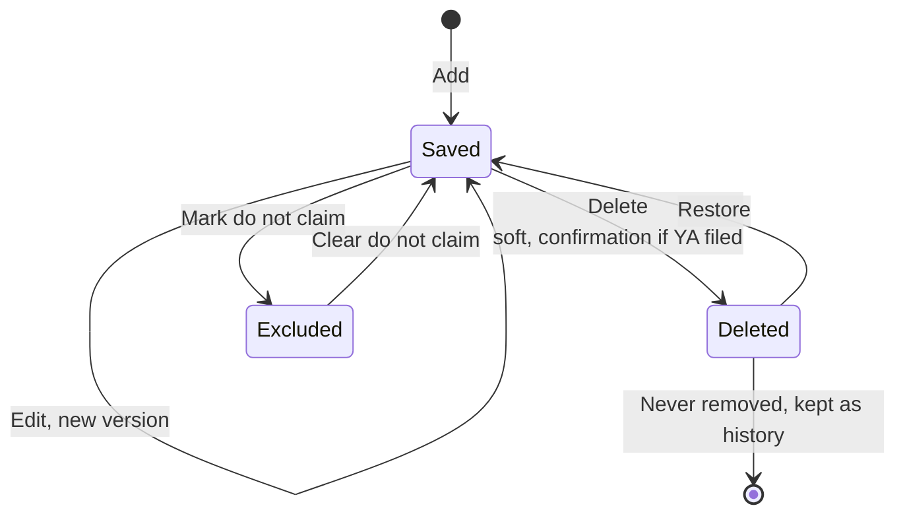
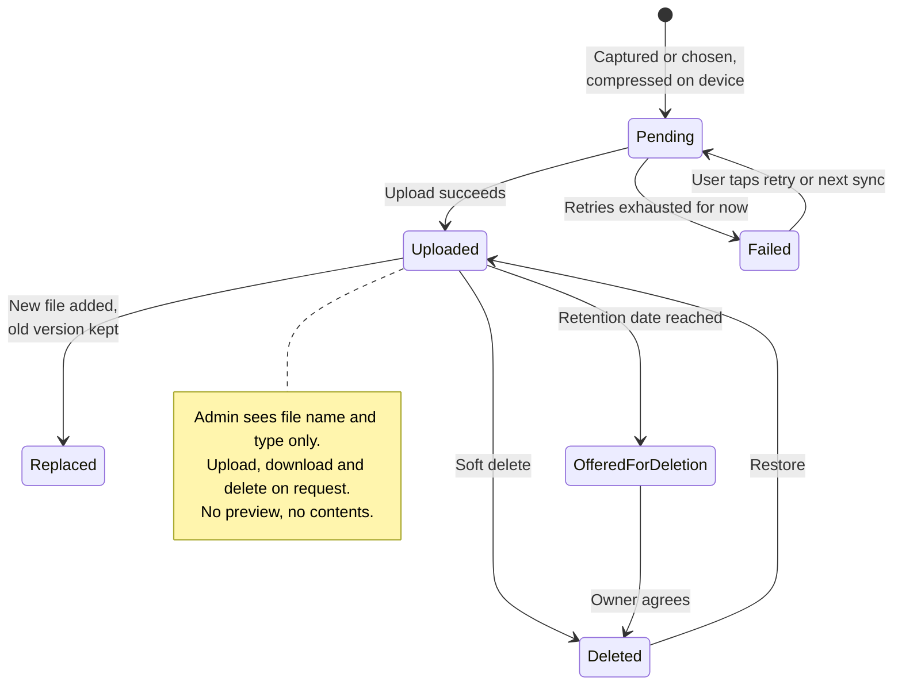
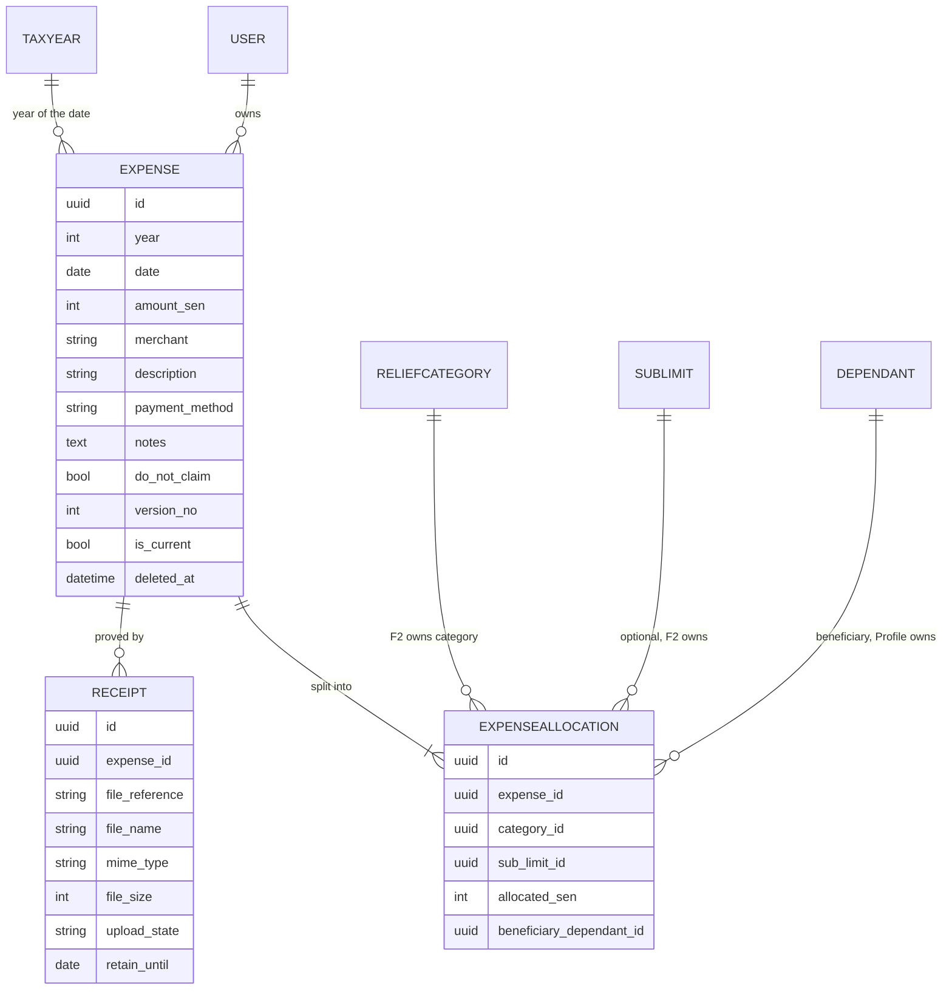
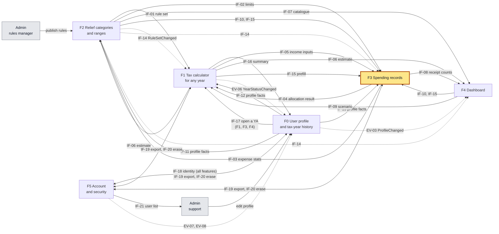
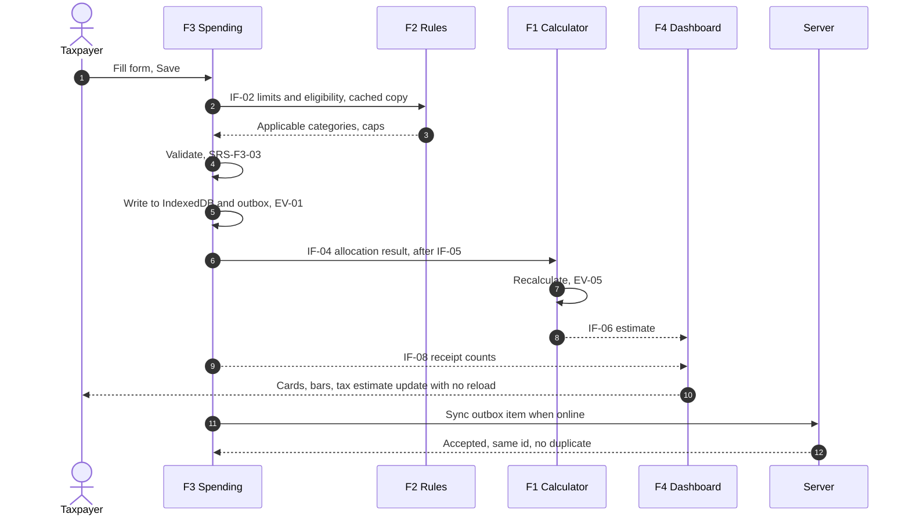

# URS-SRS-F3: Spending records

| Item | Value |
| --- | --- |
| Document ID | URS-SRS-F3 |
| Document type | URS and SRS (user and system requirements) |
| Product | Tax Relief Manager (TRM), Malaysia tax relief system (PWA) |
| Version | 0.14 |
| Status | Draft (for owner review) |
| Date | 2026-11-26 (first written 2026-11-13) |
| Owner | Champs (product owner) |
| PRD reference | PRD-TRM section 3.3 "Spending records", FR-3.1 to FR-3.7 |
| Source | PRD-TRM (written from revision 37; names checked against revision 48); owner prompts P-16, P-38 and P-42; rules checked in RES-002; owner answers to the PRD items (P-60 to P-67); PRD revision 53; stack decisions of P-68 to P-71 (ADR-001); owner decisions of 25/11/2026 on the profile ids and the dependants of a saved calculation (P-101 to P-107); owner decision of 26/11/2026 on the key of HouseholdLink (P-119) |
| Change tracking | [REG-02 URS and SRS change log](../registers/REG_02_URS_SRS_Change_Log.md); work history in [REG-01 History log](../registers/REG_01_History_Log.md); short forms in [REG-03 Acronyms](../registers/REG_03_Acronyms.md) |

## 0. Conventions shared by all six documents

### 0.1 The document set

| Doc | File | Feature (name from the PRD) | PRD requirements covered |
| --- | --- | --- | --- |
| F0 | [URS_SRS_F0_User_Profile.md](URS_SRS_F0_User_Profile.md) | User profile and tax-year history | PRD sections 5, 7, 8; FR-2.3 depends on it (no FR block yet, F-032) |
| F1 | [URS_SRS_F1_Tax_Calculator.md](URS_SRS_F1_Tax_Calculator.md) | Tax calculator for any year (PRD section 3.1, includes PCB) | FR-1.1 to FR-1.11 |
| F2 | [URS_SRS_F2_Relief_Categories.md](URS_SRS_F2_Relief_Categories.md) | Relief categories and ranges (PRD section 3.2, includes the rule sets and the rules admin) | FR-2.1 to FR-2.7 |
| F3 | [URS_SRS_F3_Spending_Records.md](URS_SRS_F3_Spending_Records.md) | Spending records (PRD section 3.3) | FR-3.1 to FR-3.7 |
| F4 | [URS_SRS_F4_Dashboard.md](URS_SRS_F4_Dashboard.md) | Dashboard (PRD section 3.4) | FR-4.1 to FR-4.8 |
| F5 | [URS_SRS_F5_Account_Security.md](URS_SRS_F5_Account_Security.md) | Account and security | NFR-6, NFR-7, NFR-8; PRD sections 7 and 8 (sign in, settings, roles); no FR block yet |

Source: PRD-TRM, the PRD "Malaysia Tax Relief System (PWA)" ([PRD_TRM_Malaysia_Tax_Relief_System.md](../prd/PRD_TRM_Malaysia_Tax_Relief_System.md)), written from revision 37 and checked against revision 48. The PRD is the master for feature names and IDs (AGENTS.md section 6); F0 and F5 have no PRD feature section yet. Logs: [REG_01_History_Log.md](../registers/REG_01_History_Log.md) is the main log of our work; [REG_02_URS_SRS_Change_Log.md](../registers/REG_02_URS_SRS_Change_Log.md) records every detail change to these six documents.

### 0.2 How to read the IDs

| Prefix | Meaning | Where |
| --- | --- | --- |
| URS-Fn-nn | User requirement (n is 0 for the profile document, 1 to 4 for the core features, 5 for account and security), in the owner's terms ("what the user must be able to do") | Part A of the feature document |
| FD-Fn-nn | Flow or state diagram drawn for the URS | Part A |
| SRS-Fn-nn | System requirement: exactly how the application behaves | Part B |
| SQ-Fn-nn | Sequence diagram that shows a specification across features | Part B |
| TC-Fn-nn | Test case with exact inputs and expected outputs | Part B |
| IF-nn | Interface: data one feature passes to another (same list in all six documents) | Section A5 |
| EV-nn | Event that tells other features to refresh | Section A5 |
| FR, BR, NFR | Requirement and rule IDs from the PRD | PRD |
| SD-Fn-nn | **Specification decision**: a detail the PRD does not state, which I filled in. Needs the owner's confirmation. | Part B |
| DA-nn | **Data addition**: a field or table the PRD data model does not have but the specification needs (same list in all six documents, in Part B2 under Data additions) | Part B |
| OI-Fn-nn | Open item: unresolved question | Part B |

Every SRS row has a **Basis** column: the PRD ID it comes from, or SD, DA or OI where I added or could not settle something. Every SRS row has a **Flow** column naming the URS diagram it works from.

### 0.3 Shared terms and rules

| Term | Exact meaning in all six documents |
| --- | --- |
| YA | Year of Assessment. YA 2026 covers income and spending dated 1 Jan to 31 Dec 2026. |
| Current YA | The YA whose period contains today's date. |
| Ended YA | A YA whose period end is before today. |
| Money | Stored as whole sen (integer). RM 1,449.00 is 144900. Displayed as "RM 1,449.00". |
| Rule set | All published, current rows for one YA: TaxYear, TaxBand, RebateRule, ReliefCategory, ReliefRule, SubLimit and (DA-05) RuleTier. |
| Actual spend | The amount the user paid, before any cap. |
| Applied (claimable) | The part of an amount that counts toward relief after sub-limits, category cap, shared cap and claim-frequency rules. |
| Over cap | Actual spend minus applied. |
| Effective cap | The most this user can apply in one category for one YA: fixed cap, cap per dependant times the number of eligible dependants, or the tier that matches the user's facts. |
| Room | Effective cap minus applied, never below zero. A shared-cap group has one room, counted once. |
| Estimate | Any tax figure built on a rule with status Announced, or for a YA that has not ended (it uses only the months entered so far). It is labelled "estimate". |
| Soft delete | deleted_at and deleted_by are set on the current version row. Nothing is removed. |
| Versioned edit | An edit inserts a new row with the next version_no, sets is_current to false on the old row. created_by and updated_by hold the acting user, or the SYSTEM user for system actions. |
| Profile year | The TaxpayerProfile row, with its dependants, that belongs to one YA (DA-16). A user has one current profile per YA. |
| Age at YA end | Whole years completed on the YA's period end (31 December). The default reference date for every age test ([OI-F1-01](URS_SRS_F1_Tax_Calculator.md#oi-f1-01)). |
| Locked profile | The profile of a YA whose UserTaxYear.status is filed. Nobody can change it until the YA is reopened. Derived, not stored ([SD-F0-12](URS_SRS_F0_User_Profile.md#sd-f0-12)). |
| Tax-year history | The list of stored YAs with the stage of each (Not started, In progress, Calculated, Filed), owned by F0. |
| Rounding | Each band's tax is rounded half-up to the nearest sen, then summed ([SD-F1-05](URS_SRS_F1_Tax_Calculator.md#sd-f1-05)). |
| Session | One signed-in period on one browser or device. It ends by sign-out, expiry or revoke (F5). |
| Fresh sign-in | A sign-in within the last 10 minutes. It is asked for again before a sensitive action such as a password change, an export or a deletion ([SD-F5-06](URS_SRS_F5_Account_Security.md#sd-f5-06)). |
| Grace period | The 14 days between a deletion request and the erase. The user can cancel in this time ([SD-F5-08](URS_SRS_F5_Account_Security.md#sd-f5-08)). |
| Retention period | 7 years from the end of the YA (NFR-8), the time the taxpayer should keep records. |
| Release | R1 to R4, the releases of PRD section 9.1: R1 is built in PRD phase 1, R2 in phase 3, R3 in phase 4, R4 in phase 5. R1 is the MVP for the product owner's personal use. R2 items are reserved here only where R1 must leave a hook. |
| Phase | Only a phase of the PRD roadmap (section 9.1): phase 0 Discovery, 1 R1 build, 2 Personal use, 3 R2, 4 R3, 5 R4, then the public launch gate. |
| Basic account | The part of F5 built in R1: the simple account ([SD-F5-17](URS_SRS_F5_Account_Security.md#sd-f5-17)). Called Phase 1 until 23/11/2026. |
| Launch account | The part of F5 held until before the public launch: lockout, emailed links, staying signed in, two-factor login, deletion of the whole account ([SD-F5-17](URS_SRS_F5_Account_Security.md#sd-f5-17)). Called Phase 2 until 23/11/2026. |

---

# Part A. User Requirements Specification (URS)

## A1. Purpose and scope

**Purpose.** F3 records each expense that may qualify for tax relief, with its receipt, and works out how much of it counts (the claimable amount) against the category's cap, sub-limits, shared caps and claim-frequency rules. F3 is the only feature that writes expenses and receipts. It owns the **claim allocator**, the single piece of logic that decides what counts, and F1 and F4 use its result.

**In scope (R1):** expense form with camera capture; validation and duplicate warning; claimable amount; split across categories; edit, soft delete, restore; search and filter; offline use and sync; receipt storage and 7-year retention; filed-YA protection; admin file support by name and type.

**Reserved (R2, R3, R4):** receipt rules engine (R2), bank and e-wallet import (R3), receipt OCR (R4). F3 leaves the receipt and expense fields they will fill.

**Out of scope:** reading receipts automatically; payment.

## A2. Users and roles

| User | What they do in F3 |
| --- | --- |
| Taxpayer | Adds, edits, deletes, restores, searches expenses and receipts |
| Admin | On request, uploads, downloads or deletes a user's files by file name and type. Never sees receipt contents, amounts, merchants or descriptions (PRD section 8). |
| System | Sync jobs; computed results use the SYSTEM user |

## A3. User requirements

| ID | The user must be able to | PRD source | Flow |
| --- | --- | --- | --- |
| URS-F3-01 | Record an expense with date, amount, category, merchant, description, payment method, notes and receipt (camera, image or PDF) | FR-3.1 | [FD-F3-01](URS_SRS_F3_Spending_Records.md#fd-f3-01), [FD-F3-03](URS_SRS_F3_Spending_Records.md#fd-f3-03) |
| URS-F3-02 | Pick only categories that apply to me, have the YA worked out from the date, and see the sub-limit choices of a category | FR-3.1, FR-3.2 | [FD-F3-03](URS_SRS_F3_Spending_Records.md#fd-f3-03) |
| URS-F3-03 | Be stopped by real errors and only warned about the rest: amount, date, eligibility; missing receipt; possible duplicate | FR-3.2 | [FD-F3-03](URS_SRS_F3_Spending_Records.md#fd-f3-03) |
| URS-F3-04 | See the actual spend and the claimable amount of each expense side by side, and why any part does not count | FR-3.3, BR-2, BR-3, BR-4 | [FD-F3-04](URS_SRS_F3_Spending_Records.md#fd-f3-04) |
| URS-F3-05 | Split one expense across categories so the parts add up to the total and nothing is claimed twice | FR-3.4, BR-8 | [FD-F3-03](URS_SRS_F3_Spending_Records.md#fd-f3-03) |
| URS-F3-06 | Edit, delete (without losing it), search and filter expenses by YA, category, date and receipt status | FR-3.5 | [FD-F3-01](URS_SRS_F3_Spending_Records.md#fd-f3-01), [FD-F3-06](URS_SRS_F3_Spending_Records.md#fd-f3-06) |
| URS-F3-07 | Add and edit expenses offline, and have them sync later without duplicates or lost edits | FR-3.6, NFR-2 | [FD-F3-05](URS_SRS_F3_Spending_Records.md#fd-f3-05) |
| URS-F3-08 | Be warned, and confirm, before deleting or changing anything that belongs to a filed YA | FR-3.7 | [FD-F3-06](URS_SRS_F3_Spending_Records.md#fd-f3-06) |
| URS-F3-09 | Keep each receipt for 7 years from the end of the YA, and see its upload state | NFR-3, NFR-8 | [FD-F3-07](URS_SRS_F3_Spending_Records.md#fd-f3-07) |
| URS-F3-10 | Mark an expense "do not claim" so it stays recorded but does not count | BR-2 | [FD-F3-04](URS_SRS_F3_Spending_Records.md#fd-f3-04) |
| URS-F3-11 | See, right after saving, what the expense did to the category's remaining room and the estimate | FR-3.x acceptance, FR-4 acceptance | [FD-F3-01](URS_SRS_F3_Spending_Records.md#fd-f3-01) |
| URS-F3-12 | See the history of every change to an expense or receipt | NFR-9 | [FD-F3-08](URS_SRS_F3_Spending_Records.md#fd-f3-08) |
| URS-F3-13 | Say who an expense is for (me, spouse, a child, a parent) where the relief depends on it | BR-11, section 2.3 | [FD-F3-03](URS_SRS_F3_Spending_Records.md#fd-f3-03) |
| URS-F3-14 | (Admin) Help with a user's files by file name and type, without opening any confidential data | PRD section 8 | [FD-F3-07](URS_SRS_F3_Spending_Records.md#fd-f3-07) |
| URS-F3-15 | Have my spending records and receipt files included in my data export and deleted when I delete my account | PRD sections 7 and 8, NFR-7, NFR-8 | [FD-F5-09](URS_SRS_F5_Account_Security.md#fd-f5-09), [FD-F5-10](URS_SRS_F5_Account_Security.md#fd-f5-10) |

## A4. Flow diagrams

**[FD-F3-01](URS_SRS_F3_Spending_Records.md#fd-f3-01). User flow in spending records**

**[FD-F3-02](URS_SRS_F3_Spending_Records.md#fd-f3-02). What F3 receives from and gives to other features**

**[FD-F3-03](URS_SRS_F3_Spending_Records.md#fd-f3-03). Add or edit an expense**

**[FD-F3-04](URS_SRS_F3_Spending_Records.md#fd-f3-04). Claim allocation: how much of an expense counts** (the allocator, [SRS-F3-06](URS_SRS_F3_Spending_Records.md#srs-f3-06) to [SRS-F3-08](URS_SRS_F3_Spending_Records.md#srs-f3-08))

**[FD-F3-05](URS_SRS_F3_Spending_Records.md#fd-f3-05). Offline capture and sync**

**[FD-F3-06](URS_SRS_F3_Spending_Records.md#fd-f3-06). Life of an expense**

**[FD-F3-07](URS_SRS_F3_Spending_Records.md#fd-f3-07). Life of a receipt, and the admin's file actions**

**[FD-F3-08](URS_SRS_F3_Spending_Records.md#fd-f3-08). Data held by F3 and the entities it connects to**

## A5. Relationship with other features

**FD-00. System map of the profile (F0), the four core features and account and security (F5) (identical in all six documents; the feature of this document is highlighted)**

Reading the map: a solid arrow is data a feature reads or receives; a dashed arrow is an event. F0 owns the profile and the profile of every YA; the four core features only read it. F5 owns the account and the sign-in; it tells every feature who is signed in (IF-18, drawn once, to F0), asks F0, F1 and F3 for their part of a data export (IF-19) and tells them to erase (IF-20). F2 and F4 own no user data, so they take part only through IF-18. F1 and F3 depend on each other, so the order of calculation is fixed: F1 sends income inputs (IF-05), F3 allocates claims (IF-04), then F1 finishes the tax chain. That order is drawn in [SQ-F1-01](URS_SRS_F1_Tax_Calculator.md#sq-f1-01).

**Interfaces (identical in all six documents).** "Provider spec" is the SRS row that builds the data; "Consumer spec" is the SRS row that uses it.

| ID | From | To | Data carried | Trigger | Provider spec | Consumer spec |
| --- | --- | --- | --- | --- | --- | --- |
| IF-01 | F2 | F1 | Rule set of the selected YA plus, for this user, the evaluated rules: per category applicable or not, effective cap, tier, sub-limits, shared group, claim frequency | YA selected; EV-03; EV-04 | [SRS-F2-13](URS_SRS_F2_Relief_Categories.md#srs-f2-13) | [SRS-F1-01](URS_SRS_F1_Tax_Calculator.md#srs-f1-01) |
| IF-02 | F2 | F3 | Categories open to this user for the YA, with limits, sub-limits, shared group, frequency, required documents, beneficiary rule | Expense form opened; YA changed; EV-04 | [SRS-F2-13](URS_SRS_F2_Relief_Categories.md#srs-f2-13) | [SRS-F3-02](URS_SRS_F3_Spending_Records.md#srs-f3-02) |
| IF-03 | F3 | F2 | Per category: expense count, actual spend, applied, over cap, expenses missing a receipt | Category detail opened; EV-01 | [SRS-F3-14](URS_SRS_F3_Spending_Records.md#srs-f3-14) | [SRS-F2-06](URS_SRS_F2_Relief_Categories.md#srs-f2-06) |
| IF-04 | F3 | F1 | Allocation result: applied amount per category (spending and income-sourced), deductions applied, aggregate income before donations | Any change to expenses, income, profile or rules | [SRS-F3-14](URS_SRS_F3_Spending_Records.md#srs-f3-14) | [SRS-F1-06](URS_SRS_F1_Tax_Calculator.md#srs-f1-06) |
| IF-05 | F1 | F3 | Income inputs: total income for the YA, and the amount already counted by income-sourced categories (employee EPF, SOCSO and EIS) | EV-02 | [SRS-F1-05](URS_SRS_F1_Tax_Calculator.md#srs-f1-05) | [SRS-F3-07](URS_SRS_F3_Spending_Records.md#srs-f3-07) |
| IF-06 | F1 | F2, F4 | Estimate: full tax chain, reliefs by category (applied, effective cap, room, source), PCB figures, labels | Every recalculation (EV-05) | [SRS-F1-07](URS_SRS_F1_Tax_Calculator.md#srs-f1-07), [SRS-F1-13](URS_SRS_F1_Tax_Calculator.md#srs-f1-13) | [SRS-F2-05](URS_SRS_F2_Relief_Categories.md#srs-f2-05), [SRS-F4-02](URS_SRS_F4_Dashboard.md#srs-f4-02) |
| IF-07 | F2 | F4 | Catalogue summary (category, group, status, effective cap), TaxYear dates (period, filing deadline) | YA selected; EV-04 | [SRS-F2-13](URS_SRS_F2_Relief_Categories.md#srs-f2-13) | [SRS-F4-02](URS_SRS_F4_Dashboard.md#srs-f4-02) |
| IF-08 | F3 | F4 | Receipt counts per category and in total: with receipt, missing, pending upload; expense counts | EV-01 | [SRS-F3-14](URS_SRS_F3_Spending_Records.md#srs-f3-14) | [SRS-F4-04](URS_SRS_F4_Dashboard.md#srs-f4-04), [SRS-F4-08](URS_SRS_F4_Dashboard.md#srs-f4-08) |
| IF-09 | F4 | F1 | Scenario request (as recorded for any YA, no reliefs, use room of listed categories, use all room) and the scenario estimate | Dashboard load; EV-05 | [SRS-F1-18](URS_SRS_F1_Tax_Calculator.md#srs-f1-18) | [SRS-F4-05](URS_SRS_F4_Dashboard.md#srs-f4-05), [SRS-F4-06](URS_SRS_F4_Dashboard.md#srs-f4-06) |
| IF-10 | F2, F4 | F3 | Navigate to the spending list with a filter: YA, category, receipt status | User taps a count or alert | [SRS-F3-15](URS_SRS_F3_Spending_Records.md#srs-f3-15) | [SRS-F2-06](URS_SRS_F2_Relief_Categories.md#srs-f2-06), [SRS-F4-11](URS_SRS_F4_Dashboard.md#srs-f4-11) |
| IF-11 | F0 | F2 | Profile facts of the selected YA: marital status, spouse income and disability, own disability, dependants with date of birth, education level and disability, first-home facts, whether the dependants list is confirmed, and whether the profile is complete | EV-03 | [SRS-F0-15](URS_SRS_F0_User_Profile.md#srs-f0-15) | [SRS-F2-04](URS_SRS_F2_Relief_Categories.md#srs-f2-04) |
| IF-12 | F0 | F1 | The same profile facts and the complete flag | EV-03 | [SRS-F0-15](URS_SRS_F0_User_Profile.md#srs-f0-15) | [SRS-F1-04](URS_SRS_F1_Tax_Calculator.md#srs-f1-04) |
| IF-13 | F0 | F3 | The same profile facts and the complete flag of the YA the expense falls in, used to check eligibility and the beneficiary | EV-03 | [SRS-F0-15](URS_SRS_F0_User_Profile.md#srs-f0-15) | [SRS-F3-02](URS_SRS_F3_Spending_Records.md#srs-f3-02), [SRS-F3-03](URS_SRS_F3_Spending_Records.md#srs-f3-03) |
| IF-14 | F2 | F1, F3, F4 | RuleSetChanged event: YA and new rule version | Admin publishes ([SRS-F2-11](URS_SRS_F2_Relief_Categories.md#srs-f2-11)) | [SRS-F2-11](URS_SRS_F2_Relief_Categories.md#srs-f2-11) | [SRS-F1-15](URS_SRS_F1_Tax_Calculator.md#srs-f1-15), [SRS-F3-14](URS_SRS_F3_Spending_Records.md#srs-f3-14), [SRS-F4-10](URS_SRS_F4_Dashboard.md#srs-f4-10) |
| IF-15 | F1, F2, F4 | F3 | Open the add-expense form pre-filled: YA, category, optional sub-limit, optional amount | User taps "Add as expense" | [SRS-F3-15](URS_SRS_F3_Spending_Records.md#srs-f3-15) | [SRS-F1-16](URS_SRS_F1_Tax_Calculator.md#srs-f1-16), [SRS-F2-06](URS_SRS_F2_Relief_Categories.md#srs-f2-06), [SRS-F4-11](URS_SRS_F4_Dashboard.md#srs-f4-11) |
| IF-16 | F1 | F0 | Tax-year summary for every stored YA: status and filed date, whether income exists, the live estimate (tax payable, total reliefs, chargeable income, labels) and the saved calculations (id, trigger, date, figures, profile id and profile version used, and the row ids of the dependants used) | History list or detail opened; EV-05; EV-06 | [SRS-F1-23](URS_SRS_F1_Tax_Calculator.md#srs-f1-23) | [SRS-F0-11](URS_SRS_F0_User_Profile.md#srs-f0-11), [SRS-F0-12](URS_SRS_F0_User_Profile.md#srs-f0-12) |
| IF-17 | F0 | F1, F3, F4 | Open a feature for a chosen YA, with an optional filter (F3: receipt status) | User taps an action on a tax year | [SRS-F0-12](URS_SRS_F0_User_Profile.md#srs-f0-12) | [SRS-F1-01](URS_SRS_F1_Tax_Calculator.md#srs-f1-01), [SRS-F3-15](URS_SRS_F3_Spending_Records.md#srs-f3-15), [SRS-F4-01](URS_SRS_F4_Dashboard.md#srs-f4-01) |
| IF-18 | F5 | F0, F1, F3 (F2 and F4 read the role only, [OI-F5-05](URS_SRS_F5_Account_Security.md#oi-f5-05)) | Signed-in identity: user id, role (user or admin), language, session expiry, device id, whether two-factor login is on | App start; sign-in; session refresh; EV-07; EV-08 | [SRS-F5-18](URS_SRS_F5_Account_Security.md#srs-f5-18) | [SRS-F0-19](URS_SRS_F0_User_Profile.md#srs-f0-19), [SRS-F1-24](URS_SRS_F1_Tax_Calculator.md#srs-f1-24), [SRS-F3-18](URS_SRS_F3_Spending_Records.md#srs-f3-18) |
| IF-19 | F0, F1, F3 | F5 | Export part: every row the feature owns for the user, all versions, as records, plus the list of files (F3) | The export job runs ([SRS-F5-14](URS_SRS_F5_Account_Security.md#srs-f5-14)) | [SRS-F0-19](URS_SRS_F0_User_Profile.md#srs-f0-19), [SRS-F1-24](URS_SRS_F1_Tax_Calculator.md#srs-f1-24), [SRS-F3-18](URS_SRS_F3_Spending_Records.md#srs-f3-18) | [SRS-F5-14](URS_SRS_F5_Account_Security.md#srs-f5-14) |
| IF-20 | F5 | F0, F1, F3 | Erase request: delete every row and file of the user, or, when the request names a YA, only the rows and files of that YA, and answer with the counts | The user confirms the deletion of a YA past its 7 years ([SRS-F5-21](URS_SRS_F5_Account_Security.md#srs-f5-21)); in the launch account also when the grace period ends ([SRS-F5-16](URS_SRS_F5_Account_Security.md#srs-f5-16)) | [SRS-F5-16](URS_SRS_F5_Account_Security.md#srs-f5-16), [SRS-F5-21](URS_SRS_F5_Account_Security.md#srs-f5-21) | [SRS-F0-19](URS_SRS_F0_User_Profile.md#srs-f0-19), [SRS-F1-24](URS_SRS_F1_Tax_Calculator.md#srs-f1-24), [SRS-F3-18](URS_SRS_F3_Spending_Records.md#srs-f3-18) |
| IF-21 | F5 | F0 | User list for support: user id, name, email, status, role, two-factor flag, last sign-in date; no tax data | An admin opens the user list | [SRS-F5-17](URS_SRS_F5_Account_Security.md#srs-f5-17) | [SRS-F0-16](URS_SRS_F0_User_Profile.md#srs-f0-16) |

**Events**

| ID | Event | Raised by | Heard by |
| --- | --- | --- | --- |
| EV-01 | ExpenseChanged (ya, expense ids) | F3, after every local save, edit, delete or sync | F1, F2, F4 |
| EV-02 | IncomeChanged (ya) | F1, after every income or PCB save | F3 (refresh IF-05), F4 |
| EV-03 | ProfileChanged (ya, profile id, version) | F0, after every profile or dependant save, copy to a new YA, or apply to later YAs | F1, F2, F3, F4 |
| EV-04 | RuleSetChanged (ya, version) = IF-14 | F2 | F1, F3, F4 |
| EV-05 | EstimateComputed (ya) | F1, after every recalculation | F2, F4 |
| EV-06 | YearStatusChanged (ya, status filed or open) | F1, after mark as filed or reopen ([SRS-F1-21](URS_SRS_F1_Tax_Calculator.md#srs-f1-21)) | F0, F4 |
| EV-07 | AccountStatusChanged (user, status active, disabled or deletion_pending) | F5, after an admin disables or enables the account, a deletion request or its cancel ([SRS-F5-15](URS_SRS_F5_Account_Security.md#srs-f5-15), [SRS-F5-17](URS_SRS_F5_Account_Security.md#srs-f5-17)) | F0, F1, F3 |
| EV-08 | SessionEnded (user, device, reason: signed out, expired, revoked, password changed) | F5, whenever a session ends ([SRS-F5-08](URS_SRS_F5_Account_Security.md#srs-f5-08), [SRS-F5-09](URS_SRS_F5_Account_Security.md#srs-f5-09)) | F0, F1, F3 |

**Data ownership (identical in all six documents).** O = owns and writes; R = reads; Agg = reads only aggregated results through an interface; none = no access. Export and erase mean the feature supplies its part to F5 (IF-19) and deletes it on request (IF-20). "Admin" can touch the profile (while its YA is not filed), the account's name and language, and file names only.

| Entity | F0 | F1 | F2 | F3 | F4 | F5 | Admin |
| --- | --- | --- | --- | --- | --- | --- | --- |
| User.name, User.language, TaxpayerProfile (one per YA, DA-16), Dependant, HouseholdLink | O | R (IF-12) | R (IF-11) | R (IF-13) | none | Export, erase | Manage name, language and profile fields of a YA that is not filed |
| User.email, role, status; Credential, Session, ConsentRecord, Invitation, DataRequest, SecurityEvent (DA-21 to DA-24) | R (IF-18) | R (IF-18) | R (IF-18, role) | R (IF-18) | R (IF-18, role) | O | Invite, disable, enable, send a reset email. No password, no email change, no two-factor off |
| IncomeRecord | none | O | none | Agg (IF-05) | Agg (IF-06) | Export, erase | none |
| UserTaxYear (DA-12: filed status per user) | R (lock follows status) | O | none | R | R | Export, erase | none |
| TaxEstimate, TaxEstimateDependant (DA-29) | Agg (IF-16) | O | Agg (IF-06) | none | R | Export, erase | none |
| TaxYear, TaxBand, RebateRule | none | R (IF-01) | O | none | R (IF-07) | none | Create and edit |
| RuleTestRun (DA-27) | none | none | O | none | none | none | Runs the tests in the browser; no edit |
| ReliefCategory, ReliefRule, SubLimit, RuleTier | none | R (IF-01) | O | R (IF-02) | R (IF-07) | none | Create and edit |
| Expense, ExpenseAllocation | none | Agg (IF-04) | Agg (IF-03) | O | Agg (IF-08) | Export, erase | none (amounts and descriptions are confidential) |
| Receipt | none | none | none | O | Agg (IF-08) | Export, erase | File name and type only; upload, download, delete on request ([OI-F3-01](URS_SRS_F3_Spending_Records.md#oi-f3-01)) |

**A5.4 Inter-related data for F3**

| Data | Direction | Other feature | What F3 uses it for, or gives it for | Interface | If it is missing or late |
| --- | --- | --- | --- | --- | --- |
| Category limits, sub-limits, groups, frequency, documents, beneficiary rule | in | F2 | Category picker, validation, allocator | IF-02 | Form shows "Rules not loaded"; saving is blocked until rules are cached |
| Profile facts and dependants of the YA the expense falls in | in | F0 | Eligibility checks, beneficiary list | IF-13 | Profile Incomplete: F3 shows the gate and accepts no expense for that YA ([SRS-F0-03](URS_SRS_F0_User_Profile.md#srs-f0-03)) |
| Income inputs: total income, EPF, SOCSO and EIS amounts | in | F1 | Donation cap, shared caps, SOCSO cap | IF-05 | Allocator waits for the input; shows "Updating" |
| Allocation result | out | F1 | Spending reliefs and deductions in the tax chain | IF-04 | Not applicable |
| Expense statistics per category | out | F2 | Category detail | IF-03 | Not applicable |
| Receipt and expense counts | out | F4 | Missing-receipt counts and alerts | IF-08 | Not applicable |
| Entry points: list filter, prefilled form | in | F1, F2, F4 | Open the right list or form | IF-10, IF-15 | Not applicable |
| RuleSetChanged | in | F2 | Recompute claimable | IF-14 | Not applicable |
| ExpenseChanged | out | F1, F2, F4 | Refresh | EV-01 | Not applicable |
| Signed-in identity: user id, role | in | F5 | Decide whose expenses and files F3 reads and writes; admins only reach file support ([SRS-F3-17](URS_SRS_F3_Spending_Records.md#srs-f3-17)) | IF-18 | Offline, the identity stored at the last sign-in is used until the session expires ([SRS-F5-09](URS_SRS_F5_Account_Security.md#srs-f5-09)) |
| Export part of the spending data and the receipt files | out | F5 | The user's data export | IF-19 | Not applicable |
| Erase request | in | F5 | Delete the user's expenses, allocations, receipts and stored files when the grace period ends | IF-20 | F5 repeats the request until F3 confirms ([SRS-F5-16](URS_SRS_F5_Account_Security.md#srs-f5-16)) |
| AccountStatusChanged, SessionEnded | in | F5 | Stop uploads and the outbox | EV-07, EV-08 | F3 learns on the next server call, which is refused with the same notice |

## A6. Assumptions and constraints

1. Claimable amounts are derived at read time and never stored (PRD section 5). Only the final estimate is saved, by F1.
2. Money is whole sen.
3. Receipts are private, encrypted storage; the admin never sees contents (NFR-6, PRD section 8).
4. The claim order rule is BR-2: expenses fill the cap in date order.

---

# Part B. System Requirements Specification (SRS)

## B1. Functional specifications

### B1.1 Recording an expense

| ID | Specification | Basis | URS | Flow | Test |
| --- | --- | --- | --- | --- | --- |
| SRS-F3-01 | **Expense form.** Fields: date (required, default today), amount in RM with up to 2 decimals (required), category (required), sub-limit (if the category has any), beneficiary (if required, [SRS-F3-02](URS_SRS_F3_Spending_Records.md#srs-f3-02)), merchant (required, 1 to 100 characters), description (optional, up to 300), payment method (cash, debit or credit card, e-wallet, bank transfer, other; required), notes (optional, up to 1,000), "Do not claim" (switch, default off, DA-01), receipts (0 to 5 files, [SRS-F3-05](URS_SRS_F3_Spending_Records.md#srs-f3-05)), split lines ([SRS-F3-09](URS_SRS_F3_Spending_Records.md#srs-f3-09)). Buttons: Save, Save and add another, Cancel. After Save the screen shows: actual spend, claimable amount, category room left, and, when F1 has answered (EV-05), the change in tax payable. | FR-3.1, DA-01 | [URS-F3-01](URS_SRS_F3_Spending_Records.md#urs-f3-01), [URS-F3-11](URS_SRS_F3_Spending_Records.md#urs-f3-11) | [FD-F3-03](URS_SRS_F3_Spending_Records.md#fd-f3-03) | [TC-F3-01](URS_SRS_F3_Spending_Records.md#tc-f3-01), [TC-F3-02](URS_SRS_F3_Spending_Records.md#tc-f3-02) |
| SRS-F3-02 | **YA, category, sub-limit, beneficiary.** 1. YA = the calendar year of the date. If the profile of that YA is Incomplete, F3 shows the gate "Complete your profile for YA {y}" and accepts no expense for it ([SRS-F0-03](URS_SRS_F0_User_Profile.md#srs-f0-03)). 2. The category list comes from IF-02 for that YA: categories with amount source S, or I and S (SOCSO), that are applicable for this user, and not retired. 3. Categories that are not applicable are not offered; a user who needs one is told to update the profile (link). 4. When the chosen category has sub-limits, the user picks one or "Other" (counts only against the category cap). 5. A beneficiary is required when the category's beneficiary_rule is set: R08 (a parent), R23 (a child within the age limit), R24 (a child aged 2 or below), R07 (self, spouse or a child), R09 (the disabled person). The choices come from the profile of the YA the date falls in (IF-13). A dependant removed later (F0 [SD-F0-13](URS_SRS_F0_User_Profile.md#sd-f0-13)) stays on old expenses as "(removed)" and is not offered for new ones. The date is used to test age for the beneficiary on the rule's reference date ([OI-F1-01](URS_SRS_F1_Tax_Calculator.md#oi-f1-01)). | FR-3.1, FR-3.2, BR-11, DA-15 | [URS-F3-02](URS_SRS_F3_Spending_Records.md#urs-f3-02), [URS-F3-13](URS_SRS_F3_Spending_Records.md#urs-f3-13) | [FD-F3-03](URS_SRS_F3_Spending_Records.md#fd-f3-03) | [TC-F3-12](URS_SRS_F3_Spending_Records.md#tc-f3-12), [TC-F3-20](URS_SRS_F3_Spending_Records.md#tc-f3-20) |
| SRS-F3-03 | **Validation.** **Errors (save is blocked):** amount not above RM 0.00, or above RM 99,999,999.99; date missing or invalid; date after today; date in a year with no rule set; the profile of that year is Incomplete (gate, [SRS-F0-03](URS_SRS_F0_User_Profile.md#srs-f0-03)); no category; category not eligible, meaning not applicable to the profile (message "Your profile says this does not apply. Update your profile.") or retired; beneficiary missing or not eligible (for example a child above the age limit); split parts not equal to the total; a required field missing; more than 5 receipts; a receipt of a type or size not allowed. **Warnings (user may save):** no receipt attached; possible duplicate ([SRS-F3-04](URS_SRS_F3_Spending_Records.md#srs-f3-04)); the expense will not fully count (shows how much is over cap); the date is in a filed YA (asks to confirm, [SRS-F3-11](URS_SRS_F3_Spending_Records.md#srs-f3-11)); the form was opened under a YA filter different from the date's YA ("This expense belongs to YA {year}"). Every message is shown at its field, not as a pop-up. | FR-3.2, [SD-F3-01](URS_SRS_F3_Spending_Records.md#sd-f3-01) | [URS-F3-03](URS_SRS_F3_Spending_Records.md#urs-f3-03) | [FD-F3-03](URS_SRS_F3_Spending_Records.md#fd-f3-03) | [TC-F3-04](URS_SRS_F3_Spending_Records.md#tc-f3-04), [TC-F3-05](URS_SRS_F3_Spending_Records.md#tc-f3-05), [TC-F3-12](URS_SRS_F3_Spending_Records.md#tc-f3-12), [TC-F3-15](URS_SRS_F3_Spending_Records.md#tc-f3-15), [TC-F3-20](URS_SRS_F3_Spending_Records.md#tc-f3-20) |
| SRS-F3-04 | **Duplicate detection.** Before saving, find another current, non-deleted expense of the same user with the same merchant (trimmed, case-insensitive), the same date and the same amount, excluding the one being edited. If found, warn with a link to the existing record; the user may "Save anyway" or "Cancel". The check runs on the device and, after sync, on the server (a server hit sets a "possible duplicate" mark on the later record and shows it in the list). | FR-3.2 | [URS-F3-03](URS_SRS_F3_Spending_Records.md#urs-f3-03) | [FD-F3-03](URS_SRS_F3_Spending_Records.md#fd-f3-03) | [TC-F3-05](URS_SRS_F3_Spending_Records.md#tc-f3-05) |
| SRS-F3-05 | **Receipts.** 1. Sources: camera capture, image (JPEG, PNG, HEIC, WebP) or PDF; up to 5 per expense. 2. Images are compressed on the device to at most 1,600 px on the long edge as JPEG at quality 80 ([SD-F3-02](URS_SRS_F3_Spending_Records.md#sd-f3-02)); PDFs are not changed; each file at most 10 MB after compression. 3. Each file is a Receipt row with upload_state pending, uploaded or failed (DA-11), file_name, file_size and mime_type. A pending file counts as attached. 4. Upload runs in the background, with retries at 5 s, 15 s, 60 s, 5 min and then every 5 min until it succeeds; the user can tap retry. 5. Files go to private, encrypted object storage; file_reference is an opaque key. 6. retain_until = 31 December of the YA's year plus 7 years. When it passes, F3 offers deletion; it never deletes by itself. 7. Replacing a file adds a new version; the old file is kept until retain_until. 8. Deleting a receipt is a soft delete. | FR-3.1, NFR-3, NFR-8, DA-11, [SD-F3-02](URS_SRS_F3_Spending_Records.md#sd-f3-02) | [URS-F3-09](URS_SRS_F3_Spending_Records.md#urs-f3-09) | [FD-F3-07](URS_SRS_F3_Spending_Records.md#fd-f3-07) | [TC-F3-13](URS_SRS_F3_Spending_Records.md#tc-f3-13), [TC-F3-17](URS_SRS_F3_Spending_Records.md#tc-f3-17) |

### B1.2 Claim allocation

| ID | Specification | Basis | URS | Flow | Test |
| --- | --- | --- | --- | --- | --- |
| SRS-F3-06 | **Claim allocator (one implementation for F1, F3 and F4).** Input: user, YA, evaluated rules (IF-02), current non-deleted ExpenseAllocation rows with their expense, income inputs (IF-05), and applied totals of earlier YAs. Algorithm for relief categories, all in sen: 1. State starts empty: running amount per sub-limit, per category, per shared group. 2. Income-sourced amounts first ([SRS-F3-07](URS_SRS_F3_Spending_Records.md#srs-f3-07)). 3. Sort allocations by expense date ascending, then allocation id (UUID v7, so creation order) (DA-02). 4. For each allocation with amount x: if its expense is do_not_claim, applied = 0 with reason USER_EXCLUDED; else if the category has no rule in the YA, applied = 0 with reason NO_RULE and the expense is listed under "Needs attention"; else if blocked by claim frequency ([SRS-F3-08](URS_SRS_F3_Spending_Records.md#srs-f3-08)), applied = 0 with reason FREQUENCY; else: sub_ok = x if no sub-limit, otherwise min(x, sub-limit cap minus running sub-limit); cat_ok = min(sub_ok, effective cap minus running category); grp_ok = cat_ok if the category has no shared group, otherwise min(cat_ok, group cap minus running group). applied = grp_ok. Update running amounts: sub-limit by sub_ok, category by applied, group by applied. over cap = x minus applied, with a reason split: SUBLIMIT = x minus sub_ok, CATEGORY_CAP = sub_ok minus cat_ok, GROUP_CAP = cat_ok minus grp_ok. 5. Deductions: [SRS-F3-07](URS_SRS_F3_Spending_Records.md#srs-f3-07). 6. Output per allocation: applied, over cap with reasons; per category: expense count, actual total, applied total, over total; per group and per deduction: applied total. Editing an earlier expense can change later expenses' applied amounts; this is by design (BR-2). The allocator is a pure function and runs in under 100 ms for 2,000 allocations. | FR-3.3, BR-2, BR-3, BR-4, DA-02 | [URS-F3-04](URS_SRS_F3_Spending_Records.md#urs-f3-04), [URS-F3-10](URS_SRS_F3_Spending_Records.md#urs-f3-10) | [FD-F3-04](URS_SRS_F3_Spending_Records.md#fd-f3-04) | [TC-F3-01](URS_SRS_F3_Spending_Records.md#tc-f3-01), [TC-F3-02](URS_SRS_F3_Spending_Records.md#tc-f3-02), [TC-F3-07](URS_SRS_F3_Spending_Records.md#tc-f3-07), [TC-F3-08](URS_SRS_F3_Spending_Records.md#tc-f3-08), [TC-F3-11](URS_SRS_F3_Spending_Records.md#tc-f3-11) |
| SRS-F3-07 | **Income inputs, shared caps and deductions.** From IF-05, F3 gets total_income and prior_amounts per income-sourced category (R14 employee EPF, R18 SOCSO and EIS). 1. Before any expense, each prior amount is applied: first to the category's income sub-limit when it has one (R18 in YA 2027: MANDATORY 350), then to the category cap (R14: 4,000), then to the group cap. Additional voluntary EPF contributions are entered as expenses under R15, because LHDN counts them inside its RM 3,000 limit. Prior amounts of categories in one group are applied in code order. 2. Deductions: D02 professional subscriptions are applied in full (no cap). Aggregate income before donations = max(0, total_income minus D02 applied). The D01 cap = floor(aggregate income before donations x 10 / 100) in sen (cap_basis percent_of_aggregate, DA-05; [OI-F3-02](URS_SRS_F3_Spending_Records.md#oi-f3-02)). Donations are applied in date order up to that cap; the rest is over cap with reason DONATION_CAP. 3. The allocator returns aggregate income before donations to F1 inside IF-04, so F1 and F3 use the same figure. | BR-3, BR-4, BR-7, DA-05, [OI-F3-02](URS_SRS_F3_Spending_Records.md#oi-f3-02) | [URS-F3-04](URS_SRS_F3_Spending_Records.md#urs-f3-04) | [FD-F3-04](URS_SRS_F3_Spending_Records.md#fd-f3-04) | [TC-F3-08](URS_SRS_F3_Spending_Records.md#tc-f3-08), [TC-F3-09](URS_SRS_F3_Spending_Records.md#tc-f3-09), [TC-F3-22](URS_SRS_F3_Spending_Records.md#tc-f3-22) |
| SRS-F3-08 | **Claim frequency.** F3 applies the configuration of [SRS-F2-14](URS_SRS_F2_Relief_Categories.md#srs-f2-14). Applied totals of earlier YAs are produced by this same allocator, oldest YA first, each YA using only earlier YAs. once_every_n_ya: blocked when the category has applied > 0 in any of the previous n minus 1 YAs. once_in_period: blocked when an earlier YA inside the period has applied > 0. max_claim_years (m): blocked when the m YAs just before this one are all applied > 0. When the user saves an expense in a blocked category F3 warns: "Already claimed in YA {y}; this relief can be claimed once every {n} YAs." The expense is kept with applied 0 and reason FREQUENCY. | BR-5, DA-06 | [URS-F3-04](URS_SRS_F3_Spending_Records.md#urs-f3-04) | [FD-F3-04](URS_SRS_F3_Spending_Records.md#fd-f3-04) | [TC-F3-10](URS_SRS_F3_Spending_Records.md#tc-f3-10), [TC-F3-18](URS_SRS_F3_Spending_Records.md#tc-f3-18) |
| SRS-F3-09 | **Split.** One expense has one or more ExpenseAllocation lines. A single-category expense has exactly one line equal to the total. In split mode the user adds lines (category, sub-limit, beneficiary, amount). Rule: the sum of line amounts equals the expense amount to the sen; the form shows "RM {x} left to allocate" and blocks saving until it is 0.00. A category may appear once per expense. Editing the expense total in split mode clears the "left to allocate" check and asks the user to fix the lines. The same expense cannot be counted under two categories except through a split (BR-8). | FR-3.4, BR-8 | [URS-F3-05](URS_SRS_F3_Spending_Records.md#urs-f3-05) | [FD-F3-03](URS_SRS_F3_Spending_Records.md#fd-f3-03) | [TC-F3-04](URS_SRS_F3_Spending_Records.md#tc-f3-04) |

### B1.3 Edit, delete, search, offline

| ID | Specification | Basis | URS | Flow | Test |
| --- | --- | --- | --- | --- | --- |
| SRS-F3-10 | **Edit and versions.** Saving a change to an expense, its allocation lines or its receipts inserts a new version row (version_no + 1, is_current true, updated_by = acting user) and sets is_current false on the old row. Allocation lines and receipts are versioned with their own rows. Nothing is overwritten. | NFR-9, PRD section 5 | [URS-F3-06](URS_SRS_F3_Spending_Records.md#urs-f3-06), [URS-F3-12](URS_SRS_F3_Spending_Records.md#urs-f3-12) | [FD-F3-06](URS_SRS_F3_Spending_Records.md#fd-f3-06), [FD-F3-08](URS_SRS_F3_Spending_Records.md#fd-f3-08) | [TC-F3-14](URS_SRS_F3_Spending_Records.md#tc-f3-14) |
| SRS-F3-11 | **Soft delete, restore, filed-YA guard.** 1. Delete sets deleted_at and deleted_by on the current version. A deleted expense disappears from lists and allocation, and appears in "Recently deleted" with a Restore button ([SD-F3-03](URS_SRS_F3_Spending_Records.md#sd-f3-03)). 2. If UserTaxYear.status for the expense's YA is filed (DA-12), delete, edit and receipt deletion each need an explicit confirmation: a checkbox "I understand this changes the records behind my filed return" and a Confirm button. 3. Receipts follow the same rules. 4. Restore is a versioned edit. | FR-3.5, FR-3.7, DA-12, [SD-F3-03](URS_SRS_F3_Spending_Records.md#sd-f3-03) | [URS-F3-06](URS_SRS_F3_Spending_Records.md#urs-f3-06), [URS-F3-08](URS_SRS_F3_Spending_Records.md#urs-f3-08) | [FD-F3-06](URS_SRS_F3_Spending_Records.md#fd-f3-06) | [TC-F3-06](URS_SRS_F3_Spending_Records.md#tc-f3-06) |
| SRS-F3-12 | **Search and filter.** List columns: date, merchant, category (with "split" mark), actual, applied, chips (receipt: has, missing, pending upload; over cap; do not claim; possible duplicate; waiting to sync). Filters, combined with AND: YA (default current YA), category (multi), date range, receipt status (has, missing, pending upload), claim status (fully counted, partly counted, nothing counted, do not claim), text (merchant, description, notes; case-insensitive substring). Sort: date (newest first by default), amount, applied. The footer shows, for the filtered set, total actual and total applied. The list loads 50 rows at a time. | FR-3.5 | [URS-F3-06](URS_SRS_F3_Spending_Records.md#urs-f3-06) | [FD-F3-01](URS_SRS_F3_Spending_Records.md#fd-f3-01) | [TC-F3-19](URS_SRS_F3_Spending_Records.md#tc-f3-19) |
| SRS-F3-13 | **Offline capture and sync.** 1. Every create, edit and delete is written to IndexedDB first, with an outbox item {operation, entity, id, base_version, payload, client_time}. 2. Screens, the allocator, F1 and F4 read local data, so a new record shows everywhere at once. 3. Sync starts on the browser online event, on app start and every 60 seconds while the app is open and online. 4. The server is idempotent: a create with an id it already has and the same payload is accepted with no change; an update whose base_version is the current version creates the next version; an update whose base_version is older is a conflict, and the version with the later client_time wins, while the losing version is kept as a non-current row marked conflict_loser, and the user sees "Your edit of {time} replaced a newer one" or "A newer edit from another device replaced yours" with a link to the history. 5. Failures retry at 5 s, 15 s, 60 s, 5 min, then every 5 min. 6. A status chip shows Synced, Pending n or Failed n. 7. Receipt uploads have their own queue ([SRS-F3-05](URS_SRS_F3_Spending_Records.md#srs-f3-05)). 8. A record's id is a client-generated UUID v7 (DA-02). | FR-3.6, NFR-2, DA-02, [SD-F3-04](URS_SRS_F3_Spending_Records.md#sd-f3-04) | [URS-F3-07](URS_SRS_F3_Spending_Records.md#urs-f3-07) | [FD-F3-05](URS_SRS_F3_Spending_Records.md#fd-f3-05) | [TC-F3-03](URS_SRS_F3_Spending_Records.md#tc-f3-03), [TC-F3-14](URS_SRS_F3_Spending_Records.md#tc-f3-14), [TC-F3-21](URS_SRS_F3_Spending_Records.md#tc-f3-21) |

### B1.4 Outputs, entry points, audit, admin

| ID | Specification | Basis | URS | Flow | Test |
| --- | --- | --- | --- | --- | --- |
| SRS-F3-14 | **Outputs and events.** After every local write, F3 raises EV-01 (ya, expense ids). It recomputes when it hears EV-01, EV-02 (new IF-05), EV-03 (for the YA in the event) or EV-04. It provides: **IF-04** {ya, rule version, applied_by_category [category_id, applied_sen], deductions {donations_applied, prof_subs_applied, aggregate_before_donations}}; **IF-03** per category {expense_count, actual_total, applied_total, over_total, missing_receipt_count, pending_upload_count}; **IF-08** per category and in total {expenses_with_receipt, missing_receipt, pending_upload, expense_count}. A receipt counts as attached when it is uploaded or pending; failed counts as missing. IF-04 is sent to F1 whenever it is recomputed, and carries the rule version it used so F1 can discard a stale result. | IF-03, IF-04, IF-08, IF-14 | [URS-F3-04](URS_SRS_F3_Spending_Records.md#urs-f3-04), [URS-F3-11](URS_SRS_F3_Spending_Records.md#urs-f3-11) | [FD-F3-02](URS_SRS_F3_Spending_Records.md#fd-f3-02) | [TC-F3-01](URS_SRS_F3_Spending_Records.md#tc-f3-01), [TC-F3-13](URS_SRS_F3_Spending_Records.md#tc-f3-13) |
| SRS-F3-15 | **Entry points (IF-10, IF-15).** IF-10: the list opens with a filter {ya, category_id, receipt_status, claim_status}; the active filter is shown as removable chips. IF-15: the form opens with {ya, category_id, sub_limit_id, amount} filled; the user can change any field; the YA field is derived from the date, so a prefilled YA sets the date to 31 December of that YA when the YA has ended, to today when it is the current YA, and leaves the date empty with a notice when the YA has not started. The list also opens from the tax-year history of F0 for a chosen YA, with the same filter (IF-17). | IF-10, IF-15 | [URS-F3-06](URS_SRS_F3_Spending_Records.md#urs-f3-06), [URS-F3-11](URS_SRS_F3_Spending_Records.md#urs-f3-11) | [FD-F3-01](URS_SRS_F3_Spending_Records.md#fd-f3-01) | [TC-F3-19](URS_SRS_F3_Spending_Records.md#tc-f3-19) |
| SRS-F3-16 | **History view.** On any expense: a version list with version_no, who (user or SYSTEM), when, what changed (field, old, new), and conflict marks. Read only. Deleted and replaced receipts are listed with their dates. | NFR-9 | [URS-F3-12](URS_SRS_F3_Spending_Records.md#urs-f3-12) | [FD-F3-08](URS_SRS_F3_Spending_Records.md#fd-f3-08) | [TC-F3-14](URS_SRS_F3_Spending_Records.md#tc-f3-14) |
| SRS-F3-17 | **Admin file support.** An admin can open a user's file list showing only file name, mime type, file size and upload date (DA-11). The admin can upload a file to a user's expense, download a file, or delete a file, on request (the request is typed into a required "Reason" field). There is no preview, no thumbnail and no search inside files. The expense's amount, merchant, description and notes are not returned to the admin by the API. The admin may download a file only to help with a failed or broken upload, which the reason must say; the admin does not open its contents and is personally responsible for the downloaded file and what happens to it ([OI-F3-01](URS_SRS_F3_Spending_Records.md#oi-f3-01), owner 23/11/2026). Each action is written to created_by or updated_by with the admin's id and kept in the version history. | PRD section 8, DA-11, [OI-F3-01](URS_SRS_F3_Spending_Records.md#oi-f3-01) | [URS-F3-14](URS_SRS_F3_Spending_Records.md#urs-f3-14) | [FD-F3-07](URS_SRS_F3_Spending_Records.md#fd-f3-07) | [TC-F3-16](URS_SRS_F3_Spending_Records.md#tc-f3-16) |
| SRS-F3-18 | **Identity, export and erase (links to F5).** 1. **Identity (IF-18).** F3 reads the signed-in user id and role. Every request is for the signed-in user's own expenses and files. An admin session reaches file names, types, sizes and dates only ([SRS-F3-17](URS_SRS_F3_Spending_Records.md#srs-f3-17)). 2. **Export part (IF-19).** When F5 asks, F3 returns every Expense and ExpenseAllocation version (soft-deleted rows included, with version fields), every Receipt record, and the original stored file of every uploaded receipt, named "{expense_id}_{n}.{extension}". A receipt that is still pending upload on a device is listed as "not uploaded" and has no file. 3. **Erase (IF-20).** When F5 asks, F3 hard deletes the user's Expense, ExpenseAllocation and Receipt rows, deletes every stored file and every copy of it (compressed copies and thumbnails), and answers with the number of rows deleted per entity and the number of files deleted. After the erase a request for any of those files fails. The device cache and the upload queue are removed at the next sign-in. If the request names a YA (ya, [SRS-F5-21](URS_SRS_F5_Account_Security.md#srs-f5-21)), F3 deletes only the expenses dated in that YA, their allocations, receipts and stored files. 4. **Events.** On EV-07 with status disabled or deletion_pending, and on EV-08, F3 stops uploads and the outbox. Receipts waiting to upload stay on the device until the sign-out rules of [SRS-F5-09](URS_SRS_F5_Account_Security.md#srs-f5-09) decide. | NFR-6, NFR-7, NFR-8, [SD-F5-08](URS_SRS_F5_Account_Security.md#sd-f5-08), [SD-F5-09](URS_SRS_F5_Account_Security.md#sd-f5-09) | [URS-F3-15](URS_SRS_F3_Spending_Records.md#urs-f3-15), [URS-F5-08](URS_SRS_F5_Account_Security.md#urs-f5-08), [URS-F5-09](URS_SRS_F5_Account_Security.md#urs-f5-09) | [FD-F5-09](URS_SRS_F5_Account_Security.md#fd-f5-09), [FD-F5-10](URS_SRS_F5_Account_Security.md#fd-f5-10) | [TC-F3-23](URS_SRS_F3_Spending_Records.md#tc-f3-23) |

## B2. Data specification

### B2.1 Fields F3 writes and reads

| Entity | F3 access | Fields | Notes |
| --- | --- | --- | --- |
| Expense | write | id (UUID v7), user_id, year (from date), date, amount_sen, merchant, description, payment_method, notes, do_not_claim (DA-01), possible_duplicate, version_no, is_current, conflict_loser, deleted_at, deleted_by, created_at, created_by, updated_at, updated_by | Claimable amount is not stored |
| ExpenseAllocation | write | id, expense_id, category_id, sub_limit_id, allocated_sen, beneficiary_dependant_id (DA-15), version fields, audit fields | |
| Receipt | write | id, expense_id, file_reference, file_name, mime_type, file_size, upload_state (DA-11), uploaded_at, retain_until, version fields, audit fields | |
| UserTaxYear | read | status | DA-12 |
| ReliefCategory, ReliefRule, SubLimit, RuleTier | read (IF-02) | evaluated per user | Owned by F2 |
| TaxpayerProfile, Dependant | read (IF-13) | the profile of the expense's YA | Owned by F0 |
| IncomeRecord (as IF-05) | read | total_income, prior amounts | Not read directly |

### B2.2 Data additions

**DA-01 to DA-30: data additions the specification needs (identical in all six documents).** Each stays "proposed" until the owner approves it; then the PRD is updated. Since PRD revision 53 (23/11/2026) every one of them is approved and in the PRD data model, except DA-03, which is removed. On 13/11/2026 the owner approved DA-16 and DA-19. On 14/11/2026 he approved DA-20 with a change: every question is mandatory. On 23/11/2026 he approved DA-01 to DA-15 (PRD items 1 and 2); DA-03 is removed and DA-10 loses include_projection, because he chose no projection ([SD-F1-02](URS_SRS_F1_Tax_Calculator.md#sd-f1-02)). Later on 23/11/2026 he approved DA-17, DA-18 and DA-21 to DA-24; the account tables are built by phase (basic account in R1, the rest with the launch account and R3). On 25/11/2026 he approved DA-28 and DA-29 (ids of the profile rows and the dependants of a saved calculation) and on 26/11/2026 DA-30 (the key of HouseholdLink); all three are in the PRD data model since revision 54.

| ID | Entity and field | Why it is needed | Used by | Status |
| --- | --- | --- | --- | --- |
| DA-01 | Expense.do_not_claim (boolean, default false) | BR-2: the user can mark an expense "do not claim" | F3, F1, F4 | Approved 23/11/2026 |
| DA-02 | Every offline-created entity takes a client-generated UUID v7 as its primary key | Offline sync without duplicates (risk register); gives a stable, time-ordered tie-break for claim order | F3, F1 | Approved 23/11/2026 |
| DA-03 | (Removed) IncomeRecord.is_projected | Was for planned or overridden future months; not needed, because months not entered are never projected ([SD-F1-02](URS_SRS_F1_Tax_Calculator.md#sd-f1-02)) | none | Removed 23/11/2026 |
| DA-04 | ReliefRule.eligibility_rule (structured JSON test) next to the human-readable eligibility text | FR-2.3 filters by profile, so the test must be machine-readable | F2, F1, F3 | Approved 23/11/2026 |
| DA-05 | ReliefRule.cap_basis (fixed, per_dependant, tiered, percent_of_aggregate), ReliefRule.cap_percent_bp (for percent_of_aggregate; 10% = 1000) and new entity RuleTier (rule_id, tier_name, condition, cap) | Caps per child, caps that depend on a fact (first-home price band, education level) and the donation cap of 10% of aggregate income | F2, F1 | Approved 23/11/2026 |
| DA-06 | ReliefRule.claim_frequency (annual, once_every_n_ya, once_in_period), frequency_n, period_from_year, period_to_year, max_claim_years | BR-5 and the "up to 3 consecutive YAs" and "once within YA 2026 to YA 2027" conditions | F2, F3 | Approved 23/11/2026 |
| DA-07 | ReliefCategory.kind (relief, deduction) and ReliefCategory.amount_source (automatic, profile, income, spending) | Tells the system which feature supplies the amount | F2, F1, F3 | Approved 23/11/2026 |
| DA-08 | publish_state (draft, published) and change_set_id on TaxBand, ReliefRule, SubLimit, RuleTier, RebateRule, TaxYear | Publish gate (NFR-10): a change set is validated and tested as one unit | F2 | Approved 23/11/2026 |
| DA-09 | IncomeRecord.departure_levy_paid (money) | The departure-levy rebate has no input field in the PRD | F1 | Approved 23/11/2026 |
| DA-10 | TaxEstimate.is_estimate, trigger (user, filed, system) | Reproduce and label snapshots | F1, F4 | Approved 23/11/2026 (include_projection removed) |
| DA-11 | Receipt.file_name, Receipt.file_size, Receipt.upload_state (pending, uploaded, failed) | Admin works by file name and type only (PRD roles table); a receipt waiting to upload must still count as attached | F3 | Approved 23/11/2026 |
| DA-12 | New entity UserTaxYear (user_id, year, status open or filed, filed_on) | TaxYear is shared by all users, so "filed" cannot live there; FR-3.7 needs it per user | F1, F3, F4, F0 | Approved 23/11/2026 |
| DA-13 | TaxpayerProfile.spouse_is_disabled, TaxpayerProfile.pays_alimony | Disabled-spouse and alimony reliefs cannot be decided without them | F1, F2 | Approved 23/11/2026 |
| DA-14 | ReliefRule.needs_confirmation (boolean), notes (text), retired_on (date) | Mark unresolved values (decision 4); retire a rule instead of deleting it | F2 | Approved 23/11/2026 |
| DA-15 | ExpenseAllocation.beneficiary_dependant_id (nullable) | Parents' medical care and childcare depend on who the expense is for | F3, F2 | Approved 23/11/2026 |
| DA-16 | TaxpayerProfile.year (integer), copied_from_year (nullable integer), state (draft, active). One current row per user per YA. Dependants follow through Dependant.profile_id | The PRD holds one profile per user, but marital status, children and disability change between years and each YA must keep the facts it was calculated with (F-033) | F0, F1, F2, F3, F4 | Approved 13/11/2026 |
| DA-17 | Dependant.person_key (UUID shared by every yearly copy of the same person), Dependant.display_name (text; a nickname is enough) | History can follow one child across years, and an expense can name its beneficiary | F0, F3 | Approved 23/11/2026 |
| DA-18 | TaxEstimate.profile_id, TaxEstimate.profile_version_no | A saved calculation must show exactly which profile version it used | F1, F0 | Approved 23/11/2026 |
| DA-19 | TaxpayerProfile.first_home_price (money, nullable) | R06 has two tiers by home price (up to 500,000 and up to 750,000) and no field holds the price (F-036) | F0, F2 | Approved 13/11/2026 |
| DA-20 | TaxpayerProfile.has_first_home and dependants_confirmed (boolean). Every fact on TaxpayerProfile, and Dependant.is_disabled, is_unmarried and education_level, is null only while its question is open or not shown; every visible question is mandatory ([SD-F0-14](URS_SRS_F0_User_Profile.md#sd-f0-14)) | A profile is either Incomplete or Complete, and F1 to F4 stay behind the gate until it is Complete, so an unanswered fact is never read as "No" | F0, F1, F2, F3, F4 | Approved 14/11/2026 (changed from the proposal) |
| DA-21 | User.status (active, disabled, deletion_pending), User.email_verified_at, User.deletion_requested_at, User.deletion_due_on, User.last_sign_in_at | Email verification before first use, admin disable, the deletion grace period (NFR-6, NFR-7) | F5, F0 | Approved 23/11/2026 (deletion dates built with the launch account) |
| DA-22 | New entity Credential (user_id, password_hash, hash_algorithm, password_changed_at, failed_attempts, locked_until, totp_secret_encrypted, totp_enabled, recovery_codes_hash) and new entity Session (id, user_id, device_label, remembered, created_at, last_seen_at, expires_at, revoked_at, revoked_reason) | Password, two-factor login, the list of signed-in devices and session timeout (NFR-6) | F5 | Approved 23/11/2026 (R1: password and session fields; lock, two-factor and remembered with the launch account; device_label with R3) |
| DA-23 | New entity ConsentRecord (id, user_id, purpose, text_version, language, accepted_at, withdrawn_at) and new entity Invitation (id, code_hash, created_by, created_at, expires_at, used_by, used_at) | PDPA consent recorded at sign-up (NFR-7); invitation-only sign-up in R1 ([SD-F5-01](URS_SRS_F5_Account_Security.md#sd-f5-01)) | F5 | Approved 23/11/2026 (built in R1) |
| DA-24 | New entity DataRequest (id, user_id, type export, delete or delete_ya, ya, status, requested_at, ready_at, due_on, expires_at, file_ref) and new entity SecurityEvent (id, user_id, type, at, device_label, actor_id, reason, ip_address kept 30 days) | Export and deletion on request (NFR-7); the user's list of security events; the trail of admin actions on accounts | F5 | Approved 23/11/2026 (built with the launch account and R3) |
| DA-25 | SubLimit.eligibility_rule (structured test, as DA-04) and SubLimit.claim_frequency, frequency_n, period_from_year, period_to_year (as DA-06) | Some rules apply to one item of a category: once-only items in R12, the child's age by type of centre in R23, breastfeeding inside R07 from YA 2027 ([OI-F2-04](URS_SRS_F2_Relief_Categories.md#oi-f2-04)) | F2, F3 | Approved 23/11/2026 |
| DA-26 | TaxpayerProfile.spouse_foreign_income_above_limit, is_pensionable_public_servant, first_home_earns_income (booleans); Dependant.relief_shared, own_income_above_relief (booleans); TaxYear.efiling_deadline (date) | LHDN eligibility conditions for R03, R14, R06 and R20 to R22, and the e-Filing deadline next to the filing deadline (RES-003) | F0, F2 | Approved 23/11/2026 |
| DA-27 | New entity RuleTestRun (id, change_set_id, rows_hash, engine_version, passed, failed_tests, run_at, run_by) | The server has no tax engine, so it stores the result of the publish-gate tests that ran in the admin's browser and accepts Publish only for a passing run of the same draft ([SRS-F2-11](URS_SRS_F2_Relief_Categories.md#srs-f2-11), [SD-F2-10](URS_SRS_F2_Relief_Categories.md#sd-f2-10)) | F2 | Proposed (the gate design is approved, [SD-F2-10](URS_SRS_F2_Relief_Categories.md#sd-f2-10); the field list waits) |
| DA-28 | TaxpayerProfile.row_id and Dependant.row_id (UUID v7 made on the device; the primary key of every version row); TaxpayerProfile.profile_id (UUID v5 of the user and the YA, the same on every version) takes the place of TaxpayerProfile.id; Dependant.dependant_id (the same on every version of one dependant) takes the place of Dependant.id. ExpenseAllocation.beneficiary_dependant_id (DA-15) holds Dependant.dependant_id | A profile and a dependant keep one row for each version, so one id cannot be the primary key; the primary key stays a UUID v7 as DA-02 and ADR-004 say, and the UUID v5 lets two offline devices agree on one profile for a YA (F-086) | F0, F1, F3 | Approved 25/11/2026 (in the PRD since revision 54) |
| DA-29 | New entity TaxEstimateDependant (id, estimate_id, dependant_row_id, created_at, created_by), insert only: one row for each dependant row that a saved calculation used | DA-18 names the profile version of a saved calculation, but a dependant changes under its own version number; the exact dependant rows make the profile of a filed YA reproducible (F-087) | F1, F0 | Approved 25/11/2026 (in the PRD since revision 54) |
| DA-30 | HouseholdLink.row_id (UUID v7, primary key); HouseholdLink also carries version_no, is_current, deleted_at and deleted_by as the other versioned entities do; one current row for each (user_id, linked_user_id) | The table had no key (F-086); the PRD marks HouseholdLink as versioned | F0 | Approved 26/11/2026 (in the PRD since revision 54) |

### B2.3 Category codes

**Category codes (identical in all six documents; used by tests and by the category picker).** Caps are in RM. "Src" is the DA-07 amount source: A automatic, P profile, I income, S spending. Basis is the DA-05 cap basis. YA 2025 and YA 2026 values are Gazetted (Finance Act 2025) or Confirmed by LHDN (Public Ruling 5/2026); YA 2027 values are Announced (Budget 2027; Finance Bill 2026, first reading 16/11/2026). Checked on 23/11/2026 (RES-002). Item-level rules use sub-limit rows (DA-25, [OI-F2-04](URS_SRS_F2_Relief_Categories.md#oi-f2-04)).

| Code | Category | Group | Src | YA 2025 | YA 2026 | YA 2027 | Basis and sub-limits | Frequency |
| --- | --- | --- | --- | --- | --- | --- | --- | --- |
| R01 | Individual and dependent relatives | Personal and family | A | 9,000 | 9,000 | 12,000 | fixed | annual |
| R02 | Disabled individual | Personal and family | P | 7,000 | 7,000 | 7,000 | fixed | annual |
| R03 | Spouse or alimony | Personal and family | P | 4,000 | 4,000 | 4,000 | fixed; not applicable when a non-disabled spouse has income from outside Malaysia above 4,000 (Q11, DA-26) | annual |
| R04 | Disabled spouse | Personal and family | P | 6,000 | 6,000 | 6,000 | fixed | annual |
| R05 | Education fees (self); from YA 2027 Education and Skills Training Fees | Education | S | 7,000 | 7,000 | 7,000 | fixed; sub-limit SKILLS 2,000 (YA 2025, YA 2026); from YA 2027 sub-limits TVET 3,000 (self or spouse) and COURSES_CLASSES 2,000 (non-employment courses for self or spouse and children's STEM, arts, language or religion classes) | annual |
| R06 | First-home loan interest | Housing | S | 7,000 or 5,000 | 7,000 or 5,000 | 7,000 or 5,000 | tiered by home price (profile fact first_home_price, DA-19): up to 500,000 gives 7,000; 500,001 to 750,000 gives 5,000; one unit only; not applicable when the home earns income (Q13, DA-26) | up to 3 consecutive YAs |
| R07 | Medical (self, spouse, child); from YA 2027 Health and Well-being | Medical and health | S | 10,000 | 10,000 | 10,000 | fixed; sub-limits VACC 1,000 (any NPRA-registered vaccine from YA 2026), DENTAL 1,000, CHECKUP 1,000, CHILD_LD (6,000 in YA 2025, 10,000 after), POSTNATAL 3,000 (YA 2027 only), BREASTFEEDING 1,000 (YA 2027 only, child 2 and below, once every 2 YAs, self or spouse) | annual |
| R08 | Parents or grandparents (medical and care) | Medical and health | S | 8,000 | 8,000 | 8,000 | fixed; sub-limit CHECKUP_VACC 1,000; YA 2027 covers all types of care | annual |
| R09 | Supporting equipment for disabled person | Medical and health | S | 6,000 | 6,000 | 6,000 | fixed | annual |
| R10 | Lifestyle | Lifestyle | S | 2,500 | 2,500 | 2,500 | fixed; YA 2027 moves skills courses to R05 and adds AI subscriptions and pet adoption, vaccination and neutering | annual |
| R11 | Sports (additional lifestyle) | Lifestyle | S | 1,000 | 1,000 | 1,000 | fixed; sub-limit SHOES 300 (YA 2027, inside the cap) | annual |
| R12 | EV charging, food waste composter or grinder, home CCTV | Green and safety | S | 2,500 | 2,500 | 2,500 | fixed; sub-limit rows (DA-25): EV_CHARGING (YA 2025 to YA 2027), COMPOSTER (once in YA 2025 to YA 2027), GRINDER and CCTV (from YA 2026, each once in YA 2026 or YA 2027) | per sub-limit (DA-25) |
| R13 | Domestic tourism | Lifestyle | S | none | 1,000 | 1,000 | fixed; YA 2026 and YA 2027 only (YA 2027 extension announced in Budget 2027) | annual |
| R14 | Employee EPF | Insurance and savings | I | 7,000 shared | 7,000 shared | 7,000 shared | member of group GRP-INS-EPF (group cap 7,000); category cap 4,000 for mandatory contributions (LHDN YA 2023 to YA 2025); not applicable to a pensionable public servant (Q12, DA-26), who keeps the R15 3,000 | annual |
| R15 | Life insurance and takaful | Insurance and savings | S | 7,000 shared | 7,000 shared | 7,000 shared | member of group GRP-INS-EPF (group cap 7,000); category cap 3,000 for life insurance, family takaful and additional voluntary EPF (LHDN YA 2023 to YA 2025; Finance Act 2025 for YA 2026); from YA 2026 a policy on the life of the individual's child counts | annual |
| R16 | PRS and deferred annuity | Insurance and savings | S | 3,000 | 3,000 | 3,000 | fixed | annual |
| R17 | Education and medical insurance | Insurance and savings | S | 4,000 (LHDN) | 4,000 (LHDN) | 4,000 (unchanged) | fixed; LHDN gives 4,000 from YA 2025 (3,000 for YA 2018 to YA 2024), confirmed for YA 2026 in Public Ruling 5/2026 | annual |
| R18 | SOCSO and EIS | Insurance and savings | I and S | 350 | 350 | 500 | fixed; YA 2027 sub-limits MANDATORY 350 (now also mandatory Lindung Kendiri), VOLUNTARY 150 (Lindung 24 Jam and the other Lindung Kendiri sectors) | annual |
| R19 | SSPN net savings | Insurance and savings | S | 8,000 | 8,000 | 8,000 | fixed; deposits minus withdrawals ([OI-F3-03](URS_SRS_F3_Spending_Records.md#oi-f3-03)) | annual |
| R20 | Child under 18 | Personal and family | P | 2,000 per child | 2,000 per child | 2,000 per child | per_dependant; a child with relief_shared counts 0.5 and a child with own_income_above_relief counts 0 (DA-26) | annual |
| R21 | Child 18 and above, full-time education | Personal and family | P | 2,000 or 8,000 per child | 2,000 or 8,000 per child | 2,000 or 8,000 per child | per_dependant and tiered by education level (8,000 for diploma and above in Malaysia, degree and above overseas); a child with relief_shared counts 0.5 and a child with own_income_above_relief counts 0 (DA-26) | annual |
| R22 | Disabled child | Personal and family | P | 8,000 per child | 8,000 per child | 8,000 per child | per_dependant; tier HIGHER_EDU adds 8,000 for a child 18 and above in higher education; a child with relief_shared counts 0.5 and a child with own_income_above_relief counts 0 (DA-26) | annual |
| R23 | Childcare or kindergarten fees | Childcare | S | 3,000 (child up to 6) | 3,000 (child up to 6, or 12 at a care centre) | 3,000 (child up to 6, or 12 at a care centre) | fixed; sub-limit rows (DA-25): TASKA_TADIKA (child 6 and below) and CARE_CENTRE (from YA 2026, child 12 and below, centre registered under the Care Centres Act 1993) | annual |
| R24 | Breastfeeding equipment | Childcare | S | 1,000 | 1,000 | none (moved into R07) | fixed; beneficiary child 2 and below; working mothers only; from YA 2027 the R07 sub-limit BREASTFEEDING | once every 2 YAs |
| D01 | Approved donations | Deductions | S | 10% of aggregate income | 10% of aggregate income | 10% of aggregate income | percent_of_aggregate, 10% of aggregate income before donations ([OI-F3-02](URS_SRS_F3_Spending_Records.md#oi-f3-02)) | annual |
| D02 | Professional body subscriptions | Deductions | S | no cap | no cap | no cap | actual cost | annual |

LHDN values for R14, R15 and R17 were read on 2026-11-12 from the hasil.gov.my tax reliefs page and its "Maximise your tax relief" leaflet (up to YA 2025). Every row was checked on 2026-11-23 against the Finance Act 2025, LHDN Public Ruling 5/2026 and the Budget 2027 tax measures (RES-002). Rebates are not categories. They are RebateRule rows: PERSONAL RM400 (chargeable income RM35,000 or below), SPOUSE RM400 (same threshold, when R03 applies), ZAKAT (ringgit for ringgit), DEPARTURE_LEVY (ringgit for ringgit).

## B3. Specification details

**B3.1 Reason codes** shown beside an amount that does not fully count.

| Code | Shown as | When |
| --- | --- | --- |
| SUBLIMIT | "Over the {name} limit of RM {cap}" | Part is above the sub-limit |
| CATEGORY_CAP | "Over the category cap of RM {cap}" | Part is above the effective cap |
| GROUP_CAP | "Over the shared cap of RM {cap} with {group}" | Part is above the group cap |
| DONATION_CAP | "Over the donation limit of RM {cap}" | Part is above 10% of aggregate income |
| FREQUENCY | "Already claimed in YA {y}" | Claim frequency blocks it |
| USER_EXCLUDED | "You marked this do not claim" | do_not_claim is on |
| NO_RULE | "No rule for this category in YA {year}" | Category rule removed after the expense was saved |

**B3.2 Worked allocation (YA 2026, lifestyle R10, cap RM 2,500)**

| Expense (date, amount) | Running before (RM) | Applied (RM) | Over cap (RM) |
| --- | --- | --- | --- |
| 10 Jan, 2,000 | 0 | 2,000 | 0 |
| 15 Feb, 1,000 | 2,000 | 500 | 500, CATEGORY_CAP |

If the January expense is edited to RM 500, the February expense becomes applied RM 1,000, over cap RM 0.

**B3.3 Sequence of "add an expense" across features**

**[SQ-F3-01](URS_SRS_F3_Spending_Records.md#sq-f3-01). Adding an expense, until the dashboard shows it** (works from [FD-F3-03](URS_SRS_F3_Spending_Records.md#fd-f3-03), [FD-F3-04](URS_SRS_F3_Spending_Records.md#fd-f3-04), [FD-F3-05](URS_SRS_F3_Spending_Records.md#fd-f3-05))

## B4. Screen behaviour

| Screen | Content | States |
| --- | --- | --- |
| Add or edit spending | Fields of [SRS-F3-01](URS_SRS_F3_Spending_Records.md#srs-f3-01); category picker grouped like F2; sub-limit and beneficiary pickers; split lines with "left to allocate"; receipt tiles with state; result strip after saving | Offline: "Saved on this device, will sync". Rules not loaded: save disabled with reason. Filed YA: warning strip. Saving: button disabled, no double save |
| Spending list | Filter chips, search, rows ([SRS-F3-12](URS_SRS_F3_Spending_Records.md#srs-f3-12)), footer totals, "Recently deleted" | Empty: "No expenses yet. Add your first." No result: "Nothing matches" and clear filters |
| Expense detail | Fields, allocation lines, receipts, reason chips, history ([SRS-F3-16](URS_SRS_F3_Spending_Records.md#srs-f3-16)), actions Edit, Delete, Mark do not claim | Deleted: read-only with Restore |
| Admin file support | User search by account, file list by name and type ([SRS-F3-17](URS_SRS_F3_Spending_Records.md#srs-f3-17)) | No contents shown anywhere |

Camera capture works on Android, iOS and desktop browsers that allow it; where it does not, the file picker is used. All fields are reachable one-handed on a 360 px screen (NFR-12).

## B5. Non-functional requirements that bind F3

| PRD ID | How it applies to F3 |
| --- | --- |
| NFR-2 | [SRS-F3-13](URS_SRS_F3_Spending_Records.md#srs-f3-13) |
| NFR-3 | [SRS-F3-05](URS_SRS_F3_Spending_Records.md#srs-f3-05) |
| NFR-5 | Allocator under 100 ms for 2,000 allocations; whole recalculation under 200 ms with F1 |
| NFR-6 | Encrypted storage; admin cannot read expense data or file contents; identity comes from F5 ([SRS-F3-18](URS_SRS_F3_Spending_Records.md#srs-f3-18)) |
| NFR-7 | Export and erase of spending data and files: [SRS-F3-18](URS_SRS_F3_Spending_Records.md#srs-f3-18); no amounts or merchants in a log: [SRS-F5-19](URS_SRS_F5_Account_Security.md#srs-f5-19) |
| NFR-8 | retain_until, offer deletion after 7 years |
| NFR-9 | [SRS-F3-10](URS_SRS_F3_Spending_Records.md#srs-f3-10), [SRS-F3-16](URS_SRS_F3_Spending_Records.md#srs-f3-16) |
| NFR-11 | Reason texts and labels in English and Bahasa Malaysia; amounts in RM; dates DD/MM/YYYY |
| NFR-12 | Accessible controls, no colour-only status |

## B6. Traceability matrix

| URS | SRS | Flow | PRD | Tests |
| --- | --- | --- | --- | --- |
| URS-F3-01 | [SRS-F3-01](URS_SRS_F3_Spending_Records.md#srs-f3-01) | [FD-F3-03](URS_SRS_F3_Spending_Records.md#fd-f3-03) | FR-3.1 | [TC-F3-01](URS_SRS_F3_Spending_Records.md#tc-f3-01), [TC-F3-02](URS_SRS_F3_Spending_Records.md#tc-f3-02) |
| URS-F3-02 | [SRS-F3-02](URS_SRS_F3_Spending_Records.md#srs-f3-02) | [FD-F3-03](URS_SRS_F3_Spending_Records.md#fd-f3-03) | FR-3.1, FR-3.2 | [TC-F3-12](URS_SRS_F3_Spending_Records.md#tc-f3-12), [TC-F3-20](URS_SRS_F3_Spending_Records.md#tc-f3-20) |
| URS-F3-03 | [SRS-F3-03](URS_SRS_F3_Spending_Records.md#srs-f3-03), [SRS-F3-04](URS_SRS_F3_Spending_Records.md#srs-f3-04) | [FD-F3-03](URS_SRS_F3_Spending_Records.md#fd-f3-03) | FR-3.2 | [TC-F3-04](URS_SRS_F3_Spending_Records.md#tc-f3-04), [TC-F3-05](URS_SRS_F3_Spending_Records.md#tc-f3-05), [TC-F3-15](URS_SRS_F3_Spending_Records.md#tc-f3-15) |
| URS-F3-04 | [SRS-F3-06](URS_SRS_F3_Spending_Records.md#srs-f3-06), [SRS-F3-07](URS_SRS_F3_Spending_Records.md#srs-f3-07), [SRS-F3-08](URS_SRS_F3_Spending_Records.md#srs-f3-08), [SRS-F3-14](URS_SRS_F3_Spending_Records.md#srs-f3-14) | [FD-F3-04](URS_SRS_F3_Spending_Records.md#fd-f3-04) | FR-3.3 | [TC-F3-01](URS_SRS_F3_Spending_Records.md#tc-f3-01), [TC-F3-02](URS_SRS_F3_Spending_Records.md#tc-f3-02), [TC-F3-07](URS_SRS_F3_Spending_Records.md#tc-f3-07) to [TC-F3-11](URS_SRS_F3_Spending_Records.md#tc-f3-11) |
| URS-F3-05 | [SRS-F3-09](URS_SRS_F3_Spending_Records.md#srs-f3-09) | [FD-F3-03](URS_SRS_F3_Spending_Records.md#fd-f3-03) | FR-3.4 | [TC-F3-04](URS_SRS_F3_Spending_Records.md#tc-f3-04) |
| URS-F3-06 | [SRS-F3-10](URS_SRS_F3_Spending_Records.md#srs-f3-10), [SRS-F3-11](URS_SRS_F3_Spending_Records.md#srs-f3-11), [SRS-F3-12](URS_SRS_F3_Spending_Records.md#srs-f3-12), [SRS-F3-15](URS_SRS_F3_Spending_Records.md#srs-f3-15) | [FD-F3-01](URS_SRS_F3_Spending_Records.md#fd-f3-01), [FD-F3-06](URS_SRS_F3_Spending_Records.md#fd-f3-06) | FR-3.5 | [TC-F3-06](URS_SRS_F3_Spending_Records.md#tc-f3-06), [TC-F3-19](URS_SRS_F3_Spending_Records.md#tc-f3-19) |
| URS-F3-07 | [SRS-F3-13](URS_SRS_F3_Spending_Records.md#srs-f3-13) | [FD-F3-05](URS_SRS_F3_Spending_Records.md#fd-f3-05) | FR-3.6 | [TC-F3-03](URS_SRS_F3_Spending_Records.md#tc-f3-03), [TC-F3-14](URS_SRS_F3_Spending_Records.md#tc-f3-14), [TC-F3-21](URS_SRS_F3_Spending_Records.md#tc-f3-21) |
| URS-F3-08 | [SRS-F3-11](URS_SRS_F3_Spending_Records.md#srs-f3-11) | [FD-F3-06](URS_SRS_F3_Spending_Records.md#fd-f3-06) | FR-3.7 | [TC-F3-06](URS_SRS_F3_Spending_Records.md#tc-f3-06) |
| URS-F3-09 | [SRS-F3-05](URS_SRS_F3_Spending_Records.md#srs-f3-05) | [FD-F3-07](URS_SRS_F3_Spending_Records.md#fd-f3-07) | NFR-3, NFR-8 | [TC-F3-13](URS_SRS_F3_Spending_Records.md#tc-f3-13), [TC-F3-17](URS_SRS_F3_Spending_Records.md#tc-f3-17) |
| URS-F3-10 | [SRS-F3-01](URS_SRS_F3_Spending_Records.md#srs-f3-01), [SRS-F3-06](URS_SRS_F3_Spending_Records.md#srs-f3-06) | [FD-F3-04](URS_SRS_F3_Spending_Records.md#fd-f3-04) | BR-2 | [TC-F3-11](URS_SRS_F3_Spending_Records.md#tc-f3-11) |
| URS-F3-11 | [SRS-F3-01](URS_SRS_F3_Spending_Records.md#srs-f3-01), [SRS-F3-14](URS_SRS_F3_Spending_Records.md#srs-f3-14), [SRS-F3-15](URS_SRS_F3_Spending_Records.md#srs-f3-15) | [FD-F3-01](URS_SRS_F3_Spending_Records.md#fd-f3-01) | FR-3 and FR-4 acceptance | [TC-F3-03](URS_SRS_F3_Spending_Records.md#tc-f3-03) |
| URS-F3-12 | [SRS-F3-10](URS_SRS_F3_Spending_Records.md#srs-f3-10), [SRS-F3-16](URS_SRS_F3_Spending_Records.md#srs-f3-16) | [FD-F3-08](URS_SRS_F3_Spending_Records.md#fd-f3-08) | NFR-9 | [TC-F3-14](URS_SRS_F3_Spending_Records.md#tc-f3-14) |
| URS-F3-13 | [SRS-F3-02](URS_SRS_F3_Spending_Records.md#srs-f3-02) | [FD-F3-03](URS_SRS_F3_Spending_Records.md#fd-f3-03) | BR-11 | [TC-F3-12](URS_SRS_F3_Spending_Records.md#tc-f3-12) |
| URS-F3-14 | [SRS-F3-17](URS_SRS_F3_Spending_Records.md#srs-f3-17) | [FD-F3-07](URS_SRS_F3_Spending_Records.md#fd-f3-07) | PRD section 8 | [TC-F3-16](URS_SRS_F3_Spending_Records.md#tc-f3-16) |
| URS-F3-15 | [SRS-F3-18](URS_SRS_F3_Spending_Records.md#srs-f3-18) | [FD-F5-09](URS_SRS_F5_Account_Security.md#fd-f5-09), [FD-F5-10](URS_SRS_F5_Account_Security.md#fd-f5-10) | PRD sections 7 and 8, NFR-7, NFR-8 | [TC-F3-23](URS_SRS_F3_Spending_Records.md#tc-f3-23) |

## B7. Test cases

Rules used by the tests are the YA 2026 values in the category table unless stated. "Applied" is the claimable amount.

| ID | Inputs | Expected | Checks |
| --- | --- | --- | --- |
| TC-F3-01 | One lifestyle (R10) expense of RM 3,000.00 | Actual 3,000.00; applied 2,500.00; over cap 500.00, CATEGORY_CAP; EV-01 raised; IF-04 shows R10 applied 2,500.00 | [SRS-F3-06](URS_SRS_F3_Spending_Records.md#srs-f3-06), [SRS-F3-14](URS_SRS_F3_Spending_Records.md#srs-f3-14) |
| TC-F3-02 | Medical (R07) with sub-limit VACC, vaccination RM 1,500.00 | Applied 1,000.00; over cap 500.00, SUBLIMIT; R07 category cap not reached | [SRS-F3-06](URS_SRS_F3_Spending_Records.md#srs-f3-06) |
| TC-F3-03 | Network off; add an expense; then network on | Expense and dashboard update at once; outbox shows Pending 1; after sync exactly one row on the server; chip shows Synced | [SRS-F3-13](URS_SRS_F3_Spending_Records.md#srs-f3-13), [SRS-F3-14](URS_SRS_F3_Spending_Records.md#srs-f3-14) |
| TC-F3-04 | Expense RM 1,000.00 split R10 600.00 and R11 400.00; then R10 600.00 and R11 300.00 | First saves; second is blocked with "RM 100.00 left to allocate" | [SRS-F3-09](URS_SRS_F3_Spending_Records.md#srs-f3-09), [SRS-F3-03](URS_SRS_F3_Spending_Records.md#srs-f3-03) |
| TC-F3-05 | Second expense with same merchant (any case), date and amount | Warning with link to the first; Save anyway works; record gets possible_duplicate | [SRS-F3-04](URS_SRS_F3_Spending_Records.md#srs-f3-04) |
| TC-F3-06 | YA 2026 marked filed; delete an expense dated in 2026 | Confirmation with checkbox is required; after confirming the expense is soft-deleted and appears in Recently deleted | [SRS-F3-11](URS_SRS_F3_Spending_Records.md#srs-f3-11) |
| TC-F3-07 | R10: 10 Jan RM 2,000.00 and 15 Feb RM 1,000.00; then edit January to RM 500.00 | Before: Jan 2,000.00, Feb 500.00 applied. After: Jan 500.00, Feb 1,000.00 applied | [SRS-F3-06](URS_SRS_F3_Spending_Records.md#srs-f3-06) |
| TC-F3-08 | Group GRP-INS-EPF cap 7,000; R14 cap 4,000; R15 cap 3,000; EPF prior 7,920.00 from IF-05; life insurance (R15) RM 3,500.00. Second case: EPF prior 2,000.00 and insurance RM 6,000.00 | First case: EPF applied 4,000.00; insurance applied 3,000.00, CATEGORY_CAP 500.00; combined 7,000.00. Second case: EPF 2,000.00; insurance 3,000.00, CATEGORY_CAP 3,000.00; combined 5,000.00 | [SRS-F3-07](URS_SRS_F3_Spending_Records.md#srs-f3-07) |
| TC-F3-09 | Total income 72,000.00; donations RM 10,000.00; then again with professional subscriptions RM 2,000.00 | Cap 7,200.00, applied 7,200.00, over 2,800.00; with subscriptions: aggregate before donations 70,000.00, cap 7,000.00, applied 7,000.00 | [SRS-F3-07](URS_SRS_F3_Spending_Records.md#srs-f3-07) |
| TC-F3-10 | R24 breastfeeding RM 1,000.00 applied in YA 2025; then RM 800.00 in YA 2026; then RM 800.00 in YA 2027 recorded under R07 sub-limit BREASTFEEDING ([OI-F2-04](URS_SRS_F2_Relief_Categories.md#oi-f2-04)) | YA 2026: applied 0.00, FREQUENCY, warning shown. YA 2027: applied 800.00 under R07 | [SRS-F3-08](URS_SRS_F3_Spending_Records.md#srs-f3-08) |
| TC-F3-11 | R10 expense RM 3,000.00 with do not claim on | Applied 0.00, USER_EXCLUDED; actual 3,000.00 shown; category room unchanged | [SRS-F3-06](URS_SRS_F3_Spending_Records.md#srs-f3-06) |
| TC-F3-12 | R23 childcare in YA 2026: (a) a child aged 7 at a TASKA (limit 6); (b) the same child at a registered care centre (limit 12); (c) a child aged 14 at a care centre ([OI-F2-04](URS_SRS_F2_Relief_Categories.md#oi-f2-04)) | (a) Error: beneficiary not eligible. (b) Saves. (c) Error: beneficiary not eligible | [SRS-F3-02](URS_SRS_F3_Spending_Records.md#srs-f3-02), [SRS-F3-03](URS_SRS_F3_Spending_Records.md#srs-f3-03) |
| TC-F3-13 | Expense with no receipt; then add a receipt that is still uploading | First: warning, counted as missing in IF-08. After attach: pending counts as attached; when uploaded, state Uploaded | [SRS-F3-05](URS_SRS_F3_Spending_Records.md#srs-f3-05), [SRS-F3-14](URS_SRS_F3_Spending_Records.md#srs-f3-14) |
| TC-F3-14 | Same expense edited on two devices while offline; the later client time was on device B | After both sync: version of device B is current; device A's version kept as conflict_loser; both notices shown; history lists both | [SRS-F3-13](URS_SRS_F3_Spending_Records.md#srs-f3-13), [SRS-F3-16](URS_SRS_F3_Spending_Records.md#srs-f3-16) |
| TC-F3-15 | Date tomorrow | Error "Date is in the future" | [SRS-F3-03](URS_SRS_F3_Spending_Records.md#srs-f3-03) |
| TC-F3-16 | Admin opens a user's file list | Only file name, type, size and date are returned; no amounts or merchants; a download needs a reason, goes to the admin and is recorded with the admin's id and the reason; the action appears in the version history with the admin's id | [SRS-F3-17](URS_SRS_F3_Spending_Records.md#srs-f3-17) |
| TC-F3-17 | Receipt for an expense dated 10 Jun 2026 | retain_until 31/12/2033 | [SRS-F3-05](URS_SRS_F3_Spending_Records.md#srs-f3-05) |
| TC-F3-18 | R06 home loan interest claimed in YA 2025, 2026 and 2027; expense in YA 2028 | YA 2028 applied 0.00, FREQUENCY (3 consecutive YAs used) | [SRS-F3-08](URS_SRS_F3_Spending_Records.md#srs-f3-08) |
| TC-F3-19 | Open the list from F4 with filter receipt_status = missing | Only expenses without a receipt; filter chip visible and removable | [SRS-F3-12](URS_SRS_F3_Spending_Records.md#srs-f3-12), [SRS-F3-15](URS_SRS_F3_Spending_Records.md#srs-f3-15) |
| TC-F3-20 | Profile with no children; try R23 | R23 not offered; if forced through IF-15, error "Your profile says this does not apply" with link | [SRS-F3-02](URS_SRS_F3_Spending_Records.md#srs-f3-02), [SRS-F3-03](URS_SRS_F3_Spending_Records.md#srs-f3-03) |
| TC-F3-21 | The same create item is sent twice (retry after a lost reply) | One row; second reply is "accepted, no change" | [SRS-F3-13](URS_SRS_F3_Spending_Records.md#srs-f3-13) |
| TC-F3-22 | YA 2027 R18: SOCSO prior 504.00 from IF-05; voluntary Lindung expense RM 200.00 with sub-limit VOLUNTARY | Prior applied 350.00 (MANDATORY sub-limit); expense applied 150.00 (VOLUNTARY sub-limit 150, category room 500 minus 350); over 50.00, SUBLIMIT | [SRS-F3-07](URS_SRS_F3_Spending_Records.md#srs-f3-07) |
| TC-F3-23 | Aisyah has 12 expenses and 9 receipts (8 uploaded, 1 pending on a phone); one expense was deleted earlier; she exports, then deletes her account | The export part holds all 12 expenses with their versions (the deleted one included), 9 receipt records, 8 files named {expense_id}_{n}.{extension}, and the pending receipt listed as "not uploaded". After the grace period F3 deletes the rows and the 8 files, returns the counts, and a fetch of any of the files fails; the admin file list for Aisyah is empty | [SRS-F3-18](URS_SRS_F3_Spending_Records.md#srs-f3-18), [SRS-F3-17](URS_SRS_F3_Spending_Records.md#srs-f3-17) |

## B8. Specification decisions and open items

**Specification decisions (SD). Need the owner's yes or no.**

| ID | Decision | Why |
| --- | --- | --- |
| SD-F3-01 | The error and warning split in [SRS-F3-03](URS_SRS_F3_Spending_Records.md#srs-f3-03), including blocking a category that the profile says does not apply and a date in the future | PRD lists the checks but not which block |
| SD-F3-02 | Up to 5 receipts per expense; images compressed to 1,600 px long edge, JPEG 80; at most 10 MB; background retries 5 s to 5 min | PRD says "compressed" and "retried" without numbers |
| SD-F3-03 | "Recently deleted" list with Restore | A soft delete needs a way back |
| SD-F3-04 | Conflict rule: later client edit time wins, loser kept as conflict_loser | NFR-2 says "last edit time per record" but not what happens to the loser |

**Open items (OI).**

| ID | Question | Proposed default until answered | Who |
| --- | --- | --- | --- |
| OI-F3-01 | **Answered 2026-11-23 by the owner (P-61, P-62).** The PRD role stays: an admin can upload, download or delete a user's files, by file name and type only, to help with a file that failed or needs help. A download goes to the admin, who does not open its contents and is personally responsible for the file and whatever happens to it | Download is delivered to the owner's account, not opened by the admin | Owner |
| OI-F3-02 | Donation cap base: LHDN's limit is 10% of aggregate income. Is that before donations and after professional subscriptions, as drafted? | Total income minus professional subscriptions | Owner, from LHDN |
| OI-F3-03 | SSPN net savings (R19) is "deposits minus withdrawals". An expense amount must be above zero, so withdrawals cannot be recorded | Withdrawals are not recorded in R1; the user enters the net deposit | Owner |
| OI-F3-04 | Zakat paid is captured in F1's income record (PRD data model), so a zakat receipt cannot be attached | Keep in F1; add a receipt link later if wanted | Owner |
