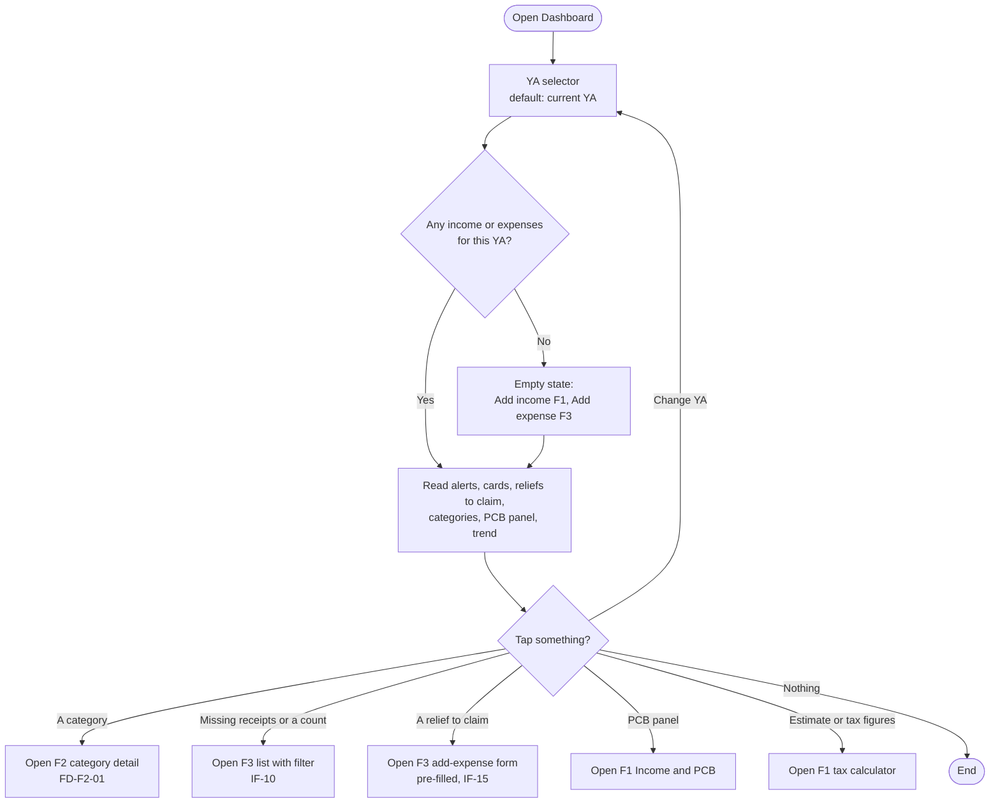
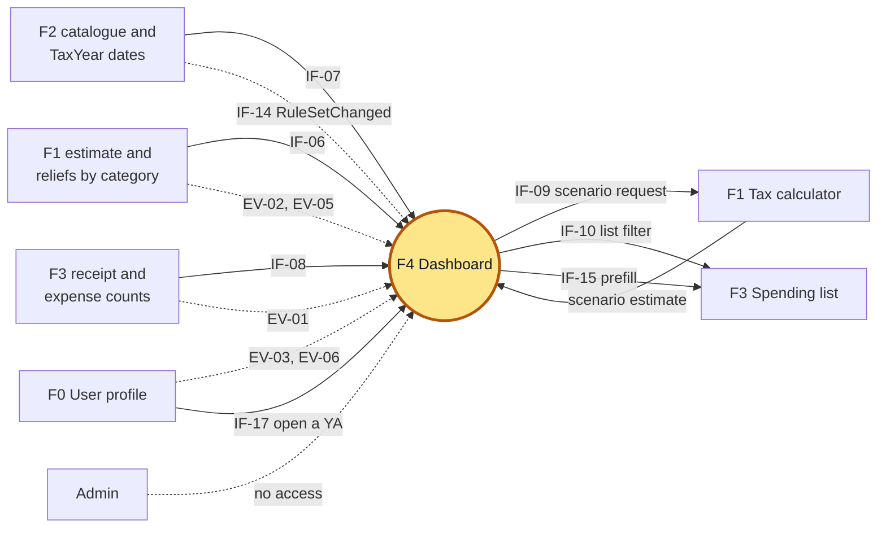
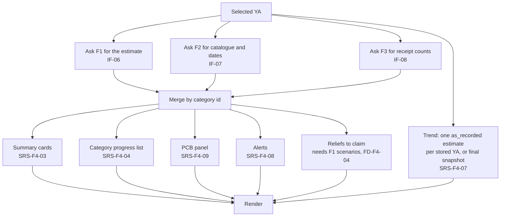
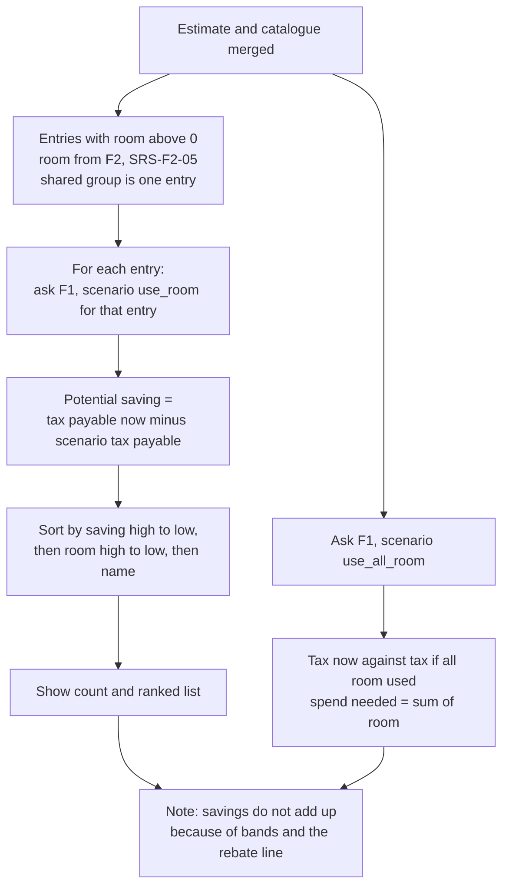
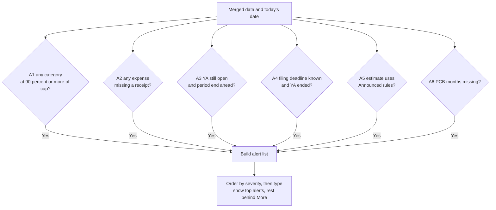
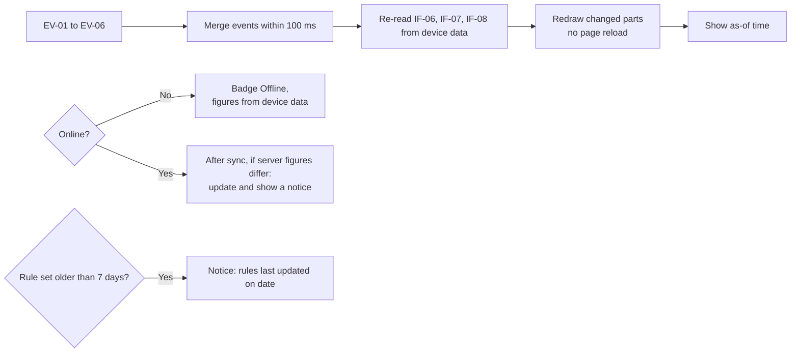
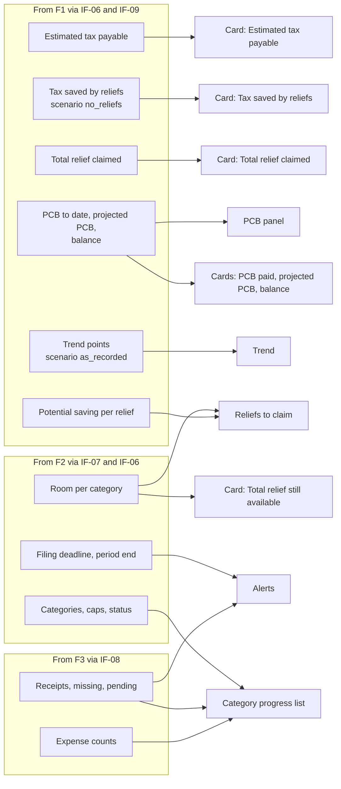
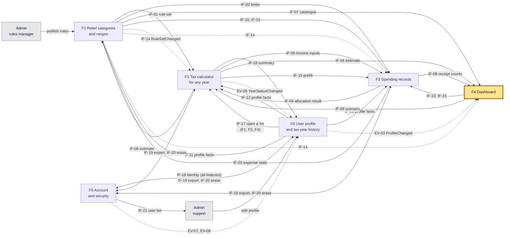
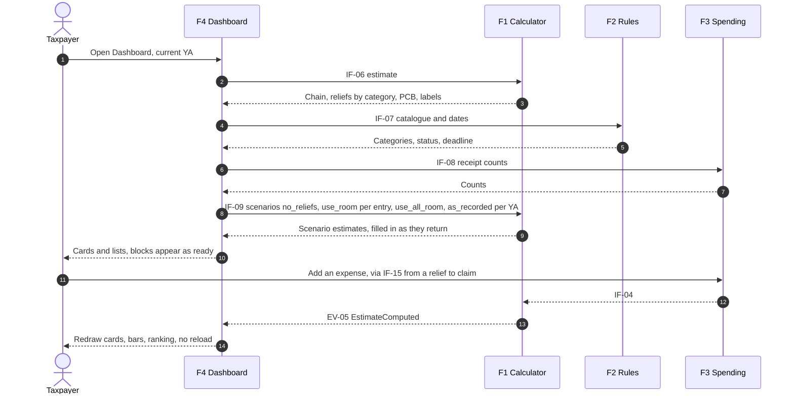

# URS-SRS-F4: Dashboard

| Item | Value |
| --- | --- |
| Document ID | URS-SRS-F4 |
| Document type | URS and SRS (user and system requirements) |
| Product | Tax Relief Manager (TRM), Malaysia tax relief system (PWA) |
| Version | 0.7 |
| Status | Draft (for owner review) |
| Date | 2026-11-23 (first written 2026-11-13) |
| Owner | Champs (product owner) |
| PRD reference | PRD-TRM section 3.4 "Dashboard", FR-4.1 to FR-4.8 |
| Source | PRD-TRM (written from revision 37; names checked against revision 48); owner prompts P-16 and P-38 |
| Change tracking | [REG-02 URS and SRS change log](../registers/REG_02_URS_SRS_Change_Log.md); work history in [REG-01 History log](../registers/REG_01_History_Log.md); short forms in [REG-03 Acronyms](../registers/REG_03_Acronyms.md) |

## 0. Conventions shared by all six documents

### 0.1 The document set

| Doc | File | Feature (name from the PRD) | PRD requirements covered |
| --- | --- | --- | --- |
| F0 | [URS_SRS_F0_User_Profile.md](URS_SRS_F0_User_Profile.md) | User profile and tax-year history | PRD sections 5, 7, 8; FR-2.3 depends on it (no FR block yet, F-032) |
| F1 | [URS_SRS_F1_Tax_Calculator.md](URS_SRS_F1_Tax_Calculator.md) | Tax calculator for any year (PRD section 3.1, includes PCB) | FR-1.1 to FR-1.11 |
| F2 | [URS_SRS_F2_Relief_Categories.md](URS_SRS_F2_Relief_Categories.md) | Relief categories and ranges (PRD section 3.2, includes the rule sets and the rules admin) | FR-2.1 to FR-2.7 |
| F3 | [URS_SRS_F3_Spending_Records.md](URS_SRS_F3_Spending_Records.md) | Spending records (PRD section 3.3) | FR-3.1 to FR-3.7 |
| F4 | [URS_SRS_F4_Dashboard.md](URS_SRS_F4_Dashboard.md) | Dashboard (PRD section 3.4) | FR-4.1 to FR-4.8 |
| F5 | [URS_SRS_F5_Account_Security.md](URS_SRS_F5_Account_Security.md) | Account and security | NFR-6, NFR-7, NFR-8; PRD sections 7 and 8 (sign in, settings, roles); no FR block yet |

Source: PRD-TRM, the PRD "Malaysia Tax Relief System (PWA)" ([PRD_TRM_Malaysia_Tax_Relief_System.md](../prd/PRD_TRM_Malaysia_Tax_Relief_System.md)), written from revision 37 and checked against revision 48. The PRD is the master for feature names and IDs (AGENTS.md section 6); F0 and F5 have no PRD feature section yet. Logs: [REG_01_History_Log.md](../registers/REG_01_History_Log.md) is the main log of our work; [REG_02_URS_SRS_Change_Log.md](../registers/REG_02_URS_SRS_Change_Log.md) records every detail change to these six documents.

### 0.2 How to read the IDs

| Prefix | Meaning | Where |
| --- | --- | --- |
| URS-Fn-nn | User requirement (n is 0 for the profile document, 1 to 4 for the core features, 5 for account and security), in the owner's terms ("what the user must be able to do") | Part A of the feature document |
| FD-Fn-nn | Flow or state diagram drawn for the URS | Part A |
| SRS-Fn-nn | System requirement: exactly how the application behaves | Part B |
| SQ-Fn-nn | Sequence diagram that shows a specification across features | Part B |
| TC-Fn-nn | Test case with exact inputs and expected outputs | Part B |
| IF-nn | Interface: data one feature passes to another (same list in all six documents) | Section A5 |
| EV-nn | Event that tells other features to refresh | Section A5 |
| FR, BR, NFR | Requirement and rule IDs from the PRD | PRD |
| SD-Fn-nn | **Specification decision**: a detail the PRD does not state, which I filled in. Needs the owner's confirmation. | Part B |
| DA-nn | **Data addition**: a field or table the PRD data model does not have but the specification needs (same list in all six documents, in Part B2 under Data additions) | Part B |
| OI-Fn-nn | Open item: unresolved question | Part B |

Every SRS row has a **Basis** column: the PRD ID it comes from, or SD, DA or OI where I added or could not settle something. Every SRS row has a **Flow** column naming the URS diagram it works from.

### 0.3 Shared terms and rules

| Term | Exact meaning in all six documents |
| --- | --- |
| YA | Year of Assessment. YA 2026 covers income and spending dated 1 Jan to 31 Dec 2026. |
| Current YA | The YA whose period contains today's date. |
| Ended YA | A YA whose period end is before today. |
| Money | Stored as whole sen (integer). RM 1,449.00 is 144900. Displayed as "RM 1,449.00". |
| Rule set | All published, current rows for one YA: TaxYear, TaxBand, RebateRule, ReliefCategory, ReliefRule, SubLimit and (DA-05) RuleTier. |
| Actual spend | The amount the user paid, before any cap. |
| Applied (claimable) | The part of an amount that counts toward relief after sub-limits, category cap, shared cap and claim-frequency rules. |
| Over cap | Actual spend minus applied. |
| Effective cap | The most this user can apply in one category for one YA: fixed cap, cap per dependant times the number of eligible dependants, or the tier that matches the user's facts. |
| Room | Effective cap minus applied, never below zero. A shared-cap group has one room, counted once. |
| Estimate | Any tax figure built on a rule with status Announced, or on projected months. It is labelled "estimate". |
| Soft delete | deleted_at and deleted_by are set on the current version row. Nothing is removed. |
| Versioned edit | An edit inserts a new row with the next version_no, sets is_current to false on the old row. created_by and updated_by hold the acting user, or the SYSTEM user for system actions. |
| Profile year | The TaxpayerProfile row, with its dependants, that belongs to one YA (DA-16). A user has one current profile per YA. |
| Age at YA end | Whole years completed on the YA's period end (31 December). The default reference date for every age test ([OI-F1-01](URS_SRS_F1_Tax_Calculator.md#oi-f1-01)). |
| Locked profile | The profile of a YA whose UserTaxYear.status is filed. Nobody can change it until the YA is reopened. Derived, not stored ([SD-F0-12](URS_SRS_F0_User_Profile.md#sd-f0-12)). |
| Tax-year history | The list of stored YAs with the stage of each (Not started, In progress, Calculated, Filed), owned by F0. |
| Rounding | Each band's tax is rounded half-up to the nearest sen, then summed ([SD-F1-05](URS_SRS_F1_Tax_Calculator.md#sd-f1-05)). |
| Session | One signed-in period on one browser or device. It ends by sign-out, expiry or revoke (F5). |
| Fresh sign-in | A sign-in within the last 10 minutes. It is asked for again before a sensitive action such as a password change, an export or a deletion ([SD-F5-06](URS_SRS_F5_Account_Security.md#sd-f5-06)). |
| Grace period | The 14 days between a deletion request and the erase. The user can cancel in this time ([SD-F5-08](URS_SRS_F5_Account_Security.md#sd-f5-08)). |
| Retention period | 7 years from the end of the YA (NFR-8), the time the taxpayer should keep records. |
| Release | R1 to R4, the releases of PRD section 9.1: R1 is built in PRD phase 1, R2 in phase 3, R3 in phase 4, R4 in phase 5. R1 is the MVP for the product owner's personal use. R2 items are reserved here only where R1 must leave a hook. |
| Phase | Only a phase of the PRD roadmap (section 9.1): phase 0 Discovery, 1 R1 build, 2 Personal use, 3 R2, 4 R3, 5 R4, then the public launch gate. |
| Basic account | The part of F5 built in R1: the simple account ([SD-F5-17](URS_SRS_F5_Account_Security.md#sd-f5-17)). Called Phase 1 until 23/11/2026. |
| Launch account | The part of F5 held until before the public launch: lockout, emailed links, staying signed in, two-factor login, deletion of the whole account ([SD-F5-17](URS_SRS_F5_Account_Security.md#sd-f5-17)). Called Phase 2 until 23/11/2026. |

---

# Part A. User Requirements Specification (URS)

## A1. Purpose and scope

**Purpose.** F4 gives one view of how much relief has been claimed, how much can still be claimed, and what that does to tax, so the taxpayer can act before year-end. F4 owns no data and calculates no tax. It assembles figures from F1, F2 and F3, and asks F1 for "what if" scenarios.

**In scope (R1):** YA selector; summary cards; per-category progress; reliefs to claim with count and ranking; tax now against tax if all remaining room were used; multi-year trend; alerts; PCB panel; live update, offline use, drill-down.

**Reserved (R2):** year-end optimizer screen (ranks what to spend before 31 December; PRD section 4); reminders and push notifications (alerts here are in-app only).

**Out of scope:** any calculation of tax, caps or claimable amounts (those belong to F1, F2, F3).

## A2. Users and roles

| User | What they do in F4 |
| --- | --- |
| Taxpayer | Reads the dashboard for their own data; drills into F1, F2, F3 |
| Admin | Has no access to any user's dashboard (income, PCB, spending and estimates are confidential, PRD section 8) |

## A3. User requirements

| ID | The taxpayer must be able to | PRD source | Flow |
| --- | --- | --- | --- |
| URS-F4-01 | Choose the YA, starting from the current YA | FR-4.1 | [FD-F4-01](URS_SRS_F4_Dashboard.md#fd-f4-01) |
| URS-F4-02 | See summary cards: estimated tax payable, tax saved by reliefs, total relief claimed, total relief still available, PCB paid to date, projected full-year PCB, expected balance or refund | FR-4.2 | [FD-F4-03](URS_SRS_F4_Dashboard.md#fd-f4-03), [FD-F4-07](URS_SRS_F4_Dashboard.md#fd-f4-07) |
| URS-F4-03 | See, for each category, claimed against cap as a progress bar, the remaining amount, the number of receipts and the number missing a receipt | FR-4.3 | [FD-F4-03](URS_SRS_F4_Dashboard.md#fd-f4-03) |
| URS-F4-04 | See how many reliefs I can still claim, ranked by how much tax each would save | FR-4.4 | [FD-F4-04](URS_SRS_F4_Dashboard.md#fd-f4-04) |
| URS-F4-05 | See my tax now against my tax if I used all remaining room | FR-4.5 | [FD-F4-04](URS_SRS_F4_Dashboard.md#fd-f4-04) |
| URS-F4-06 | See the trend of tax payable and relief claimed across years | FR-4.6 | [FD-F4-03](URS_SRS_F4_Dashboard.md#fd-f4-03) |
| URS-F4-07 | Be alerted when a category is at 90% of its cap or more, when receipts are missing, how many days are left in the YA, and how many days to the filing deadline | FR-4.7 | [FD-F4-05](URS_SRS_F4_Dashboard.md#fd-f4-05) |
| URS-F4-08 | See the PCB deducted per month, the projected year total, and the projection against the estimated tax | FR-4.8 | [FD-F4-03](URS_SRS_F4_Dashboard.md#fd-f4-03) |
| URS-F4-09 | See every figure update after any change, with no page reload and without a connection | FR-4 acceptance, FR-1.6 | [FD-F4-06](URS_SRS_F4_Dashboard.md#fd-f4-06) |
| URS-F4-10 | Jump from a figure to the place that explains or changes it | usage | [FD-F4-01](URS_SRS_F4_Dashboard.md#fd-f4-01) |
| URS-F4-11 | Know when a figure is an estimate, which rules it rests on, and how fresh the data is | BR-1, NFR-14 | [FD-F4-06](URS_SRS_F4_Dashboard.md#fd-f4-06) |
| URS-F4-12 | See a helpful screen when there is no data yet | usage | [FD-F4-01](URS_SRS_F4_Dashboard.md#fd-f4-01) |
| URS-F4-13 | Be sure that no one else, including an admin, can open my dashboard | NFR-6, PRD section 8 | [FD-F4-02](URS_SRS_F4_Dashboard.md#fd-f4-02) |

## A4. Flow diagrams

**[FD-F4-01](URS_SRS_F4_Dashboard.md#fd-f4-01). User flow on the dashboard**

**[FD-F4-02](URS_SRS_F4_Dashboard.md#fd-f4-02). What F4 receives from and gives to other features**

**[FD-F4-03](URS_SRS_F4_Dashboard.md#fd-f4-03). Assembling the dashboard**

**[FD-F4-04](URS_SRS_F4_Dashboard.md#fd-f4-04). Reliefs to claim, ranking and the all-room scenario**

**[FD-F4-05](URS_SRS_F4_Dashboard.md#fd-f4-05). Alerts**

**[FD-F4-06](URS_SRS_F4_Dashboard.md#fd-f4-06). What makes the dashboard update, and what it shows when offline or stale**

**[FD-F4-07](URS_SRS_F4_Dashboard.md#fd-f4-07). Where each figure on the dashboard comes from** (data lineage; every source is another feature)

## A5. Relationship with other features

**FD-00. System map of the profile (F0), the four core features and account and security (F5) (identical in all six documents; the feature of this document is highlighted)**

Reading the map: a solid arrow is data a feature reads or receives; a dashed arrow is an event. F0 owns the profile and the profile of every YA; the four core features only read it. F5 owns the account and the sign-in; it tells every feature who is signed in (IF-18, drawn once, to F0), asks F0, F1 and F3 for their part of a data export (IF-19) and tells them to erase (IF-20). F2 and F4 own no user data, so they take part only through IF-18. F1 and F3 depend on each other, so the order of calculation is fixed: F1 sends income inputs (IF-05), F3 allocates claims (IF-04), then F1 finishes the tax chain. That order is drawn in [SQ-F1-01](URS_SRS_F1_Tax_Calculator.md#sq-f1-01).

**Interfaces (identical in all six documents).** "Provider spec" is the SRS row that builds the data; "Consumer spec" is the SRS row that uses it.

| ID | From | To | Data carried | Trigger | Provider spec | Consumer spec |
| --- | --- | --- | --- | --- | --- | --- |
| IF-01 | F2 | F1 | Rule set of the selected YA plus, for this user, the evaluated rules: per category applicable or not, effective cap, tier, sub-limits, shared group, claim frequency | YA selected; EV-03; EV-04 | [SRS-F2-13](URS_SRS_F2_Relief_Categories.md#srs-f2-13) | [SRS-F1-01](URS_SRS_F1_Tax_Calculator.md#srs-f1-01) |
| IF-02 | F2 | F3 | Categories open to this user for the YA, with limits, sub-limits, shared group, frequency, required documents, beneficiary rule | Expense form opened; YA changed; EV-04 | [SRS-F2-13](URS_SRS_F2_Relief_Categories.md#srs-f2-13) | [SRS-F3-02](URS_SRS_F3_Spending_Records.md#srs-f3-02) |
| IF-03 | F3 | F2 | Per category: expense count, actual spend, applied, over cap, expenses missing a receipt | Category detail opened; EV-01 | [SRS-F3-14](URS_SRS_F3_Spending_Records.md#srs-f3-14) | [SRS-F2-06](URS_SRS_F2_Relief_Categories.md#srs-f2-06) |
| IF-04 | F3 | F1 | Allocation result: applied amount per category (spending and income-sourced), deductions applied, aggregate income before donations | Any change to expenses, income, profile or rules | [SRS-F3-14](URS_SRS_F3_Spending_Records.md#srs-f3-14) | [SRS-F1-06](URS_SRS_F1_Tax_Calculator.md#srs-f1-06) |
| IF-05 | F1 | F3 | Income inputs: total income for the YA, and the amount already counted by income-sourced categories (employee EPF, SOCSO and EIS) | EV-02 | [SRS-F1-05](URS_SRS_F1_Tax_Calculator.md#srs-f1-05) | [SRS-F3-07](URS_SRS_F3_Spending_Records.md#srs-f3-07) |
| IF-06 | F1 | F2, F4 | Estimate: full tax chain, reliefs by category (applied, effective cap, room, source), PCB figures, labels | Every recalculation (EV-05) | [SRS-F1-07](URS_SRS_F1_Tax_Calculator.md#srs-f1-07), [SRS-F1-13](URS_SRS_F1_Tax_Calculator.md#srs-f1-13) | [SRS-F2-05](URS_SRS_F2_Relief_Categories.md#srs-f2-05), [SRS-F4-02](URS_SRS_F4_Dashboard.md#srs-f4-02) |
| IF-07 | F2 | F4 | Catalogue summary (category, group, status, effective cap), TaxYear dates (period, filing deadline) | YA selected; EV-04 | [SRS-F2-13](URS_SRS_F2_Relief_Categories.md#srs-f2-13) | [SRS-F4-02](URS_SRS_F4_Dashboard.md#srs-f4-02) |
| IF-08 | F3 | F4 | Receipt counts per category and in total: with receipt, missing, pending upload; expense counts | EV-01 | [SRS-F3-14](URS_SRS_F3_Spending_Records.md#srs-f3-14) | [SRS-F4-04](URS_SRS_F4_Dashboard.md#srs-f4-04), [SRS-F4-08](URS_SRS_F4_Dashboard.md#srs-f4-08) |
| IF-09 | F4 | F1 | Scenario request (as recorded for any YA, no reliefs, use room of listed categories, use all room) and the scenario estimate | Dashboard load; EV-05 | [SRS-F1-18](URS_SRS_F1_Tax_Calculator.md#srs-f1-18) | [SRS-F4-05](URS_SRS_F4_Dashboard.md#srs-f4-05), [SRS-F4-06](URS_SRS_F4_Dashboard.md#srs-f4-06) |
| IF-10 | F2, F4 | F3 | Navigate to the spending list with a filter: YA, category, receipt status | User taps a count or alert | [SRS-F3-15](URS_SRS_F3_Spending_Records.md#srs-f3-15) | [SRS-F2-06](URS_SRS_F2_Relief_Categories.md#srs-f2-06), [SRS-F4-11](URS_SRS_F4_Dashboard.md#srs-f4-11) |
| IF-11 | F0 | F2 | Profile facts of the selected YA: marital status, spouse income and disability, own disability, dependants with date of birth, education level and disability, first-home facts, whether the dependants list is confirmed, and whether the profile is complete | EV-03 | [SRS-F0-15](URS_SRS_F0_User_Profile.md#srs-f0-15) | [SRS-F2-04](URS_SRS_F2_Relief_Categories.md#srs-f2-04) |
| IF-12 | F0 | F1 | The same profile facts and the complete flag | EV-03 | [SRS-F0-15](URS_SRS_F0_User_Profile.md#srs-f0-15) | [SRS-F1-04](URS_SRS_F1_Tax_Calculator.md#srs-f1-04) |
| IF-13 | F0 | F3 | The same profile facts and the complete flag of the YA the expense falls in, used to check eligibility and the beneficiary | EV-03 | [SRS-F0-15](URS_SRS_F0_User_Profile.md#srs-f0-15) | [SRS-F3-02](URS_SRS_F3_Spending_Records.md#srs-f3-02), [SRS-F3-03](URS_SRS_F3_Spending_Records.md#srs-f3-03) |
| IF-14 | F2 | F1, F3, F4 | RuleSetChanged event: YA and new rule version | Admin publishes ([SRS-F2-11](URS_SRS_F2_Relief_Categories.md#srs-f2-11)) | [SRS-F2-11](URS_SRS_F2_Relief_Categories.md#srs-f2-11) | [SRS-F1-15](URS_SRS_F1_Tax_Calculator.md#srs-f1-15), [SRS-F3-14](URS_SRS_F3_Spending_Records.md#srs-f3-14), [SRS-F4-10](URS_SRS_F4_Dashboard.md#srs-f4-10) |
| IF-15 | F1, F2, F4 | F3 | Open the add-expense form pre-filled: YA, category, optional sub-limit, optional amount | User taps "Add as expense" | [SRS-F3-15](URS_SRS_F3_Spending_Records.md#srs-f3-15) | [SRS-F1-16](URS_SRS_F1_Tax_Calculator.md#srs-f1-16), [SRS-F2-06](URS_SRS_F2_Relief_Categories.md#srs-f2-06), [SRS-F4-11](URS_SRS_F4_Dashboard.md#srs-f4-11) |
| IF-16 | F1 | F0 | Tax-year summary for every stored YA: status and filed date, whether income exists, the live estimate (tax payable, total reliefs, chargeable income, labels) and the saved calculations (id, trigger, date, figures, profile id and profile version used) | History list or detail opened; EV-05; EV-06 | [SRS-F1-23](URS_SRS_F1_Tax_Calculator.md#srs-f1-23) | [SRS-F0-11](URS_SRS_F0_User_Profile.md#srs-f0-11), [SRS-F0-12](URS_SRS_F0_User_Profile.md#srs-f0-12) |
| IF-17 | F0 | F1, F3, F4 | Open a feature for a chosen YA, with an optional filter (F3: receipt status) | User taps an action on a tax year | [SRS-F0-12](URS_SRS_F0_User_Profile.md#srs-f0-12) | [SRS-F1-01](URS_SRS_F1_Tax_Calculator.md#srs-f1-01), [SRS-F3-15](URS_SRS_F3_Spending_Records.md#srs-f3-15), [SRS-F4-01](URS_SRS_F4_Dashboard.md#srs-f4-01) |
| IF-18 | F5 | F0, F1, F3 (F2 and F4 read the role only, [OI-F5-05](URS_SRS_F5_Account_Security.md#oi-f5-05)) | Signed-in identity: user id, role (user or admin), language, session expiry, device id, whether two-factor login is on | App start; sign-in; session refresh; EV-07; EV-08 | [SRS-F5-18](URS_SRS_F5_Account_Security.md#srs-f5-18) | [SRS-F0-19](URS_SRS_F0_User_Profile.md#srs-f0-19), [SRS-F1-24](URS_SRS_F1_Tax_Calculator.md#srs-f1-24), [SRS-F3-18](URS_SRS_F3_Spending_Records.md#srs-f3-18) |
| IF-19 | F0, F1, F3 | F5 | Export part: every row the feature owns for the user, all versions, as records, plus the list of files (F3) | The export job runs ([SRS-F5-14](URS_SRS_F5_Account_Security.md#srs-f5-14)) | [SRS-F0-19](URS_SRS_F0_User_Profile.md#srs-f0-19), [SRS-F1-24](URS_SRS_F1_Tax_Calculator.md#srs-f1-24), [SRS-F3-18](URS_SRS_F3_Spending_Records.md#srs-f3-18) | [SRS-F5-14](URS_SRS_F5_Account_Security.md#srs-f5-14) |
| IF-20 | F5 | F0, F1, F3 | Erase request: delete every row and file of the user, or, when the request names a YA, only the rows and files of that YA, and answer with the counts | The user confirms the deletion of a YA past its 7 years ([SRS-F5-21](URS_SRS_F5_Account_Security.md#srs-f5-21)); in the launch account also when the grace period ends ([SRS-F5-16](URS_SRS_F5_Account_Security.md#srs-f5-16)) | [SRS-F5-16](URS_SRS_F5_Account_Security.md#srs-f5-16), [SRS-F5-21](URS_SRS_F5_Account_Security.md#srs-f5-21) | [SRS-F0-19](URS_SRS_F0_User_Profile.md#srs-f0-19), [SRS-F1-24](URS_SRS_F1_Tax_Calculator.md#srs-f1-24), [SRS-F3-18](URS_SRS_F3_Spending_Records.md#srs-f3-18) |
| IF-21 | F5 | F0 | User list for support: user id, name, email, status, role, two-factor flag, last sign-in date; no tax data | An admin opens the user list | [SRS-F5-17](URS_SRS_F5_Account_Security.md#srs-f5-17) | [SRS-F0-16](URS_SRS_F0_User_Profile.md#srs-f0-16) |

**Events**

| ID | Event | Raised by | Heard by |
| --- | --- | --- | --- |
| EV-01 | ExpenseChanged (ya, expense ids) | F3, after every local save, edit, delete or sync | F1, F2, F4 |
| EV-02 | IncomeChanged (ya) | F1, after every income or PCB save | F3 (refresh IF-05), F4 |
| EV-03 | ProfileChanged (ya, profile id, version) | F0, after every profile or dependant save, copy to a new YA, or apply to later YAs | F1, F2, F3, F4 |
| EV-04 | RuleSetChanged (ya, version) = IF-14 | F2 | F1, F3, F4 |
| EV-05 | EstimateComputed (ya) | F1, after every recalculation | F2, F4 |
| EV-06 | YearStatusChanged (ya, status filed or open) | F1, after mark as filed or reopen ([SRS-F1-21](URS_SRS_F1_Tax_Calculator.md#srs-f1-21)) | F0, F4 |
| EV-07 | AccountStatusChanged (user, status active, disabled or deletion_pending) | F5, after an admin disables or enables the account, a deletion request or its cancel ([SRS-F5-15](URS_SRS_F5_Account_Security.md#srs-f5-15), [SRS-F5-17](URS_SRS_F5_Account_Security.md#srs-f5-17)) | F0, F1, F3 |
| EV-08 | SessionEnded (user, device, reason: signed out, expired, revoked, password changed) | F5, whenever a session ends ([SRS-F5-08](URS_SRS_F5_Account_Security.md#srs-f5-08), [SRS-F5-09](URS_SRS_F5_Account_Security.md#srs-f5-09)) | F0, F1, F3 |

**Data ownership (identical in all six documents).** O = owns and writes; R = reads; Agg = reads only aggregated results through an interface; none = no access. Export and erase mean the feature supplies its part to F5 (IF-19) and deletes it on request (IF-20). "Admin" can touch the profile (while its YA is not filed), the account's name and language, and file names only.

| Entity | F0 | F1 | F2 | F3 | F4 | F5 | Admin |
| --- | --- | --- | --- | --- | --- | --- | --- |
| User.name, User.language, TaxpayerProfile (one per YA, DA-16), Dependant, HouseholdLink | O | R (IF-12) | R (IF-11) | R (IF-13) | none | Export, erase | Manage name, language and profile fields of a YA that is not filed |
| User.email, role, status; Credential, Session, ConsentRecord, Invitation, DataRequest, SecurityEvent (DA-21 to DA-24) | R (IF-18) | R (IF-18) | R (IF-18, role) | R (IF-18) | R (IF-18, role) | O | Invite, disable, enable, send a reset email. No password, no email change, no two-factor off |
| IncomeRecord | none | O | none | Agg (IF-05) | Agg (IF-06) | Export, erase | none |
| UserTaxYear (DA-12: filed status per user) | R (lock follows status) | O | none | R | R | Export, erase | none |
| TaxEstimate | Agg (IF-16) | O | Agg (IF-06) | none | R | Export, erase | none |
| TaxYear, TaxBand, RebateRule | none | R (IF-01) | O | none | R (IF-07) | none | Create and edit |
| ReliefCategory, ReliefRule, SubLimit, RuleTier | none | R (IF-01) | O | R (IF-02) | R (IF-07) | none | Create and edit |
| Expense, ExpenseAllocation | none | Agg (IF-04) | Agg (IF-03) | O | Agg (IF-08) | Export, erase | none (amounts and descriptions are confidential) |
| Receipt | none | none | none | O | Agg (IF-08) | Export, erase | File name and type only; upload, download, delete on request ([OI-F3-01](URS_SRS_F3_Spending_Records.md#oi-f3-01)) |

**A5.4 Inter-related data for F4**

| Data | Direction | Other feature | What F4 uses it for | Interface | If it is missing or late |
| --- | --- | --- | --- | --- | --- |
| Estimate with reliefs by category, PCB figures, labels | in | F1 | Cards, bars, PCB panel, status labels | IF-06 | Cards show "Updating" with the last values and their time |
| Scenario estimates | in | F1 | Tax saved by reliefs, ranking, all-room scenario, trend points | IF-09 | The affected block shows "Calculating"; other blocks are not delayed |
| Catalogue summary and TaxYear dates | in | F2 | Categories, caps, room rules, deadline, period end | IF-07 | Last cached catalogue with its age |
| Receipt and expense counts | in | F3 | Receipts per category, missing receipts, alerts | IF-08 | Counts show "Updating" |
| List filter and prefilled form | out | F3 | Drill-down | IF-10, IF-15 | Not applicable |
| RuleSetChanged, ExpenseChanged, IncomeChanged, ProfileChanged, EstimateComputed, YearStatusChanged | in | F1, F2, F3, F0 | Refresh | IF-14, EV-01, EV-02, EV-03, EV-05, EV-06 | Not applicable |

## A6. Assumptions and constraints

1. F4 never calculates tax, caps or claimable amounts. It formats what F1, F2 and F3 return. If a figure on the dashboard is wrong, the fix is in the feature that supplies it ([FD-F4-07](URS_SRS_F4_Dashboard.md#fd-f4-07)).
2. All figures come from data on the device, so the dashboard works offline.
3. Relief claimed includes automatic reliefs such as the RM 9,000 individual relief.
4. Alerts exist only inside the app in R1 (push notifications are R2).

---

# Part B. System Requirements Specification (SRS)

## B1. Functional specifications

### B1.1 Selector, assembly, cards

| ID | Specification | Basis | URS | Flow | Test |
| --- | --- | --- | --- | --- | --- |
| SRS-F4-01 | **YA selector.** Lists every stored YA, newest first. The default on each app open is the current YA ([SD-F4-01](URS_SRS_F4_Dashboard.md#sd-f4-01)). Changing it redraws the whole dashboard from device data. If the profile of the selected YA is Incomplete, the dashboard shows the gate "Complete your profile for YA {y}" ([SRS-F0-03](URS_SRS_F0_User_Profile.md#srs-f0-03)) in place of every block below the header. The selector shows the rule status of the YA (Announced, Gazetted or Confirmed) and, for a YA marked filed, "Filed". The selector also opens on a YA chosen in the tax-year history of F0 (IF-17). | FR-4.1, [SD-F4-01](URS_SRS_F4_Dashboard.md#sd-f4-01) | [URS-F4-01](URS_SRS_F4_Dashboard.md#urs-f4-01) | [FD-F4-01](URS_SRS_F4_Dashboard.md#fd-f4-01) | [TC-F4-01](URS_SRS_F4_Dashboard.md#tc-f4-01) |
| SRS-F4-02 | **Data assembly.** For the selected YA F4 reads: the estimate (IF-06: tax chain, reliefs_by_category [category, applied, effective_cap, room, source], PCB figures, labels); the catalogue summary and TaxYear dates (IF-07); receipt and expense counts per category (IF-08). Merge key: category id. Order of loading: IF-06 first (cards), IF-07 and IF-08 next, then scenarios (IF-09) which fill their blocks as each returns. Each block renders as soon as its data is ready; a slow block does not hold the others. F4 holds no copy of these data beyond the screen state. | IF-06, IF-07, IF-08, IF-09 | [URS-F4-02](URS_SRS_F4_Dashboard.md#urs-f4-02), [URS-F4-03](URS_SRS_F4_Dashboard.md#urs-f4-03) | [FD-F4-03](URS_SRS_F4_Dashboard.md#fd-f4-03) | [TC-F4-02](URS_SRS_F4_Dashboard.md#tc-f4-02) |
| SRS-F4-03 | **Summary cards** (money shown as "RM 1,449.00"). 1. **Estimated tax payable** = estimate.tax_payable. 2. **Tax saved by reliefs** = (IF-09 scenario no_reliefs).tax_payable minus estimate.tax_payable. 3. **Total relief claimed** = estimate.total_reliefs (all categories, including automatic ones; deductions are not included). 4. **Total relief still available** = sum of room over entries of kind relief ([SRS-F2-05](URS_SRS_F2_Relief_Categories.md#srs-f2-05)), a shared group counted once; not applicable and blocked categories count 0. 5. **PCB paid to date** = recorded regular PCB plus recorded PCB on extra pay ([SRS-F1-12](URS_SRS_F1_Tax_Calculator.md#srs-f1-12)). 6. **Projected full-year PCB** = [SRS-F1-12](URS_SRS_F1_Tax_Calculator.md#srs-f1-12). 7. **Expected balance or refund** = [SRS-F1-13](URS_SRS_F1_Tax_Calculator.md#srs-f1-13), with the word "Balance to pay" or "Refund estimate". Each card has a one-line explanation and a link to its source (F1 or F2). A card whose data is missing shows "Add income to see this" with a link. | FR-4.2, BR-9, [SD-F4-02](URS_SRS_F4_Dashboard.md#sd-f4-02) | [URS-F4-02](URS_SRS_F4_Dashboard.md#urs-f4-02) | [FD-F4-07](URS_SRS_F4_Dashboard.md#fd-f4-07) | [TC-F4-03](URS_SRS_F4_Dashboard.md#tc-f4-03) |
| SRS-F4-04 | **Per-category progress.** One row per applicable category of the YA that has an effective cap above 0, including categories with RM 0 claimed; a shared group is one row listing its members; "Show not applicable" off by default. Row: name, group, claimed over effective cap as text ("RM 2,500.00 of RM 2,500.00, 100%"), a progress bar with ARIA values, remaining RM, number of receipts, number missing a receipt (IF-08). Bar state is shown by text as well as colour: normal below 90%, "Near cap" from 90% to below 100%, "Cap reached" at 100%. Sort: remaining high to low (default), name, percent used. Categories with no cap (D02) are shown as "No cap, claimed RM x". Tap a row: category detail in F2; tap the missing count: F3 list filtered (IF-10). | FR-4.3, IF-08 | [URS-F4-03](URS_SRS_F4_Dashboard.md#urs-f4-03) | [FD-F4-03](URS_SRS_F4_Dashboard.md#fd-f4-03) | [TC-F4-04](URS_SRS_F4_Dashboard.md#tc-f4-04) |

### B1.2 Reliefs to claim, scenario, trend

| ID | Specification | Basis | URS | Flow | Test |
| --- | --- | --- | --- | --- | --- |
| SRS-F4-05 | **Reliefs to claim.** 1. Entries: every category with room above 0, relief or deduction with a cap (D01), a shared group counted once; not applicable and blocked ones excluded; D02 excluded (no cap) ([SD-F4-03](URS_SRS_F4_Dashboard.md#sd-f4-03)). 2. The **count** = number of entries. A category with RM 0 claimed is an entry with its full cap (acceptance criterion). 3. For each entry F4 sends IF-09 scenario use_room with that entry only. **Potential saving = estimate.tax_payable minus scenario.tax_payable.** F4 also shows the marginal rate ([SRS-F1-10](URS_SRS_F1_Tax_Calculator.md#srs-f1-10)) beside it as information. 4. Sort by potential saving, high to low; ties by room high to low; then name A to Z. 5. An entry whose saving is RM 0.00 stays in the list, last, with "No tax saved at your current income". 6. Row: name, room, potential saving, "Add expense" button (IF-15, pre-filled with the YA and category). 7. A line under the list: "Savings overlap, so they do not add up" ([SD-F4-04](URS_SRS_F4_Dashboard.md#sd-f4-04)). 8. The ranking runs off the main thread; the rest of the dashboard is not blocked, and the ranking may lag by up to 500 ms ([SD-F4-05](URS_SRS_F4_Dashboard.md#sd-f4-05)). | FR-4.4, [SD-F4-03](URS_SRS_F4_Dashboard.md#sd-f4-03), [SD-F4-04](URS_SRS_F4_Dashboard.md#sd-f4-04), [SD-F4-05](URS_SRS_F4_Dashboard.md#sd-f4-05) | [URS-F4-04](URS_SRS_F4_Dashboard.md#urs-f4-04) | [FD-F4-04](URS_SRS_F4_Dashboard.md#fd-f4-04) | [TC-F4-05](URS_SRS_F4_Dashboard.md#tc-f4-05), [TC-F4-06](URS_SRS_F4_Dashboard.md#tc-f4-06) |
| SRS-F4-06 | **Tax now against tax if all room were used.** F4 sends IF-09 scenario use_all_room. It shows two figures: tax payable now (estimate) and tax payable in the scenario, the difference ("could save"), and the spend that would be needed = sum of the room used. If the scenario tax is RM 0.00 it adds "Savings are limited by the tax you owe". The block always carries the sentence: "This is not advice to spend; only spending you actually need counts". | FR-4.5, IF-09 | [URS-F4-05](URS_SRS_F4_Dashboard.md#urs-f4-05) | [FD-F4-04](URS_SRS_F4_Dashboard.md#fd-f4-04) | [TC-F4-07](URS_SRS_F4_Dashboard.md#tc-f4-07) |
| SRS-F4-07 | **Multi-year trend.** One point per stored YA: tax payable and total relief claimed. Source per YA: a YA marked filed uses its final snapshot ([SRS-F1-19](URS_SRS_F1_Tax_Calculator.md#srs-f1-19), trigger filed); any other YA uses IF-09 scenario as_recorded (a live estimate from that YA's own data). A YA with no income and no expenses is "no data", not zero. Rule status of each point is shown (Announced points are hatched and labelled "estimate"). Display: grouped bars by YA with a table view as the accessible alternative. The chart shows no fewer than 2 and up to 10 YAs; with one YA it shows "Add data for another YA to see a trend". | FR-4.6, [SD-F4-06](URS_SRS_F4_Dashboard.md#sd-f4-06) | [URS-F4-06](URS_SRS_F4_Dashboard.md#urs-f4-06) | [FD-F4-03](URS_SRS_F4_Dashboard.md#fd-f4-03) | [TC-F4-08](URS_SRS_F4_Dashboard.md#tc-f4-08) |

### B1.3 Alerts, PCB, update, navigation

| ID | Specification | Basis | URS | Flow | Test |
| --- | --- | --- | --- | --- | --- |
| SRS-F4-08 | **Alerts.** Evaluated from the merged data and today's date. **A1 near cap:** a category or group with applied at or above 90% and below 100% of its effective cap (automatic categories excluded): "{name} is at {pct}% of its cap". A category at 100%: "Cap reached" as information. **A2 missing receipts:** n current expenses with no receipt (uploaded or pending): link to F3 list (IF-10). **A3 days left in the YA:** for a current YA, days = period_end minus today; shown when 90 days or fewer remain, with the total room ("RM x of relief room left"). **A4 filing deadline:** when the YA has ended, is not filed and the deadline is known: days = filing_deadline minus today; overdue shows "Deadline passed"; when no deadline is stored shows "Deadline not published yet" ([SD-F2-03](URS_SRS_F2_Relief_Categories.md#sd-f2-03)). **A5 announced rules:** the estimate uses Announced rules. **A6 PCB gap:** one or more months have no recorded PCB between recorded months ([SRS-F1-11](URS_SRS_F1_Tax_Calculator.md#srs-f1-11)). Severity: high = deadline within 14 days or passed, or 30 days or fewer left in the YA; medium = A1, A2, A4 otherwise; info = A5, A6, A3 above 30 days. Order: severity, then A4, A3, A1, A2, A6, A5. The top 3 show; the rest are behind "More". Alerts are derived, so they disappear when the cause is fixed; there is no dismiss in R1. | FR-4.7, [SD-F4-07](URS_SRS_F4_Dashboard.md#sd-f4-07) | [URS-F4-07](URS_SRS_F4_Dashboard.md#urs-f4-07) | [FD-F4-05](URS_SRS_F4_Dashboard.md#fd-f4-05) | [TC-F4-09](URS_SRS_F4_Dashboard.md#tc-f4-09), [TC-F4-10](URS_SRS_F4_Dashboard.md#tc-f4-10), [TC-F4-11](URS_SRS_F4_Dashboard.md#tc-f4-11) |
| SRS-F4-09 | **PCB panel.** 1. Twelve month columns for the YA: regular PCB and PCB on extra pay stacked; actual months solid, projected months hatched, overridden months marked; missing months flagged. 2. Totals row: recorded to date, projected year total, tax payable, expected balance or refund ([SRS-F1-13](URS_SRS_F1_Tax_Calculator.md#srs-f1-13)) and the chip "PCB likely above tax: refund estimate" or "PCB likely below tax: balance to pay". 3. A table view for accessibility. 4. "Edit PCB" opens F1's Income and PCB screen for the YA. 5. For an ended YA there is no projection; the panel shows recorded PCB and the missing months. | FR-4.8, FR-1.8 to FR-1.10 | [URS-F4-08](URS_SRS_F4_Dashboard.md#urs-f4-08) | [FD-F4-03](URS_SRS_F4_Dashboard.md#fd-f4-03) | [TC-F4-12](URS_SRS_F4_Dashboard.md#tc-f4-12) |
| SRS-F4-10 | **Live update, offline, freshness.** 1. F4 listens to EV-01, EV-02, EV-03, EV-04, EV-05 and EV-06 (a YA filed or reopened: the Filed badge changes). Events within 100 ms are merged; blocks re-read from device data and redraw without a page reload; target 200 ms for cards, bars and PCB panel after the last event (NFR-5). 2. An "as of {time}" label shows the time of the last recalculation. 3. Offline: a badge "Offline" and figures from device data; nothing is blocked. 4. After sync, if the server verification returns different figures, F4 updates and shows "Updated after sync". 5. If the cached rule set is older than 7 days and the device is online, F4 asks F2 for the current rule version ([SRS-F2-13](URS_SRS_F2_Relief_Categories.md#srs-f2-13)); if the device is offline it shows "Rules last updated on {date}". | FR-4 acceptance, FR-1.6, NFR-2, NFR-5 | [URS-F4-09](URS_SRS_F4_Dashboard.md#urs-f4-09), [URS-F4-11](URS_SRS_F4_Dashboard.md#urs-f4-11) | [FD-F4-06](URS_SRS_F4_Dashboard.md#fd-f4-06) | [TC-F4-13](URS_SRS_F4_Dashboard.md#tc-f4-13), [TC-F4-14](URS_SRS_F4_Dashboard.md#tc-f4-14) |
| SRS-F4-11 | **Drill-down and navigation.** Category row or detail: F2 category detail. Missing receipts count or alert A2: F3 list with filter {ya, receipt_status = missing} (IF-10). Category's over-cap count: F3 list filtered by category and claim status (IF-10). Relief to claim: F3 add-expense form with {ya, category_id} (IF-15). PCB panel: F1 Income and PCB. Tax cards and balance: F1 tax calculator. Filing deadline alert: F1 tax calculator, where "Mark as filed" lives. Every link keeps the selected YA. Back returns to the dashboard with the same YA and scroll position. | IF-10, IF-15 | [URS-F4-10](URS_SRS_F4_Dashboard.md#urs-f4-10) | [FD-F4-01](URS_SRS_F4_Dashboard.md#fd-f4-01) | [TC-F4-15](URS_SRS_F4_Dashboard.md#tc-f4-15) |

### B1.4 Labels, empty states, access, layout

| ID | Specification | Basis | URS | Flow | Test |
| --- | --- | --- | --- | --- | --- |
| SRS-F4-12 | **Estimate labels.** The dashboard header shows the labels F1 returns ([SRS-F1-14](URS_SRS_F1_Tax_Calculator.md#srs-f1-14)): "Estimate: based on announced rules" (with the list on tap) and "Includes projected months: n". The fixed text "This is an estimate. LHDN's assessment prevails." appears under the cards. F4 never removes or rewords a label returned by F1. | BR-1, NFR-14 | [URS-F4-11](URS_SRS_F4_Dashboard.md#urs-f4-11) | [FD-F4-06](URS_SRS_F4_Dashboard.md#fd-f4-06) | [TC-F4-16](URS_SRS_F4_Dashboard.md#tc-f4-16) |
| SRS-F4-13 | **Empty and error states.** No income for the YA: cards that need income show "Add income" (F1). No expenses: the category list still shows every category with RM 0 claimed, and an "Add your first expense" button (F3). No rule set for the YA: the page shows "No rules for YA {year}" and nothing else but the selector. A block that fails to load shows "Could not load. Try again" with a button; other blocks are unaffected. Errors are text, not pop-ups. | usage | [URS-F4-12](URS_SRS_F4_Dashboard.md#urs-f4-12) | [FD-F4-01](URS_SRS_F4_Dashboard.md#fd-f4-01) | [TC-F4-17](URS_SRS_F4_Dashboard.md#tc-f4-17) |
| SRS-F4-14 | **Layout and accessibility.** Single column at 360 px. Order: alerts (top 3), summary cards, reliefs to claim, tax now against all room, per-category progress, PCB panel, trend. From 768 px: cards in a grid of up to 4 columns. Targets at least 44 px. WCAG 2.1 AA: text alternative for every chart, progress bars with role and values, status not shown by colour alone. English and Bahasa Malaysia labels; RM amounts; dates DD/MM/YYYY. | NFR-11, NFR-12 | [URS-F4-02](URS_SRS_F4_Dashboard.md#urs-f4-02) | [FD-F4-03](URS_SRS_F4_Dashboard.md#fd-f4-03) | [TC-F4-18](URS_SRS_F4_Dashboard.md#tc-f4-18) |
| SRS-F4-15 | **Access control.** A dashboard request is served only for the signed-in profile owner's own data. An admin session receives no income, PCB, spending, estimate or receipt data from IF-06, IF-08 or IF-09, for any user. The admin's own account behaves as a normal user. | NFR-6, PRD section 8 | [URS-F4-13](URS_SRS_F4_Dashboard.md#urs-f4-13) | [FD-F4-02](URS_SRS_F4_Dashboard.md#fd-f4-02) | [TC-F4-19](URS_SRS_F4_Dashboard.md#tc-f4-19) |
| SRS-F4-16 | **Performance.** First meaningful screen under 2.5 s on a mid-range phone over 4G (NFR-5); cards, bars and PCB panel redraw under 200 ms after an event; ranking ([SRS-F4-05](URS_SRS_F4_Dashboard.md#srs-f4-05)) within 500 ms; trend within 1 s. Heavy work (scenarios) runs in a Web Worker. | NFR-5, [SD-F4-05](URS_SRS_F4_Dashboard.md#sd-f4-05) | [URS-F4-09](URS_SRS_F4_Dashboard.md#urs-f4-09) | [FD-F4-06](URS_SRS_F4_Dashboard.md#fd-f4-06) | [TC-F4-13](URS_SRS_F4_Dashboard.md#tc-f4-13) |

## B2. Data specification

F4 owns no entity and writes nothing. It reads the payloads below, which other features define.

| Payload | Defined by | Fields F4 uses |
| --- | --- | --- |
| IF-06 estimate | [SRS-F1-07](URS_SRS_F1_Tax_Calculator.md#srs-f1-07), [SRS-F1-13](URS_SRS_F1_Tax_Calculator.md#srs-f1-13) | tax_before_rebates, rebates, tax_payable, total_income, total_reliefs, chargeable_income, marginal_rate, effective_rate, pcb_recorded_regular, pcb_recorded_additional, projected_annual_pcb, balance, months [month, regular, additional, state actual, override, projected or missing], reliefs_by_category [category_id, applied, effective_cap, room, source], labels (estimate, announced rows, projected months) |
| IF-07 catalogue and dates | [SRS-F2-13](URS_SRS_F2_Relief_Categories.md#srs-f2-13) | category id, code, name, group, kind, status, effective cap, room rule; TaxYear period_start, period_end, filing_deadline |
| IF-08 counts | [SRS-F3-14](URS_SRS_F3_Spending_Records.md#srs-f3-14) | per category and total: expense_count, expenses_with_receipt, missing_receipt, pending_upload |
| IF-09 scenario | [SRS-F1-18](URS_SRS_F1_Tax_Calculator.md#srs-f1-18) | scenario estimate in the IF-06 shape |
| Snapshot | [SRS-F1-19](URS_SRS_F1_Tax_Calculator.md#srs-f1-19) | final TaxEstimate row for a filed YA |

### B2.1 Data additions

**DA-01 to DA-25: data additions the specification needs (identical in all six documents).** None of these is in the PRD data model yet. They stay "proposed" until the owner approves them; then the PRD is updated. On 13/11/2026 the owner approved DA-16 and DA-19. On 14/11/2026 he approved DA-20 with a change: every question is mandatory.

| ID | Entity and field | Why it is needed | Used by | Status |
| --- | --- | --- | --- | --- |
| DA-01 | Expense.do_not_claim (boolean, default false) | BR-2: the user can mark an expense "do not claim" | F3, F1, F4 | Proposed |
| DA-02 | Every offline-created entity takes a client-generated UUID v7 as its primary key | Offline sync without duplicates (risk register); gives a stable, time-ordered tie-break for claim order | F3, F1 | Proposed |
| DA-03 | IncomeRecord.is_projected (boolean, default false) | Holds a user's planned or overridden future month (income and PCB) apart from actual records | F1, F4 | Proposed |
| DA-04 | ReliefRule.eligibility_rule (structured JSON test) next to the human-readable eligibility text | FR-2.3 filters by profile, so the test must be machine-readable | F2, F1, F3 | Proposed |
| DA-05 | ReliefRule.cap_basis (fixed, per_dependant, tiered, percent_of_aggregate), ReliefRule.cap_percent_bp (for percent_of_aggregate; 10% = 1000) and new entity RuleTier (rule_id, tier_name, condition, cap) | Caps per child, caps that depend on a fact (first-home price band, education level) and the donation cap of 10% of aggregate income | F2, F1 | Proposed |
| DA-06 | ReliefRule.claim_frequency (annual, once_every_n_ya, once_in_period), frequency_n, period_from_year, period_to_year, max_claim_years | BR-5 and the "up to 3 consecutive YAs" and "once within YA 2026 to YA 2027" conditions | F2, F3 | Proposed |
| DA-07 | ReliefCategory.kind (relief, deduction) and ReliefCategory.amount_source (automatic, profile, income, spending) | Tells the system which feature supplies the amount | F2, F1, F3 | Proposed |
| DA-08 | publish_state (draft, published) and change_set_id on TaxBand, ReliefRule, SubLimit, RuleTier, RebateRule, TaxYear | Publish gate (NFR-10): a change set is validated and tested as one unit | F2 | Proposed |
| DA-09 | IncomeRecord.departure_levy_paid (money) | The departure-levy rebate has no input field in the PRD | F1 | Proposed |
| DA-10 | TaxEstimate.is_estimate, include_projection, trigger (user, filed, system) | Reproduce and label snapshots | F1, F4 | Proposed |
| DA-11 | Receipt.file_name, Receipt.file_size, Receipt.upload_state (pending, uploaded, failed) | Admin works by file name and type only (PRD roles table); a receipt waiting to upload must still count as attached | F3 | Proposed |
| DA-12 | New entity UserTaxYear (user_id, year, status open or filed, filed_on) | TaxYear is shared by all users, so "filed" cannot live there; FR-3.7 needs it per user | F1, F3, F4, F0 | Proposed |
| DA-13 | TaxpayerProfile.spouse_is_disabled, TaxpayerProfile.pays_alimony | Disabled-spouse and alimony reliefs cannot be decided without them | F1, F2 | Proposed |
| DA-14 | ReliefRule.needs_confirmation (boolean), notes (text), retired_on (date) | Mark unresolved values (decision 4); retire a rule instead of deleting it | F2 | Proposed |
| DA-15 | ExpenseAllocation.beneficiary_dependant_id (nullable) | Parents' medical care and childcare depend on who the expense is for | F3, F2 | Proposed |
| DA-16 | TaxpayerProfile.year (integer), copied_from_year (nullable integer), state (draft, active). One current row per user per YA. Dependants follow through Dependant.profile_id | The PRD holds one profile per user, but marital status, children and disability change between years and each YA must keep the facts it was calculated with (F-033) | F0, F1, F2, F3, F4 | Approved 13/11/2026 |
| DA-17 | Dependant.person_key (UUID shared by every yearly copy of the same person), Dependant.display_name (text; a nickname is enough) | History can follow one child across years, and an expense can name its beneficiary | F0, F3 | Proposed |
| DA-18 | TaxEstimate.profile_id, TaxEstimate.profile_version_no | A saved calculation must show exactly which profile version it used | F1, F0 | Proposed |
| DA-19 | TaxpayerProfile.first_home_price (money, nullable) | R06 has two tiers by home price (up to 500,000 and up to 750,000) and no field holds the price (F-036) | F0, F2 | Approved 13/11/2026 |
| DA-20 | TaxpayerProfile.has_first_home and dependants_confirmed (boolean). Every fact on TaxpayerProfile, and Dependant.is_disabled, is_unmarried and education_level, is null only while its question is open or not shown; every visible question is mandatory ([SD-F0-14](URS_SRS_F0_User_Profile.md#sd-f0-14)) | A profile is either Incomplete or Complete, and F1 to F4 stay behind the gate until it is Complete, so an unanswered fact is never read as "No" | F0, F1, F2, F3, F4 | Approved 14/11/2026 (changed from the proposal) |
| DA-21 | User.status (active, disabled, deletion_pending), User.email_verified_at, User.deletion_requested_at, User.deletion_due_on, User.last_sign_in_at | Email verification before first use, admin disable, the deletion grace period (NFR-6, NFR-7) | F5, F0 | Proposed |
| DA-22 | New entity Credential (user_id, password_hash, hash_algorithm, password_changed_at, failed_attempts, locked_until, totp_secret_encrypted, totp_enabled, recovery_codes_hash) and new entity Session (id, user_id, device_label, remembered, created_at, last_seen_at, expires_at, revoked_at, revoked_reason) | Password, two-factor login, the list of signed-in devices and session timeout (NFR-6) | F5 | Proposed |
| DA-23 | New entity ConsentRecord (id, user_id, purpose, text_version, language, accepted_at, withdrawn_at) and new entity Invitation (id, code_hash, created_by, created_at, expires_at, used_by, used_at) | PDPA consent recorded at sign-up (NFR-7); invitation-only sign-up in R1 ([SD-F5-01](URS_SRS_F5_Account_Security.md#sd-f5-01)) | F5 | Proposed |
| DA-24 | New entity DataRequest (id, user_id, type export, delete or delete_ya, ya, status, requested_at, ready_at, due_on, expires_at, file_ref) and new entity SecurityEvent (id, user_id, type, at, device_label, actor_id, reason, ip_address kept 30 days) | Export and deletion on request (NFR-7); the user's list of security events; the trail of admin actions on accounts | F5 | Proposed |
| DA-25 | SubLimit.eligibility_rule (structured test, as DA-04) and SubLimit.claim_frequency, frequency_n, period_from_year, period_to_year (as DA-06) | Some rules apply to one item of a category: once-only items in R12, the child's age by type of centre in R23, breastfeeding inside R07 from YA 2027 ([OI-F2-04](URS_SRS_F2_Relief_Categories.md#oi-f2-04)) | F2, F3 | Proposed |

### B2.2 Category codes

**Category codes (identical in all six documents; used by tests and by the category picker).** Caps are in RM. "Src" is the DA-07 amount source: A automatic, P profile, I income, S spending. Basis is the DA-05 cap basis. YA 2025 and YA 2026 values are Gazetted (Finance Act 2025) or Confirmed by LHDN (Public Ruling 5/2026); YA 2027 values are Announced (Budget 2027; Finance Bill 2026, first reading 16/11/2026). Checked on 23/11/2026 (RES-002). Item-level rules use sub-limit rows (DA-25, [OI-F2-04](URS_SRS_F2_Relief_Categories.md#oi-f2-04)).

| Code | Category | Group | Src | YA 2025 | YA 2026 | YA 2027 | Basis and sub-limits | Frequency |
| --- | --- | --- | --- | --- | --- | --- | --- | --- |
| R01 | Individual and dependent relatives | Personal and family | A | 9,000 | 9,000 | 12,000 | fixed | annual |
| R02 | Disabled individual | Personal and family | P | 7,000 | 7,000 | 7,000 | fixed | annual |
| R03 | Spouse or alimony | Personal and family | P | 4,000 | 4,000 | 4,000 | fixed | annual |
| R04 | Disabled spouse | Personal and family | P | 6,000 | 6,000 | 6,000 | fixed | annual |
| R05 | Education fees (self); from YA 2027 Education and Skills Training Fees | Education | S | 7,000 | 7,000 | 7,000 | fixed; sub-limit SKILLS 2,000 (YA 2025, YA 2026); from YA 2027 sub-limits TVET 3,000 (self or spouse) and COURSES_CLASSES 2,000 (non-employment courses for self or spouse and children's STEM, arts, language or religion classes) | annual |
| R06 | First-home loan interest | Housing | S | 7,000 or 5,000 | 7,000 or 5,000 | 7,000 or 5,000 | tiered by home price (profile fact first_home_price, DA-19): up to 500,000 gives 7,000; 500,001 to 750,000 gives 5,000 | up to 3 consecutive YAs |
| R07 | Medical (self, spouse, child); from YA 2027 Health and Well-being | Medical and health | S | 10,000 | 10,000 | 10,000 | fixed; sub-limits VACC 1,000 (any NPRA-registered vaccine from YA 2026), DENTAL 1,000, CHECKUP 1,000, CHILD_LD (6,000 in YA 2025, 10,000 after), POSTNATAL 3,000 (YA 2027 only), BREASTFEEDING 1,000 (YA 2027 only, child 2 and below, once every 2 YAs, self or spouse) | annual |
| R08 | Parents or grandparents (medical and care) | Medical and health | S | 8,000 | 8,000 | 8,000 | fixed; sub-limit CHECKUP_VACC 1,000; YA 2027 covers all types of care | annual |
| R09 | Supporting equipment for disabled person | Medical and health | S | 6,000 | 6,000 | 6,000 | fixed | annual |
| R10 | Lifestyle | Lifestyle | S | 2,500 | 2,500 | 2,500 | fixed; YA 2027 moves skills courses to R05 and adds AI subscriptions and pet adoption, vaccination and neutering | annual |
| R11 | Sports (additional lifestyle) | Lifestyle | S | 1,000 | 1,000 | 1,000 | fixed; sub-limit SHOES 300 (YA 2027, inside the cap) | annual |
| R12 | EV charging, food waste composter or grinder, home CCTV | Green and safety | S | 2,500 | 2,500 | 2,500 | fixed; sub-limit rows (DA-25): EV_CHARGING (YA 2025 to YA 2027), COMPOSTER (once in YA 2025 to YA 2027), GRINDER and CCTV (from YA 2026, each once in YA 2026 or YA 2027) | per sub-limit (DA-25) |
| R13 | Domestic tourism | Lifestyle | S | none | 1,000 | 1,000 | fixed; YA 2026 and YA 2027 only (YA 2027 extension announced in Budget 2027) | annual |
| R14 | Employee EPF | Insurance and savings | I | 7,000 shared | 7,000 shared | 7,000 shared | member of group GRP-INS-EPF (group cap 7,000); category cap 4,000 for mandatory contributions (LHDN YA 2023 to YA 2025) | annual |
| R15 | Life insurance and takaful | Insurance and savings | S | 7,000 shared | 7,000 shared | 7,000 shared | member of group GRP-INS-EPF (group cap 7,000); category cap 3,000 for life insurance, family takaful and additional voluntary EPF (LHDN YA 2023 to YA 2025; Finance Act 2025 for YA 2026); from YA 2026 a policy on the life of the individual's child counts | annual |
| R16 | PRS and deferred annuity | Insurance and savings | S | 3,000 | 3,000 | 3,000 | fixed | annual |
| R17 | Education and medical insurance | Insurance and savings | S | 4,000 (LHDN) | 4,000 (LHDN) | 4,000 (unchanged) | fixed; LHDN gives 4,000 from YA 2025 (3,000 for YA 2018 to YA 2024), confirmed for YA 2026 in Public Ruling 5/2026 | annual |
| R18 | SOCSO and EIS | Insurance and savings | I and S | 350 | 350 | 500 | fixed; YA 2027 sub-limits MANDATORY 350 (now also mandatory Lindung Kendiri), VOLUNTARY 150 (Lindung 24 Jam and the other Lindung Kendiri sectors) | annual |
| R19 | SSPN net savings | Insurance and savings | S | 8,000 | 8,000 | 8,000 | fixed; deposits minus withdrawals ([OI-F3-03](URS_SRS_F3_Spending_Records.md#oi-f3-03)) | annual |
| R20 | Child under 18 | Personal and family | P | 2,000 per child | 2,000 per child | 2,000 per child | per_dependant | annual |
| R21 | Child 18 and above, full-time education | Personal and family | P | 2,000 or 8,000 per child | 2,000 or 8,000 per child | 2,000 or 8,000 per child | per_dependant and tiered by education level (8,000 for diploma and above in Malaysia, degree and above overseas) | annual |
| R22 | Disabled child | Personal and family | P | 8,000 per child | 8,000 per child | 8,000 per child | per_dependant; tier HIGHER_EDU adds 8,000 for a child 18 and above in higher education | annual |
| R23 | Childcare or kindergarten fees | Childcare | S | 3,000 (child up to 6) | 3,000 (child up to 6, or 12 at a care centre) | 3,000 (child up to 6, or 12 at a care centre) | fixed; sub-limit rows (DA-25): TASKA_TADIKA (child 6 and below) and CARE_CENTRE (from YA 2026, child 12 and below, centre registered under the Care Centres Act 1993) | annual |
| R24 | Breastfeeding equipment | Childcare | S | 1,000 | 1,000 | none (moved into R07) | fixed; beneficiary child 2 and below; working mothers only; from YA 2027 the R07 sub-limit BREASTFEEDING | once every 2 YAs |
| D01 | Approved donations | Deductions | S | 10% of aggregate income | 10% of aggregate income | 10% of aggregate income | percent_of_aggregate, 10% of aggregate income before donations ([OI-F3-02](URS_SRS_F3_Spending_Records.md#oi-f3-02)) | annual |
| D02 | Professional body subscriptions | Deductions | S | no cap | no cap | no cap | actual cost | annual |

LHDN values for R14, R15 and R17 were read on 2026-11-12 from the hasil.gov.my tax reliefs page and its "Maximise your tax relief" leaflet (up to YA 2025). Every row was checked on 2026-11-23 against the Finance Act 2025, LHDN Public Ruling 5/2026 and the Budget 2027 tax measures (RES-002). Rebates are not categories. They are RebateRule rows: PERSONAL RM400 (chargeable income RM35,000 or below), SPOUSE RM400 (same threshold, when R03 applies), ZAKAT (ringgit for ringgit), DEPARTURE_LEVY (ringgit for ringgit).

## B3. Specification details

**B3.1 Card formulas for the worked example** (YA 2026, F1 [TC-F1-05](URS_SRS_F1_Tax_Calculator.md#tc-f1-05); PCB RM 125 for January to October)

| Card | Value | Source and working |
| --- | --- | --- |
| Estimated tax payable | RM 1,449.00 | IF-06 |
| Tax saved by reliefs | RM 2,631.00 | Scenario no_reliefs: chargeable income 72,000.00, tax 4,080.00, minus 1,449.00 |
| Total relief claimed | RM 22,850.00 | IF-06 total_reliefs |
| Total relief still available | RM 32,500.00 | Room: R07 8,400 + R19 8,000 + R05 7,000 + R16 3,000 + R12 2,500 + R17 1,600 + R13 1,000 + R11 1,000 (relief only; D01 is a deduction) |
| PCB paid to date | RM 1,250.00 | 125 x 10 |
| Projected full-year PCB | RM 1,500.00 | [SRS-F1-12](URS_SRS_F1_Tax_Calculator.md#srs-f1-12) |
| Expected balance or refund | Refund estimate RM 51.00 | 1,449.00 minus 1,500.00 |

**B3.2 Reliefs to claim for the same example** (single, resident, no children, no parents, no first-home; values computed by script on 2026-11-12; R17 uses the RM 4,000 cap that LHDN gives for YA 2025, carried forward to YA 2026)

| Rank | Entry | Room (RM) | Chargeable income after (RM) | Tax payable after (RM) | Potential saving (RM) |
| --- | --- | --- | --- | --- | --- |
| 1 | R07 Medical | 8,400.00 | 40,750.00 | 945.00 | 504.00 |
| 2 | R19 SSPN net savings | 8,000.00 | 41,150.00 | 969.00 | 480.00 |
| 3 | D01 Donations (deduction) | 7,200.00 | 41,950.00 | 1,017.00 | 432.00 |
| 4 | R05 Education fees | 7,000.00 | 42,150.00 | 1,029.00 | 420.00 |
| 5 | R16 PRS and annuity | 3,000.00 | 46,150.00 | 1,269.00 | 180.00 |
| 6 | R12 EV, composter, CCTV | 2,500.00 | 46,650.00 | 1,299.00 | 150.00 |
| 7 | R17 Education and medical insurance | 1,600.00 | 47,550.00 | 1,353.00 | 96.00 |
| 8 | R13 Domestic tourism | 1,000.00 | 48,150.00 | 1,389.00 | 60.00 |
| 9 | R11 Sports | 1,000.00 | 48,150.00 | 1,389.00 | 60.00 |

Count = 9. R13 is ahead of R11 on the tie because the room is equal and the name sorts first. Using R05 and R07 together gives chargeable income 33,750.00, tax before rebates 562.50, rebate 400.00, tax payable 162.50, a saving of 1,286.50, which is more than 420.00 plus 504.00 = 924.00 because the RM 400 rebate is gained. This is why the savings overlap line exists.

All room used (all 9 entries, spend 39,700.00): chargeable income 9,450.00, tax before rebates 44.50, rebate 400.00, tax payable 0.00, saving 1,449.00.

**B3.3 Sequence of a dashboard load and a live update**

**[SQ-F4-01](URS_SRS_F4_Dashboard.md#sq-f4-01). Dashboard load and refresh after an expense** (works from [FD-F4-03](URS_SRS_F4_Dashboard.md#fd-f4-03), [FD-F4-04](URS_SRS_F4_Dashboard.md#fd-f4-04), [FD-F4-06](URS_SRS_F4_Dashboard.md#fd-f4-06))

## B4. Screen behaviour

| Block | Content | States |
| --- | --- | --- |
| Header | YA selector, rule status, as-of time, Offline badge, estimate labels | Updating, Offline, Filed |
| Gate | Title "Complete your profile for YA {y}", open questions, button "Answer the next question" ([SRS-F0-03](URS_SRS_F0_User_Profile.md#srs-f0-03)) | Shown in place of every block below the header while the profile is Incomplete |
| Alerts | Top 3 alerts, More | None: block hidden |
| Summary cards | Seven cards ([SRS-F4-03](URS_SRS_F4_Dashboard.md#srs-f4-03)) | Missing data: "Add income to see this" |
| Reliefs to claim | Count, ranked rows with Add expense | Ranking: "Calculating" up to 500 ms; none: "No relief room left" |
| Tax now against all room | Two figures, spend needed, caution | Calculating |
| Category progress | Rows ([SRS-F4-04](URS_SRS_F4_Dashboard.md#srs-f4-04)) | Empty: still lists categories with RM 0 |
| PCB panel | Month columns, totals, chip, table view | No PCB recorded: "Add your PCB" |
| Trend | Grouped bars, table view | One YA: message |

## B5. Non-functional requirements that bind F4

| PRD ID | How it applies to F4 |
| --- | --- |
| NFR-2 | Works from device data offline |
| NFR-5 | [SRS-F4-16](URS_SRS_F4_Dashboard.md#srs-f4-16) |
| NFR-6 | [SRS-F4-15](URS_SRS_F4_Dashboard.md#srs-f4-15) |
| NFR-11 | Labels, RM, DD/MM/YYYY |
| NFR-12 | [SRS-F4-14](URS_SRS_F4_Dashboard.md#srs-f4-14) |
| NFR-14 | [SRS-F4-12](URS_SRS_F4_Dashboard.md#srs-f4-12) |

## B6. Traceability matrix

| URS | SRS | Flow | PRD | Tests |
| --- | --- | --- | --- | --- |
| URS-F4-01 | [SRS-F4-01](URS_SRS_F4_Dashboard.md#srs-f4-01) | [FD-F4-01](URS_SRS_F4_Dashboard.md#fd-f4-01) | FR-4.1 | [TC-F4-01](URS_SRS_F4_Dashboard.md#tc-f4-01) |
| URS-F4-02 | [SRS-F4-02](URS_SRS_F4_Dashboard.md#srs-f4-02), [SRS-F4-03](URS_SRS_F4_Dashboard.md#srs-f4-03), [SRS-F4-14](URS_SRS_F4_Dashboard.md#srs-f4-14) | [FD-F4-03](URS_SRS_F4_Dashboard.md#fd-f4-03), [FD-F4-07](URS_SRS_F4_Dashboard.md#fd-f4-07) | FR-4.2 | [TC-F4-02](URS_SRS_F4_Dashboard.md#tc-f4-02), [TC-F4-03](URS_SRS_F4_Dashboard.md#tc-f4-03), [TC-F4-18](URS_SRS_F4_Dashboard.md#tc-f4-18) |
| URS-F4-03 | [SRS-F4-02](URS_SRS_F4_Dashboard.md#srs-f4-02), [SRS-F4-04](URS_SRS_F4_Dashboard.md#srs-f4-04) | [FD-F4-03](URS_SRS_F4_Dashboard.md#fd-f4-03) | FR-4.3 | [TC-F4-04](URS_SRS_F4_Dashboard.md#tc-f4-04) |
| URS-F4-04 | [SRS-F4-05](URS_SRS_F4_Dashboard.md#srs-f4-05) | [FD-F4-04](URS_SRS_F4_Dashboard.md#fd-f4-04) | FR-4.4 | [TC-F4-05](URS_SRS_F4_Dashboard.md#tc-f4-05), [TC-F4-06](URS_SRS_F4_Dashboard.md#tc-f4-06) |
| URS-F4-05 | [SRS-F4-06](URS_SRS_F4_Dashboard.md#srs-f4-06) | [FD-F4-04](URS_SRS_F4_Dashboard.md#fd-f4-04) | FR-4.5 | [TC-F4-07](URS_SRS_F4_Dashboard.md#tc-f4-07) |
| URS-F4-06 | [SRS-F4-07](URS_SRS_F4_Dashboard.md#srs-f4-07) | [FD-F4-03](URS_SRS_F4_Dashboard.md#fd-f4-03) | FR-4.6 | [TC-F4-08](URS_SRS_F4_Dashboard.md#tc-f4-08) |
| URS-F4-07 | [SRS-F4-08](URS_SRS_F4_Dashboard.md#srs-f4-08) | [FD-F4-05](URS_SRS_F4_Dashboard.md#fd-f4-05) | FR-4.7 | [TC-F4-09](URS_SRS_F4_Dashboard.md#tc-f4-09), [TC-F4-10](URS_SRS_F4_Dashboard.md#tc-f4-10), [TC-F4-11](URS_SRS_F4_Dashboard.md#tc-f4-11) |
| URS-F4-08 | [SRS-F4-09](URS_SRS_F4_Dashboard.md#srs-f4-09) | [FD-F4-03](URS_SRS_F4_Dashboard.md#fd-f4-03) | FR-4.8 | [TC-F4-12](URS_SRS_F4_Dashboard.md#tc-f4-12) |
| URS-F4-09 | [SRS-F4-10](URS_SRS_F4_Dashboard.md#srs-f4-10), [SRS-F4-16](URS_SRS_F4_Dashboard.md#srs-f4-16) | [FD-F4-06](URS_SRS_F4_Dashboard.md#fd-f4-06) | FR-4 acceptance | [TC-F4-13](URS_SRS_F4_Dashboard.md#tc-f4-13), [TC-F4-14](URS_SRS_F4_Dashboard.md#tc-f4-14) |
| URS-F4-10 | [SRS-F4-11](URS_SRS_F4_Dashboard.md#srs-f4-11) | [FD-F4-01](URS_SRS_F4_Dashboard.md#fd-f4-01) | usage | [TC-F4-15](URS_SRS_F4_Dashboard.md#tc-f4-15) |
| URS-F4-11 | [SRS-F4-10](URS_SRS_F4_Dashboard.md#srs-f4-10), [SRS-F4-12](URS_SRS_F4_Dashboard.md#srs-f4-12) | [FD-F4-06](URS_SRS_F4_Dashboard.md#fd-f4-06) | BR-1, NFR-14 | [TC-F4-14](URS_SRS_F4_Dashboard.md#tc-f4-14), [TC-F4-16](URS_SRS_F4_Dashboard.md#tc-f4-16) |
| URS-F4-12 | [SRS-F4-13](URS_SRS_F4_Dashboard.md#srs-f4-13) | [FD-F4-01](URS_SRS_F4_Dashboard.md#fd-f4-01) | usage | [TC-F4-17](URS_SRS_F4_Dashboard.md#tc-f4-17) |
| URS-F4-13 | [SRS-F4-15](URS_SRS_F4_Dashboard.md#srs-f4-15) | [FD-F4-02](URS_SRS_F4_Dashboard.md#fd-f4-02) | NFR-6 | [TC-F4-19](URS_SRS_F4_Dashboard.md#tc-f4-19) |

## B7. Test cases

Unless stated, the data is the worked example in B3.1.

| ID | Inputs | Expected | Checks |
| --- | --- | --- | --- |
| TC-F4-01 | Open the app on 12 Nov 2026 | YA 2026 selected; list shows 2027, 2026, 2025; YA 2027 labelled Announced | [SRS-F4-01](URS_SRS_F4_Dashboard.md#srs-f4-01) |
| TC-F4-02 | Open the dashboard with the F1 estimate delayed | Header and categories render; cards show "Updating"; no block waits for another | [SRS-F4-02](URS_SRS_F4_Dashboard.md#srs-f4-02) |
| TC-F4-03 | Worked example | Cards as in B3.1: 1,449.00; 2,631.00; 22,850.00; 32,500.00; 1,250.00; 1,500.00; Refund estimate 51.00 | [SRS-F4-03](URS_SRS_F4_Dashboard.md#srs-f4-03) |
| TC-F4-04 | Category with RM 0 claimed (R11 Sports) | Row shown: "RM 0.00 of RM 1,000.00, 0%", remaining 1,000.00; Lifestyle row "RM 2,500.00 of RM 2,500.00, 100%, Cap reached" | [SRS-F4-04](URS_SRS_F4_Dashboard.md#srs-f4-04) |
| TC-F4-05 | Worked example | Reliefs to claim count 9, order and savings as in B3.2; R11 with RM 0 claimed is listed with its full RM 1,000.00 | [SRS-F4-05](URS_SRS_F4_Dashboard.md#srs-f4-05) |
| TC-F4-06 | Same data but tax payable already RM 0.00 | All entries listed with saving RM 0.00 and "No tax saved at your current income" | [SRS-F4-05](URS_SRS_F4_Dashboard.md#srs-f4-05) |
| TC-F4-07 | Worked example | Tax now 1,449.00; tax if all room used 0.00; could save 1,449.00; spend needed 39,700.00; note "Savings are limited by the tax you owe" | [SRS-F4-06](URS_SRS_F4_Dashboard.md#srs-f4-06) |
| TC-F4-08 | Stored YAs 2025 (no data), 2026 (live), 2027 (no data) | One point with data (2026); message "Add data for another YA to see a trend"; after YA 2026 is marked filed, its point uses the final snapshot | [SRS-F4-07](URS_SRS_F4_Dashboard.md#srs-f4-07) |
| TC-F4-09 | Lifestyle at 2,250.00 of 2,500.00 (90%) | Alert "Lifestyle is at 90% of its cap" | [SRS-F4-08](URS_SRS_F4_Dashboard.md#srs-f4-08) |
| TC-F4-10 | 2 expenses without receipt; date 5 Dec 2026, YA 2026 current | A2 "2 expenses are missing a receipt" linking to the filtered F3 list; A3 "26 days left in YA 2026, RM 32,500 of relief room left"; severity high for A3 (30 days or fewer) | [SRS-F4-08](URS_SRS_F4_Dashboard.md#srs-f4-08) |
| TC-F4-11 | YA 2025 ended, not filed, deadline stored 15 May 2026, today 12 Nov 2026 | A4 "Deadline passed"; high severity | [SRS-F4-08](URS_SRS_F4_Dashboard.md#srs-f4-08) |
| TC-F4-12 | PCB 125 Jan to Oct; bonus PCB 300 in March | Months 1 to 10 solid (March stacked with 300); 11 and 12 hatched at 125; recorded 1,550.00; projected 1,800.00; chip "PCB likely above tax: refund estimate" | [SRS-F4-09](URS_SRS_F4_Dashboard.md#srs-f4-09) |
| TC-F4-13 | Add an expense while offline | Cards, category bar and tax estimate update in under 200 ms with no reload; badge Offline; "as of" time changes | [SRS-F4-10](URS_SRS_F4_Dashboard.md#srs-f4-10), [SRS-F4-16](URS_SRS_F4_Dashboard.md#srs-f4-16) |
| TC-F4-14 | Rule set cached 9 days ago, device offline | Notice "Rules last updated on {date}" | [SRS-F4-10](URS_SRS_F4_Dashboard.md#srs-f4-10) |
| TC-F4-15 | Tap Missing receipts | F3 list opens for YA 2026 with filter chip receipt missing; Back returns to the dashboard with same YA and scroll | [SRS-F4-11](URS_SRS_F4_Dashboard.md#srs-f4-11) |
| TC-F4-16 | YA 2027 selected | Header shows "Estimate: based on announced rules"; disclaimer under the cards | [SRS-F4-12](URS_SRS_F4_Dashboard.md#srs-f4-12) |
| TC-F4-17 | New user, YA 2026 | Cards needing income say "Add income"; category list shows all applicable categories at RM 0 | [SRS-F4-13](URS_SRS_F4_Dashboard.md#srs-f4-13) |
| TC-F4-18 | 360 px wide screen | Single column in the order of [SRS-F4-14](URS_SRS_F4_Dashboard.md#srs-f4-14); no horizontal scroll; every chart has a table view | [SRS-F4-14](URS_SRS_F4_Dashboard.md#srs-f4-14) |
| TC-F4-19 | Admin requests another user's dashboard data | Refused: no income, PCB, spending or estimate returned | [SRS-F4-15](URS_SRS_F4_Dashboard.md#srs-f4-15) |

## B8. Specification decisions and open items

**Specification decisions (SD). Need the owner's yes or no.**

| ID | Decision | Why |
| --- | --- | --- |
| SD-F4-01 | The selector defaults to the current YA on each app open and is not remembered | FR-4.1 says "defaults to the current YA"; in January 2027 the owner may want YA 2026, so the selector must be one tap away |
| SD-F4-02 | "Total relief claimed" includes automatic reliefs (for example the RM 9,000 individual relief); "still available" counts reliefs only | The PRD does not say; this matches the PRD worked example total of 22,850 |
| SD-F4-03 | Reliefs to claim includes deductions with a cap (D01), excludes D02 (no cap), and counts a shared group once | The PRD says "categories with room left" |
| SD-F4-04 | Potential saving is the difference F1 returns when that entry's room is used, not room times marginal rate; the marginal rate is shown as information | The PRD says "using the current marginal rate"; the simple product is wrong across bands and across the RM 35,000 rebate line |
| SD-F4-05 | Scenarios run in a Web Worker; ranking may lag by up to 500 ms | Keeps the 200 ms target for the main blocks |
| SD-F4-06 | The trend uses live estimates, or the final snapshot for a filed YA | PRD stores only insert-only snapshots, not one per YA |
| SD-F4-07 | Alert thresholds: A3 shown from 90 days; high severity at 30 days or 14 days to the deadline; top 3 shown | The PRD names the alerts without thresholds except 90% |

**Open items (OI).**

| ID | Question | Proposed default until answered | Who |
| --- | --- | --- | --- |
| OI-F4-01 | Should "total relief still available" also include deductions with a cap (donations)? | Reliefs only | Owner |
| OI-F4-02 | Should the dashboard remember the last YA the owner looked at? | No ([SD-F4-01](URS_SRS_F4_Dashboard.md#sd-f4-01)) | Owner |
