# URS-SRS-F5: Account and security

| Item | Value |
| --- | --- |
| Document ID | URS-SRS-F5 |
| Document type | URS and SRS (user and system requirements) |
| Product | Tax Relief Manager (TRM), Malaysia tax relief system (PWA) |
| Version | 0.9 |
| Status | Draft (for owner review) |
| Date | 2026-11-23 (first written 2026-11-13) |
| Owner | Champs (product owner) |
| PRD reference | None yet: PRD-TRM sections 7 and 8, NFR-6, NFR-7, NFR-8. The PRD has no feature section or FR block for F5 (Pending PRD sync item 25, waiting for owner approval) |
| Source | PRD-TRM (written from revision 37; names checked against revision 48); owner prompts P-14, P-15, P-16, P-34, P-38 and P-41; owner answers to PRD items 1 to 4 and 7 to 9 (P-60 to P-63) |
| Change tracking | [REG-02 URS and SRS change log](../registers/REG_02_URS_SRS_Change_Log.md); work history in [REG-01 History log](../registers/REG_01_History_Log.md); short forms in [REG-03 Acronyms](../registers/REG_03_Acronyms.md) |

## 0. Conventions shared by all six documents

### 0.1 The document set

| Doc | File | Feature (name from the PRD) | PRD requirements covered |
| --- | --- | --- | --- |
| F0 | [URS_SRS_F0_User_Profile.md](URS_SRS_F0_User_Profile.md) | User profile and tax-year history | PRD sections 5, 7, 8; FR-2.3 depends on it (no FR block yet, F-032) |
| F1 | [URS_SRS_F1_Tax_Calculator.md](URS_SRS_F1_Tax_Calculator.md) | Tax calculator for any year (PRD section 3.1, includes PCB) | FR-1.1 to FR-1.11 |
| F2 | [URS_SRS_F2_Relief_Categories.md](URS_SRS_F2_Relief_Categories.md) | Relief categories and ranges (PRD section 3.2, includes the rule sets and the rules admin) | FR-2.1 to FR-2.7 |
| F3 | [URS_SRS_F3_Spending_Records.md](URS_SRS_F3_Spending_Records.md) | Spending records (PRD section 3.3) | FR-3.1 to FR-3.7 |
| F4 | [URS_SRS_F4_Dashboard.md](URS_SRS_F4_Dashboard.md) | Dashboard (PRD section 3.4) | FR-4.1 to FR-4.8 |
| F5 | [URS_SRS_F5_Account_Security.md](URS_SRS_F5_Account_Security.md) | Account and security | NFR-6, NFR-7, NFR-8; PRD sections 7 and 8 (sign in, settings, roles); no FR block yet |

Source: PRD-TRM, the PRD "Malaysia Tax Relief System (PWA)" ([PRD_TRM_Malaysia_Tax_Relief_System.md](../prd/PRD_TRM_Malaysia_Tax_Relief_System.md)), written from revision 37 and checked against revision 48. The PRD is the master for feature names and IDs (AGENTS.md section 6); F0 and F5 have no PRD feature section yet. Logs: [REG_01_History_Log.md](../registers/REG_01_History_Log.md) is the main log of our work; [REG_02_URS_SRS_Change_Log.md](../registers/REG_02_URS_SRS_Change_Log.md) records every detail change to these six documents.

### 0.2 How to read the IDs

| Prefix | Meaning | Where |
| --- | --- | --- |
| URS-Fn-nn | User requirement (n is 0 for the profile document, 1 to 4 for the core features, 5 for account and security), in the owner's terms ("what the user must be able to do") | Part A of the feature document |
| FD-Fn-nn | Flow or state diagram drawn for the URS | Part A |
| SRS-Fn-nn | System requirement: exactly how the application behaves | Part B |
| SQ-Fn-nn | Sequence diagram that shows a specification across features | Part B |
| TC-Fn-nn | Test case with exact inputs and expected outputs | Part B |
| IF-nn | Interface: data one feature passes to another (same list in all six documents) | Section A5 |
| EV-nn | Event that tells other features to refresh | Section A5 |
| FR, BR, NFR | Requirement and rule IDs from the PRD | PRD |
| SD-Fn-nn | **Specification decision**: a detail the PRD does not state, which I filled in. Needs the owner's confirmation. | Part B |
| DA-nn | **Data addition**: a field or table the PRD data model does not have but the specification needs (same list in all six documents, in Part B2 under Data additions) | Part B |
| OI-Fn-nn | Open item: unresolved question | Part B |

Every SRS row has a **Basis** column: the PRD ID it comes from, or SD, DA or OI where I added or could not settle something. Every SRS row has a **Flow** column naming the URS diagram it works from.

### 0.3 Shared terms and rules

| Term | Exact meaning in all six documents |
| --- | --- |
| YA | Year of Assessment. YA 2026 covers income and spending dated 1 Jan to 31 Dec 2026. |
| Current YA | The YA whose period contains today's date. |
| Ended YA | A YA whose period end is before today. |
| Money | Stored as whole sen (integer). RM 1,449.00 is 144900. Displayed as "RM 1,449.00". |
| Rule set | All published, current rows for one YA: TaxYear, TaxBand, RebateRule, ReliefCategory, ReliefRule, SubLimit and (DA-05) RuleTier. |
| Actual spend | The amount the user paid, before any cap. |
| Applied (claimable) | The part of an amount that counts toward relief after sub-limits, category cap, shared cap and claim-frequency rules. |
| Over cap | Actual spend minus applied. |
| Effective cap | The most this user can apply in one category for one YA: fixed cap, cap per dependant times the number of eligible dependants, or the tier that matches the user's facts. |
| Room | Effective cap minus applied, never below zero. A shared-cap group has one room, counted once. |
| Estimate | Any tax figure built on a rule with status Announced, or for a YA that has not ended (it uses only the months entered so far). It is labelled "estimate". |
| Soft delete | deleted_at and deleted_by are set on the current version row. Nothing is removed. |
| Versioned edit | An edit inserts a new row with the next version_no, sets is_current to false on the old row. created_by and updated_by hold the acting user, or the SYSTEM user for system actions. |
| Profile year | The TaxpayerProfile row, with its dependants, that belongs to one YA (DA-16). A user has one current profile per YA. |
| Age at YA end | Whole years completed on the YA's period end (31 December). The default reference date for every age test ([OI-F1-01](URS_SRS_F1_Tax_Calculator.md#oi-f1-01)). |
| Locked profile | The profile of a YA whose UserTaxYear.status is filed. Nobody can change it until the YA is reopened. Derived, not stored ([SD-F0-12](URS_SRS_F0_User_Profile.md#sd-f0-12)). |
| Tax-year history | The list of stored YAs with the stage of each (Not started, In progress, Calculated, Filed), owned by F0. |
| Rounding | Each band's tax is rounded half-up to the nearest sen, then summed ([SD-F1-05](URS_SRS_F1_Tax_Calculator.md#sd-f1-05)). |
| Session | One signed-in period on one browser or device. It ends by sign-out, expiry or revoke (F5). |
| Fresh sign-in | A sign-in within the last 10 minutes. It is asked for again before a sensitive action such as a password change, an export or a deletion ([SD-F5-06](URS_SRS_F5_Account_Security.md#sd-f5-06)). |
| Grace period | The 14 days between a deletion request and the erase. The user can cancel in this time ([SD-F5-08](URS_SRS_F5_Account_Security.md#sd-f5-08)). |
| Retention period | 7 years from the end of the YA (NFR-8), the time the taxpayer should keep records. |
| Release | R1 to R4, the releases of PRD section 9.1: R1 is built in PRD phase 1, R2 in phase 3, R3 in phase 4, R4 in phase 5. R1 is the MVP for the product owner's personal use. R2 items are reserved here only where R1 must leave a hook. |
| Phase | Only a phase of the PRD roadmap (section 9.1): phase 0 Discovery, 1 R1 build, 2 Personal use, 3 R2, 4 R3, 5 R4, then the public launch gate. |
| Basic account | The part of F5 built in R1: the simple account ([SD-F5-17](URS_SRS_F5_Account_Security.md#sd-f5-17)). Called Phase 1 until 23/11/2026. |
| Launch account | The part of F5 held until before the public launch: lockout, emailed links, staying signed in, two-factor login, deletion of the whole account ([SD-F5-17](URS_SRS_F5_Account_Security.md#sd-f5-17)). Called Phase 2 until 23/11/2026. |

---

# Part A. User Requirements Specification (URS)

## A1. Purpose and scope

**Purpose.** F5 keeps the account of every person who uses TRM and protects it. It covers sign-up, email verification, consent, sign-in, two-factor login, sessions, password and email changes, the settings screen, the export of a person's data, the deletion of an account, and the account tools of an admin. F5 owns the email, the password, the role and the status of an account. It holds no tax data. It is numbered 5 because it was added after the profile (F0) and the four core features, when the owner asked for sign-in and privacy to be specified ("as it a specification we need, later on this will help on development", 13/11/2026).

**In scope.** Everything in the purpose above. The specification is complete for the whole product, and it is built in two parts, the basic account and the launch account, and some parts wait for R3 (PRD phase 4). On 14/11/2026 the owner asked for a simple first phase and moved some features to a later phase. On 22/11/2026 the owner moved data export, the deletion of old records and the security screens to R3 (PRD phase 4) ([SD-F5-19](URS_SRS_F5_Account_Security.md#sd-f5-19)). The **basic account** is built first, in R1 (PRD phase 1). The **launch account** is held until before the public launch (PRD public launch gate); until 23/11/2026 the two were called Phase 1 and Phase 2 ([F-060](../registers/REG_01_History_Log.md)). The launch account is held: it is specified here so that nothing is lost, but it is not built yet. The parts marked R3 are built with R3, phase 4 of the PRD roadmap (PRD section 9.1). Every requirement says its phase, and B3.6 lists the split for each SRS.

| Part | Built in | Why |
| --- | --- | --- |
| Invitation-only sign-up, password sign-in, a simple session, the consent record (draft text), change of the own password and email, a temporary reset link sent by an admin, admin account tools (invite, disable, enable, send a reset link) and the Settings screen | Basic account (R1) | The simple account the owner asked for on 14/11/2026 |
| Sign-in lockout and rate limits; email verification and the other emailed links (self-service forgot password, email-change link); staying signed in (own-device and shared-device lifetimes, fresh sign-in window); two-factor login with recovery codes; deletion of a whole account with a grace period | Launch account (before public launch) | Held by the owner on 14/11/2026 ("hold the feature of sign in lock, links, staying signed in, two-factor, deletion and security to another phase") |
| Data export; deletion of the records of a YA once its 7-year period has ended, with its notice; the security events screen and the new-device notice; the session controls (list of devices, sign out one or all other devices) | R3 (PRD phase 4) | Moved by the owner on 22/11/2026 ([SD-F5-19](URS_SRS_F5_Account_Security.md#sd-f5-19): "move it to phase 4 (r3)") |
| Final consent and privacy text | Before public launch | PRD launch gate and NFR-7 |

**Not in this document (not planned):** sign-in through other providers, codes by SMS, passkeys, device biometrics, access for a spouse or an accountant, a screen to assign roles ([SD-F5-11](URS_SRS_F5_Account_Security.md#sd-f5-11)). Reminders and their permission prompts are R2; Settings keeps a slot for them.

**Out of scope:** the profile, dependants and tax-year history (F0), any tax data (F1 to F4), the hosting choice and the wording of the privacy notice (decided with the PDPA adviser, [OI-F5-01](URS_SRS_F5_Account_Security.md#oi-f5-01), [OI-F5-02](URS_SRS_F5_Account_Security.md#oi-f5-02)).

## A2. Users and roles

| User | What they do in F5 |
| --- | --- |
| Visitor | Opens the sign-up or sign-in page; signs up with an invitation. Launch account: verifies the email; resets a forgotten password without an admin |
| Taxpayer | Basic account: signs in and out; changes the own password and email; follows a reset link sent by an admin; accepts or reads the consent. Launch account: two-factor login, deleting the whole account. R3: exports the data; deletes the records of a YA older than 7 years; signed-in devices; security events |
| Admin | Opens the Accounts list; creates invitations; disables or enables an account; sends a temporary reset link; opens support mode (F0). Launch account: two-factor login is required. Never sees or sets a password, never changes an email, never turns two-factor off, never sees tax data |
| System | Sends emails, runs the export job and the erase job for records past 7 years, removes expired items, acts as the SYSTEM user |

## A3. User requirements

| ID | The taxpayer must be able to | PRD source | Flow |
| --- | --- | --- | --- |
| URS-F5-01 | Create an account with an invitation, an email and a password (launch account: and prove the email is mine before I use the app) | PRD section 7 (Sign in and onboarding), NFR-6 | [FD-F5-03](URS_SRS_F5_Account_Security.md#fd-f5-03) |
| URS-F5-02 | Read the data consent before I use the app, accept it, see later what I accepted and when, and be asked again if the text changes | NFR-7, PRD section 7 | [FD-F5-08](URS_SRS_F5_Account_Security.md#fd-f5-08) |
| URS-F5-03 | Sign in and out and be signed out after a period of no use (launch account: stay signed in on my own device) | NFR-6 | [FD-F5-04](URS_SRS_F5_Account_Security.md#fd-f5-04), [FD-F5-07](URS_SRS_F5_Account_Security.md#fd-f5-07) |
| URS-F5-04 | Get back into my account when I forget my password: in the basic account an administrator sends me a temporary link; in the launch account I can also ask for one myself | PRD section 7 | [FD-F5-05](URS_SRS_F5_Account_Security.md#fd-f5-05) |
| URS-F5-05 | (launch account) Turn two-factor login on and off with an authenticator app, keep recovery codes, and recover if I lose the phone | NFR-6 | [FD-F5-06](URS_SRS_F5_Account_Security.md#fd-f5-06) |
| URS-F5-06 | Change my password and my email (R3: see where I am signed in and sign out another device) | NFR-6 | [FD-F5-07](URS_SRS_F5_Account_Security.md#fd-f5-07), [FD-F5-05](URS_SRS_F5_Account_Security.md#fd-f5-05) |
| URS-F5-07 | (R3) See the security events on my account: sign-ins, failed attempts, changes and actions by an administrator | NFR-6, NFR-9 | [FD-F5-07](URS_SRS_F5_Account_Security.md#fd-f5-07) |
| URS-F5-08 | (R3) Export all my data in a file I can keep | NFR-7, PRD section 7 (Settings) | [FD-F5-09](URS_SRS_F5_Account_Security.md#fd-f5-09) |
| URS-F5-09 | (launch account) Delete my account and all my data, after a clear warning about the 7-year record rule, with time to change my mind | NFR-7, NFR-8, PRD section 7 (Settings) | [FD-F5-10](URS_SRS_F5_Account_Security.md#fd-f5-10) |
| URS-F5-10 | Use the app offline, and be safe if a device is shared, lost or kept offline for a long time | NFR-2, NFR-6 | [FD-F5-07](URS_SRS_F5_Account_Security.md#fd-f5-07) |
| URS-F5-11 | Be sure that an administrator can never see my tax data or change my email or password | PRD section 8, NFR-6, PRD risk 3 | [FD-F5-11](URS_SRS_F5_Account_Security.md#fd-f5-11) |
| URS-F5-12 | (Admin) Invite people, see the status of accounts, disable or enable an account and send a password reset email, without seeing any credential or tax data | PRD section 8 | [FD-F5-11](URS_SRS_F5_Account_Security.md#fd-f5-11) |
| URS-F5-13 | Find language, security, privacy, export and deletion in one Settings screen | PRD section 7 (Settings), NFR-11 | [FD-F5-01](URS_SRS_F5_Account_Security.md#fd-f5-01) |
| URS-F5-14 | (R3) Be told when the records of a year are older than 7 years, and delete them myself when I choose; never before the 7 years end | NFR-7, NFR-8, owner decision 14/11/2026 | [FD-F5-13](URS_SRS_F5_Account_Security.md#fd-f5-13) |

## A4. Flow diagrams

**[FD-F5-01](URS_SRS_F5_Account_Security.md#fd-f5-01). User flow in F5**

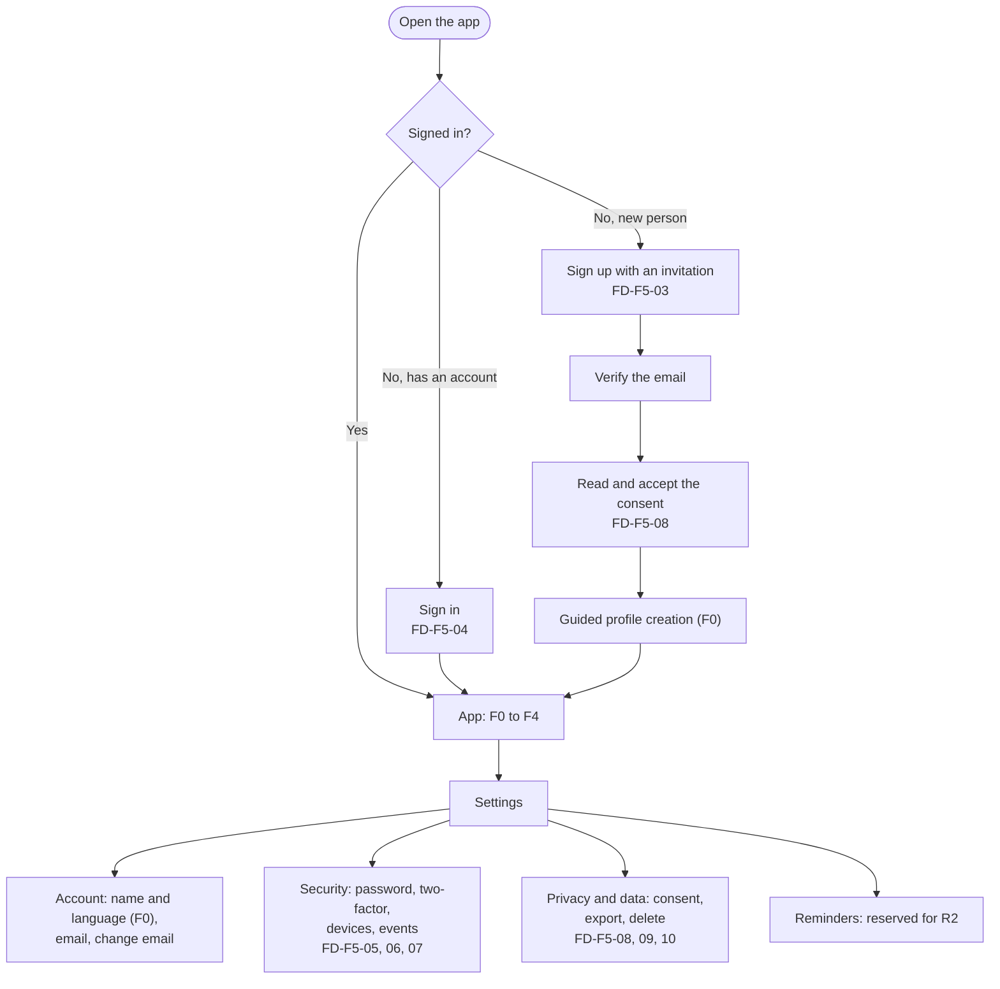

**[FD-F5-02](URS_SRS_F5_Account_Security.md#fd-f5-02). What F5 gives to and receives from other features**

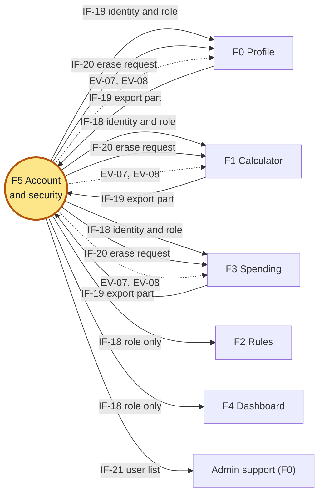

**[FD-F5-03](URS_SRS_F5_Account_Security.md#fd-f5-03). Sign-up and email verification** (email verification is in the launch account)

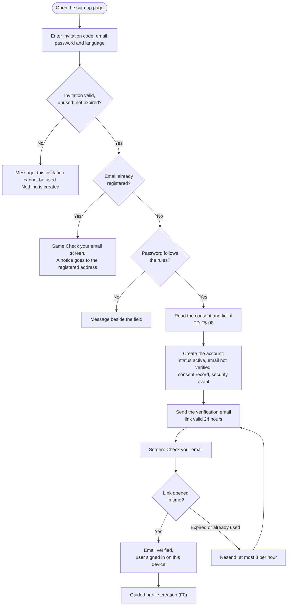

**[FD-F5-04](URS_SRS_F5_Account_Security.md#fd-f5-04). Sign-in, lockout and two-factor** (lockout and two-factor are in the launch account)

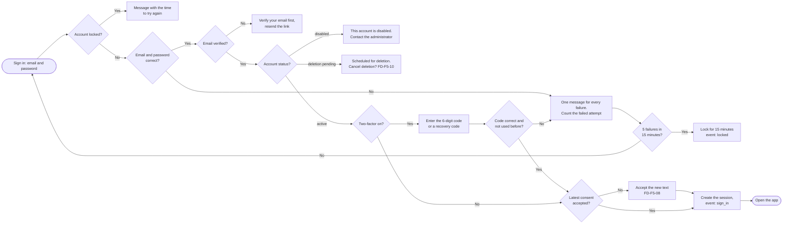

**[FD-F5-05](URS_SRS_F5_Account_Security.md#fd-f5-05). Forgot password, change password, change email** (basic account: the admin-sent link and the change of password and email; self-service forgot password and the email-change link are in the launch account)

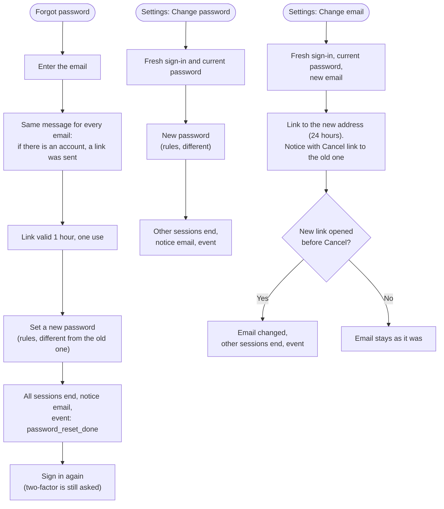

**[FD-F5-06](URS_SRS_F5_Account_Security.md#fd-f5-06). Two-factor login: turn on, turn off, lost phone** (launch account)

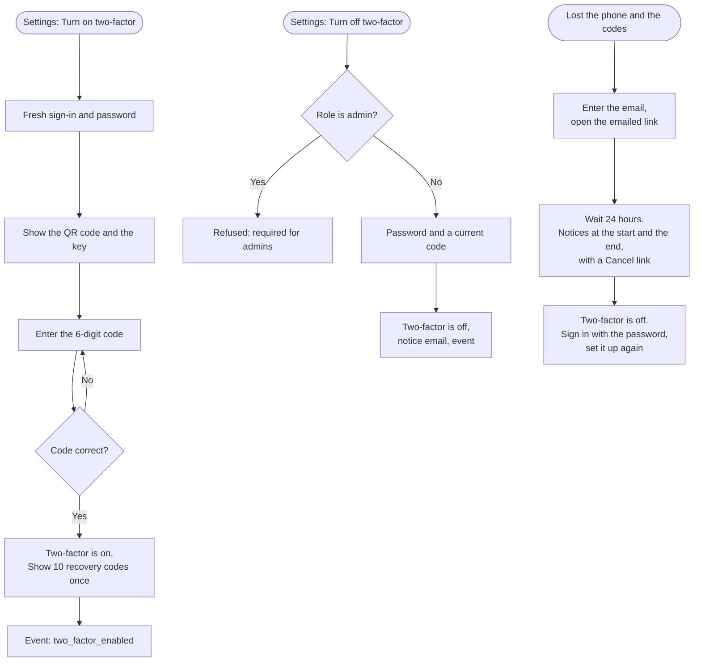

**[FD-F5-07](URS_SRS_F5_Account_Security.md#fd-f5-07). Life of a session** (basic account: one session length, the lock screen and the sign-out warning; the rest is in the launch account)

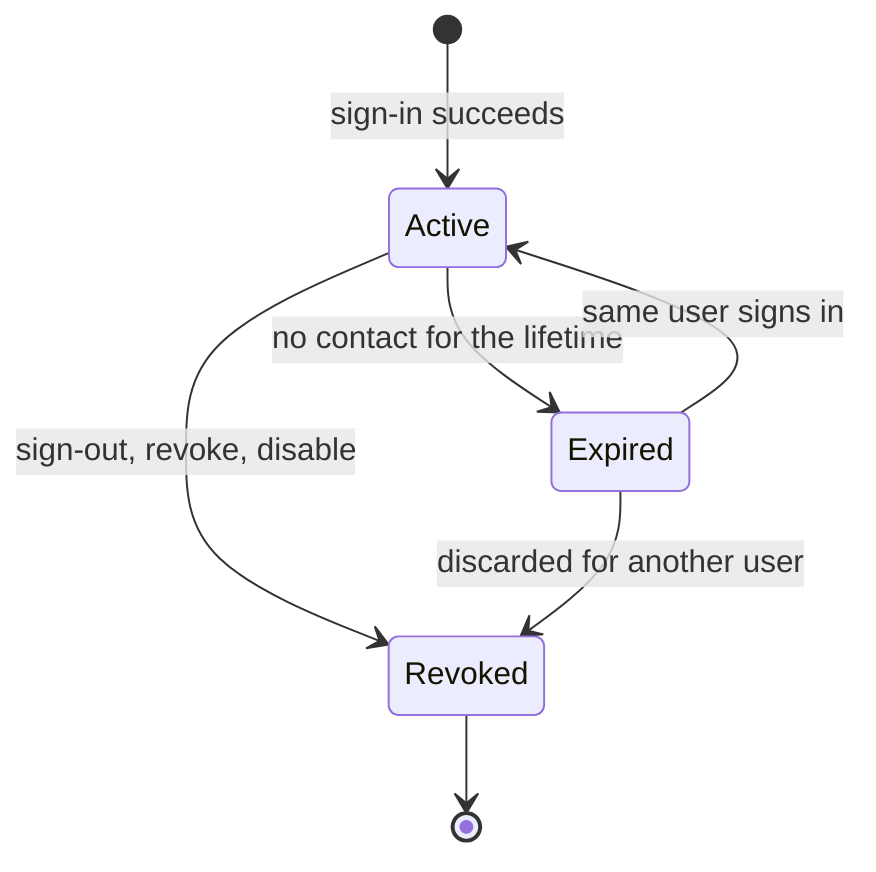

Reading the diagram: a session lives as long as the server keeps seeing it (own device 14 days, shared device 2 hours, admin 30 minutes). While the device is offline the app works from device data until the stored expiry. An expired session locks the screen and hides the data, but deletes nothing, so unsent changes are never lost by a timeout. The devices list and the security events ([URS-F5-06](URS_SRS_F5_Account_Security.md#urs-f5-06), [URS-F5-07](URS_SRS_F5_Account_Security.md#urs-f5-07)) are screens over the Session and SecurityEvent rows.

**[FD-F5-08](URS_SRS_F5_Account_Security.md#fd-f5-08). Consent**

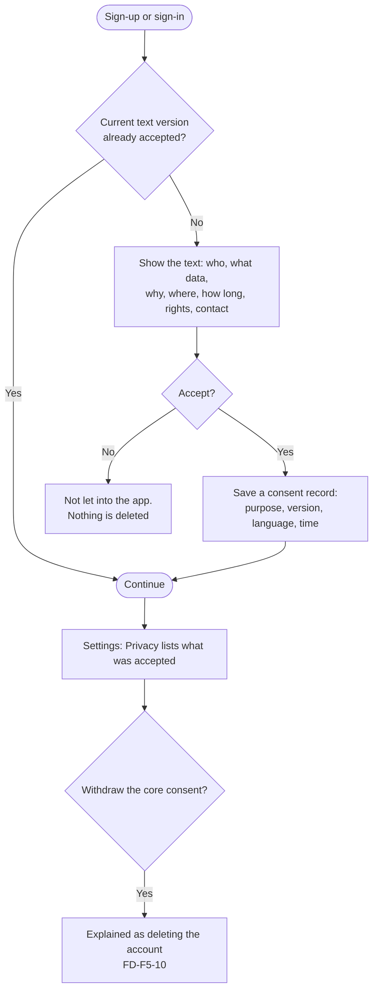

**[FD-F5-09](URS_SRS_F5_Account_Security.md#fd-f5-09). Export my data** (R3)

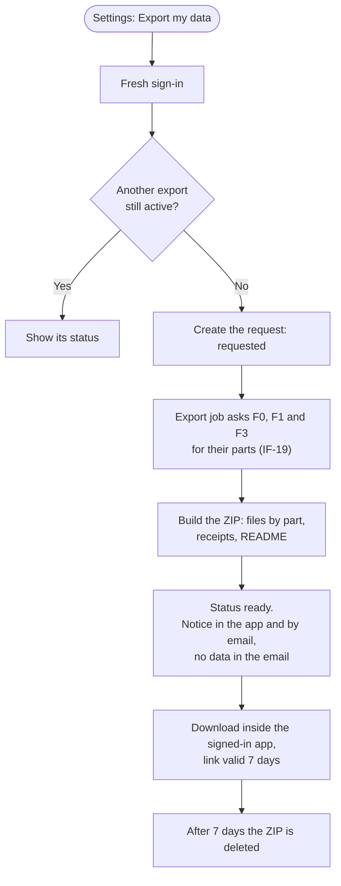

**[FD-F5-10](URS_SRS_F5_Account_Security.md#fd-f5-10). Delete my account** (launch account)

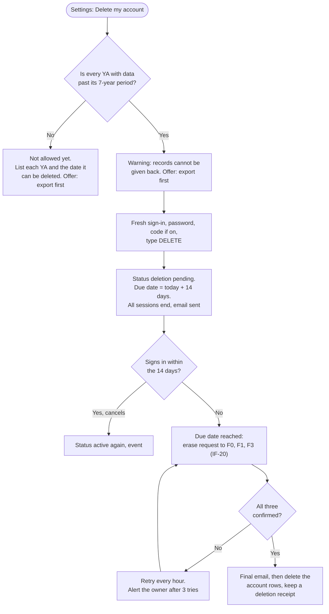

**[FD-F5-11](URS_SRS_F5_Account_Security.md#fd-f5-11). Admin account tools and their limits**

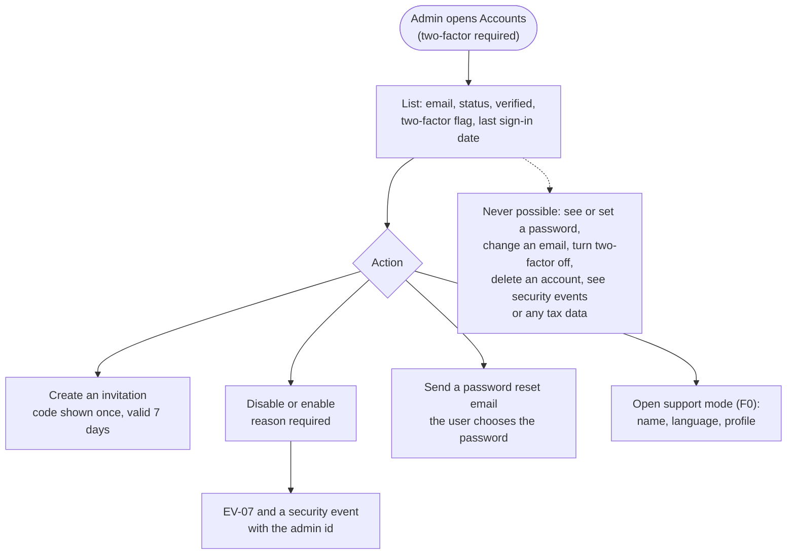

**[FD-F5-12](URS_SRS_F5_Account_Security.md#fd-f5-12). Data F5 owns**

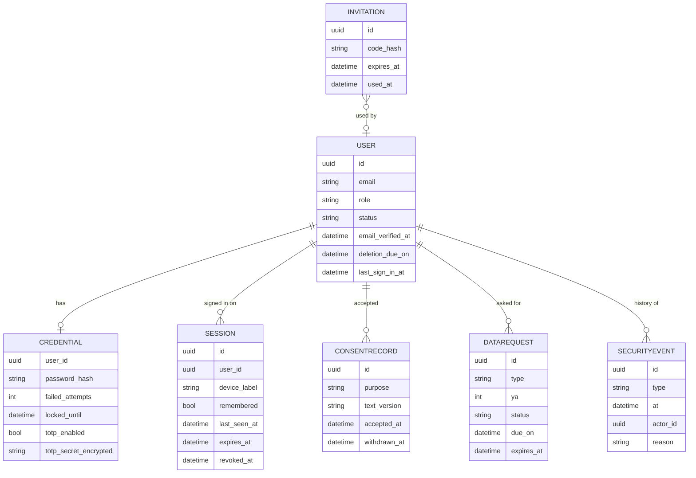

**[FD-F5-13](URS_SRS_F5_Account_Security.md#fd-f5-13). Records older than 7 years** (R3)

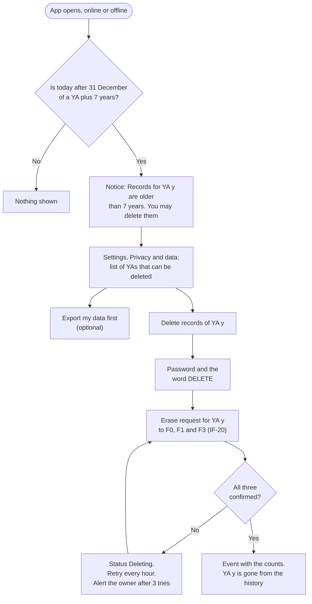

## A5. Relationship with other features

**FD-00. System map of the profile (F0), the four core features and account and security (F5) (identical in all six documents; the feature of this document is highlighted)**

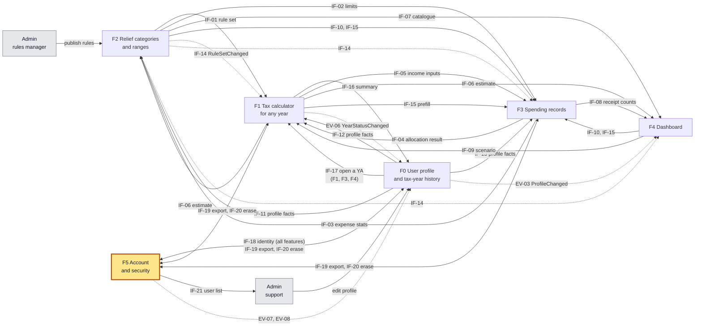

Reading the map: a solid arrow is data a feature reads or receives; a dashed arrow is an event. F0 owns the profile and the profile of every YA; the four core features only read it. F5 owns the account and the sign-in; it tells every feature who is signed in (IF-18, drawn once, to F0), asks F0, F1 and F3 for their part of a data export (IF-19) and tells them to erase (IF-20). F2 and F4 own no user data, so they take part only through IF-18. F1 and F3 depend on each other, so the order of calculation is fixed: F1 sends income inputs (IF-05), F3 allocates claims (IF-04), then F1 finishes the tax chain. That order is drawn in [SQ-F1-01](URS_SRS_F1_Tax_Calculator.md#sq-f1-01).

**Interfaces (identical in all six documents).** "Provider spec" is the SRS row that builds the data; "Consumer spec" is the SRS row that uses it.

| ID | From | To | Data carried | Trigger | Provider spec | Consumer spec |
| --- | --- | --- | --- | --- | --- | --- |
| IF-01 | F2 | F1 | Rule set of the selected YA plus, for this user, the evaluated rules: per category applicable or not, effective cap, tier, sub-limits, shared group, claim frequency | YA selected; EV-03; EV-04 | [SRS-F2-13](URS_SRS_F2_Relief_Categories.md#srs-f2-13) | [SRS-F1-01](URS_SRS_F1_Tax_Calculator.md#srs-f1-01) |
| IF-02 | F2 | F3 | Categories open to this user for the YA, with limits, sub-limits, shared group, frequency, required documents, beneficiary rule | Expense form opened; YA changed; EV-04 | [SRS-F2-13](URS_SRS_F2_Relief_Categories.md#srs-f2-13) | [SRS-F3-02](URS_SRS_F3_Spending_Records.md#srs-f3-02) |
| IF-03 | F3 | F2 | Per category: expense count, actual spend, applied, over cap, expenses missing a receipt | Category detail opened; EV-01 | [SRS-F3-14](URS_SRS_F3_Spending_Records.md#srs-f3-14) | [SRS-F2-06](URS_SRS_F2_Relief_Categories.md#srs-f2-06) |
| IF-04 | F3 | F1 | Allocation result: applied amount per category (spending and income-sourced), deductions applied, aggregate income before donations | Any change to expenses, income, profile or rules | [SRS-F3-14](URS_SRS_F3_Spending_Records.md#srs-f3-14) | [SRS-F1-06](URS_SRS_F1_Tax_Calculator.md#srs-f1-06) |
| IF-05 | F1 | F3 | Income inputs: total income for the YA, and the amount already counted by income-sourced categories (employee EPF, SOCSO and EIS) | EV-02 | [SRS-F1-05](URS_SRS_F1_Tax_Calculator.md#srs-f1-05) | [SRS-F3-07](URS_SRS_F3_Spending_Records.md#srs-f3-07) |
| IF-06 | F1 | F2, F4 | Estimate: full tax chain, reliefs by category (applied, effective cap, room, source), PCB figures, labels | Every recalculation (EV-05) | [SRS-F1-07](URS_SRS_F1_Tax_Calculator.md#srs-f1-07), [SRS-F1-13](URS_SRS_F1_Tax_Calculator.md#srs-f1-13) | [SRS-F2-05](URS_SRS_F2_Relief_Categories.md#srs-f2-05), [SRS-F4-02](URS_SRS_F4_Dashboard.md#srs-f4-02) |
| IF-07 | F2 | F4 | Catalogue summary (category, group, status, effective cap), TaxYear dates (period, filing deadline) | YA selected; EV-04 | [SRS-F2-13](URS_SRS_F2_Relief_Categories.md#srs-f2-13) | [SRS-F4-02](URS_SRS_F4_Dashboard.md#srs-f4-02) |
| IF-08 | F3 | F4 | Receipt counts per category and in total: with receipt, missing, pending upload; expense counts | EV-01 | [SRS-F3-14](URS_SRS_F3_Spending_Records.md#srs-f3-14) | [SRS-F4-04](URS_SRS_F4_Dashboard.md#srs-f4-04), [SRS-F4-08](URS_SRS_F4_Dashboard.md#srs-f4-08) |
| IF-09 | F4 | F1 | Scenario request (as recorded for any YA, no reliefs, use room of listed categories, use all room) and the scenario estimate | Dashboard load; EV-05 | [SRS-F1-18](URS_SRS_F1_Tax_Calculator.md#srs-f1-18) | [SRS-F4-05](URS_SRS_F4_Dashboard.md#srs-f4-05), [SRS-F4-06](URS_SRS_F4_Dashboard.md#srs-f4-06) |
| IF-10 | F2, F4 | F3 | Navigate to the spending list with a filter: YA, category, receipt status | User taps a count or alert | [SRS-F3-15](URS_SRS_F3_Spending_Records.md#srs-f3-15) | [SRS-F2-06](URS_SRS_F2_Relief_Categories.md#srs-f2-06), [SRS-F4-11](URS_SRS_F4_Dashboard.md#srs-f4-11) |
| IF-11 | F0 | F2 | Profile facts of the selected YA: marital status, spouse income and disability, own disability, dependants with date of birth, education level and disability, first-home facts, whether the dependants list is confirmed, and whether the profile is complete | EV-03 | [SRS-F0-15](URS_SRS_F0_User_Profile.md#srs-f0-15) | [SRS-F2-04](URS_SRS_F2_Relief_Categories.md#srs-f2-04) |
| IF-12 | F0 | F1 | The same profile facts and the complete flag | EV-03 | [SRS-F0-15](URS_SRS_F0_User_Profile.md#srs-f0-15) | [SRS-F1-04](URS_SRS_F1_Tax_Calculator.md#srs-f1-04) |
| IF-13 | F0 | F3 | The same profile facts and the complete flag of the YA the expense falls in, used to check eligibility and the beneficiary | EV-03 | [SRS-F0-15](URS_SRS_F0_User_Profile.md#srs-f0-15) | [SRS-F3-02](URS_SRS_F3_Spending_Records.md#srs-f3-02), [SRS-F3-03](URS_SRS_F3_Spending_Records.md#srs-f3-03) |
| IF-14 | F2 | F1, F3, F4 | RuleSetChanged event: YA and new rule version | Admin publishes ([SRS-F2-11](URS_SRS_F2_Relief_Categories.md#srs-f2-11)) | [SRS-F2-11](URS_SRS_F2_Relief_Categories.md#srs-f2-11) | [SRS-F1-15](URS_SRS_F1_Tax_Calculator.md#srs-f1-15), [SRS-F3-14](URS_SRS_F3_Spending_Records.md#srs-f3-14), [SRS-F4-10](URS_SRS_F4_Dashboard.md#srs-f4-10) |
| IF-15 | F1, F2, F4 | F3 | Open the add-expense form pre-filled: YA, category, optional sub-limit, optional amount | User taps "Add as expense" | [SRS-F3-15](URS_SRS_F3_Spending_Records.md#srs-f3-15) | [SRS-F1-16](URS_SRS_F1_Tax_Calculator.md#srs-f1-16), [SRS-F2-06](URS_SRS_F2_Relief_Categories.md#srs-f2-06), [SRS-F4-11](URS_SRS_F4_Dashboard.md#srs-f4-11) |
| IF-16 | F1 | F0 | Tax-year summary for every stored YA: status and filed date, whether income exists, the live estimate (tax payable, total reliefs, chargeable income, labels) and the saved calculations (id, trigger, date, figures, profile id and profile version used) | History list or detail opened; EV-05; EV-06 | [SRS-F1-23](URS_SRS_F1_Tax_Calculator.md#srs-f1-23) | [SRS-F0-11](URS_SRS_F0_User_Profile.md#srs-f0-11), [SRS-F0-12](URS_SRS_F0_User_Profile.md#srs-f0-12) |
| IF-17 | F0 | F1, F3, F4 | Open a feature for a chosen YA, with an optional filter (F3: receipt status) | User taps an action on a tax year | [SRS-F0-12](URS_SRS_F0_User_Profile.md#srs-f0-12) | [SRS-F1-01](URS_SRS_F1_Tax_Calculator.md#srs-f1-01), [SRS-F3-15](URS_SRS_F3_Spending_Records.md#srs-f3-15), [SRS-F4-01](URS_SRS_F4_Dashboard.md#srs-f4-01) |
| IF-18 | F5 | F0, F1, F3 (F2 and F4 read the role only, [OI-F5-05](URS_SRS_F5_Account_Security.md#oi-f5-05)) | Signed-in identity: user id, role (user or admin), language, session expiry, device id, whether two-factor login is on | App start; sign-in; session refresh; EV-07; EV-08 | [SRS-F5-18](URS_SRS_F5_Account_Security.md#srs-f5-18) | [SRS-F0-19](URS_SRS_F0_User_Profile.md#srs-f0-19), [SRS-F1-24](URS_SRS_F1_Tax_Calculator.md#srs-f1-24), [SRS-F3-18](URS_SRS_F3_Spending_Records.md#srs-f3-18) |
| IF-19 | F0, F1, F3 | F5 | Export part: every row the feature owns for the user, all versions, as records, plus the list of files (F3) | The export job runs ([SRS-F5-14](URS_SRS_F5_Account_Security.md#srs-f5-14)) | [SRS-F0-19](URS_SRS_F0_User_Profile.md#srs-f0-19), [SRS-F1-24](URS_SRS_F1_Tax_Calculator.md#srs-f1-24), [SRS-F3-18](URS_SRS_F3_Spending_Records.md#srs-f3-18) | [SRS-F5-14](URS_SRS_F5_Account_Security.md#srs-f5-14) |
| IF-20 | F5 | F0, F1, F3 | Erase request: delete every row and file of the user, or, when the request names a YA, only the rows and files of that YA, and answer with the counts | The user confirms the deletion of a YA past its 7 years ([SRS-F5-21](URS_SRS_F5_Account_Security.md#srs-f5-21)); in the launch account also when the grace period ends ([SRS-F5-16](URS_SRS_F5_Account_Security.md#srs-f5-16)) | [SRS-F5-16](URS_SRS_F5_Account_Security.md#srs-f5-16), [SRS-F5-21](URS_SRS_F5_Account_Security.md#srs-f5-21) | [SRS-F0-19](URS_SRS_F0_User_Profile.md#srs-f0-19), [SRS-F1-24](URS_SRS_F1_Tax_Calculator.md#srs-f1-24), [SRS-F3-18](URS_SRS_F3_Spending_Records.md#srs-f3-18) |
| IF-21 | F5 | F0 | User list for support: user id, name, email, status, role, two-factor flag, last sign-in date; no tax data | An admin opens the user list | [SRS-F5-17](URS_SRS_F5_Account_Security.md#srs-f5-17) | [SRS-F0-16](URS_SRS_F0_User_Profile.md#srs-f0-16) |

**Events**

| ID | Event | Raised by | Heard by |
| --- | --- | --- | --- |
| EV-01 | ExpenseChanged (ya, expense ids) | F3, after every local save, edit, delete or sync | F1, F2, F4 |
| EV-02 | IncomeChanged (ya) | F1, after every income or PCB save | F3 (refresh IF-05), F4 |
| EV-03 | ProfileChanged (ya, profile id, version) | F0, after every profile or dependant save, copy to a new YA, or apply to later YAs | F1, F2, F3, F4 |
| EV-04 | RuleSetChanged (ya, version) = IF-14 | F2 | F1, F3, F4 |
| EV-05 | EstimateComputed (ya) | F1, after every recalculation | F2, F4 |
| EV-06 | YearStatusChanged (ya, status filed or open) | F1, after mark as filed or reopen ([SRS-F1-21](URS_SRS_F1_Tax_Calculator.md#srs-f1-21)) | F0, F4 |
| EV-07 | AccountStatusChanged (user, status active, disabled or deletion_pending) | F5, after an admin disables or enables the account, a deletion request or its cancel ([SRS-F5-15](URS_SRS_F5_Account_Security.md#srs-f5-15), [SRS-F5-17](URS_SRS_F5_Account_Security.md#srs-f5-17)) | F0, F1, F3 |
| EV-08 | SessionEnded (user, device, reason: signed out, expired, revoked, password changed) | F5, whenever a session ends ([SRS-F5-08](URS_SRS_F5_Account_Security.md#srs-f5-08), [SRS-F5-09](URS_SRS_F5_Account_Security.md#srs-f5-09)) | F0, F1, F3 |

**Data ownership (identical in all six documents).** O = owns and writes; R = reads; Agg = reads only aggregated results through an interface; none = no access. Export and erase mean the feature supplies its part to F5 (IF-19) and deletes it on request (IF-20). "Admin" can touch the profile (while its YA is not filed), the account's name and language, and file names only.

| Entity | F0 | F1 | F2 | F3 | F4 | F5 | Admin |
| --- | --- | --- | --- | --- | --- | --- | --- |
| User.name, User.language, TaxpayerProfile (one per YA, DA-16), Dependant, HouseholdLink | O | R (IF-12) | R (IF-11) | R (IF-13) | none | Export, erase | Manage name, language and profile fields of a YA that is not filed |
| User.email, role, status; Credential, Session, ConsentRecord, Invitation, DataRequest, SecurityEvent (DA-21 to DA-24) | R (IF-18) | R (IF-18) | R (IF-18, role) | R (IF-18) | R (IF-18, role) | O | Invite, disable, enable, send a reset email. No password, no email change, no two-factor off |
| IncomeRecord | none | O | none | Agg (IF-05) | Agg (IF-06) | Export, erase | none |
| UserTaxYear (DA-12: filed status per user) | R (lock follows status) | O | none | R | R | Export, erase | none |
| TaxEstimate | Agg (IF-16) | O | Agg (IF-06) | none | R | Export, erase | none |
| TaxYear, TaxBand, RebateRule | none | R (IF-01) | O | none | R (IF-07) | none | Create and edit |
| ReliefCategory, ReliefRule, SubLimit, RuleTier | none | R (IF-01) | O | R (IF-02) | R (IF-07) | none | Create and edit |
| Expense, ExpenseAllocation | none | Agg (IF-04) | Agg (IF-03) | O | Agg (IF-08) | Export, erase | none (amounts and descriptions are confidential) |
| Receipt | none | none | none | O | Agg (IF-08) | Export, erase | File name and type only; upload, download, delete on request ([OI-F3-01](URS_SRS_F3_Spending_Records.md#oi-f3-01)) |

**A5.4 Inter-related data for F5**

| Data | Direction | Other feature | What F5 uses it for, or gives it for | Interface | If it is missing or late |
| --- | --- | --- | --- | --- | --- |
| Signed-in identity: user id, role, language, session expiry, two-factor flag | out | F0, F1, F3 (role only: F2, F4) | Every feature decides whose data it reads and what an admin may do | IF-18 | Offline, the device copy from the last sign-in is used until the session expires ([SRS-F5-09](URS_SRS_F5_Account_Security.md#srs-f5-09)) |
| Export part | in | F0, F1, F3 | Builds the user's ZIP | IF-19 | A part that fails is retried; after 3 tries the export is marked failed ([SRS-F5-14](URS_SRS_F5_Account_Security.md#srs-f5-14)) |
| Erase request | out | F0, F1, F3 | R3: deletes the data of one YA that is past its 7 years ([SRS-F5-21](URS_SRS_F5_Account_Security.md#srs-f5-21)). Launch account: deletes the whole account after the grace period | IF-20 | F5 repeats the request every hour and deletes nothing of its own until all three confirm ([SRS-F5-16](URS_SRS_F5_Account_Security.md#srs-f5-16), [SRS-F5-21](URS_SRS_F5_Account_Security.md#srs-f5-21)) |
| User list for support | out | F0 | An admin opens a user in support mode | IF-21 | Not applicable |
| AccountStatusChanged | out | F0, F1, F3 | Stop sending and show a notice | EV-07 | Features learn at the next server call, which is refused with the same notice |
| SessionEnded | out | F0, F1, F3 | Stop sending and show a notice or the lock screen | EV-08 | As above |
| Name and language | in | F0 | Shown in Settings and in the Accounts list | IF-18 (language), read of User | Shown as blank until F0 has them |

## A6. Assumptions and constraints

1. Accounts are for people. R1 has one real user, the product owner. Public sign-up opens only after the launch gate (PRD section 9.1, [SD-F5-01](URS_SRS_F5_Account_Security.md#sd-f5-01)).
2. F5 never holds tax data, and its logs never hold tax data, passwords, tokens or codes (NFR-7, [SRS-F5-19](URS_SRS_F5_Account_Security.md#srs-f5-19)).
3. Every value in B3.1 (lengths, times, limits) is a starting value proposed by the specification writer, not a PRD figure. The owner confirms them as decisions [SD-F5-02](URS_SRS_F5_Account_Security.md#sd-f5-02) to [SD-F5-08](URS_SRS_F5_Account_Security.md#sd-f5-08).
4. The app works offline (NFR-2). Everything that needs the server (sign-up, sign-in, password work, export, deletion) says "Needs a connection" when offline and changes nothing.
5. The PDPA adviser and the hosting choice decide the final consent text, the retention of security events and the time limits for answering requests ([OI-F5-01](URS_SRS_F5_Account_Security.md#oi-f5-01) to [OI-F5-04](URS_SRS_F5_Account_Security.md#oi-f5-04)).
6. Sending email needs a mail service and a sending domain, held by the owner on 23/11/2026 and decided with the stack (ADR-006, [OI-F5-06](URS_SRS_F5_Account_Security.md#oi-f5-06)); the basic account needs it for the reset link. No email ever carries tax data.
7. The basic account is the simple account ([SD-F5-17](URS_SRS_F5_Account_Security.md#sd-f5-17)). The launch account is specified here and held. Some parts are built with R3 (PRD phase 4) ([SD-F5-19](URS_SRS_F5_Account_Security.md#sd-f5-19)). B3.6 says what belongs to which phase.
8. Without lockout and two-factor, the basic account relies on invitation-only access, the password rules and an admin session of 30 minutes. An admin account has no second factor in the basic account. The owner accepted this by moving these features to the launch account on 14/11/2026, and confirmed on 22/11/2026 that the basic account is used only by the owner and the people the owner invites (F-049). The launch account is needed before any public launch.

---

# Part B. System Requirements Specification (SRS)

## B1. Functional specifications

### B1.1 Sign-up, verification, consent

| ID | Specification | Basis | URS | Flow | Test |
| --- | --- | --- | --- | --- | --- |
| SRS-F5-01 | **Sign-up (by invitation).** [Basic account; the verification email is in the launch account, B3.6] 1. Fields: invitation code, email, password ([SRS-F5-02](URS_SRS_F5_Account_Security.md#srs-f5-02)), language (English or Bahasa Malaysia, default the browser's language) and the consent tick box ([SRS-F5-04](URS_SRS_F5_Account_Security.md#srs-f5-04)). 2. An invitation is single use, valid 7 days and made by an admin ([SRS-F5-17](URS_SRS_F5_Account_Security.md#srs-f5-17)). In R1 sign-up needs one ([SD-F5-01](URS_SRS_F5_Account_Security.md#sd-f5-01)); the public launch removes the field. 3. Email: valid format, 5 to 254 characters, case-insensitive, stored in lower case, unique. 4. On success F5 creates the User (status active, email_verified_at empty, role user, language as chosen), the Credential and the ConsentRecord, marks the invitation used, sends the verification email ([SRS-F5-03](URS_SRS_F5_Account_Security.md#srs-f5-03)) and shows "Check your email". After this, F0 owns User.language ([SD-F5-13](URS_SRS_F5_Account_Security.md#sd-f5-13)). 5. No account enumeration: when the email is already registered the screen is the same "Check your email" and the registered address receives "Someone tried to sign up with this email. If it was you, sign in or reset your password." An invitation that is invalid, used or expired shows "This invitation cannot be used. Ask for a new one." and nothing is created. 6. At most 10 sign-up attempts per hour per device. 7. Sign-up needs a connection. | PRD section 7 (Sign in and onboarding), NFR-6, [SD-F5-01](URS_SRS_F5_Account_Security.md#sd-f5-01), [SD-F5-13](URS_SRS_F5_Account_Security.md#sd-f5-13), DA-21 to DA-23 | [URS-F5-01](URS_SRS_F5_Account_Security.md#urs-f5-01), [URS-F5-02](URS_SRS_F5_Account_Security.md#urs-f5-02) | [FD-F5-03](URS_SRS_F5_Account_Security.md#fd-f5-03) | [TC-F5-01](URS_SRS_F5_Account_Security.md#tc-f5-01), [TC-F5-02](URS_SRS_F5_Account_Security.md#tc-f5-02) |
| SRS-F5-02 | **Password rules.** [Basic account] 1. Length 12 to 128 characters; any characters, spaces included; no required mix of letters, digits or symbols and no forced change on a schedule ([SD-F5-02](URS_SRS_F5_Account_Security.md#sd-f5-02)). 2. Refused: a password equal to the email or to the part before the @ (case-insensitive), or one on the list of common passwords (at least the 10,000 most used, checked on the server). 3. The failing rule is named beside the field; a strength hint is shown. 4. Show and hide toggle; paste and password managers are allowed. 5. Stored only as an Argon2id hash with a salt per user; never logged, emailed or returned. | NFR-6, [SD-F5-02](URS_SRS_F5_Account_Security.md#sd-f5-02) | [URS-F5-01](URS_SRS_F5_Account_Security.md#urs-f5-01) | [FD-F5-03](URS_SRS_F5_Account_Security.md#fd-f5-03) | [TC-F5-03](URS_SRS_F5_Account_Security.md#tc-f5-03) |
| SRS-F5-03 | **Email verification.** [Launch account] 1. The verification email holds a link with a random token (at least 128 bits, stored as a hash), valid 24 hours, single use. 2. Until the email is verified the user cannot use the app: sign-in shows "Verify your email first" with a Resend button, at most 3 per hour; a new link voids the older one. 3. Opening a valid link sets email_verified_at, signs the user in on that device (not remembered) and starts the guided profile creation of F0 ([SRS-F0-01](URS_SRS_F0_User_Profile.md#srs-f0-01)). 4. An expired or used link shows the reason and Resend. 5. An account never verified within 7 days is deleted by the system, and its invitation stays used ([SD-F5-03](URS_SRS_F5_Account_Security.md#sd-f5-03)). | NFR-6, [SD-F5-03](URS_SRS_F5_Account_Security.md#sd-f5-03), DA-21 | [URS-F5-01](URS_SRS_F5_Account_Security.md#urs-f5-01) | [FD-F5-03](URS_SRS_F5_Account_Security.md#fd-f5-03) | [TC-F5-04](URS_SRS_F5_Account_Security.md#tc-f5-04) |
| SRS-F5-04 | **Consent.** [Basic account; B3.6 for the withdrawal] 1. Purposes: CORE (required: storing and processing the user's profile, income, spending, receipt and security data to run TRM) and, from R2, SERVICE_EMAILS (optional, off by default; reminders). R1 has CORE only ([SD-F5-12](URS_SRS_F5_Account_Security.md#sd-f5-12)). 2. The text is shown in the user's language and is versioned (text_version). It has the headings in B3.5. The final wording is written by the PDPA adviser before public launch ([OI-F5-02](URS_SRS_F5_Account_Security.md#oi-f5-02)); R1 uses a draft with the same headings. 3. A ConsentRecord (user_id, purpose, text_version, language, accepted_at) is inserted when the user accepts. Records are never edited; withdrawal sets withdrawn_at on the record. 4. When a new text version is published, the user must accept it at the next sign-in before the app opens; declining signs the user out and deletes nothing. 5. Withdrawing CORE is the same as deleting the account: the screen explains this and opens the deletion warning ([SRS-F5-15](URS_SRS_F5_Account_Security.md#srs-f5-15)); it is not a silent switch. 6. Settings, Privacy lists every record with date and version and shows the accepted text. | NFR-7, PRD section 7, [SD-F5-12](URS_SRS_F5_Account_Security.md#sd-f5-12), DA-23 | [URS-F5-02](URS_SRS_F5_Account_Security.md#urs-f5-02) | [FD-F5-08](URS_SRS_F5_Account_Security.md#fd-f5-08) | [TC-F5-05](URS_SRS_F5_Account_Security.md#tc-f5-05), [TC-F5-06](URS_SRS_F5_Account_Security.md#tc-f5-06) |

### B1.2 Sign-in, two-factor login, sessions

| ID | Specification | Basis | URS | Flow | Test |
| --- | --- | --- | --- | --- | --- |
| SRS-F5-05 | **Sign-in.** [Basic account without lockout, own-device tick and two-factor; B3.6] 1. Fields: email, password, and the tick box "This is my own device" (ticked by default; unticked means a shared device, [SRS-F5-08](URS_SRS_F5_Account_Security.md#srs-f5-08)). 2. Any wrong email or password shows the same message "Email or password is not correct", in about the same time. 3. **Lockout:** 5 failed attempts for one email within 15 minutes lock sign-in for 15 minutes from the 5th failure (locked_until). While locked even the correct password is refused with "Too many attempts. Try again after {time}." A successful sign-in resets failed_attempts. At most 20 attempts per hour per device ([SD-F5-04](URS_SRS_F5_Account_Security.md#sd-f5-04)). 4. After a correct password: email not verified gives "Verify your email first" ([SRS-F5-03](URS_SRS_F5_Account_Security.md#srs-f5-03)); status disabled gives "This account is disabled. Contact the administrator."; status deletion_pending gives "Your account is scheduled for deletion on {date}. Cancel deletion?" ([SRS-F5-15](URS_SRS_F5_Account_Security.md#srs-f5-15)); two-factor on asks for the code ([SRS-F5-06](URS_SRS_F5_Account_Security.md#srs-f5-06)) before any session exists. 5. Then the consent check ([SRS-F5-04](URS_SRS_F5_Account_Security.md#srs-f5-04)), then the session ([SRS-F5-08](URS_SRS_F5_Account_Security.md#srs-f5-08)) and IF-18. 6. Every result writes a security event: sign_in, sign_in_failed or locked ([SRS-F5-12](URS_SRS_F5_Account_Security.md#srs-f5-12)). 7. Sign-in needs a connection. Sign-out ends this session, raises EV-08 and follows [SRS-F5-09](URS_SRS_F5_Account_Security.md#srs-f5-09). | NFR-6, [SD-F5-04](URS_SRS_F5_Account_Security.md#sd-f5-04), DA-21, DA-22 | [URS-F5-03](URS_SRS_F5_Account_Security.md#urs-f5-03) | [FD-F5-04](URS_SRS_F5_Account_Security.md#fd-f5-04) | [TC-F5-07](URS_SRS_F5_Account_Security.md#tc-f5-07), [TC-F5-08](URS_SRS_F5_Account_Security.md#tc-f5-08), [TC-F5-09](URS_SRS_F5_Account_Security.md#tc-f5-09) |
| SRS-F5-06 | **Two-factor login (admins and taxpayers).** [Launch account] 1. Method: an authenticator app (6 digits, 30-second step; the step before and after are also accepted). No codes by SMS ([SD-F5-05](URS_SRS_F5_Account_Security.md#sd-f5-05)). 2. **Turn on:** needs a fresh sign-in and the password; shows a QR code and the key as text; only a correct code turns it on (totp_enabled true, secret stored encrypted). Then 10 recovery codes of 10 characters are shown once, with Copy and Download; only their hashes are stored. 3. **Sign-in:** after the password the user enters a 6-digit code or a recovery code. A code works once: the same code a second time is refused. Wrong codes count as failed attempts for the lockout of [SRS-F5-05](URS_SRS_F5_Account_Security.md#srs-f5-05). 4. **Turn off (taxpayer):** fresh sign-in, password and a current code; notice email; event. 5. **Admin accounts:** two-factor is required. An admin without it is sent to the setup screen at sign-in and cannot use admin screens until it is on; an admin cannot turn it off. 6. Making new recovery codes needs the same checks and voids all old codes. | NFR-6, [SD-F5-05](URS_SRS_F5_Account_Security.md#sd-f5-05), DA-22 | [URS-F5-05](URS_SRS_F5_Account_Security.md#urs-f5-05) | [FD-F5-06](URS_SRS_F5_Account_Security.md#fd-f5-06) | [TC-F5-10](URS_SRS_F5_Account_Security.md#tc-f5-10), [TC-F5-11](URS_SRS_F5_Account_Security.md#tc-f5-11) |
| SRS-F5-07 | **Recovery codes and a lost authenticator.** [Launch account] 1. A sign-in with a recovery code shows how many codes are left; at 2 or fewer Settings shows "Create new recovery codes". 2. **Lost phone and no codes:** "I lost both" asks for the email and sends a link (valid 24 hours). Opening it starts a 24-hour wait. A notice goes to the email at the start (with a Cancel link) and at the end. A sign-in with a correct code, or the Cancel link, stops the wait. After the wait two-factor is turned off, the user signs in with the password only and is asked to set it up again ([SD-F5-07](URS_SRS_F5_Account_Security.md#sd-f5-07)). 3. An admin cannot turn off or reset two-factor for anyone ([SD-F5-10](URS_SRS_F5_Account_Security.md#sd-f5-10)). If the product owner loses both the phone and the email, recovery is done by whoever runs the hosting, directly in the data, outside the product. | NFR-6, [SD-F5-07](URS_SRS_F5_Account_Security.md#sd-f5-07), [SD-F5-10](URS_SRS_F5_Account_Security.md#sd-f5-10) | [URS-F5-05](URS_SRS_F5_Account_Security.md#urs-f5-05) | [FD-F5-06](URS_SRS_F5_Account_Security.md#fd-f5-06) | [TC-F5-12](URS_SRS_F5_Account_Security.md#tc-f5-12) |
| SRS-F5-08 | **Sessions.** [Basic account simple session; item 5 is R3; the rest is in the launch account, B3.6] 1. A successful sign-in creates a Session (device_label such as "Chrome on Android", remembered, created_at, last_seen_at, expires_at). 2. The session token is a random value stored as a hash and carried in a cookie that is HttpOnly, Secure and SameSite Lax; it is never kept in local storage. 3. **Lifetime** counts from the last time the server saw the session: own device 14 days; shared device 2 hours; admin 30 minutes, whatever the choice ([SD-F5-06](URS_SRS_F5_Account_Security.md#sd-f5-06)). Each server contact (a sync or any request) moves expires_at, at most once every 5 minutes. 4. **Fresh sign-in:** a change of password or email, a two-factor change, an export and a deletion need a sign-in within the last 10 minutes; otherwise the password is asked again (and the code, if two-factor is on). 5. **Devices:** Settings lists every active session with device_label, first used, last used and "This device". The user can sign out one device or "Sign out all other devices". A revoked session shows the sign-in screen at its next server contact. 6. A password change ends every other session; a password reset, an admin disable and a deletion request end all sessions. Each end raises EV-08. 7. The server checks the session and the role on every request and refuses a missing, expired or revoked session, or a role that is not allowed. No feature trusts a role sent by the device. | NFR-6, [SD-F5-06](URS_SRS_F5_Account_Security.md#sd-f5-06), DA-22 | [URS-F5-03](URS_SRS_F5_Account_Security.md#urs-f5-03), [URS-F5-06](URS_SRS_F5_Account_Security.md#urs-f5-06) | [FD-F5-07](URS_SRS_F5_Account_Security.md#fd-f5-07) | [TC-F5-13](URS_SRS_F5_Account_Security.md#tc-f5-13), [TC-F5-14](URS_SRS_F5_Account_Security.md#tc-f5-14) |
| SRS-F5-09 | **Offline use, expiry and sign-out.** [Basic account except item 4, B3.6] 1. Offline, F0 to F4 work from device data. The device keeps the session's expires_at from the last server contact, and the app works while the device clock is before it. 2. **Expired while offline:** the lock screen "Sign in when you are online to continue" hides the data. Nothing is deleted. 3. After an online sign-in by the same user the lock lifts and the outbox is sent in order. 4. **Another user on the same device** while it holds unsent changes of the first user: sign-in is refused with "This device still holds {n} unsent changes of another account. That account must sign in to send them, or choose Discard." The lock screen has Discard, with a typed confirmation, which deletes that user's data from the device. 5. **Sign-out:** with n unsent changes (n above 0) the app says "{n} changes have not been sent." and offers Wait (stay signed in) or Sign out and discard (typed confirmation); with none, it signs out and removes the user's data from the device. The cached rules are not personal and may stay. 6. After EV-07 (disabled or deletion_pending) or EV-08 (revoked or password changed), features stop sending; the next server contact shows the matching notice; unsent changes stay on the device until the user signs in again or discards them ([SD-F5-16](URS_SRS_F5_Account_Security.md#sd-f5-16)). 7. After an erase, the next sign-in fails and the device offers "Remove data from this device". | NFR-2, NFR-6, [SD-F5-16](URS_SRS_F5_Account_Security.md#sd-f5-16) | [URS-F5-10](URS_SRS_F5_Account_Security.md#urs-f5-10) | [FD-F5-07](URS_SRS_F5_Account_Security.md#fd-f5-07) | [TC-F5-15](URS_SRS_F5_Account_Security.md#tc-f5-15), [TC-F5-16](URS_SRS_F5_Account_Security.md#tc-f5-16) |

### B1.3 Password, email and security events

| ID | Specification | Basis | URS | Flow | Test |
| --- | --- | --- | --- | --- | --- |
| SRS-F5-10 | **Forgot password.** [Basic account: the admin-sent link only; the self-service screen is in the launch account] 1. "Forgot password" asks for the email. The screen and message are the same for every email: "If this email has an account, we sent a link." 2. When it has one, the link is valid 1 hour and single use, with the token stored as a hash; a new request voids the old link. At most 5 requests per hour per email and 20 per hour per device; the message does not change when a limit is reached. 3. The new password follows [SRS-F5-02](URS_SRS_F5_Account_Security.md#srs-f5-02) and must differ from the current one. 4. On success: every session ends (EV-08, reason password changed), failed attempts and any lock are cleared, a notice "Your password was changed. Not you? Contact the administrator." is emailed, and the event password_reset_done is written. Two-factor is still asked at the next sign-in. 5. An admin can trigger the email ([SRS-F5-17](URS_SRS_F5_Account_Security.md#srs-f5-17)) but never sees the link or the new password. 6. **Basic account:** only this admin-triggered path exists. The user who forgot the password asks the administrator outside the app; the administrator sends a temporary link (valid 1 hour, single use); the user opens it and chooses a new password twice ([SRS-F5-02](URS_SRS_F5_Account_Security.md#srs-f5-02)). The self-service "Forgot password" screen (items 1 and 2) is in the launch account. | NFR-6, PRD section 7 | [URS-F5-04](URS_SRS_F5_Account_Security.md#urs-f5-04) | [FD-F5-05](URS_SRS_F5_Account_Security.md#fd-f5-05) | [TC-F5-17](URS_SRS_F5_Account_Security.md#tc-f5-17) |
| SRS-F5-11 | **Change password and change email.** [Basic account without the emailed link; B3.6] 1. **Password:** fresh sign-in, current password, new password ([SRS-F5-02](URS_SRS_F5_Account_Security.md#srs-f5-02), different from the current one). On success every other session ends, a notice is emailed and the event password_changed is written. 2. **Email:** fresh sign-in, current password and the new email (valid and not used). A link valid 24 hours goes to the new address; a notice with a Cancel link goes to the old address at once. The email changes only when the new link is opened, so until then the old email stays the sign-in email. If the new address is already registered the screen is the same and nothing changes. When the email changes, every other session ends, a second notice goes to the old address and the event email_changed is written. 3. Only the account owner can do either. A request from an admin, or for another user, is refused with "The email can only be changed by the account owner" or "The password can only be changed by the account owner" ([SD-F5-10](URS_SRS_F5_Account_Security.md#sd-f5-10)). | NFR-6, [SD-F5-10](URS_SRS_F5_Account_Security.md#sd-f5-10), PRD section 8 | [URS-F5-06](URS_SRS_F5_Account_Security.md#urs-f5-06), [URS-F5-11](URS_SRS_F5_Account_Security.md#urs-f5-11) | [FD-F5-05](URS_SRS_F5_Account_Security.md#fd-f5-05) | [TC-F5-18](URS_SRS_F5_Account_Security.md#tc-f5-18) |
| SRS-F5-12 | **Security events.** [Basic account writes admin actions only; items 2 and 5 are R3; the rest is in the launch account, B3.6] 1. The event types are in B3.2. Each row holds user_id, type, at, device_label, actor_id (the admin id for an admin action, otherwise the user), reason (admin actions) and ip_address (cleared after 30 days). 2. Settings, Security events shows the user's last 50 events, newest first, with date and time, a plain label, the device and the words "by an administrator" when the actor is an admin. It is read only; nobody, an admin included, can edit or delete an event. 3. Events are kept 12 months and then deleted by the system ([SD-F5-15](URS_SRS_F5_Account_Security.md#sd-f5-15)). 4. An event never holds a password, code, token, amount or tax figure ([SRS-F5-19](URS_SRS_F5_Account_Security.md#srs-f5-19)). 5. A sign-in from a device the user has not used before sends the notice "New sign-in on {device_label}". | NFR-6, NFR-9, [SD-F5-15](URS_SRS_F5_Account_Security.md#sd-f5-15), DA-24 | [URS-F5-07](URS_SRS_F5_Account_Security.md#urs-f5-07) | [FD-F5-07](URS_SRS_F5_Account_Security.md#fd-f5-07) | [TC-F5-19](URS_SRS_F5_Account_Security.md#tc-f5-19) |

### B1.4 Settings, export, deletion, admin, interfaces

| ID | Specification | Basis | URS | Flow | Test |
| --- | --- | --- | --- | --- | --- |
| SRS-F5-13 | **Settings screen.** [Basic account sections; B3.6] Top to bottom: 1. **Account:** name and language (edited through F0, [SRS-F0-19](URS_SRS_F0_User_Profile.md#srs-f0-19)) and the email, read only, with "Change email". 2. **Security:** change password; two-factor (on or off, recovery codes left); signed-in devices; security events. 3. **Privacy and data:** consents ([SRS-F5-04](URS_SRS_F5_Account_Security.md#srs-f5-04)); "Export my data" ([SRS-F5-14](URS_SRS_F5_Account_Security.md#srs-f5-14)); "Delete my account" ([SRS-F5-15](URS_SRS_F5_Account_Security.md#srs-f5-15)). 4. **Reminders:** a reserved slot that shows "Not available yet" (R2). 5. **About:** app version. Offline: the name and language stay editable (a versioned save on the device); every Security and Privacy action shows "Needs a connection" and is disabled. An admin sees the same screen plus an "Accounts" entry ([SRS-F5-17](URS_SRS_F5_Account_Security.md#srs-f5-17)). | PRD section 7 (Settings), NFR-11 | [URS-F5-13](URS_SRS_F5_Account_Security.md#urs-f5-13) | [FD-F5-01](URS_SRS_F5_Account_Security.md#fd-f5-01) | [TC-F5-20](URS_SRS_F5_Account_Security.md#tc-f5-20) |
| SRS-F5-14 | **Data export (IF-19).** [R3, [SD-F5-19](URS_SRS_F5_Account_Security.md#sd-f5-19); B3.6] 1. The signed-in owner asks from Settings after a fresh sign-in. One request at a time per user (status requested, building, ready, expired, failed). 2. The export job asks F0, F1 and F3 for their parts ([SRS-F0-19](URS_SRS_F0_User_Profile.md#srs-f0-19), [SRS-F1-24](URS_SRS_F1_Tax_Calculator.md#srs-f1-24), [SRS-F3-18](URS_SRS_F3_Spending_Records.md#srs-f3-18)) and builds a ZIP laid out as in B3.3. The target is ready within 24 hours of the request ([SD-F5-14](URS_SRS_F5_Account_Security.md#sd-f5-14)). 3. When ready the user gets a notice in the app and an email that carries no data and no link to the file ("Your export is ready. Sign in to download it."). 4. The download works only inside the signed-in app, for the owner, after a fresh sign-in, for 7 days; then the ZIP is deleted and the status is expired. 5. The ZIP is stored encrypted and private. Nobody else, an admin included, can download it. 6. Contents: all the user's data, old versions and soft-deleted rows included; never another user's data, never the public rules, never passwords, secrets, sessions or tokens. 7. Events: export_requested, export_ready, export_downloaded. 8. A part that fails is retried; after 3 tries the request is failed, the user sees "The export failed. Try again." and the owner is alerted ([OI-F5-04](URS_SRS_F5_Account_Security.md#oi-f5-04) sets the time limit). | NFR-7, PRD section 7 (Settings), [SD-F5-14](URS_SRS_F5_Account_Security.md#sd-f5-14), DA-24 | [URS-F5-08](URS_SRS_F5_Account_Security.md#urs-f5-08) | [FD-F5-09](URS_SRS_F5_Account_Security.md#fd-f5-09) | [TC-F5-21](URS_SRS_F5_Account_Security.md#tc-f5-21), [TC-F5-22](URS_SRS_F5_Account_Security.md#tc-f5-22) |
| SRS-F5-15 | **Account deletion request.** [Launch account; for the moment deletion is allowed only after 7 years, [SD-F5-09](URS_SRS_F5_Account_Security.md#sd-f5-09)] 1. Entry: Settings, Delete my account; also from withdrawing the core consent ([SRS-F5-04](URS_SRS_F5_Account_Security.md#srs-f5-04)). 2. **Check and warning screen:** every YA that has data (stage Calculated or Filed, or with expenses) has a 7-year period that ends on 31 December of the YA plus 7 years. The warning screen shows the text "LHDN expects you to keep records for 7 years. After deletion we cannot give them back." and a button "Export my data first". For the moment the account can be deleted only when every YA that has data is past its 7-year period ([SD-F5-09](URS_SRS_F5_Account_Security.md#sd-f5-09)); otherwise the screen lists each YA with the date it can be deleted, offers "Export my data first" and does not offer the deletion. A user can still delete the records of an older YA with [SRS-F5-21](URS_SRS_F5_Account_Security.md#srs-f5-21). In the basic account there is no Delete my account button: a request goes to the product owner, who answers it outside the product within the time limit of [OI-F5-04](URS_SRS_F5_Account_Security.md#oi-f5-04). 3. **Confirm:** fresh sign-in, password, a code if two-factor is on, and the word DELETE typed. 4. **Effect:** status deletion_pending; deletion_requested_at; deletion_due_on = the request date plus 14 days ([SD-F5-08](URS_SRS_F5_Account_Security.md#sd-f5-08)); every session ends (EV-08); EV-07; a confirmation email with the due date and how to cancel. 5. **Cancel:** signing in during the 14 days shows "Your account is scheduled for deletion on {date}. Cancel deletion?" Cancel sets the status back to active, clears the dates, writes the event deletion_cancelled and emails a notice. 6. Deleting an admin account is not offered in R1 (disable only), because rule rows name the admin in created_by ([SD-F5-11](URS_SRS_F5_Account_Security.md#sd-f5-11)). | NFR-7, NFR-8, [SD-F5-08](URS_SRS_F5_Account_Security.md#sd-f5-08), [SD-F5-09](URS_SRS_F5_Account_Security.md#sd-f5-09), [SD-F5-11](URS_SRS_F5_Account_Security.md#sd-f5-11), [SD-F5-17](URS_SRS_F5_Account_Security.md#sd-f5-17), DA-21, DA-24 | [URS-F5-09](URS_SRS_F5_Account_Security.md#urs-f5-09) | [FD-F5-10](URS_SRS_F5_Account_Security.md#fd-f5-10) | [TC-F5-23](URS_SRS_F5_Account_Security.md#tc-f5-23) |
| SRS-F5-16 | **Erase run (IF-20).** [R3 for one YA past 7 years, [SRS-F5-21](URS_SRS_F5_Account_Security.md#srs-f5-21); whole account is in the launch account] 1. A system job, at least hourly, finds accounts whose deletion_due_on has arrived and sends IF-20 to F0, F1 and F3. Each feature deletes and returns its counts ([SRS-F0-19](URS_SRS_F0_User_Profile.md#srs-f0-19), [SRS-F1-24](URS_SRS_F1_Tax_Calculator.md#srs-f1-24), [SRS-F3-18](URS_SRS_F3_Spending_Records.md#srs-f3-18)). 2. Only when all three have confirmed, F5 sends the final email "Your account and data were deleted on {date}", then deletes the user's Session, Credential, ConsentRecord, DataRequest (and any export file), SecurityEvent and, last, the User row. It then writes a deletion receipt: a hash of the user id, the date and the counts; no email and no name. On the invitation only used_at is kept. 3. If a feature does not confirm, F5 deletes nothing of its own, the status stays deletion_pending, and the job retries every hour; after 3 failed tries the owner is alerted. 4. **Backups:** erased data is removed from backups within 35 days of the erase; the receipt records the latest purge date (erase date plus 35 days). 5. The erase changes no rules and no other user's data. | NFR-7, [SD-F5-08](URS_SRS_F5_Account_Security.md#sd-f5-08), DA-21, DA-24 | [URS-F5-09](URS_SRS_F5_Account_Security.md#urs-f5-09) | [FD-F5-10](URS_SRS_F5_Account_Security.md#fd-f5-10) | [TC-F5-24](URS_SRS_F5_Account_Security.md#tc-f5-24) |
| SRS-F5-17 | **Admin account tools (IF-21).** [Basic account; two-factor for admins is in the launch account] 1. The Accounts screen is for admins with two-factor on. It lists email, name, role, status, email verified, two-factor on or off and last sign-in date; search by the start of the email; 50 per page. This is the list F0 uses to open support mode (IF-21, [SRS-F0-16](URS_SRS_F0_User_Profile.md#srs-f0-16)). 2. **Actions:** create an invitation (the code is shown once; valid 7 days; single use); disable or enable an account (a reason is required; disabling ends all sessions and raises EV-07); send a temporary password-reset link by email (valid 1 hour, single use; the user chooses the new password; the admin never sees the link or the password, [SRS-F5-10](URS_SRS_F5_Account_Security.md#srs-f5-10)); open support mode (F0). 3. **Never possible** (the server refuses): seeing or setting a password, changing an email, turning two-factor off, reading recovery codes, tokens or session details, reading a user's security events, reading any tax data (IF-06, IF-08, IF-09, IF-16), deleting an account. The refusal texts are in [SRS-F5-11](URS_SRS_F5_Account_Security.md#srs-f5-11). 4. An admin cannot disable the own account or the last enabled admin. 5. R1 has no screen for roles: the owner sets role = admin in the data ([SD-F5-11](URS_SRS_F5_Account_Security.md#sd-f5-11)). 6. Every admin action writes a security event with actor_id = the admin and the reason; the user sees "by an administrator" in the list of events. | PRD section 8, NFR-6, NFR-9, [SD-F5-10](URS_SRS_F5_Account_Security.md#sd-f5-10), [SD-F5-11](URS_SRS_F5_Account_Security.md#sd-f5-11), DA-21 | [URS-F5-11](URS_SRS_F5_Account_Security.md#urs-f5-11), [URS-F5-12](URS_SRS_F5_Account_Security.md#urs-f5-12) | [FD-F5-11](URS_SRS_F5_Account_Security.md#fd-f5-11) | [TC-F5-25](URS_SRS_F5_Account_Security.md#tc-f5-25), [TC-F5-26](URS_SRS_F5_Account_Security.md#tc-f5-26) |
| SRS-F5-18 | **Serving identity and events (IF-18, EV-07, EV-08).** 1. **IF-18** carries user_id, role, language, session expires_at, device_id and two_factor_on. It is given at sign-in, at app start from the device copy, and whenever one of the values changes. 2. A feature sends the session cookie with every server request. The server resolves the user and the role itself; a field in a request body can never set the user or the role. 3. **EV-07** AccountStatusChanged and **EV-08** SessionEnded are raised as in A5. A feature that hears them acts as in [SRS-F0-19](URS_SRS_F0_User_Profile.md#srs-f0-19) item 5, [SRS-F1-24](URS_SRS_F1_Tax_Calculator.md#srs-f1-24) item 4 and [SRS-F3-18](URS_SRS_F3_Spending_Records.md#srs-f3-18) item 4. 4. F2 and F4 read only the role, to guard their admin screens ([OI-F5-05](URS_SRS_F5_Account_Security.md#oi-f5-05)). | NFR-6, IF-18, [SD-F5-13](URS_SRS_F5_Account_Security.md#sd-f5-13) | [URS-F5-11](URS_SRS_F5_Account_Security.md#urs-f5-11) | [FD-F5-02](URS_SRS_F5_Account_Security.md#fd-f5-02) | [TC-F5-14](URS_SRS_F5_Account_Security.md#tc-f5-14), [TC-F5-26](URS_SRS_F5_Account_Security.md#tc-f5-26) |
| SRS-F5-19 | **Transport, storage and logs.** 1. HTTPS only: a plain HTTP request is redirected, and the site sends strict transport security. The app sets a content security policy that blocks scripts from other sites. 2. Cookies as in [SRS-F5-08](URS_SRS_F5_Account_Security.md#srs-f5-08). 3. Passwords: Argon2id with a salt per user. TOTP secrets are encrypted with a key kept outside the database. Recovery codes and the tokens of sessions, verification, reset and invitations: only hashes are stored. 4. Data and receipts are encrypted at rest and held in private storage (NFR-6). 5. **Logs** hold only time, user_id, request type and result code. They never hold an email, password, token, code, tax figure, amount, merchant or file content, and no analytics tool receives tax data (NFR-7). 6. Rate limits: [SRS-F5-01](URS_SRS_F5_Account_Security.md#srs-f5-01), [SRS-F5-05](URS_SRS_F5_Account_Security.md#srs-f5-05), [SRS-F5-10](URS_SRS_F5_Account_Security.md#srs-f5-10). 7. Tables F5 owns carry the audit fields (NFR-9). SecurityEvent is itself the trail and is insert only. | NFR-6, NFR-7, NFR-9 | [URS-F5-11](URS_SRS_F5_Account_Security.md#urs-f5-11) | not drawn | [TC-F5-27](URS_SRS_F5_Account_Security.md#tc-f5-27) |
| SRS-F5-20 | **Layout, language, accessibility, performance.** Single column at 360 px; targets at least 44 px; WCAG 2.1 AA: every status (Active, Disabled, Verified, Locked, Ready, Expired) has text and not colour alone; errors sit beside the field; forms work with password managers. Labels in English and Bahasa Malaysia; dates DD/MM/YYYY; times in 24-hour form in the device time zone. Target (NFR-5): the sign-in screen is usable in under 2.5 s on a mid-range phone over 4G. | NFR-5, NFR-11, NFR-12 | [URS-F5-13](URS_SRS_F5_Account_Security.md#urs-f5-13) | [FD-F5-01](URS_SRS_F5_Account_Security.md#fd-f5-01) | [TC-F5-28](URS_SRS_F5_Account_Security.md#tc-f5-28) |
| SRS-F5-21 | **Records older than 7 years.** [R3, [SD-F5-19](URS_SRS_F5_Account_Security.md#sd-f5-19)] 1. **Period.** The retention period of a YA ends on 31 December of the YA plus 7 years (for YA 2025: 31/12/2032). From the next day, 01/01/2033, the YA is "deletable" ([SD-F5-09](URS_SRS_F5_Account_Security.md#sd-f5-09)). A YA that has any data counts: a profile, income, a saved calculation or an expense dated in it. 2. **Notice.** When the app opens, F5 compares the device date with the period of each YA. For each YA that is deletable and not yet deleted, the app shows once the notice "Records for YA {y} are older than 7 years. You may delete them." with the buttons "Review" and "Not now". "Review" opens Settings, Privacy and data. The list of deletable YAs stays in Settings until they are deleted. The check uses device data, so it works offline; it sends no email. 3. **Never automatic.** Nothing is deleted unless the user asks. The notice and the list say what a delete removes: the profile and dependants of that YA, its income, filed status and saved calculations, the expenses dated in it with their allocations and receipt files. They offer "Export my data first" ([SRS-F5-14](URS_SRS_F5_Account_Security.md#srs-f5-14)). Deleting is the taxpayer's own choice ([SD-F5-09](URS_SRS_F5_Account_Security.md#sd-f5-09)). 4. **Confirm.** The user taps "Delete records of YA {y}", enters the password and types DELETE. A connection is needed. 5. **Effect.** F5 inserts a DataRequest (type delete_ya, ya = y) and sends IF-20 with ya = y to F0, F1 and F3. Each deletes only the rows and files of that YA ([SRS-F0-19](URS_SRS_F0_User_Profile.md#srs-f0-19), [SRS-F1-24](URS_SRS_F1_Tax_Calculator.md#srs-f1-24), [SRS-F3-18](URS_SRS_F3_Spending_Records.md#srs-f3-18)) and returns its counts. A filed YA can be deleted; the filed lock does not apply. Until all three have confirmed, the YA shows "Deleting" and F5 retries every hour; after 3 failed tries the owner is alerted. When all three have confirmed, F5 writes the event records_deleted (ya and counts, no figures), the YA is gone from the tax-year history, and the user sees "Records for YA {y} were deleted." Other YAs, the account and the consents are not changed. Erased data leaves the backups within 35 days ([SD-F5-08](URS_SRS_F5_Account_Security.md#sd-f5-08)). 6. **Refusal.** The server refuses a request for a YA whose period has not ended, with "Records for YA {y} must be kept until {31/12/year}.", whatever the device sends. 7. Later YAs hold their own copy of the profile ([SD-F0-01](URS_SRS_F0_User_Profile.md#sd-f0-01)), so deleting an old YA does not change them. | NFR-7, NFR-8, [SD-F5-09](URS_SRS_F5_Account_Security.md#sd-f5-09), [SD-F5-17](URS_SRS_F5_Account_Security.md#sd-f5-17), DA-24 | [URS-F5-14](URS_SRS_F5_Account_Security.md#urs-f5-14) | [FD-F5-13](URS_SRS_F5_Account_Security.md#fd-f5-13) | [TC-F5-29](URS_SRS_F5_Account_Security.md#tc-f5-29) |

## B2. Data specification

### B2.1 Fields F5 writes and reads

| Entity | F5 access | Fields | Notes |
| --- | --- | --- | --- |
| User | write (email, role, status, dates); create | id, email, role (user or admin), status (DA-21), email_verified_at, deletion_requested_at, deletion_due_on, last_sign_in_at, audit fields; name and language are written by F0 after sign-up | F5 creates the row with the initial language ([SD-F5-13](URS_SRS_F5_Account_Security.md#sd-f5-13)) |
| Credential (DA-22) | write | user_id, password_hash, hash_algorithm, password_changed_at, failed_attempts, locked_until, totp_secret_encrypted, totp_enabled, recovery_codes_hash | One row per user. Never returned by any interface |
| Session (DA-22) | write | id, user_id, device_label, remembered, created_at, last_seen_at, expires_at, revoked_at, revoked_reason, token_hash | Hashed token only |
| ConsentRecord (DA-23) | insert, set withdrawn_at | id, user_id, purpose, text_version, language, accepted_at, withdrawn_at | Never edited otherwise |
| Invitation (DA-23) | write | id, code_hash, created_by, created_at, expires_at, used_by, used_at | Single use |
| DataRequest (DA-24) | write | id, user_id, type (export, delete, delete_ya), ya (only for delete_ya), status, requested_at, ready_at, due_on, expires_at, file_ref | One active export per user; one active delete_ya per user and YA |
| SecurityEvent (DA-24) | insert only | id, user_id, type, at, device_label, actor_id, reason, ip_address (cleared after 30 days) | The trail; no edit, no delete by anyone |
| TaxpayerProfile, Dependant, HouseholdLink, IncomeRecord, UserTaxYear, TaxEstimate, Expense, ExpenseAllocation, Receipt | no direct access | Export part (IF-19) and erase (IF-20) only, through F0, F1 and F3 | F5 never reads tax data itself |

### B2.2 Data additions

**DA-01 to DA-26: data additions the specification needs (identical in all six documents).** None of these is in the PRD data model yet. They stay "proposed" until the owner approves them; then the PRD is updated. On 13/11/2026 the owner approved DA-16 and DA-19. On 14/11/2026 he approved DA-20 with a change: every question is mandatory. On 23/11/2026 he approved DA-01 to DA-15 (PRD items 1 and 2); DA-03 is removed and DA-10 loses include_projection, because he chose no projection ([SD-F1-02](URS_SRS_F1_Tax_Calculator.md#sd-f1-02)).

| ID | Entity and field | Why it is needed | Used by | Status |
| --- | --- | --- | --- | --- |
| DA-01 | Expense.do_not_claim (boolean, default false) | BR-2: the user can mark an expense "do not claim" | F3, F1, F4 | Approved 23/11/2026 |
| DA-02 | Every offline-created entity takes a client-generated UUID v7 as its primary key | Offline sync without duplicates (risk register); gives a stable, time-ordered tie-break for claim order | F3, F1 | Approved 23/11/2026 |
| DA-03 | (Removed) IncomeRecord.is_projected | Was for planned or overridden future months; not needed, because months not entered are never projected ([SD-F1-02](URS_SRS_F1_Tax_Calculator.md#sd-f1-02)) | none | Removed 23/11/2026 |
| DA-04 | ReliefRule.eligibility_rule (structured JSON test) next to the human-readable eligibility text | FR-2.3 filters by profile, so the test must be machine-readable | F2, F1, F3 | Approved 23/11/2026 |
| DA-05 | ReliefRule.cap_basis (fixed, per_dependant, tiered, percent_of_aggregate), ReliefRule.cap_percent_bp (for percent_of_aggregate; 10% = 1000) and new entity RuleTier (rule_id, tier_name, condition, cap) | Caps per child, caps that depend on a fact (first-home price band, education level) and the donation cap of 10% of aggregate income | F2, F1 | Approved 23/11/2026 |
| DA-06 | ReliefRule.claim_frequency (annual, once_every_n_ya, once_in_period), frequency_n, period_from_year, period_to_year, max_claim_years | BR-5 and the "up to 3 consecutive YAs" and "once within YA 2026 to YA 2027" conditions | F2, F3 | Approved 23/11/2026 |
| DA-07 | ReliefCategory.kind (relief, deduction) and ReliefCategory.amount_source (automatic, profile, income, spending) | Tells the system which feature supplies the amount | F2, F1, F3 | Approved 23/11/2026 |
| DA-08 | publish_state (draft, published) and change_set_id on TaxBand, ReliefRule, SubLimit, RuleTier, RebateRule, TaxYear | Publish gate (NFR-10): a change set is validated and tested as one unit | F2 | Approved 23/11/2026 |
| DA-09 | IncomeRecord.departure_levy_paid (money) | The departure-levy rebate has no input field in the PRD | F1 | Approved 23/11/2026 |
| DA-10 | TaxEstimate.is_estimate, trigger (user, filed, system) | Reproduce and label snapshots | F1, F4 | Approved 23/11/2026 (include_projection removed) |
| DA-11 | Receipt.file_name, Receipt.file_size, Receipt.upload_state (pending, uploaded, failed) | Admin works by file name and type only (PRD roles table); a receipt waiting to upload must still count as attached | F3 | Approved 23/11/2026 |
| DA-12 | New entity UserTaxYear (user_id, year, status open or filed, filed_on) | TaxYear is shared by all users, so "filed" cannot live there; FR-3.7 needs it per user | F1, F3, F4, F0 | Approved 23/11/2026 |
| DA-13 | TaxpayerProfile.spouse_is_disabled, TaxpayerProfile.pays_alimony | Disabled-spouse and alimony reliefs cannot be decided without them | F1, F2 | Approved 23/11/2026 |
| DA-14 | ReliefRule.needs_confirmation (boolean), notes (text), retired_on (date) | Mark unresolved values (decision 4); retire a rule instead of deleting it | F2 | Approved 23/11/2026 |
| DA-15 | ExpenseAllocation.beneficiary_dependant_id (nullable) | Parents' medical care and childcare depend on who the expense is for | F3, F2 | Approved 23/11/2026 |
| DA-16 | TaxpayerProfile.year (integer), copied_from_year (nullable integer), state (draft, active). One current row per user per YA. Dependants follow through Dependant.profile_id | The PRD holds one profile per user, but marital status, children and disability change between years and each YA must keep the facts it was calculated with (F-033) | F0, F1, F2, F3, F4 | Approved 13/11/2026 |
| DA-17 | Dependant.person_key (UUID shared by every yearly copy of the same person), Dependant.display_name (text; a nickname is enough) | History can follow one child across years, and an expense can name its beneficiary | F0, F3 | Proposed |
| DA-18 | TaxEstimate.profile_id, TaxEstimate.profile_version_no | A saved calculation must show exactly which profile version it used | F1, F0 | Proposed |
| DA-19 | TaxpayerProfile.first_home_price (money, nullable) | R06 has two tiers by home price (up to 500,000 and up to 750,000) and no field holds the price (F-036) | F0, F2 | Approved 13/11/2026 |
| DA-20 | TaxpayerProfile.has_first_home and dependants_confirmed (boolean). Every fact on TaxpayerProfile, and Dependant.is_disabled, is_unmarried and education_level, is null only while its question is open or not shown; every visible question is mandatory ([SD-F0-14](URS_SRS_F0_User_Profile.md#sd-f0-14)) | A profile is either Incomplete or Complete, and F1 to F4 stay behind the gate until it is Complete, so an unanswered fact is never read as "No" | F0, F1, F2, F3, F4 | Approved 14/11/2026 (changed from the proposal) |
| DA-21 | User.status (active, disabled, deletion_pending), User.email_verified_at, User.deletion_requested_at, User.deletion_due_on, User.last_sign_in_at | Email verification before first use, admin disable, the deletion grace period (NFR-6, NFR-7) | F5, F0 | Proposed |
| DA-22 | New entity Credential (user_id, password_hash, hash_algorithm, password_changed_at, failed_attempts, locked_until, totp_secret_encrypted, totp_enabled, recovery_codes_hash) and new entity Session (id, user_id, device_label, remembered, created_at, last_seen_at, expires_at, revoked_at, revoked_reason) | Password, two-factor login, the list of signed-in devices and session timeout (NFR-6) | F5 | Proposed |
| DA-23 | New entity ConsentRecord (id, user_id, purpose, text_version, language, accepted_at, withdrawn_at) and new entity Invitation (id, code_hash, created_by, created_at, expires_at, used_by, used_at) | PDPA consent recorded at sign-up (NFR-7); invitation-only sign-up in R1 ([SD-F5-01](URS_SRS_F5_Account_Security.md#sd-f5-01)) | F5 | Proposed |
| DA-24 | New entity DataRequest (id, user_id, type export, delete or delete_ya, ya, status, requested_at, ready_at, due_on, expires_at, file_ref) and new entity SecurityEvent (id, user_id, type, at, device_label, actor_id, reason, ip_address kept 30 days) | Export and deletion on request (NFR-7); the user's list of security events; the trail of admin actions on accounts | F5 | Proposed |
| DA-25 | SubLimit.eligibility_rule (structured test, as DA-04) and SubLimit.claim_frequency, frequency_n, period_from_year, period_to_year (as DA-06) | Some rules apply to one item of a category: once-only items in R12, the child's age by type of centre in R23, breastfeeding inside R07 from YA 2027 ([OI-F2-04](URS_SRS_F2_Relief_Categories.md#oi-f2-04)) | F2, F3 | Approved 23/11/2026 |
| DA-26 | TaxpayerProfile.spouse_foreign_income_above_limit, is_pensionable_public_servant, first_home_earns_income (booleans); Dependant.relief_shared, own_income_above_relief (booleans); TaxYear.efiling_deadline (date) | LHDN eligibility conditions for R03, R14, R06 and R20 to R22, and the e-Filing deadline next to the filing deadline (RES-003) | F0, F2 | Approved 23/11/2026 |

### B2.3 Category codes

**Category codes (identical in all six documents; used by tests and by the category picker).** Caps are in RM. "Src" is the DA-07 amount source: A automatic, P profile, I income, S spending. Basis is the DA-05 cap basis. YA 2025 and YA 2026 values are Gazetted (Finance Act 2025) or Confirmed by LHDN (Public Ruling 5/2026); YA 2027 values are Announced (Budget 2027; Finance Bill 2026, first reading 16/11/2026). Checked on 23/11/2026 (RES-002). Item-level rules use sub-limit rows (DA-25, [OI-F2-04](URS_SRS_F2_Relief_Categories.md#oi-f2-04)).

| Code | Category | Group | Src | YA 2025 | YA 2026 | YA 2027 | Basis and sub-limits | Frequency |
| --- | --- | --- | --- | --- | --- | --- | --- | --- |
| R01 | Individual and dependent relatives | Personal and family | A | 9,000 | 9,000 | 12,000 | fixed | annual |
| R02 | Disabled individual | Personal and family | P | 7,000 | 7,000 | 7,000 | fixed | annual |
| R03 | Spouse or alimony | Personal and family | P | 4,000 | 4,000 | 4,000 | fixed; not applicable when a non-disabled spouse has income from outside Malaysia above 4,000 (Q11, DA-26) | annual |
| R04 | Disabled spouse | Personal and family | P | 6,000 | 6,000 | 6,000 | fixed | annual |
| R05 | Education fees (self); from YA 2027 Education and Skills Training Fees | Education | S | 7,000 | 7,000 | 7,000 | fixed; sub-limit SKILLS 2,000 (YA 2025, YA 2026); from YA 2027 sub-limits TVET 3,000 (self or spouse) and COURSES_CLASSES 2,000 (non-employment courses for self or spouse and children's STEM, arts, language or religion classes) | annual |
| R06 | First-home loan interest | Housing | S | 7,000 or 5,000 | 7,000 or 5,000 | 7,000 or 5,000 | tiered by home price (profile fact first_home_price, DA-19): up to 500,000 gives 7,000; 500,001 to 750,000 gives 5,000; one unit only; not applicable when the home earns income (Q13, DA-26) | up to 3 consecutive YAs |
| R07 | Medical (self, spouse, child); from YA 2027 Health and Well-being | Medical and health | S | 10,000 | 10,000 | 10,000 | fixed; sub-limits VACC 1,000 (any NPRA-registered vaccine from YA 2026), DENTAL 1,000, CHECKUP 1,000, CHILD_LD (6,000 in YA 2025, 10,000 after), POSTNATAL 3,000 (YA 2027 only), BREASTFEEDING 1,000 (YA 2027 only, child 2 and below, once every 2 YAs, self or spouse) | annual |
| R08 | Parents or grandparents (medical and care) | Medical and health | S | 8,000 | 8,000 | 8,000 | fixed; sub-limit CHECKUP_VACC 1,000; YA 2027 covers all types of care | annual |
| R09 | Supporting equipment for disabled person | Medical and health | S | 6,000 | 6,000 | 6,000 | fixed | annual |
| R10 | Lifestyle | Lifestyle | S | 2,500 | 2,500 | 2,500 | fixed; YA 2027 moves skills courses to R05 and adds AI subscriptions and pet adoption, vaccination and neutering | annual |
| R11 | Sports (additional lifestyle) | Lifestyle | S | 1,000 | 1,000 | 1,000 | fixed; sub-limit SHOES 300 (YA 2027, inside the cap) | annual |
| R12 | EV charging, food waste composter or grinder, home CCTV | Green and safety | S | 2,500 | 2,500 | 2,500 | fixed; sub-limit rows (DA-25): EV_CHARGING (YA 2025 to YA 2027), COMPOSTER (once in YA 2025 to YA 2027), GRINDER and CCTV (from YA 2026, each once in YA 2026 or YA 2027) | per sub-limit (DA-25) |
| R13 | Domestic tourism | Lifestyle | S | none | 1,000 | 1,000 | fixed; YA 2026 and YA 2027 only (YA 2027 extension announced in Budget 2027) | annual |
| R14 | Employee EPF | Insurance and savings | I | 7,000 shared | 7,000 shared | 7,000 shared | member of group GRP-INS-EPF (group cap 7,000); category cap 4,000 for mandatory contributions (LHDN YA 2023 to YA 2025); not applicable to a pensionable public servant (Q12, DA-26), who keeps the R15 3,000 | annual |
| R15 | Life insurance and takaful | Insurance and savings | S | 7,000 shared | 7,000 shared | 7,000 shared | member of group GRP-INS-EPF (group cap 7,000); category cap 3,000 for life insurance, family takaful and additional voluntary EPF (LHDN YA 2023 to YA 2025; Finance Act 2025 for YA 2026); from YA 2026 a policy on the life of the individual's child counts | annual |
| R16 | PRS and deferred annuity | Insurance and savings | S | 3,000 | 3,000 | 3,000 | fixed | annual |
| R17 | Education and medical insurance | Insurance and savings | S | 4,000 (LHDN) | 4,000 (LHDN) | 4,000 (unchanged) | fixed; LHDN gives 4,000 from YA 2025 (3,000 for YA 2018 to YA 2024), confirmed for YA 2026 in Public Ruling 5/2026 | annual |
| R18 | SOCSO and EIS | Insurance and savings | I and S | 350 | 350 | 500 | fixed; YA 2027 sub-limits MANDATORY 350 (now also mandatory Lindung Kendiri), VOLUNTARY 150 (Lindung 24 Jam and the other Lindung Kendiri sectors) | annual |
| R19 | SSPN net savings | Insurance and savings | S | 8,000 | 8,000 | 8,000 | fixed; deposits minus withdrawals ([OI-F3-03](URS_SRS_F3_Spending_Records.md#oi-f3-03)) | annual |
| R20 | Child under 18 | Personal and family | P | 2,000 per child | 2,000 per child | 2,000 per child | per_dependant; a child with relief_shared counts 0.5 and a child with own_income_above_relief counts 0 (DA-26) | annual |
| R21 | Child 18 and above, full-time education | Personal and family | P | 2,000 or 8,000 per child | 2,000 or 8,000 per child | 2,000 or 8,000 per child | per_dependant and tiered by education level (8,000 for diploma and above in Malaysia, degree and above overseas); a child with relief_shared counts 0.5 and a child with own_income_above_relief counts 0 (DA-26) | annual |
| R22 | Disabled child | Personal and family | P | 8,000 per child | 8,000 per child | 8,000 per child | per_dependant; tier HIGHER_EDU adds 8,000 for a child 18 and above in higher education; a child with relief_shared counts 0.5 and a child with own_income_above_relief counts 0 (DA-26) | annual |
| R23 | Childcare or kindergarten fees | Childcare | S | 3,000 (child up to 6) | 3,000 (child up to 6, or 12 at a care centre) | 3,000 (child up to 6, or 12 at a care centre) | fixed; sub-limit rows (DA-25): TASKA_TADIKA (child 6 and below) and CARE_CENTRE (from YA 2026, child 12 and below, centre registered under the Care Centres Act 1993) | annual |
| R24 | Breastfeeding equipment | Childcare | S | 1,000 | 1,000 | none (moved into R07) | fixed; beneficiary child 2 and below; working mothers only; from YA 2027 the R07 sub-limit BREASTFEEDING | once every 2 YAs |
| D01 | Approved donations | Deductions | S | 10% of aggregate income | 10% of aggregate income | 10% of aggregate income | percent_of_aggregate, 10% of aggregate income before donations ([OI-F3-02](URS_SRS_F3_Spending_Records.md#oi-f3-02)) | annual |
| D02 | Professional body subscriptions | Deductions | S | no cap | no cap | no cap | actual cost | annual |

LHDN values for R14, R15 and R17 were read on 2026-11-12 from the hasil.gov.my tax reliefs page and its "Maximise your tax relief" leaflet (up to YA 2025). Every row was checked on 2026-11-23 against the Finance Act 2025, LHDN Public Ruling 5/2026 and the Budget 2027 tax measures (RES-002). Rebates are not categories. They are RebateRule rows: PERSONAL RM400 (chargeable income RM35,000 or below), SPOUSE RM400 (same threshold, when R03 applies), ZAKAT (ringgit for ringgit), DEPARTURE_LEVY (ringgit for ringgit).

## B3. Specification details

**B3.1 Values used by the specification** (starting values proposed by the specification writer; each needs the owner's decision where an SD is named)

| Parameter | Value | Used in | Built in | Decision |
| --- | --- | --- | --- | --- |
| Password length | 12 to 128 characters | [SRS-F5-02](URS_SRS_F5_Account_Security.md#srs-f5-02) | Basic | [SD-F5-02](URS_SRS_F5_Account_Security.md#sd-f5-02) |
| Failed sign-ins before a lock | 5 within 15 minutes; lock 15 minutes | [SRS-F5-05](URS_SRS_F5_Account_Security.md#srs-f5-05) | Launch | [SD-F5-04](URS_SRS_F5_Account_Security.md#sd-f5-04) |
| Sign-in and sign-up rate limits | 20 sign-in attempts and 10 sign-up attempts per hour per device | [SRS-F5-01](URS_SRS_F5_Account_Security.md#srs-f5-01), [SRS-F5-05](URS_SRS_F5_Account_Security.md#srs-f5-05) | Launch | [SD-F5-04](URS_SRS_F5_Account_Security.md#sd-f5-04) |
| Verification link life; resend limit | 24 hours, single use; 3 resends per hour | [SRS-F5-03](URS_SRS_F5_Account_Security.md#srs-f5-03) | Launch | [SD-F5-03](URS_SRS_F5_Account_Security.md#sd-f5-03) |
| Unverified account removed after | 7 days | [SRS-F5-03](URS_SRS_F5_Account_Security.md#srs-f5-03) | Launch | [SD-F5-03](URS_SRS_F5_Account_Security.md#sd-f5-03) |
| Invitation life | 7 days, single use | [SRS-F5-01](URS_SRS_F5_Account_Security.md#srs-f5-01), [SRS-F5-17](URS_SRS_F5_Account_Security.md#srs-f5-17) | Basic | [SD-F5-01](URS_SRS_F5_Account_Security.md#sd-f5-01) |
| Reset link life (sent by an admin) | 1 hour, single use | [SRS-F5-10](URS_SRS_F5_Account_Security.md#srs-f5-10) | Basic | [SD-F5-04](URS_SRS_F5_Account_Security.md#sd-f5-04) |
| Reset request limit (self-service) | 5 per hour per email | [SRS-F5-10](URS_SRS_F5_Account_Security.md#srs-f5-10) | Launch | [SD-F5-04](URS_SRS_F5_Account_Security.md#sd-f5-04) |
| Email-change link life | 24 hours | [SRS-F5-11](URS_SRS_F5_Account_Security.md#srs-f5-11) | Launch | [SD-F5-04](URS_SRS_F5_Account_Security.md#sd-f5-04) |
| Session lifetime (after the last server contact) | Basic account: taxpayer 14 days, admin 30 minutes. The launch account adds the shared device: 2 hours | [SRS-F5-08](URS_SRS_F5_Account_Security.md#srs-f5-08) | Basic and launch | [SD-F5-06](URS_SRS_F5_Account_Security.md#sd-f5-06) |
| Fresh sign-in window | 10 minutes | [SRS-F5-08](URS_SRS_F5_Account_Security.md#srs-f5-08) | Launch | [SD-F5-06](URS_SRS_F5_Account_Security.md#sd-f5-06) |
| Two-factor code | 6 digits, 30-second step, one step either side accepted | [SRS-F5-06](URS_SRS_F5_Account_Security.md#srs-f5-06) | Launch | [SD-F5-05](URS_SRS_F5_Account_Security.md#sd-f5-05) |
| Recovery codes | 10 codes, 10 characters, one use each; warning at 2 or fewer | [SRS-F5-06](URS_SRS_F5_Account_Security.md#srs-f5-06), [SRS-F5-07](URS_SRS_F5_Account_Security.md#srs-f5-07) | Launch | [SD-F5-05](URS_SRS_F5_Account_Security.md#sd-f5-05) |
| Lost-authenticator wait | 24 hours | [SRS-F5-07](URS_SRS_F5_Account_Security.md#srs-f5-07) | Launch | [SD-F5-07](URS_SRS_F5_Account_Security.md#sd-f5-07) |
| Export ready within; link life | 24 hours; 7 days | [SRS-F5-14](URS_SRS_F5_Account_Security.md#srs-f5-14) | Basic | [SD-F5-14](URS_SRS_F5_Account_Security.md#sd-f5-14) |
| Records deletable from | 1 January after 31 December of the YA plus 7 years | [SRS-F5-21](URS_SRS_F5_Account_Security.md#srs-f5-21) | Basic | [SD-F5-09](URS_SRS_F5_Account_Security.md#sd-f5-09) |
| Backup purge | 35 days after the erase | [SRS-F5-16](URS_SRS_F5_Account_Security.md#srs-f5-16), [SRS-F5-21](URS_SRS_F5_Account_Security.md#srs-f5-21) | Basic | [SD-F5-08](URS_SRS_F5_Account_Security.md#sd-f5-08) |
| Deletion grace period (whole account) | 14 days | [SRS-F5-15](URS_SRS_F5_Account_Security.md#srs-f5-15) | Launch | [SD-F5-08](URS_SRS_F5_Account_Security.md#sd-f5-08) |
| Security events kept; IP address kept | 12 months; 30 days | [SRS-F5-12](URS_SRS_F5_Account_Security.md#srs-f5-12) | Launch | [SD-F5-15](URS_SRS_F5_Account_Security.md#sd-f5-15) |
| Events shown to the user | Last 50 | [SRS-F5-12](URS_SRS_F5_Account_Security.md#srs-f5-12) | Launch | none |

**B3.2 Security event types**

| Type | Written when | Shown to the user |
| --- | --- | --- |
| sign_in, sign_in_failed, locked | [SRS-F5-05](URS_SRS_F5_Account_Security.md#srs-f5-05) | Yes |
| sign_out, session_revoked | A session ends by the user or by a revoke ([SRS-F5-08](URS_SRS_F5_Account_Security.md#srs-f5-08)) | Yes |
| password_changed, password_reset_requested, password_reset_done | [SRS-F5-10](URS_SRS_F5_Account_Security.md#srs-f5-10), [SRS-F5-11](URS_SRS_F5_Account_Security.md#srs-f5-11) | Yes |
| email_change_requested, email_changed | [SRS-F5-11](URS_SRS_F5_Account_Security.md#srs-f5-11) | Yes |
| two_factor_enabled, two_factor_disabled, recovery_code_used, recovery_codes_created, two_factor_wait_started | [SRS-F5-06](URS_SRS_F5_Account_Security.md#srs-f5-06), [SRS-F5-07](URS_SRS_F5_Account_Security.md#srs-f5-07) | Yes |
| consent_accepted, consent_withdrawn | [SRS-F5-04](URS_SRS_F5_Account_Security.md#srs-f5-04) | Yes |
| export_requested, export_ready, export_downloaded | [SRS-F5-14](URS_SRS_F5_Account_Security.md#srs-f5-14) | Yes |
| deletion_requested, deletion_cancelled | [SRS-F5-15](URS_SRS_F5_Account_Security.md#srs-f5-15) | Yes |
| records_deleted (ya and counts) | [SRS-F5-21](URS_SRS_F5_Account_Security.md#srs-f5-21) | Yes |
| invitation_created, account_disabled, account_enabled, reset_email_sent | [SRS-F5-17](URS_SRS_F5_Account_Security.md#srs-f5-17) (actor is the admin, with a reason) | Yes, with "by an administrator" |

**B3.3 Layout of the export ZIP** ([SRS-F5-14](URS_SRS_F5_Account_Security.md#srs-f5-14); the folder name is trm-export-{date as YYYY-MM-DD})

| File or folder | Content | Supplied by |
| --- | --- | --- |
| README.txt | What the files are, the export date, the YAs covered, how to read the version columns | F5 |
| account/account.csv, account/consents.csv, account/security_events.csv | Email, role, status, dates (never the password or secrets); every consent record; every security event | F5 |
| profile/profile_versions.csv, profile/dependants.csv, profile/household_links.csv | Every profile version of every YA; every dependant version with person_key; household links | F0 |
| income/income_records.csv, income/tax_year_status.csv, income/tax_estimates.csv | Every income and PCB version (earlier and deleted rows marked); filed status per YA; every saved calculation with the profile version it used | F1 |
| spending/expenses.csv, spending/expense_allocations.csv, spending/receipts.csv | Every expense and allocation version; every receipt record, with "not uploaded" for a pending one | F3 |
| receipts/{expense_id}_{n}.{extension} | The original stored receipt files | F3 |
| json/everything.json | All the records above in one file, for another program | F5 |

**B3.4 Worked example: Aisyah's records and account over time** (test family of F0 B3.2 and F1 B3.3; she signs up on 13/11/2026; YA 2025 filed, YA 2026 calculated, YA 2027 in progress)

| Step | Date | What happens |
| --- | --- | --- |
| Sign-up | 13/11/2026 09:00 | Invitation used. Launch account: the verification link is valid until 14/11/2026 09:00 |
| YA 2025 deletable | 01/01/2033 | The period ended on 31/12/2032 (31/12/2025 plus 7 years). The notice shows at the next app open and the YA is listed in Settings ([SRS-F5-21](URS_SRS_F5_Account_Security.md#srs-f5-21)) |
| YA 2026 deletable | 01/01/2034 | The period ended on 31/12/2033 |
| YA 2027 deletable | 01/01/2035 | The period ended on 31/12/2034 |
| Account deletion requested (launch account) | 05/01/2035 | All YAs with data are past their periods, so the warning screen opens. Status deletion_pending; deletion_due_on 19/01/2035 (05/01/2035 plus 14 days) |
| Cancel possible (launch account) | 05/01/2035 to 18/01/2035 | A sign-in shows "Your account is scheduled for deletion on 19/01/2035. Cancel deletion?" |
| Erase run (launch account) | 19/01/2035 | F0, F1 and F3 delete and confirm; F5 sends the final email, then deletes its rows and the User row; the receipt is written |
| Backup purge deadline | 23/02/2035 | 19/01/2035 plus 35 days |
| Lockout example (launch account, [TC-F5-08](URS_SRS_F5_Account_Security.md#tc-f5-08)) | 5th wrong password at 10:00:00 | Locked until 10:15:00 |

**B3.5 Headings the consent text must have** ([SRS-F5-04](URS_SRS_F5_Account_Security.md#srs-f5-04); the wording is the PDPA adviser's)

| No | Heading | Must say |
| --- | --- | --- |
| 1 | Who we are | The operator and a contact for privacy questions |
| 2 | What we keep | Account, profile and dependants (nicknames and dates of birth), income and PCB, spending, receipt files, security events |
| 3 | Why | Only to run TRM for the user; no sale; no tax data in analytics or logs |
| 4 | Where | The hosting region and any transfer outside Malaysia ([OI-F5-01](URS_SRS_F5_Account_Security.md#oi-f5-01)) |
| 5 | How long | Until the user deletes the account; the 7-year record guidance (NFR-8) |
| 6 | Your rights | Read and export, correct, withdraw consent, delete; how, and how fast we answer ([OI-F5-04](URS_SRS_F5_Account_Security.md#oi-f5-04)) |
| 7 | Dependants' data | The user enters it for the household; keep it to a nickname and a date of birth |

**[SQ-F5-01](URS_SRS_F5_Account_Security.md#sq-f5-01). Export my data** (works from [FD-F5-09](URS_SRS_F5_Account_Security.md#fd-f5-09) and [SRS-F5-14](URS_SRS_F5_Account_Security.md#srs-f5-14))

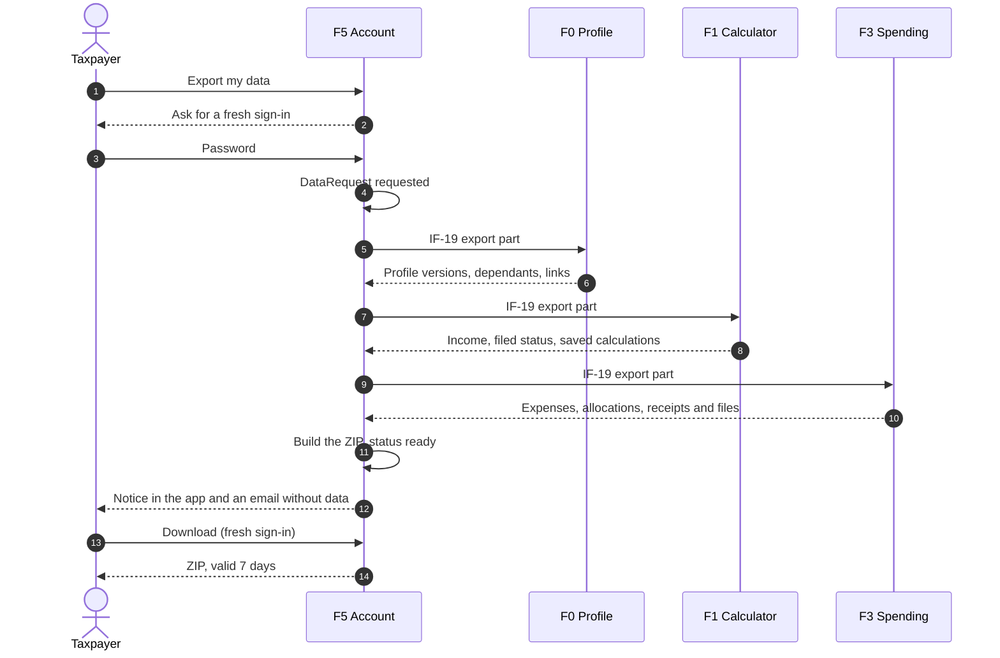

**[SQ-F5-02](URS_SRS_F5_Account_Security.md#sq-f5-02). Delete my account** (works from [FD-F5-10](URS_SRS_F5_Account_Security.md#fd-f5-10), [SRS-F5-15](URS_SRS_F5_Account_Security.md#srs-f5-15) and [SRS-F5-16](URS_SRS_F5_Account_Security.md#srs-f5-16))

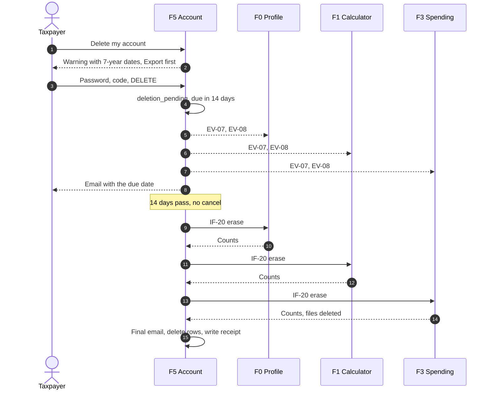

**B3.6 Build split: basic account, launch account and R3** (owner decision of 14/11/2026, [SD-F5-17](URS_SRS_F5_Account_Security.md#sd-f5-17): "for the first phase we proceed on simple"; changed on 22/11/2026, [SD-F5-19](URS_SRS_F5_Account_Security.md#sd-f5-19): some parts move to R3, phase 4 of the PRD roadmap). Where an SRS is split, the row text is complete for the last phase and this table says what is built in each.

| SRS | Built in the basic account (R1) | Held for the launch account | Built in R3 (PRD phase 4) |
| --- | --- | --- | --- |
| [SRS-F5-01](URS_SRS_F5_Account_Security.md#srs-f5-01) Sign-up | Items 1 to 3 and 7. On success the account is active and usable at once. An invalid, used or expired invitation gives the message of item 5. A registered email shows "This email is already registered. Sign in or ask the administrator." | The verification email and "Check your email" (item 4), the neutral message for a registered email, the sign-up rate limit (item 6) | Nothing |
| [SRS-F5-02](URS_SRS_F5_Account_Security.md#srs-f5-02) Password rules | All | Nothing | Nothing |
| [SRS-F5-03](URS_SRS_F5_Account_Security.md#srs-f5-03) Email verification | Nothing; email_verified_at stays empty and nothing checks it. The guided profile creation of F0 starts at the first sign-in | All | Nothing |
| [SRS-F5-04](URS_SRS_F5_Account_Security.md#srs-f5-04) Consent | All, except item 5: withdrawing CORE explains that the account is deleted on request to the product owner | Item 5 as written (opens the deletion warning) | Nothing |
| [SRS-F5-05](URS_SRS_F5_Account_Security.md#srs-f5-05) Sign-in | Items 1 (email and password only), 2, 4 (disabled), 5 and 7 | Item 3 (lockout and rate limits), the own-device tick, the unverified, deletion_pending and two-factor branches of item 4, item 6 (sign-in events) | Nothing |
| [SRS-F5-06](URS_SRS_F5_Account_Security.md#srs-f5-06), [SRS-F5-07](URS_SRS_F5_Account_Security.md#srs-f5-07) Two-factor and recovery | Nothing | All. Admins have no second factor in the basic account (A6 item 8) | Nothing |
| [SRS-F5-08](URS_SRS_F5_Account_Security.md#srs-f5-08) Sessions | Items 1 (without "remembered"), 2 and 7; item 3 with one lifetime: taxpayer 14 days, admin 30 minutes; an admin disable ends the user's sessions | The shared-device lifetime, item 4 (fresh sign-in), the other session ends of item 6. In the basic account a change of password and a change of email ask for the current password instead of a fresh sign-in | Item 5 (list of devices, sign out one or all other devices) |
| [SRS-F5-09](URS_SRS_F5_Account_Security.md#srs-f5-09) Offline, expiry, sign-out | Items 1, 2, 3, 5, 6 and 7 | Item 4 (another user on a device that holds unsent changes) | Nothing |
| [SRS-F5-10](URS_SRS_F5_Account_Security.md#srs-f5-10) Forgot password | Item 5 and item 6: the admin-sent link; items 2 (link life, single use) to 4 apply to that link | Items 1 and 2 (the self-service screen and its rate limits) | Nothing |
| [SRS-F5-11](URS_SRS_F5_Account_Security.md#srs-f5-11) Password and email | Item 1 with the current password (no fresh sign-in window); item 2 as a change in Settings with the current password and the new email, effective at once, no link and no notices; item 3 | The emailed link, the notices, the fresh sign-in window | Nothing |
| [SRS-F5-12](URS_SRS_F5_Account_Security.md#srs-f5-12) Security events | Item 1 and item 4, writing only the admin actions (invitation_created, account_disabled, account_enabled, reset_email_sent); retention of item 3 | The other event types of B3.2 | Item 2 (the screen), item 5 (new-device notice), the events of export and records_deleted |
| [SRS-F5-13](URS_SRS_F5_Account_Security.md#srs-f5-13) Settings | Account (name, language, email with Change email), Security (change password only), Privacy and data (consents only), Reminders slot, About | Two-factor, Delete my account | Signed-in devices, security events, Export my data, records older than 7 years |
| [SRS-F5-14](URS_SRS_F5_Account_Security.md#srs-f5-14) Export | Nothing | Nothing | All |
| [SRS-F5-15](URS_SRS_F5_Account_Security.md#srs-f5-15) Account deletion | Nothing; a request goes to the product owner (item 7 of the row) | All; "Export my data first" appears once R3 has built the export | Nothing |
| [SRS-F5-16](URS_SRS_F5_Account_Security.md#srs-f5-16) Erase run | Nothing | The whole-account erase and its receipt | The run for one YA ([SRS-F5-21](URS_SRS_F5_Account_Security.md#srs-f5-21)), with items 1 to 4 for that YA |
| [SRS-F5-17](URS_SRS_F5_Account_Security.md#srs-f5-17) Admin tools | Items 1 (password only, no two-factor), 2, 3, 4, 5 and 6 | The requirement that an admin has two-factor on | Nothing |
| [SRS-F5-18](URS_SRS_F5_Account_Security.md#srs-f5-18), [SRS-F5-19](URS_SRS_F5_Account_Security.md#srs-f5-19), [SRS-F5-20](URS_SRS_F5_Account_Security.md#srs-f5-20) | All | Nothing | Nothing |
| [SRS-F5-21](URS_SRS_F5_Account_Security.md#srs-f5-21) Records older than 7 years | Nothing | Nothing | All |

Test scope: a test marked (launch account) is built with the launch account, and a test marked (R3) is built with R3. In the other tests, the steps that use a launch account feature (verification link, lockout, two-factor, own-device tick, fresh sign-in, security events screen, devices) are skipped in the basic account.

## B4. Screen behaviour

| Block | Content | States |
| --- | --- | --- |
| Sign-up | Invitation code, email, password with show and hide, language, consent tick box with a link to the text | Neutral messages per [SRS-F5-01](URS_SRS_F5_Account_Security.md#srs-f5-01); offline: "Needs a connection" |
| Check your email (launch account) | Message, Resend with the remaining count | Resend limit reached: "Try again in an hour" |
| Sign-in | Email, password, "This is my own device", Forgot password | Failure message; lock message with the time; disabled and deletion notices |
| Two-factor entry (launch account) | 6-digit field, "Use a recovery code", "I lost both" | Wrong code beside the field |
| Consent | The text, Accept, Decline | New version at sign-in |
| Settings | Account, Security, Privacy and data, Reminders, About ([SRS-F5-13](URS_SRS_F5_Account_Security.md#srs-f5-13)) | Offline: security and privacy actions disabled |
| Devices (R3) | One card per session: device, first used, last used, This device; Sign out; Sign out all other devices | Empty: only this device |
| Security events (R3) | Last 50 events, newest first | Empty: "No events yet" |
| Two-factor setup (launch account) | QR code, key, code field, recovery codes once | Wrong code: stays on the page |
| Export (R3) | Request button, status, Download | requested, building, ready, expired, failed |
| Old records (R3) | The notice "Records for YA {y} are older than 7 years"; list of deletable YAs with the date each became deletable; Export first; Delete records of YA {y} (password and DELETE) | Empty: "No records are older than 7 years yet"; Deleting; deleted |
| Delete account (launch account) | Check of the 7-year periods; warning, Export first, confirm form | Not allowed yet: list of YAs and dates; pending: cancel screen at sign-in |
| Accounts (admin) | List, search, invitation, disable or enable, reset email, open support mode | Two-factor off: setup screen first |
| Lock screen | "Sign in when you are online to continue", Discard | Data hidden, nothing deleted |
| Sign-out warning | "{n} changes have not been sent", Wait, Sign out and discard | Only when n is above 0 |

## B5. Non-functional requirements that bind F5

| PRD ID | How it applies to F5 |
| --- | --- |
| NFR-2 | Offline rules, expiry and the lock screen: [SRS-F5-09](URS_SRS_F5_Account_Security.md#srs-f5-09) |
| NFR-5 | Sign-in screen speed: [SRS-F5-20](URS_SRS_F5_Account_Security.md#srs-f5-20) |
| NFR-6 | Role-based access, two-factor login, session timeout, HTTPS, encryption: [SRS-F5-05](URS_SRS_F5_Account_Security.md#srs-f5-05) to [SRS-F5-08](URS_SRS_F5_Account_Security.md#srs-f5-08), [SRS-F5-17](URS_SRS_F5_Account_Security.md#srs-f5-17), [SRS-F5-19](URS_SRS_F5_Account_Security.md#srs-f5-19) |
| NFR-7 | Consent, export and deletion, no tax data in logs: [SRS-F5-04](URS_SRS_F5_Account_Security.md#srs-f5-04), [SRS-F5-14](URS_SRS_F5_Account_Security.md#srs-f5-14) to [SRS-F5-16](URS_SRS_F5_Account_Security.md#srs-f5-16), [SRS-F5-19](URS_SRS_F5_Account_Security.md#srs-f5-19), [SRS-F5-21](URS_SRS_F5_Account_Security.md#srs-f5-21) |
| NFR-8 | Deletion only after the 7-year period: [SRS-F5-15](URS_SRS_F5_Account_Security.md#srs-f5-15), [SRS-F5-21](URS_SRS_F5_Account_Security.md#srs-f5-21) |
| NFR-9 | Audit fields and the security-event trail: [SRS-F5-12](URS_SRS_F5_Account_Security.md#srs-f5-12), [SRS-F5-19](URS_SRS_F5_Account_Security.md#srs-f5-19) |
| NFR-11 | English and Bahasa Malaysia, DD/MM/YYYY: [SRS-F5-20](URS_SRS_F5_Account_Security.md#srs-f5-20) |
| NFR-12 | [SRS-F5-20](URS_SRS_F5_Account_Security.md#srs-f5-20) |

## B6. Traceability matrix

| URS | SRS | Flow | PRD | Tests |
| --- | --- | --- | --- | --- |
| URS-F5-01 | [SRS-F5-01](URS_SRS_F5_Account_Security.md#srs-f5-01), [SRS-F5-02](URS_SRS_F5_Account_Security.md#srs-f5-02), [SRS-F5-03](URS_SRS_F5_Account_Security.md#srs-f5-03) | [FD-F5-03](URS_SRS_F5_Account_Security.md#fd-f5-03) | PRD section 7, NFR-6 | [TC-F5-01](URS_SRS_F5_Account_Security.md#tc-f5-01), [TC-F5-02](URS_SRS_F5_Account_Security.md#tc-f5-02), [TC-F5-03](URS_SRS_F5_Account_Security.md#tc-f5-03), [TC-F5-04](URS_SRS_F5_Account_Security.md#tc-f5-04) |
| URS-F5-02 | [SRS-F5-01](URS_SRS_F5_Account_Security.md#srs-f5-01), [SRS-F5-04](URS_SRS_F5_Account_Security.md#srs-f5-04) | [FD-F5-08](URS_SRS_F5_Account_Security.md#fd-f5-08) | NFR-7 | [TC-F5-05](URS_SRS_F5_Account_Security.md#tc-f5-05), [TC-F5-06](URS_SRS_F5_Account_Security.md#tc-f5-06) |
| URS-F5-03 | [SRS-F5-05](URS_SRS_F5_Account_Security.md#srs-f5-05), [SRS-F5-08](URS_SRS_F5_Account_Security.md#srs-f5-08) | [FD-F5-04](URS_SRS_F5_Account_Security.md#fd-f5-04), [FD-F5-07](URS_SRS_F5_Account_Security.md#fd-f5-07) | NFR-6 | [TC-F5-07](URS_SRS_F5_Account_Security.md#tc-f5-07), [TC-F5-08](URS_SRS_F5_Account_Security.md#tc-f5-08), [TC-F5-09](URS_SRS_F5_Account_Security.md#tc-f5-09), [TC-F5-13](URS_SRS_F5_Account_Security.md#tc-f5-13) |
| URS-F5-04 | [SRS-F5-10](URS_SRS_F5_Account_Security.md#srs-f5-10) | [FD-F5-05](URS_SRS_F5_Account_Security.md#fd-f5-05) | PRD section 7 | [TC-F5-17](URS_SRS_F5_Account_Security.md#tc-f5-17) |
| URS-F5-05 | [SRS-F5-06](URS_SRS_F5_Account_Security.md#srs-f5-06), [SRS-F5-07](URS_SRS_F5_Account_Security.md#srs-f5-07) | [FD-F5-06](URS_SRS_F5_Account_Security.md#fd-f5-06) | NFR-6 | [TC-F5-10](URS_SRS_F5_Account_Security.md#tc-f5-10), [TC-F5-11](URS_SRS_F5_Account_Security.md#tc-f5-11), [TC-F5-12](URS_SRS_F5_Account_Security.md#tc-f5-12) |
| URS-F5-06 | [SRS-F5-08](URS_SRS_F5_Account_Security.md#srs-f5-08), [SRS-F5-11](URS_SRS_F5_Account_Security.md#srs-f5-11) | [FD-F5-07](URS_SRS_F5_Account_Security.md#fd-f5-07), [FD-F5-05](URS_SRS_F5_Account_Security.md#fd-f5-05) | NFR-6 | [TC-F5-14](URS_SRS_F5_Account_Security.md#tc-f5-14), [TC-F5-18](URS_SRS_F5_Account_Security.md#tc-f5-18) |
| URS-F5-07 | [SRS-F5-12](URS_SRS_F5_Account_Security.md#srs-f5-12) | [FD-F5-07](URS_SRS_F5_Account_Security.md#fd-f5-07) | NFR-6, NFR-9 | [TC-F5-19](URS_SRS_F5_Account_Security.md#tc-f5-19) |
| URS-F5-08 | [SRS-F5-14](URS_SRS_F5_Account_Security.md#srs-f5-14), [SRS-F0-19](URS_SRS_F0_User_Profile.md#srs-f0-19), [SRS-F1-24](URS_SRS_F1_Tax_Calculator.md#srs-f1-24), [SRS-F3-18](URS_SRS_F3_Spending_Records.md#srs-f3-18) | [FD-F5-09](URS_SRS_F5_Account_Security.md#fd-f5-09) | NFR-7 | [TC-F5-21](URS_SRS_F5_Account_Security.md#tc-f5-21), [TC-F5-22](URS_SRS_F5_Account_Security.md#tc-f5-22), [TC-F0-25](URS_SRS_F0_User_Profile.md#tc-f0-25), [TC-F1-22](URS_SRS_F1_Tax_Calculator.md#tc-f1-22), [TC-F3-23](URS_SRS_F3_Spending_Records.md#tc-f3-23) |
| URS-F5-09 | [SRS-F5-15](URS_SRS_F5_Account_Security.md#srs-f5-15), [SRS-F5-16](URS_SRS_F5_Account_Security.md#srs-f5-16), [SRS-F0-19](URS_SRS_F0_User_Profile.md#srs-f0-19), [SRS-F1-24](URS_SRS_F1_Tax_Calculator.md#srs-f1-24), [SRS-F3-18](URS_SRS_F3_Spending_Records.md#srs-f3-18) | [FD-F5-10](URS_SRS_F5_Account_Security.md#fd-f5-10) | NFR-7, NFR-8 | [TC-F5-23](URS_SRS_F5_Account_Security.md#tc-f5-23), [TC-F5-24](URS_SRS_F5_Account_Security.md#tc-f5-24), [TC-F0-25](URS_SRS_F0_User_Profile.md#tc-f0-25), [TC-F1-22](URS_SRS_F1_Tax_Calculator.md#tc-f1-22), [TC-F3-23](URS_SRS_F3_Spending_Records.md#tc-f3-23) |
| URS-F5-10 | [SRS-F5-09](URS_SRS_F5_Account_Security.md#srs-f5-09) | [FD-F5-07](URS_SRS_F5_Account_Security.md#fd-f5-07) | NFR-2, NFR-6 | [TC-F5-15](URS_SRS_F5_Account_Security.md#tc-f5-15), [TC-F5-16](URS_SRS_F5_Account_Security.md#tc-f5-16) |
| URS-F5-11 | [SRS-F5-11](URS_SRS_F5_Account_Security.md#srs-f5-11), [SRS-F5-17](URS_SRS_F5_Account_Security.md#srs-f5-17), [SRS-F5-18](URS_SRS_F5_Account_Security.md#srs-f5-18), [SRS-F5-19](URS_SRS_F5_Account_Security.md#srs-f5-19) | [FD-F5-11](URS_SRS_F5_Account_Security.md#fd-f5-11) | PRD section 8, NFR-6 | [TC-F5-18](URS_SRS_F5_Account_Security.md#tc-f5-18), [TC-F5-26](URS_SRS_F5_Account_Security.md#tc-f5-26), [TC-F5-27](URS_SRS_F5_Account_Security.md#tc-f5-27) |
| URS-F5-12 | [SRS-F5-17](URS_SRS_F5_Account_Security.md#srs-f5-17) | [FD-F5-11](URS_SRS_F5_Account_Security.md#fd-f5-11) | PRD section 8 | [TC-F5-25](URS_SRS_F5_Account_Security.md#tc-f5-25) |
| URS-F5-13 | [SRS-F5-13](URS_SRS_F5_Account_Security.md#srs-f5-13), [SRS-F5-20](URS_SRS_F5_Account_Security.md#srs-f5-20) | [FD-F5-01](URS_SRS_F5_Account_Security.md#fd-f5-01) | PRD section 7, NFR-11 | [TC-F5-20](URS_SRS_F5_Account_Security.md#tc-f5-20), [TC-F5-28](URS_SRS_F5_Account_Security.md#tc-f5-28) |
| URS-F5-14 | [SRS-F5-21](URS_SRS_F5_Account_Security.md#srs-f5-21), [SRS-F0-19](URS_SRS_F0_User_Profile.md#srs-f0-19), [SRS-F1-24](URS_SRS_F1_Tax_Calculator.md#srs-f1-24), [SRS-F3-18](URS_SRS_F3_Spending_Records.md#srs-f3-18) | [FD-F5-13](URS_SRS_F5_Account_Security.md#fd-f5-13) | NFR-7, NFR-8 | [TC-F5-29](URS_SRS_F5_Account_Security.md#tc-f5-29) |

## B7. Test cases

Unless stated, the user is Aisyah (F0 B3.2) with the email aisyah@example.com, the date is 13/11/2026 and the device is a phone on 4G.

| ID | Inputs | Expected | Checks |
| --- | --- | --- | --- |
| TC-F5-01 | A valid invitation; email Aisyah@Example.com; password "correct horse battery 7"; language Bahasa Malaysia; consent ticked | User created with email aisyah@example.com in lower case, status active, role user, email_verified_at empty, language ms; ConsentRecord CORE version 1 with the time; invitation marked used; verification email sent; screen "Check your email"; no profile row exists yet | [SRS-F5-01](URS_SRS_F5_Account_Security.md#srs-f5-01), [SRS-F5-04](URS_SRS_F5_Account_Security.md#srs-f5-04) |
| TC-F5-02 | (a) no code; (b) a used code; (c) a code made 8 days ago; (d) a valid code with an email that is already registered; (e) consent not ticked | (a) to (c): "This invitation cannot be used. Ask for a new one." and nothing is created; (d): the same "Check your email" screen, no second account, and the registered address gets the "Someone tried to sign up" notice; (e): the form cannot be submitted | [SRS-F5-01](URS_SRS_F5_Account_Security.md#srs-f5-01) |
| TC-F5-03 | Passwords: "short1"; "aisyah@example.com"; "password1234"; a 128-character password; a 129-character password; "my cat sleeps all day" | Refused with the rule named: too short; equals the email; common password. Accepted: the 128-character one and "my cat sleeps all day" (spaces allowed, 21 characters). Refused: the 129-character one | [SRS-F5-02](URS_SRS_F5_Account_Security.md#srs-f5-02) |
| TC-F5-04 | (launch account) Verification link opened at 23 h 59 min; another account's link at 24 h 01 min; the first link opened a second time; four Resend taps in one hour; sign-in before verifying | First: verified, signed in, guided profile creation starts (F0). Second: "expired" with Resend. Third: "already used". Resend: the 4th is refused with "Try again in an hour". Sign-in before verifying: "Verify your email first". An unverified account 7 days old is removed by the system | [SRS-F5-03](URS_SRS_F5_Account_Security.md#srs-f5-03) |
| TC-F5-05 | Consent version 1 accepted; version 2 is published; Aisyah signs in; (a) she accepts; (b) she declines | Before the app opens she must read version 2. (a): a second record, version 2, and the app opens; Settings lists both. (b): she is signed out, nothing is deleted, and the next sign-in asks again | [SRS-F5-04](URS_SRS_F5_Account_Security.md#srs-f5-04) |
| TC-F5-06 | Settings, Privacy: try to withdraw the core consent | A screen explains that this means deleting the account and opens the warning of [SRS-F5-15](URS_SRS_F5_Account_Security.md#srs-f5-15); the consent is not withdrawn until the deletion is requested | [SRS-F5-04](URS_SRS_F5_Account_Security.md#srs-f5-04) |
| TC-F5-07 | Sign in with the right password; then with a wrong password; then with an unknown email | Right: session created (remembered when "own device" is ticked), last_sign_in_at set, event sign_in. Wrong password and unknown email: the same message "Email or password is not correct", event sign_in_failed only for the real account | [SRS-F5-05](URS_SRS_F5_Account_Security.md#srs-f5-05) |
| TC-F5-08 | (launch account) Five wrong passwords, the 5th at 10:00:00; the right password at 10:05; the right password at 10:16 | Locked until 10:15:00; the 10:05 attempt is refused with "Too many attempts. Try again after 10:15."; 10:16 succeeds and failed_attempts is 0; events: five sign_in_failed and one locked | [SRS-F5-05](URS_SRS_F5_Account_Security.md#srs-f5-05) |
| TC-F5-09 | Two-factor is on. Right password, then (a) a wrong code, (b) the right code, (c) the same code again in a new sign-in within the same 30 seconds, (d) the code of the previous 30-second step, (e) five wrong codes | (a) message, no session; (b) session created; (c) refused (a code works once); (d) accepted; (e) counts as five failed attempts and locks as in [TC-F5-08](URS_SRS_F5_Account_Security.md#tc-f5-08) | [SRS-F5-05](URS_SRS_F5_Account_Security.md#srs-f5-05), [SRS-F5-06](URS_SRS_F5_Account_Security.md#srs-f5-06) |
| TC-F5-10 | (launch account) Turn on two-factor: after 11 minutes since sign-in; then with a fresh sign-in; wrong code; right code | The password is asked again first. A wrong code leaves it off. A right code turns it on, shows 10 recovery codes once, writes two_factor_enabled; reopening the page never shows the codes again | [SRS-F5-06](URS_SRS_F5_Account_Security.md#srs-f5-06), [SRS-F5-08](URS_SRS_F5_Account_Security.md#srs-f5-08) |
| TC-F5-11 | (launch account) Turn off two-factor as Aisyah (password and a current code); then as an admin | Aisyah: off, notice email, event. Admin: refused "Required for admins" | [SRS-F5-06](URS_SRS_F5_Account_Security.md#srs-f5-06) |
| TC-F5-12 | (launch account) Sign in with a recovery code; use it again; use 8 codes in all; make new codes; then "I lost both" with the link opened at 09:00 | First use works and shows "9 codes left"; the same code again is refused; after 8 uses "2 codes left" and the warning in Settings; new codes void the old ones. Lost both: notice at 09:00 with Cancel; at 09:00 next day two-factor is off and a notice is sent; a correct code before then stops the wait | [SRS-F5-07](URS_SRS_F5_Account_Security.md#srs-f5-07) |
| TC-F5-13 | Own device: last server contact 13/11/2026 09:00; contact again 20/11/2026 09:00. Shared device: contact 10:00, next at 12:01. Admin: contact 10:00, next at 10:31 | Own device: expires 27/11/2026 09:00, then 04/12/2026 09:00. Shared: expired at 12:00, so 12:01 shows the sign-in screen. Admin: expired at 10:30, so 10:31 shows the sign-in screen. A contact within 5 minutes of the last one does not move the expiry | [SRS-F5-08](URS_SRS_F5_Account_Security.md#srs-f5-08) |
| TC-F5-14 | (R3) Aisyah is signed in on a phone and a laptop; on the laptop she taps "Sign out all other devices"; then a request from the phone with the old cookie to F3 | The phone's session is revoked and EV-08 is raised; the phone's next contact shows the sign-in screen; F0, F1 and F3 refuse the request with a missing-session message; the event session_revoked is written; changing the password on the laptop ends every other session | [SRS-F5-08](URS_SRS_F5_Account_Security.md#srs-f5-08), [SRS-F5-18](URS_SRS_F5_Account_Security.md#srs-f5-18) |
| TC-F5-15 | Phone offline 10 days (own device); then offline 15 days after the last contact; then she signs in online; a different user signs in on the phone while it holds 3 unsent changes | 10 days: the app works and new entries go to the outbox. 15 days: the lock screen, data hidden, nothing deleted. Online sign-in by Aisyah: the lock lifts and the outbox is sent in order. The other user is refused with "This device still holds 3 unsent changes of another account..."; Discard with a typed confirmation deletes Aisyah's device data | [SRS-F5-09](URS_SRS_F5_Account_Security.md#srs-f5-09) |
| TC-F5-16 | Sign out with 3 unsent changes; choose Wait; later sign out again and choose Sign out and discard; then sign out with none | "3 changes have not been sent." Wait keeps the session. Discard needs a typed confirmation, then deletes the data and raises EV-08. With none: signs out and removes the user's data from the device | [SRS-F5-09](URS_SRS_F5_Account_Security.md#srs-f5-09) |
| TC-F5-17 | (launch account) Forgot password for aisyah@example.com and for nobody@example.com; open the link after 61 minutes; a fresh request, then the link at 30 minutes; a 6th request in an hour | The same message for both emails and the 6th request. The 61-minute link is expired. The 30-minute link allows a new password (rules, different from the old); every session ends, failed attempts clear, a notice is emailed, event password_reset_done; two-factor is asked at the next sign-in | [SRS-F5-10](URS_SRS_F5_Account_Security.md#srs-f5-10) |
| TC-F5-18 | Change password: new equals old; then a new one. Change email to bilal@example.com. An admin tries both for Aisyah | Equal: refused ("must differ"). New: other sessions end, notice, event. Email: link to bilal@example.com (24 hours) and a Cancel notice to the old address; until the link is opened the sign-in email is unchanged; after it, the email changes, other sessions end, a second notice goes to the old address. Admin: refused with "The email can only be changed by the account owner" and "The password can only be changed by the account owner" | [SRS-F5-11](URS_SRS_F5_Account_Security.md#srs-f5-11), [SRS-F5-17](URS_SRS_F5_Account_Security.md#srs-f5-17) |
| TC-F5-19 | (R3) After [TC-F5-07](URS_SRS_F5_Account_Security.md#tc-f5-07) and [TC-F5-08](URS_SRS_F5_Account_Security.md#tc-f5-08), open Settings, Security events | Newest first, at most 50: five sign_in_failed, locked, sign_in, each with date, time and device; entries with an admin actor say "by an administrator"; no password, code or token appears; there is no edit or delete control; an admin cannot read the list | [SRS-F5-12](URS_SRS_F5_Account_Security.md#srs-f5-12) |
| TC-F5-20 | Open Settings online, then offline; change the language to English | Sections as in [SRS-F5-13](URS_SRS_F5_Account_Security.md#srs-f5-13); the Reminders slot says "Not available yet". Online: the language change redraws within 200 ms and is a versioned save (F0). Offline: name and language stay editable; Security and Privacy actions are disabled with "Needs a connection" | [SRS-F5-13](URS_SRS_F5_Account_Security.md#srs-f5-13) |
| TC-F5-21 | (R3) Export: request after 11 minutes since sign-in; a second request while the first is building; download after it is ready; download after 8 days | The password is asked first. The second request shows the status of the first. The ready notice is in the app and by email with no data and no link to the file. The download needs a fresh sign-in and gives the ZIP; events export_requested, export_ready, export_downloaded. After 8 days the ZIP is gone and the status is expired | [SRS-F5-14](URS_SRS_F5_Account_Security.md#srs-f5-14) |
| TC-F5-22 | (R3) Export of Aisyah's data (three YAs, the F3 data of [TC-F3-23](URS_SRS_F3_Spending_Records.md#tc-f3-23)) | The ZIP has the files of B3.3. Row counts equal the rows owned by F0, F1 and F3, old versions and soft-deleted rows included; the pending receipt is listed as "not uploaded"; no other user's row, no password, no secret, no token. An admin and another user cannot download it | [SRS-F5-14](URS_SRS_F5_Account_Security.md#srs-f5-14) |
| TC-F5-23 | (launch account) Delete account: on 13/11/2026 Aisyah taps Delete my account; on 05/01/2035 she taps it again; confirm with a wrong word, then DELETE; sign in on day 5 and cancel; request again | On 13/11/2026 the screen says the account cannot be deleted yet, lists YA 2025 from 01/01/2033, YA 2026 from 01/01/2034 and YA 2027 from 01/01/2035, offers Export first and has no DELETE field. On 05/01/2035 the warning opens. A wrong word is refused. DELETE: status deletion_pending, due 19/01/2035, all sessions end, an email with the date. Day 5 sign-in shows the cancel screen; cancel returns the status to active, clears the dates, writes deletion_cancelled | [SRS-F5-15](URS_SRS_F5_Account_Security.md#srs-f5-15) |
| TC-F5-24 | (launch account) Due date 19/01/2035 reached. Case 1: F0, F1 and F3 all confirm. Case 2: F3 does not answer | Case 1: counts come back from the three features (equal to the exported rows), F5 sends the final email, deletes its rows and then the User row, writes a receipt with a hashed id, the date, the counts and the purge date 23/02/2035; a sign-in with the old email gives the usual wrong-password message. Case 2: F5 deletes nothing, status stays deletion_pending, retried every hour, the owner is alerted after the 3rd failed try | [SRS-F5-16](URS_SRS_F5_Account_Security.md#srs-f5-16) |
| TC-F5-25 | An admin (two-factor on) opens Accounts; creates an invitation; disables Aisyah with the reason "Lost phone"; enables her again; sends a reset email | The list shows email, name, role, status, verified, two-factor and last sign-in date. The code is shown once and works once within 7 days. Disable ends her sessions, raises EV-07 and she sees "This account is disabled. Contact the administrator." Each action is a security event with the admin as actor and the reason, shown to Aisyah as "by an administrator". The admin never sees the reset link or the new password | [SRS-F5-17](URS_SRS_F5_Account_Security.md#srs-f5-17) |
| TC-F5-26 | An admin tries: setting a password; changing an email; turning two-factor off; reading Aisyah's security events; reading her estimate (IF-16); disabling the own account; disabling the last enabled admin; an admin without two-factor opens Accounts; a request body that sets role = admin | Every attempt is refused by the server. Disabling the own account and disabling the last enabled admin give "An admin cannot disable the own account" and "Cannot disable the last enabled admin". The admin without two-factor is sent to the setup screen and sees no account data. The role in the body is ignored | [SRS-F5-17](URS_SRS_F5_Account_Security.md#srs-f5-17), [SRS-F5-18](URS_SRS_F5_Account_Security.md#srs-f5-18) |
| TC-F5-27 | Run sign-in, add an expense of RM 120.00 at "Klinik Sihat", request an export; then search every log for "120.00", "Klinik", the password, a token, a code and the email | No match for any of them. Log lines hold only time, user_id, request type and result code. A plain HTTP request is redirected to HTTPS; the cookie is HttpOnly, Secure and SameSite Lax | [SRS-F5-19](URS_SRS_F5_Account_Security.md#srs-f5-19) |
| TC-F5-28 | 360 px screen, Bahasa Malaysia; sign-in screen on a mid-range phone over 4G | Single column, no horizontal scroll; targets at least 44 px; every status has text; errors beside the field; password manager fills the form; dates DD/MM/YYYY; the sign-in screen is usable in under 2.5 s | [SRS-F5-20](URS_SRS_F5_Account_Security.md#srs-f5-20) |
| TC-F5-29 | (R3) Aisyah's data as in B3.4. Today is 05/01/2033. She opens the app offline, then online; she taps "Delete records of YA 2025" after "Export my data first" (password, DELETE); a direct request for YA 2026 is sent; a second run where F3 does not confirm | The notice "Records for YA 2025 are older than 7 years. You may delete them." shows once at app open, also offline; YA 2026 and YA 2027 are not listed. Settings lists YA 2025 as deletable since 01/01/2033. After the confirmation F5 sends IF-20 with ya = 2025 to F0, F1 and F3; each deletes only the rows and files of YA 2025 (profile versions and dependants, income, filed status, snapshots, expenses dated in 2025 with allocations, receipts and files) and returns counts equal to the rows it holds for that YA; YA 2026 and YA 2027, the account and the consents are unchanged; the tax-year history no longer lists YA 2025; the event records_deleted holds ya and counts and no figure. The request for YA 2026 is refused with "Records for YA 2026 must be kept until 31/12/2033.". When F3 does not confirm the YA shows "Deleting", F5 retries every hour and alerts the owner after the 3rd failed try | [SRS-F5-21](URS_SRS_F5_Account_Security.md#srs-f5-21), [SRS-F0-19](URS_SRS_F0_User_Profile.md#srs-f0-19), [SRS-F1-24](URS_SRS_F1_Tax_Calculator.md#srs-f1-24), [SRS-F3-18](URS_SRS_F3_Spending_Records.md#srs-f3-18) |

## B8. Specification decisions and open items

**Specification decisions (SD). Need the owner's yes or no.**

| ID | Decision | Why |
| --- | --- | --- |
| SD-F5-01 | In R1, sign-up needs a single-use invitation code made by an admin (valid 7 days). Public sign-up opens after the launch gate | PRD: no public sign-up until the launch gate is passed; R1 is for the owner only |
| SD-F5-02 | Passwords are 12 to 128 characters, any characters, checked against a list of common passwords; no composition rules, no forced periodic change | Long passwords with a common-password check are stronger and easier to live with than symbol rules |
| SD-F5-03 | (launch account) The email must be verified before first use of the app (link valid 24 hours); an account not verified in 7 days is removed | Stops sign-ups with someone else's email; no data exists yet at that point |
| SD-F5-04 | (launch account, except the 1-hour life of the admin-sent link, which is in the basic account) 5 failed sign-ins in 15 minutes lock the account for 15 minutes; rate limits per device and per email; links for reset and email change valid 1 hour and 24 hours | Slows guessing without locking the owner out for long |
| SD-F5-05 | (launch account) Two-factor uses an authenticator app only (no SMS). It is optional for taxpayers and required for admins. Ten recovery codes | SMS codes can be taken over; an admin account is the most valuable target. PRD NFR-6 says "optional" |
| SD-F5-06 | A session lasts 14 days after the last server contact for a taxpayer and 30 minutes for an admin (basic account). The launch account adds 2 hours on a shared device and the rule that sensitive actions need a sign-in within the last 10 minutes | The PRD asks for a session timeout and gives no value; offline use needs a long life for the owner's own phone |
| SD-F5-07 | (launch account) A lost authenticator is recovered by an emailed link, a 24-hour wait, notices at both ends and a Cancel link. No admin can reset it | An admin must not be able to weaken another account ([SD-F5-10](URS_SRS_F5_Account_Security.md#sd-f5-10)) |
| SD-F5-08 | (The grace period is in the launch account; the 35-day backup purge is in the basic account) Deletion has a 14-day grace period that a sign-in cancels; backups are purged within 35 days of the erase; a receipt keeps only a hashed id, the date and the counts | Protects against a mistaken or hostile request; the PDPA adviser confirms the periods ([OI-F5-04](URS_SRS_F5_Account_Security.md#oi-f5-04)) |
| SD-F5-09 | The user can delete the records of a YA, or the account, only after the 7-year period has ended: 31 December of the YA plus 7 years, so a YA is deletable from 1 January of the next year. The app tells the user when a YA becomes deletable and never deletes by itself. **Approved by the owner on 14/11/2026** ("make a notification that taxpayer can delete data that is more than 7 years"; "for a moment, let keep it as i give the answer. to allow delete after 7 years"). Confirmed again by the owner on 22/11/2026: deleting is optional and the taxpayer's own choice once the period has ended, and strictly no record of a YA is deleted before its 7 years end ("deletio is optional after 7 years. strictly no delete before 7 years of YA"). Revisit when the launch account specifies account deletion | NFR-8 is a duty of the taxpayer, and the owner chose the strict rule for now; NFR-7 still gives the right to deletion once the period has ended |
| SD-F5-10 | **Approved by the owner on 14/11/2026** ("for admin only; as taxpayer they can change the email"; the admin helps with a temporary link, not by changing the password). An admin cannot change a user's email or password, cannot turn two-factor off or reset it, and cannot delete an account. **This differs from the PRD roles table**, which lets an admin manage the email on the user's behalf | The email is the key to the account; if an admin could change it, an admin could take over any account and reach tax data. The PRD table needs a change |
| SD-F5-11 | In R1 the owner sets the role in the data; there is no screen for roles. An admin account cannot be deleted in R1 | Only one or two admins exist; rule rows name the admin in created_by |
| SD-F5-12 | R1 has one consent purpose, CORE. The text is a draft with the headings of B3.5 until the PDPA adviser writes the final text | The final wording is legal work ([OI-F5-02](URS_SRS_F5_Account_Security.md#oi-f5-02)) |
| SD-F5-13 | F0 owns the name and the language; F5 owns the email, password, role and status. F5 creates the User row with the initial language | One owner for each field; the language is a profile-style choice shown across screens |
| SD-F5-14 | The export is a ZIP with CSV files, one JSON file and the original receipts; ready within 24 hours; the link works 7 days and only inside the signed-in app | A person can open the CSV files; a program can read the JSON; the download stays under the owner's login |
| SD-F5-15 | (launch account) Security events are kept 12 months; IP addresses are kept 30 days; the user can read the last 50 | Enough to notice an attack; the PDPA adviser confirms the periods ([OI-F5-03](URS_SRS_F5_Account_Security.md#oi-f5-03)) |
| SD-F5-16 | Sign-out with unsent changes offers Wait or Sign out and discard; another user cannot sign in on a device that holds unsent changes | Offline-first means the device can hold the only copy of a change |
| SD-F5-17 | (Named Phase 1 and Phase 2 until 23/11/2026; renamed basic account and launch account by the owner on 23/11/2026, meaning unchanged.) The basic account is the simple account: invitation-only sign-up, password sign-in, a simple session, consent, change of the own password and email, an admin-sent reset link, admin account tools and Settings. The launch account holds sign-in lockout, emailed links (verification, self-service forgot password, email change), staying signed in, two-factor login and deletion of the whole account. **Approved by the owner on 14/11/2026**; data export, deletion of records past 7 years and the security screens moved to R3 on 22/11/2026 ([SD-F5-19](URS_SRS_F5_Account_Security.md#sd-f5-19)) | The owner asked to proceed simple in the first phase |
| SD-F5-18 | In the basic account a taxpayer changes the own email in Settings with the current password and it takes effect at once; the emailed link and the notices to the old address come in the launch account. An admin cannot change it. **Approved by the owner on 14/11/2026** ("as taxpayer they can change the email") | Verification links are held; the owner is the only taxpayer in R1 |
| SD-F5-19 | Data export ([SRS-F5-14](URS_SRS_F5_Account_Security.md#srs-f5-14)), the deletion of the records of a YA past its 7 years with its notice ([SRS-F5-21](URS_SRS_F5_Account_Security.md#srs-f5-21) and the one-YA run of [SRS-F5-16](URS_SRS_F5_Account_Security.md#srs-f5-16)), the security events screen and the new-device notice ([SRS-F5-12](URS_SRS_F5_Account_Security.md#srs-f5-12) items 2 and 5) and the session controls ([SRS-F5-08](URS_SRS_F5_Account_Security.md#srs-f5-08) item 5) are built with R3, phase 4 of the PRD roadmap, not in the basic account or the launch account. **Approved by the owner on 22/11/2026** ("move it to phase 4 (r3)"; "is a feature to be develop on phase 4") | Keeps the basic account small. No YA can be deleted before 01/01/2033, so nothing is lost by building the deletion later. The PRD public launch gate still lists user export (F-058) |

**Open items (OI).**

| ID | Question | Proposed default until answered | Who |
| --- | --- | --- | --- |
| OI-F5-01 | Where is the data hosted, and what is the basis for any transfer outside Malaysia (PRD decision on hosting)? | A Malaysian region; the consent text names it | Owner and PDPA adviser |
| OI-F5-02 | Who writes the final consent text and privacy notice? | The PDPA adviser, before public launch; R1 uses the draft headings of B3.5 | Owner |
| OI-F5-03 | How long may security events and IP addresses be kept? | 12 months and 30 days | PDPA adviser |
| OI-F5-04 | What time limit applies to answering an export or deletion request, and to purging backups? | Export ready within 24 hours; erase after 14 days; backups within 35 days | PDPA adviser |
| OI-F5-05 | F2 and F4 get no SRS row of their own for the role check in IF-18. Is a short row needed there (F2 admin screens; F4 has none)? | No new row: F2's admin screens use the role of IF-18 as [SRS-F5-18](URS_SRS_F5_Account_Security.md#srs-f5-18) says; add a row to F2 at version 0.5 if the owner wants it written there | Owner |
| OI-F5-06 | Which service sends the emails (verification, reset, notices), and from which address? | Held by the owner on 23/11/2026: no domain yet; decided with the stack in ADR-006 (docs/decisions/ADR_006_Email_Service.md). No email carries tax data | Engineering lead |
| OI-F5-07 | Should two-factor become required for every taxpayer at public launch? | No: optional, as in the PRD (NFR-6); admins required | Owner |
