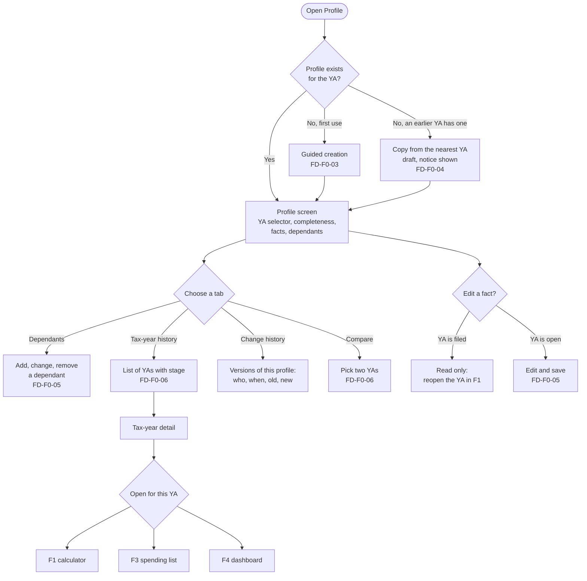
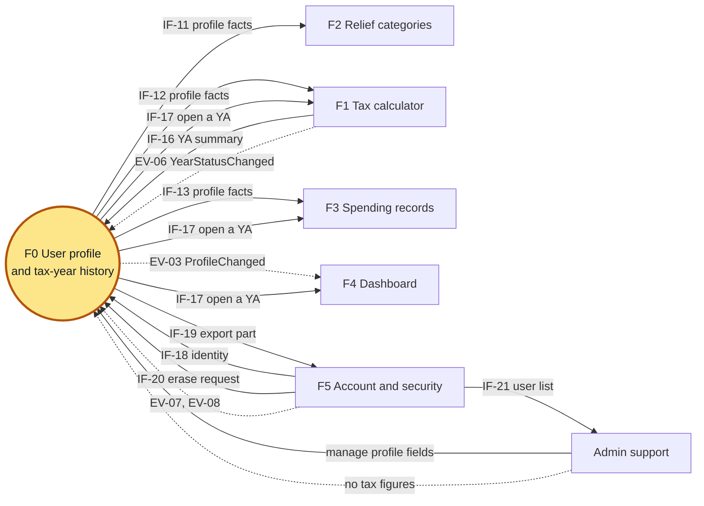
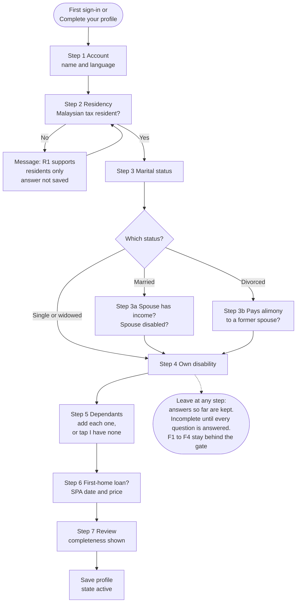
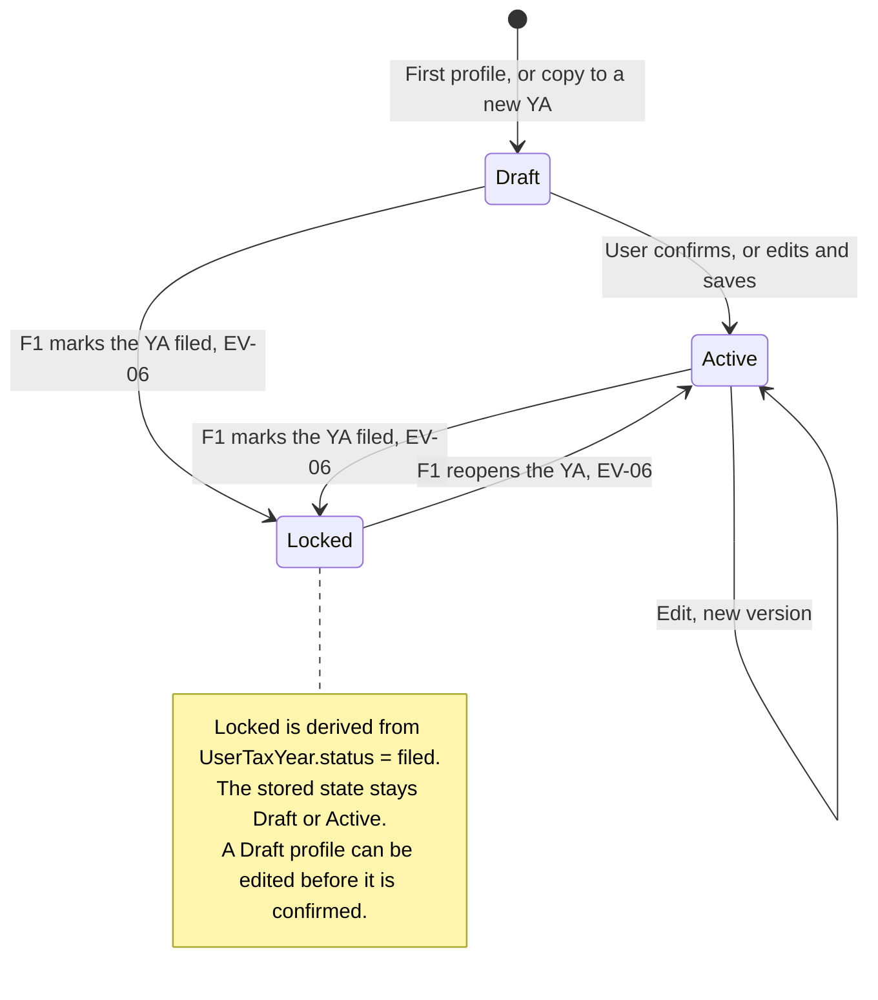
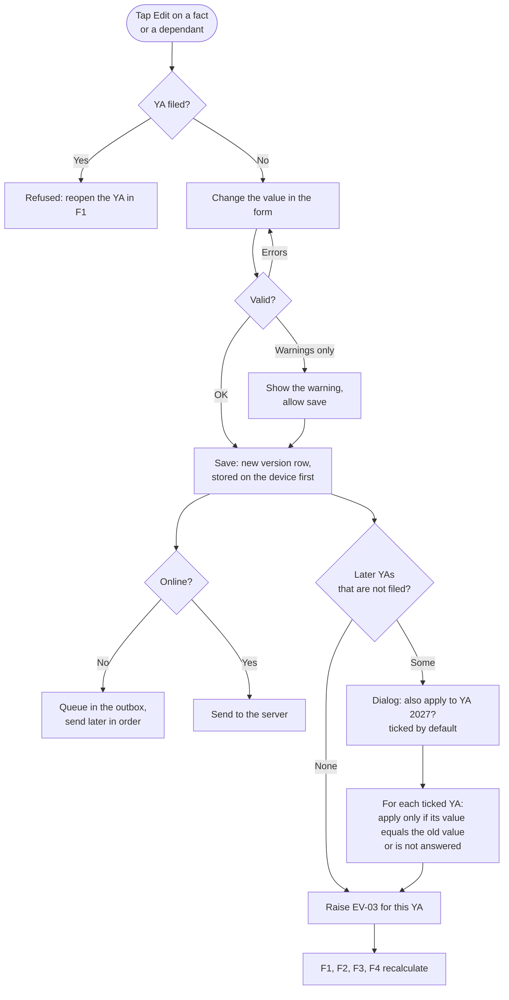
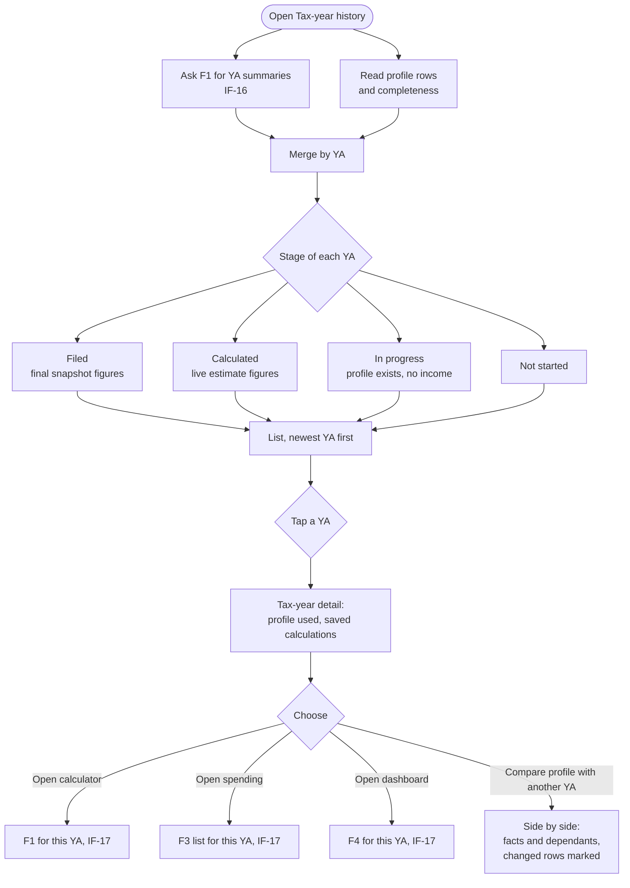
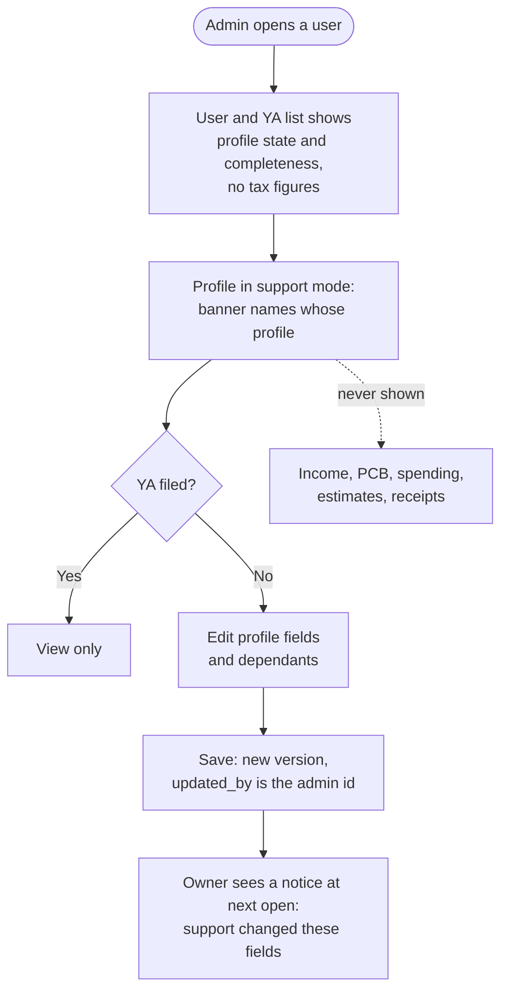
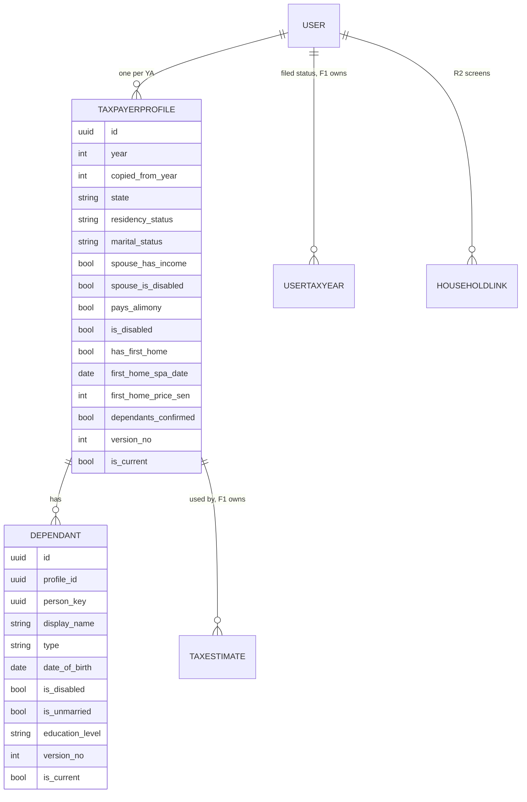
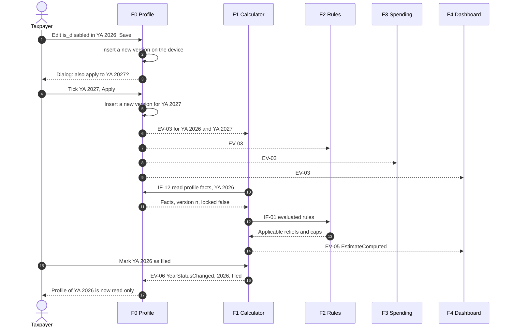

# URS and SRS: F0 User profile and tax-year history

| Item | Value |
| --- | --- |
| Product | Tax Relief Manager (TRM), Malaysia tax relief system (PWA) |
| Feature | F0 User profile and tax-year history (PRD sections 5, 7 and 8; FR-2.3 depends on it; the PRD has no FR block for it, see F-032) |
| Document version | 0.3 (draft, for owner review) |
| Date | 2026-11-14 (first written 2026-11-13) |
| Source | PRD revision 37; owner prompts P-12 to P-16 |
| Owner | Champs (product owner) |
| Change tracking | [URS_SRS_CHANGE_LOG.md](../registers/URS_SRS_CHANGE_LOG.md); work history in [HISTORY_LOG.md](../registers/HISTORY_LOG.md); short forms in [ACRONYMS.md](../registers/ACRONYMS.md) |

## 0. Conventions shared by all six documents

@@CONVENTIONS@@

---

# Part A. User Requirements Specification (URS)

## A1. Purpose and scope

**Purpose.** F0 keeps the facts about the taxpayer and the dependants that decide which reliefs apply. It keeps one profile for each Year of Assessment (YA), so a change in a later year never rewrites an earlier one. F0 also shows the history of every tax year: what has been entered, calculated and filed. F0 owns the profile data and calculates nothing. F1, F2 and F3 read the profile through IF-12, IF-11 and IF-13. It is numbered 0 because the four core features depend on it.

**In scope (R1):** guided creation of the first profile; the profile screen; dependants; one profile per YA, copied forward to a new YA; the choice of later YAs when a fact changes; the lock of a filed YA's profile; the tax-year history (list and detail); comparing the profile of two YAs; the change history of a profile; admin support on profile fields; the account's name and language; the profile's part of a data export and of an account deletion; offline use.

**Reserved (R2):** screens for HouseholdLink, spouse linking and joint assessment. R1 keeps the data structure only (PRD section 5). The field joint_assessment is stored but has no control in R1 ([SD-F0-07](URS_SRS_F0_User_Profile.md#sd-f0-07)).

**Out of scope:** sign-up, password, two-factor login, consent text, data export and account deletion. They are specified in F5 Account and security (OI-F0-01, answered). F0 only supplies its part of an export and of an erase (SRS-F0-19). Any calculation of tax, caps or reliefs (F1, F2, F3).

## A2. Users and roles

| User | What they do in F0 |
| --- | --- |
| Taxpayer | Creates and edits their own profile and dependants; reads the tax-year history and the change history |
| Admin | Opens a user's profile in support mode and changes profile fields and dependants of a YA that is not filed, and the user's name and language (never the email or the password, SD-F5-10); sees the list of YAs without any tax figure (PRD section 8); never sees income, PCB, spending, estimates or receipts |
| System | Copies a profile to a new YA, acting as the SYSTEM user |

## A3. User requirements

| ID | The taxpayer must be able to | PRD source | Flow |
| --- | --- | --- | --- |
| URS-F0-01 | Create my profile the first time I use the app, in short steps that I can leave and finish later | PRD sections 5 and 7, FR-2.3 | FD-F0-03 |
| URS-F0-02 | Tell the app my residency, marital status, my spouse's situation, my own disability and my first-home loan, so that only the reliefs that apply to me are offered | FR-2.3, BR-11 | FD-F0-03 |
| URS-F0-03 | Add, change and remove dependants (children and parents) with the facts that decide their reliefs | PRD section 5 (Dependant), FR-2.3 | FD-F0-05 |
| URS-F0-04 | See my whole profile on one screen: what is answered, what is missing, and which reliefs each answer affects | FR-2.3, usage | FD-F0-01 |
| URS-F0-05 | Have a separate profile for each YA, which starts as a copy of the previous year, so that a change in a later year never rewrites an earlier year | F-033, BR-11 | FD-F0-04 |
| URS-F0-06 | When I change a fact, choose whether it also applies to the later YAs that are not filed | usage | FD-F0-05 |
| URS-F0-07 | See the history of my tax years: for each YA, whether it is not started, in progress, calculated or filed, and its main result | owner prompt P-12 | FD-F0-06 |
| URS-F0-08 | Open one tax year to see the profile it used and its saved calculations, and jump to the calculator, the spending list or the dashboard for that YA | owner prompt P-12 | FD-F0-06 |
| URS-F0-09 | Be sure that the profile of a filed YA cannot change unless I reopen the YA, and see which profile version each saved calculation used | FR-3.7, NFR-9 | FD-F0-04 |
| URS-F0-10 | See the history of changes to a profile: who changed what, when, and from which value to which value, including changes made by support | NFR-9, PRD section 5 | FD-F0-05 |
| URS-F0-11 | Compare the profiles of two YAs and see what changed | usage | FD-F0-06 |
| URS-F0-12 | Let an admin help me with my profile fields without the admin seeing my income, tax or spending | PRD section 8 | FD-F0-07 |
| URS-F0-13 | Use and change my profile offline, and have the changes arrive once and in order when I am online again | NFR-2 | FD-F0-05 |
| URS-F0-14 | Keep my name and language with my profile, and have my profile data included when I export my data and removed when I delete my account | PRD sections 7 and 8, NFR-7 | FD-F0-02 |
| URS-F0-15 | Be asked for every fact that my reliefs depend on, and be unable to calculate, see reliefs or record spending for a year until I have answered them all | FR-2.3, BR-11, owner decision 14/11/2026 | FD-F0-03 |

## A4. Flow diagrams

**FD-F0-01. User flow in F0**

**FD-F0-02. What F0 gives to and receives from other features**

**FD-F0-03. Creating the first profile (guided creation)**

**FD-F0-04. Life of the profile of one YA**

**FD-F0-05. Editing a profile, applying it to later YAs, saving offline**

**FD-F0-06. Tax-year history, tax-year detail and comparison**

**FD-F0-07. Admin support on a profile**

**FD-F0-08. Data F0 owns**

## A5. Relationship with other features

@@FD00@@

@@IFTABLE@@

@@OWNERSHIP@@

**A5.4 Inter-related data for F0**

| Data | Direction | Other feature | What F0 uses it for, or gives it for | Interface | If it is missing or late |
| --- | --- | --- | --- | --- | --- |
| Profile facts and dependants of one YA | out | F1, F2, F3 | Reliefs, applicable categories, beneficiary choices | IF-12, IF-11, IF-13 | A profile with an open question is Incomplete (complete = false); the receiving feature shows the gate "Complete your profile" and does not calculate |
| ProfileChanged (ya) | out | F1, F2, F3, F4 | Recalculate and redraw the YA named in the event | EV-03 | Not applicable |
| YA summaries and saved calculations | in | F1 | Tax-year history list and detail | IF-16 | The Result column shows "Updating"; the profile columns still show |
| YearStatusChanged (ya, status) | in | F1 | Lock or unlock the profile of the YA; refresh the history | EV-06 | F0 reads UserTaxYear whenever a screen opens, so a missed event is corrected on open |
| Filed status of a YA | in | F1 | Derived lock of the profile | read of UserTaxYear | Treated as open until read; a refused write on sync corrects it (SRS-F0-10) |
| Open a feature for a YA | out | F1, F3, F4 | Jump from the history | IF-17 | Not applicable |
| Signed-in identity: user id, role, language | in | F5 | Decide whose data F0 reads and writes, and whether the admin rules of SRS-F0-16 apply | IF-18 | Offline, the identity stored at the last sign-in is used until the session expires (SRS-F5-09) |
| Export part of the profile data | out | F5 | The user's data export | IF-19 | Not applicable |
| Erase request | in | F5 | Delete the user's profile data when the deletion grace period ends | IF-20 | F5 repeats the request until F0 confirms (SRS-F5-16) |
| User list for support | in | F5 | An admin opens a user in support mode | IF-21 | No list: support mode cannot open |
| AccountStatusChanged, SessionEnded | in | F5 | Stop sending the outbox and show the notice | EV-07, EV-08 | F0 learns on the next server call, which is refused with the same notice |

## A6. Assumptions and constraints

1. Facts are kept per YA. The profile used for a YA is that YA's own profile ([SD-F0-01](URS_SRS_F0_User_Profile.md#sd-f0-01)). This settles F-033.
2. A profile is data about people, some of them children, so F0 keeps the least it needs: a nickname instead of a legal name, no identity numbers, no addresses ([SD-F0-06](URS_SRS_F0_User_Profile.md#sd-f0-06), NFR-7).
3. Every age test uses the age at the end of the YA, unless a rule names another date ([OI-F1-01](URS_SRS_F1_Tax_Calculator.md#oi-f1-01)).
4. A filed YA is locked. Locking is derived from the filed status that F1 owns, never stored in F0 ([SD-F0-12](URS_SRS_F0_User_Profile.md#sd-f0-12)).
5. All reads and writes use data on the device, so F0 works offline.
6. R1 is for the product owner only; HouseholdLink has no screen.
7. Every visible question is mandatory. Until the profile of a YA is Complete, F1, F2, F3 and F4 stay behind a gate for that YA ([SD-F0-14](URS_SRS_F0_User_Profile.md#sd-f0-14)).

---

# Part B. System Requirements Specification (SRS)

## B1. Functional specifications

### B1.1 Creating a profile

| ID | Specification | Basis | URS | Flow | Test |
| --- | --- | --- | --- | --- | --- |
| SRS-F0-01 | **Guided creation of the first profile.** 1. Trigger: the first sign-in of a user (after sign-up, and in Phase 2 after the email is verified, SRS-F5-03) who has no TaxpayerProfile row, or a tap on "Complete your profile" on the gate screen of F1, F2, F3 or F4. 2. Seven steps in this order: 1 Account (name and language; the email is shown, read only), 2 Residency, 3 Marital status (3a spouse questions when married, 3b alimony question when divorced), 4 Own disability, 5 Dependants, 6 First-home loan, 7 Review. 3. The profile is created for the current YA (the YA whose period contains today's date, [SD-F0-02](URS_SRS_F0_User_Profile.md#sd-f0-02)). 4. Each step saves when "Next" is tapped, as a versioned save ([SRS-F0-08](URS_SRS_F0_User_Profile.md#srs-f0-08)). "Back" never loses an answer. Leaving the flow keeps every saved step. 5. Step 1 is shown only when name or language is empty (the email was entered at sign-up, SRS-F5-01). 6. Each question is plain language with a one-line help text that names the reliefs the answer affects, for example at step 3: "Decides the spouse relief, the alimony relief and the spouse rebate". 7. Step 7 lists every answer with the completeness ([SRS-F0-03](URS_SRS_F0_User_Profile.md#srs-f0-03)). "Save profile" is offered only when every visible question is answered, and sets state = active. No step can be skipped ([SRS-F0-03](URS_SRS_F0_User_Profile.md#srs-f0-03)). | PRD section 7 (Sign in and onboarding), FR-2.3, SD-F0-02 | URS-F0-01 | FD-F0-03 | TC-F0-01, TC-F0-02 |
| SRS-F0-02 | **Questions, answers and visibility.** The questions are exactly those in B3.1. 1. A yes or no question has two answers, Yes and No, and no answer is preselected; until the user answers, the question is open (stored as null, DA-20). Marital status is a choice of single, married, divorced or widowed, not a yes or no question. 2. A question is shown only when its "Shown when" condition is true. When a condition becomes false (for example marital status changes from married to divorced), the facts of the hidden questions are set to null in the same versioned save, and the user is told which answers were cleared. 3. Every visible question is mandatory ([SD-F0-14](URS_SRS_F0_User_Profile.md#sd-f0-14)); a question that is not shown is not applicable and is not asked. 4. The answer "No" to the residency question is not accepted in R1. The message is "R1 supports resident individuals only. Non-resident tax is not included." and the question stays not answered ([SD-F0-04](URS_SRS_F0_User_Profile.md#sd-f0-04)). 5. Account fields in F0: name 1 to 100 characters; language English or Bahasa Malaysia. The email is not edited in F0 (SRS-F5-11). | FR-2.3, BR-11, DA-20, SD-F0-04, SD-F0-14 | URS-F0-01, URS-F0-02, URS-F0-15 | FD-F0-03 | TC-F0-01, TC-F0-04, TC-F0-26 |
| SRS-F0-03 | **Completeness and the gate.** 1. Visible questions are the questions of B3.1 whose "Shown when" is true for the current answers. The dependants question counts as answered when dependants_confirmed is true and every dependant has every field answered ([SRS-F0-07](URS_SRS_F0_User_Profile.md#srs-f0-07)). The first-home question counts as answered when has_first_home is not null. 2. Progress = answered visible questions divided by visible questions, as a whole percentage rounded down, shown with the count, for example "3 of 7 answered, 42%". 3. Status: **Incomplete** when any visible question is open; **Complete** when every visible question is answered. 4. No step has "Skip for now". The user can leave the flow, and the profile stays Incomplete. 5. **Gate.** While the profile of a YA is Incomplete, F1, F2, F3 and F4 show for that YA the screen "Complete your profile for YA {y}", with the list of open questions and the button "Answer the next question", which opens the first open question ([SRS-F0-01](URS_SRS_F0_User_Profile.md#srs-f0-01)). For that YA they do not calculate, show relief status or amounts, or accept income or an expense dated in it. A YA with a Complete profile works normally; the profile screen, the tax-year history, the data export and sign-out are never gated ([SRS-F1-04](URS_SRS_F1_Tax_Calculator.md#srs-f1-04), [SRS-F2-04](URS_SRS_F2_Relief_Categories.md#srs-f2-04), [SRS-F3-02](URS_SRS_F3_Spending_Records.md#srs-f3-02), [SRS-F4-04](URS_SRS_F4_Dashboard.md#srs-f4-04)). 6. The gate lifts when the last open question is saved. It uses device data, so it works offline. 7. A profile copied to a new YA is Incomplete until the user confirms the dependants list, so the gate shows once for each new YA ([SRS-F0-04](URS_SRS_F0_User_Profile.md#srs-f0-04)). | FR-2.3, SD-F0-03, SD-F0-14 | URS-F0-01, URS-F0-04, URS-F0-15 | FD-F0-03 | TC-F0-02, TC-F0-03, TC-F0-26 |
| SRS-F0-04 | **Profile of a new YA (copy forward).** 1. A YA needs a profile as soon as any feature opens it: the YA selector in F1, F2 or F4, the add-expense form in F3 (the YA of the date), or the YA selector of F0. If the user has no profile row for that YA, F0 creates one before the feature reads it. 2. The new row copies every fact and every dependant from the nearest earlier YA that has a profile (the largest year below the new one). If there is no earlier one, it copies from the nearest later one. If the user has no profile at all, F0 starts the guided creation ([SRS-F0-01](URS_SRS_F0_User_Profile.md#srs-f0-01)). 3. The copy sets year = the new YA, copied_from_year = the source year, state = draft and dependants_confirmed = false, and gives each dependant a new id with the same person_key (DA-16, DA-17). created_by and updated_by are the SYSTEM user, because the copy is a system action. 4. A draft profile that is Complete is used by F1, F2 and F3 exactly like an active one, and the screens show the notice "Profile for YA {y} was copied from YA {s} on {date}. Check it." with two buttons: "Confirm profile" (sets state = active, facts unchanged) and "Review" (opens the profile screen). 5. Because dependants_confirmed is false after a copy, the profile is Incomplete and the gate shows until the user confirms the dependants list ([SRS-F0-07](URS_SRS_F0_User_Profile.md#srs-f0-07)). 6. The system never copies over an existing row. 7. The row id is deterministic ([SRS-F0-17](URS_SRS_F0_User_Profile.md#srs-f0-17)), so two devices that create the same YA's profile create one row. | F-033, DA-16, DA-17, SD-F0-01, SD-F0-02 | URS-F0-05 | FD-F0-04 | TC-F0-07, TC-F0-08 |

### B1.2 Profile screen, dependants, saving

| ID | Specification | Basis | URS | Flow | Test |
| --- | --- | --- | --- | --- | --- |
| SRS-F0-05 | **Profile screen.** Top to bottom: 1. YA selector (every stored YA, newest first; default the current YA) with a badge: Draft, Active or Filed. 2. Completeness card with the status chip and the button "Answer the next question". 3. A notice when the state is draft ([SRS-F0-04](URS_SRS_F0_User_Profile.md#srs-f0-04)) or when support changed fields since the owner last opened the screen ([SRS-F0-16](URS_SRS_F0_User_Profile.md#srs-f0-16)). 4. Section "About you": residency, marital status, spouse questions, alimony, own disability. 5. Section "Dependants": a card per dependant (nickname, type, age at the YA's end, disability, education level) and "Add dependant"; the line "Dependants list confirmed" or "Not confirmed yet". 6. Section "First home": has_first_home, SPA date, price. 7. Each answer row shows the answer or "Not answered", an Edit button, and chips naming the reliefs it affects (B3.1), for example "R03 Spouse or alimony". 8. Footer links: Tax-year history, Change history, Compare. 9. A filed YA shows every row read only, with the banner "YA {y} is filed. Reopen it in F1 to change this profile.", and the link opens F1 ([SRS-F1-21](URS_SRS_F1_Tax_Calculator.md#srs-f1-21)). | FR-2.3, SD-F0-03 | URS-F0-04, URS-F0-09 | FD-F0-01, FD-F0-04 | TC-F0-03, TC-F0-12 |
| SRS-F0-06 | **Validation of facts.** **Errors (save is blocked):** a date that is not a valid date; first_home_price of RM 0.00 or less, or above RM 99,999,999.99, or with more than 2 decimals; a spouse or alimony answer sent while marital status does not show that question. **Warnings (save is allowed):** first_home_spa_date before 01/01/2025 or after 31/12/2027: "First-home loan relief is for an agreement signed from 01/01/2025 to 31/12/2027"; first_home_price above RM 750,000.00: "No relief tier covers a price above RM 750,000"; first_home_spa_date after the end of the YA being edited: "The agreement is dated after this YA". Money is stored as sen (DA-02 convention, NFR-11). | FR-2.3, PRD section 2.3 (R06), NFR-11 | URS-F0-02 | FD-F0-05 | TC-F0-22 |
| SRS-F0-07 | **Dependants.** 1. A dependant is a child or a parent (type). At most 20 per YA. 2. Fields: nickname (display_name, 1 to 50 characters, required; help text "A nickname is enough. Do not enter an identity number."), type, date of birth (required), is_disabled (Yes or No); for a child also is_unmarried (Yes or No) and education_level (none, school, pre_university, diploma_or_above_my, degree_or_above_overseas, other; [SD-F0-10](URS_SRS_F0_User_Profile.md#sd-f0-10)). Parents have no is_unmarried and no education_level. 3. **Errors:** date of birth missing, invalid, in the future, or more than 120 years ago; nickname empty or over 50 characters; a 21st dependant. 4. **Age** = whole years completed on a reference date. The default reference date is the YA's period end, so age at 31/12/2026 for a person born 31/12/2008 is 18, and for a person born 01/01/2009 it is 17. Each card shows "Age at 31/12/{y}: n". 5. Every field above is mandatory: a dependant with an open field shows "Incomplete", and the list cannot be confirmed until every dependant is complete. The list is confirmed with "These are all my dependants" or "I have no dependants", which sets dependants_confirmed = true. Adding, changing or removing a dependant does not reset it. A copy to a new YA resets it ([SRS-F0-04](URS_SRS_F0_User_Profile.md#srs-f0-04)). 6. **Removal** is a soft delete (deleted_at, deleted_by) of this YA's row only. The dependant stays in earlier YAs and in the history. An expense that already names the removed dependant keeps the link, and F3 shows the name with "(removed)" ([SD-F0-13](URS_SRS_F0_User_Profile.md#sd-f0-13)). | PRD section 5 (Dependant), BR-11, DA-17, DA-20, SD-F0-06, SD-F0-10, SD-F0-13 | URS-F0-03 | FD-F0-05 | TC-F0-05, TC-F0-06 |
| SRS-F0-08 | **Saving and versions.** 1. Every save of the profile inserts a new TaxpayerProfile row: version_no + 1, is_current = true, the old row is_current = false; updated_by is the acting user (the admin id for support, the SYSTEM user for a copy). One save holds every field changed in one form submit. 2. Adding, changing and removing a dependant are versioned the same way, and person_key never changes. 3. A save that changes no value writes nothing. 4. The save to the device finishes in under 100 ms, then F0 raises EV-03 (ya, profile id, version). Nothing waits for the server. 5. Offline behaviour is in [SRS-F0-17](URS_SRS_F0_User_Profile.md#srs-f0-17). | NFR-9, PRD section 5, DA-16 | URS-F0-10, URS-F0-13 | FD-F0-05, FD-F0-08 | TC-F0-18, TC-F0-24 |
| SRS-F0-09 | **Apply a change to later YAs.** 1. After a save that changed at least one fact or dependant, F0 looks for later YAs (year above the edited year) that have a profile row and are not filed. If there are none, nothing more happens. 2. Otherwise a dialog asks "Also apply this change to later years?" with a tick box for each such YA, ticked by default and labelled Draft or Active. A filed later YA is listed greyed as "Filed, not changed". Earlier YAs are never offered; to change an earlier open YA the user selects it and edits it. 3. For each ticked YA and each changed fact: if that YA's value equals the old value, or is not answered, F0 sets the new value in a versioned save of that YA (updated_by is the acting user). If it holds a different answer, F0 keeps it and lists "Kept: {fact} in YA {y} (you set a different answer)". If it already equals the new value, nothing is done. 4. A dependant added applies to a ticked YA only when no dependant with the same person_key exists there. A change to a dependant's fact follows rule 3, matched by person_key. A removal is offered as "This YA only" or "This and later YAs". 5. F0 raises one EV-03 for each YA that changed. 6. Each YA changed gets its own entry in the change history, labelled "Applied from YA {y}" ([SRS-F0-14](URS_SRS_F0_User_Profile.md#srs-f0-14)). 7. "Cancel" in the dialog keeps the original edit for the edited YA only. | F-033, SD-F0-05 | URS-F0-06 | FD-F0-05 | TC-F0-09, TC-F0-10 |

### B1.3 Lock, tax-year history, comparison, change history

| ID | Specification | Basis | URS | Flow | Test |
| --- | --- | --- | --- | --- | --- |
| SRS-F0-10 | **Lock of a filed YA.** 1. A profile is locked when UserTaxYear.status is filed for its YA (DA-12). F0 stores only draft or active ([SD-F0-12](URS_SRS_F0_User_Profile.md#sd-f0-12)). 2. F0 reads the status whenever a profile screen opens and when it hears EV-06 (ya, status), then redraws read only or editable within 200 ms. 3. While locked, the interface refuses every change from anyone, an admin included, with "YA {y} is filed. Reopen it in F1." Reads still work, and IF-11 to IF-13 return the facts as they are. 4. After a reopen, edits are allowed again and make new versions. The final snapshot still points to the profile version it used (DA-18), so the history can show it. 5. A copy to a later YA is allowed from a filed YA. 6. A change made offline for a YA that was filed on another device is refused when it syncs. The device shows "YA {y} was filed. Your change was not saved." and keeps the unsent values in the outbox as "Needs attention". | FR-3.7, NFR-9, DA-12, DA-18, SD-F0-12 | URS-F0-09 | FD-F0-04 | TC-F0-11, TC-F0-12, TC-F0-21 |
| SRS-F0-11 | **Tax-year history list.** 1. One row per stored YA (every YA that has a rule set), newest first. 2. Columns: YA; rule status (Announced, Gazetted, Confirmed); Stage; Result; Saved calculations; Profile (state and completeness). 3. **Stage** ([SD-F0-11](URS_SRS_F0_User_Profile.md#sd-f0-11)): **Filed** when UserTaxYear.status is filed. Otherwise **Calculated** when IF-16 says income exists for the YA. Otherwise **In progress** when the YA has a profile row. Otherwise **Not started**. 4. **Result:** for Filed, the tax payable and total relief of the final snapshot, labelled "Final". For Calculated, the live estimate's tax payable and total relief, labelled "Estimate", with "based on announced rules" and "includes projected months" when the labels from F1 say so. For the other stages, a dash. 5. **Saved calculations:** the number of snapshots and the date of the latest, or "None". 6. A tap on a row opens the tax-year detail ([SRS-F0-12](URS_SRS_F0_User_Profile.md#srs-f0-12)). 7. The list reads device data and works offline. While IF-16 has not answered, Result and Saved calculations show "Updating" and the other columns still show. 8. The list is a view of data F1 owns. F0 never calculates a figure. | owner prompt P-12, SD-F0-11, DA-12 | URS-F0-07 | FD-F0-06 | TC-F0-14, TC-F0-16 |
| SRS-F0-12 | **Tax-year detail.** 1. Header: YA, stage, rule status. 2. **Profile used:** the facts and dependants with the age at the YA's end. For a filed YA this is the profile version named on the final snapshot (profile_id and profile_version_no from IF-16), headed "Profile as filed (version n, {date})". If the current profile now differs after a reopen, the line "Changed since filing: n facts" is added. For any other YA it is the current profile with an Edit link ([SRS-F0-05](URS_SRS_F0_User_Profile.md#srs-f0-05)). 3. **Saved calculations:** a table, newest first: date, trigger (Saved by you, Filed, Month-end), tax payable, total relief, chargeable income, Estimate or Final, and the profile version used. 4. **Actions:** "Open calculator", "Open spending", "Open dashboard" for this YA (IF-17), "Compare profile with another YA" ([SRS-F0-13](URS_SRS_F0_User_Profile.md#srs-f0-13)), and a link to F1 for "Mark as filed" or "Reopen" ([SRS-F1-21](URS_SRS_F1_Tax_Calculator.md#srs-f1-21)). F0 does not change the filed status. 5. A YA that is Not started shows "Nothing here yet" with "Create the profile for this YA" (SRS-F0-04) and "Add income" (F1). | owner prompt P-12, DA-18, FR-3.7 | URS-F0-08, URS-F0-09 | FD-F0-06 | TC-F0-13, TC-F0-15, TC-F0-16 |
| SRS-F0-13 | **Compare two YAs.** The user picks YA A and YA B (default: this YA and the one before it). Facts: one row per question of B3.1 that is visible in at least one YA, with the value in A, the value in B, and the mark "Changed" (text and colour) when they differ; a fact not answered shows "Not answered". Dependants are matched by person_key: present in both (changed fields marked; ages shown as "16 to 17" for information, not counted as a change), only in A ("Not in YA B"), only in B ("Added in YA B"). A summary line counts changed facts, dependants added and dependants removed. A filed YA is shown as filed. Read only. | usage | URS-F0-11 | FD-F0-06 | TC-F0-17 |
| SRS-F0-14 | **Change history of a profile.** The selected YA's profile and dependant versions, newest first. Each entry shows: date and time; who ("You", "Support: {name}" or "System"); the field label with the old and the new value (for a dependant, the nickname and field; "Added" or "Removed" for a dependant itself); and a source label: "You", "Support", "Copied from YA {s}" or "Applied from YA {y}". Entries come from comparing each version with the one before it. A fact cleared by [SRS-F0-02](URS_SRS_F0_User_Profile.md#srs-f0-02) shows "Cleared (question no longer shown)". Entries still in the outbox are marked "Not synced". The list is read only and nothing in it can be edited or deleted. | NFR-9, PRD section 5 | URS-F0-10 | FD-F0-05 | TC-F0-18 |

### B1.4 Interfaces, admin, offline, layout

| ID | Specification | Basis | URS | Flow | Test |
| --- | --- | --- | --- | --- | --- |
| SRS-F0-15 | **Serving profile facts (IF-11, IF-12, IF-13) and EV-03.** 1. A feature asks for the profile of one YA. F0 returns: ya, profile_id, version_no, state, locked, completeness, complete (true or false), the facts (marital_status, spouse_has_income, spouse_is_disabled, pays_alimony, is_disabled, residency_status, has_first_home, first_home_spa_date, first_home_price, dependants_confirmed; null means a question that is open or not shown) and the dependants [id, person_key, display_name, type, date_of_birth, is_disabled, is_unmarried, education_level, age_at_period_end]. The receiver can compute the age at any other date from date_of_birth. 2. If the YA has no profile row, F0 first creates one ([SRS-F0-04](URS_SRS_F0_User_Profile.md#srs-f0-04)), so the answer is never missing. If the user has no profile at all, F0 returns an empty profile with completeness 0, complete false and every fact null. 3. Removed dependants are not returned, except to F3 as beneficiaries of old expenses ([SRS-F3-02](URS_SRS_F3_Spending_Records.md#srs-f3-02)). 4. F0 raises EV-03 (ya, profile id, version) after every profile or dependant save, every copy and every apply to a later YA. A receiver recalculates only the YA in the event. 5. No feature writes profile data. 6. A receiver that gets complete = false shows the gate of [SRS-F0-03](URS_SRS_F0_User_Profile.md#srs-f0-03) and does not calculate with the facts. | FR-2.3, DA-16, DA-20 | URS-F0-05 | FD-F0-02 | TC-F0-07, TC-F0-24 |
| SRS-F0-16 | **Admin support.** 1. An admin opens a user from the user list that F5 provides (IF-21, SRS-F5-17). The list of that user's YAs shows YA, rule status, profile state, completeness and a "Filed" lock flag. It shows no stage, no result and no saved calculations ([OI-F0-04](URS_SRS_F0_User_Profile.md#oi-f0-04)). 2. Support mode shows the banner "You are editing {name}'s profile for YA {y}". 3. The admin may change the account's name and language, profile facts and dependants of any YA that is not filed. The admin cannot mark a YA filed or reopen it, and cannot change the email or the password (SD-F5-10). 4. Saves follow [SRS-F0-08](URS_SRS_F0_User_Profile.md#srs-f0-08), with updated_by = the admin id. The "later YAs" dialog is not offered to an admin: a support change applies to the edited YA only ([SD-F0-08](URS_SRS_F0_User_Profile.md#sd-f0-08)). 5. The owner sees, at the next open, the notice "Support changed {fields} in YA {y} on {date}" until dismissed, and the change history shows "Support: {name}". 6. Any request by an admin for IF-16, IF-06, IF-08 or IF-09 data is refused. | PRD section 8, NFR-6, PRD risk 6, SD-F0-08 | URS-F0-12 | FD-F0-07 | TC-F0-19 |
| SRS-F0-17 | **Offline, sync and ids.** 1. All reads and writes use device data. 2. Saves go to the outbox and are sent in order for each profile; the server is idempotent by row id and version. 3. The id of a profile row is a UUID v5 of the text "profile:{user_id}:{year}" in a fixed namespace, so two devices that create the same YA's profile create the same row and the server merges them as versions ([SD-F0-09](URS_SRS_F0_User_Profile.md#sd-f0-09)). A dependant copy gets the id UUID v5 of "{profile_id}:{person_key}". A dependant added by the user gets a UUID v7 (DA-02). 4. When the same field is changed on two devices, the change with the later client edit time wins and both versions stay in the change history. 5. A write for a YA that was filed elsewhere is refused on sync ([SRS-F0-10](URS_SRS_F0_User_Profile.md#srs-f0-10)). 6. While the outbox holds profile writes, the screen shows the chip "Not synced". | NFR-2, DA-02, SD-F0-09 | URS-F0-13 | FD-F0-05 | TC-F0-20, TC-F0-21 |
| SRS-F0-18 | **Layout, language, accessibility, performance.** Single column at 360 px; targets at least 44 px; WCAG 2.1 AA: every status (Draft, Active, Filed, Incomplete, Complete, Changed) has text and not colour alone; the completeness bar has ARIA values; errors sit beside the field. Guided creation shows one question per screen. Labels in English and Bahasa Malaysia; dates DD/MM/YYYY; money "RM 1,449.00". Targets (NFR-5): the profile screen draws from device data in under 1 s; a save under 100 ms; the history list under 500 ms for up to 10 YAs. | NFR-5, NFR-11, NFR-12 | URS-F0-04 | FD-F0-01 | TC-F0-23 |
| SRS-F0-19 | **Account fields, identity, export and erase (links to F5).** 1. **Identity (IF-18).** F0 reads the signed-in user id, role and language from F5. Every F0 read or write is for that user's own data or, for a role of admin, under the support rules of SRS-F0-16. A request with no valid session is refused. 2. **Account fields.** F0 owns User.name and User.language. The email, password, role and status belong to F5 (SD-F5-13). F0 shows the email read only with the link "Change email in Settings". A name or language edit is a versioned save (SRS-F0-08); a language change redraws the screen within 200 ms. 3. **Export part (IF-19).** When F5 asks, F0 returns every row it owns for the user: every TaxpayerProfile version of every YA, every Dependant version (with person_key), the HouseholdLink rows and the account fields. Soft-deleted rows and old versions are included with their version fields. The part never holds another user's data. 4. **Erase (IF-20).** When F5 asks, F0 hard deletes every TaxpayerProfile, Dependant and HouseholdLink row of the user, clears the link on any other user's HouseholdLink row that names this user (the other user's row stays), and answers with the number of rows deleted per entity. The device cache of the profile data is removed at the next sign-in. If the request names a YA (ya, SRS-F5-21), F0 deletes only the TaxpayerProfile versions and the Dependant rows of that YA, keeps the HouseholdLink rows and answers with the counts. 5. **Events.** On EV-07 with status disabled or deletion_pending, and on EV-08, F0 stops sending its outbox and shows the notice defined in SRS-F5-09. 6. **User list (IF-21).** Support mode (SRS-F0-16) opens from the list F5 provides. F0 never lists users itself. | PRD sections 7 and 8, NFR-6, NFR-7, SD-F5-13, DA-21 | URS-F0-14, URS-F5-08, URS-F5-09 | FD-F0-02, FD-F5-09 | TC-F0-25 |

## B2. Data specification

### B2.1 Fields F0 writes and reads

| Entity | F0 access | Fields | Notes |
| --- | --- | --- | --- |
| User | write (name, language); read (rest) | Written by F0: name, language (en or ms), audit fields. Read from F5 (IF-18): id, email, role (user or admin), status | F5 owns the email, password, role and status (SD-F5-13); F0 never writes them |
| TaxpayerProfile | write | id (UUID v5, SRS-F0-17), user_id, year (DA-16), copied_from_year (DA-16), state (draft or active, DA-16), residency_status, marital_status (single, married, divorced, widowed), spouse_has_income, spouse_is_disabled (DA-13), pays_alimony (DA-13), is_disabled, joint_assessment (R2 hook, SD-F0-07), has_first_home (DA-20), first_home_spa_date, first_home_price_sen (DA-19), dependants_confirmed (DA-20), version_no, is_current, deleted_at, deleted_by, created_at, created_by, updated_at, updated_by | One current row per user and year. Every fact may be null (DA-20) |
| Dependant | write | id, profile_id, person_key (DA-17), display_name (DA-17), type (child or parent), date_of_birth, is_disabled, is_unmarried, education_level (SD-F0-10), version and audit fields as above | Soft delete only |
| HouseholdLink | structure only | user_id, linked_user_id, relationship, joint_assessment, link_status | R1 holds the table and test data; no screen (R2) |
| UserTaxYear (DA-12) | read | user_id, year, status, filed_on | Owned by F1; F0 derives the lock from it |
| TaxEstimate | read through IF-16 | id, trigger, computed_at, figures, profile_id, profile_version_no (DA-18) | Owned by F1; insert only |

### B2.2 Data additions

@@DATA_ADDITIONS@@

### B2.3 Category codes

@@SEED@@

## B3. Specification details

**B3.1 The questions** (the facts that F0 asks for; "Affects" tells the user, and the tests, which reliefs depend on the answer)

| Q | Question | Answers | Stored in | Shown when | Required | Affects |
| --- | --- | --- | --- | --- | --- | --- |
| Q1 | Are you a Malaysian tax resident for YA {y}? | Yes; No (not accepted in R1) | residency_status | always | Yes | R01 and every rate |
| Q2 | What is your marital status? | single, married, divorced, widowed | marital_status | always | Yes | R03, R04, spouse rebate |
| Q3 | Does your spouse have income? | Yes, No | spouse_has_income | married | Yes, when shown | R03, spouse rebate |
| Q4 | Is your spouse disabled? | Yes, No | spouse_is_disabled | married | Yes, when shown | R04 |
| Q5 | Do you pay alimony to a former spouse? | Yes, No | pays_alimony | divorced | Yes, when shown | R03 |
| Q6 | Are you disabled? | Yes, No | is_disabled | always | Yes | R02, R09 |
| Q7 | Who are your dependants? | a list of dependants, or "I have none" | Dependant rows, dependants_confirmed | always | Yes | R20, R21, R22, R07, R08, R23, R24 |
| Q8 | Do you have a first-home loan? | Yes, No | has_first_home | always | Yes | R06 |
| Q9 | When was the sale and purchase agreement (SPA) signed? | a date | first_home_spa_date | has_first_home is Yes | Yes, when shown | R06 |
| Q10 | What is the home price? | an amount in RM | first_home_price_sen | has_first_home is Yes | Yes, when shown | R06 tier |

Every visible question is mandatory (SD-F0-14). Q2 is a choice of status, not a yes or no question. A single person who has answered nothing has 5 visible questions (Q1, Q2, Q6, Q7, Q8). Married adds Q3 and Q4 (7 visible). Divorced adds Q5 (6 visible). "Yes" at Q8 adds Q9 and Q10.

**B3.2 Ages and one profile per YA** (test family: Aisyah, married, spouse has no income; three children, all unmarried; dependants list confirmed in YA 2026)

| Child | Date of birth | Age at 31/12/2026 | Age at 31/12/2027 | Age at 31/12/2028 | R20 (under 18) in YA 2026 | in YA 2027 | in YA 2028 |
| --- | --- | --- | --- | --- | --- | --- | --- |
| Aina | 15/03/2010 | 16 | 17 | 18 | Yes | Yes | No |
| Hakim | 31/12/2008 | 18 | 19 | 20 | No | No | No |
| Zara | 01/01/2009 | 17 | 18 | 19 | Yes | No | No |

R20 gives RM 2,000 per qualifying child, so the effective cap is RM 4,000.00 in YA 2026 (Aina and Zara), RM 2,000.00 in YA 2027 (Aina) and RM 0.00 in YA 2028 (no rule set exists for YA 2028 yet; shown for the age rule only). Hakim turns 18 on 31/12/2026 and is therefore 18 on the reference date; Zara turns 18 on 01/01/2027 and is 17 on 31/12/2026.

**B3.3 Tax-year history for the same user as F1's worked example** (single, resident; YA 2025 filed; YA 2026 the worked example; YA 2027 a copied profile with no income). Today is 13/11/2026. Figures are what F1 returns for these test data; F0 only displays them.

| YA | Rule status | Stage | Result | Saved calculations | Profile |
| --- | --- | --- | --- | --- | --- |
| 2027 | Announced | In progress | dash | None | Draft, copied from YA 2026; Incomplete, 4 of 5 answered until the dependants list is confirmed |
| 2026 | Announced | Calculated | Estimate: tax payable RM 1,449.00, total relief RM 22,850.00 | 2, latest 10/11/2026 | Active, Complete |
| 2025 | Confirmed | Filed (20/04/2026) | Final: tax payable RM 1,209.00, total relief RM 20,850.00 | 1, filed 20/04/2026 | Active, locked |

YA 2025 working: income RM 66,000.00 minus reliefs RM 20,850.00 gives chargeable income RM 45,150.00; tax RM 150.00 + RM 450.00 + RM 609.00 = RM 1,209.00 (no rebate above RM 35,000). YA 2026 is the F1 worked example (TC-F1-05).

**B3.4 Copy forward and apply to later YAs** (Aisyah)

| Step | What happens | Result |
| --- | --- | --- |
| 1 | The user opens YA 2027 in F4 for the first time | Profile row for YA 2027: copied_from_year 2026, state draft, dependants_confirmed false, three dependants with new ids and the same person_key, created_by SYSTEM |
| 2 | F2 evaluates R20 for YA 2027 | F2 shows the gate "Complete your profile for YA 2027" and evaluates nothing, because dependants_confirmed is false |
| 3 | The user taps "These are all my dependants" | R20 applicable; effective cap RM 2,000.00 (Aina, 17) |
| 4 | In YA 2026 the user changes marital status from married to divorced | Spouse facts cleared in YA 2026; dialog offers YA 2027 (Draft), ticked |
| 5 | The user applies | YA 2027 marital status divorced (its value equalled the old value "married"); its spouse facts cleared; one EV-03 for 2026 and one for 2027 |

**B3.5 Sequence of an edit, apply to a later YA, recalculation and filing**

**SQ-F0-01. Edit a fact, apply it to a later YA, recalculate, then mark the YA filed** (works from FD-F0-05, FD-F0-04 and FD-F0-02)

## B4. Screen behaviour

| Block | Content | States |
| --- | --- | --- |
| Guided creation | One question per screen, Back, Next, help text with affected reliefs; no Skip | Residency "No": message and stay; leaving keeps answers |
| Gate screen (shown by F1, F2, F3 and F4) | Title "Complete your profile for YA {y}", the open questions, button "Answer the next question" | Shown while the YA's profile is Incomplete; gone when the last question is saved |
| Profile screen | YA selector, completeness card, notices, About you, Dependants, First home, footer links | Draft notice; Support notice; Filed banner and read only |
| Dependant form | Nickname, type, date of birth, disability, unmarried, education level; age at YA end | Errors beside the field; warnings below; 20 limit message |
| Apply to later years dialog | One tick box per later YA, labelled Draft, Active or Filed (greyed) | Result list with "Kept" lines |
| Tax-year history | Rows per SRS-F0-11 | Updating; Not started rows still listed |
| Tax-year detail | Header, profile used, saved calculations, actions | Not started: "Nothing here yet" |
| Compare | Two YA pickers, fact rows, dependant rows, summary line | Same profile: "No differences" |
| Change history | Entries per SRS-F0-14 | Not synced mark; empty: "No changes yet" |
| Admin support mode | Banner, profile editor, list without figures | Filed: view only |

## B5. Non-functional requirements that bind F0

| PRD ID | How it applies to F0 |
| --- | --- |
| NFR-2 | Works from device data offline; SRS-F0-17 |
| NFR-5 | SRS-F0-18 |
| NFR-6 | Role-based access: an admin changes profile fields only; SRS-F0-16; identity comes from F5, SRS-F0-19 |
| NFR-7 | Data minimisation (nickname, no identity numbers); the profile's part of export and erase is SRS-F0-19; consent and deletion rules are in F5 |
| NFR-9 | Versioned rows and change history; SRS-F0-08, SRS-F0-14 |
| NFR-11 | Labels, RM, DD/MM/YYYY, English and Bahasa Malaysia; SRS-F0-18 |
| NFR-12 | SRS-F0-18 |

## B6. Traceability matrix

| URS | SRS | Flow | PRD | Tests |
| --- | --- | --- | --- | --- |
| URS-F0-01 | SRS-F0-01, SRS-F0-02, SRS-F0-03 | FD-F0-03 | PRD sections 5 and 7, FR-2.3 | TC-F0-01, TC-F0-02, TC-F0-03, TC-F0-04 |
| URS-F0-02 | SRS-F0-02, SRS-F0-06 | FD-F0-03 | FR-2.3, BR-11 | TC-F0-01, TC-F0-04, TC-F0-22 |
| URS-F0-03 | SRS-F0-07 | FD-F0-05 | PRD section 5 | TC-F0-05, TC-F0-06 |
| URS-F0-04 | SRS-F0-03, SRS-F0-05, SRS-F0-18 | FD-F0-01 | FR-2.3 | TC-F0-03, TC-F0-12, TC-F0-23 |
| URS-F0-05 | SRS-F0-04, SRS-F0-15 | FD-F0-04 | F-033, BR-11 | TC-F0-07, TC-F0-08, TC-F0-24 |
| URS-F0-06 | SRS-F0-09 | FD-F0-05 | usage | TC-F0-09, TC-F0-10 |
| URS-F0-07 | SRS-F0-11, SRS-F1-23 | FD-F0-06 | owner prompt P-12 | TC-F0-14, TC-F0-16, TC-F1-21 |
| URS-F0-08 | SRS-F0-12 | FD-F0-06 | owner prompt P-12 | TC-F0-13, TC-F0-15, TC-F0-16 |
| URS-F0-09 | SRS-F0-05, SRS-F0-10, SRS-F0-12, SRS-F1-19 | FD-F0-04 | FR-3.7, NFR-9 | TC-F0-11, TC-F0-12, TC-F0-13, TC-F0-21 |
| URS-F0-10 | SRS-F0-08, SRS-F0-14 | FD-F0-05 | NFR-9 | TC-F0-18, TC-F0-24 |
| URS-F0-11 | SRS-F0-13 | FD-F0-06 | usage | TC-F0-17 |
| URS-F0-12 | SRS-F0-16 | FD-F0-07 | PRD section 8 | TC-F0-19 |
| URS-F0-13 | SRS-F0-08, SRS-F0-17 | FD-F0-05 | NFR-2 | TC-F0-18, TC-F0-20, TC-F0-21 |
| URS-F0-14 | SRS-F0-19 | FD-F0-02 | PRD sections 7 and 8, NFR-7 | TC-F0-25 |
| URS-F0-15 | SRS-F0-02, SRS-F0-03 | FD-F0-03 | FR-2.3, BR-11 | TC-F0-26 |

## B7. Test cases

Unless stated, the data is the test family in B3.2 (Aisyah) or the F1 worked example (TC-F1-05).

| ID | Inputs | Expected | Checks |
| --- | --- | --- | --- |
| TC-F0-01 | New user, name and language empty, first sign-in on 13/11/2026; at step 2 answer "No", then "Yes" | Guided creation starts at step 1 for YA 2026. "No" shows "R1 supports resident individuals only. Non-resident tax is not included." and the question stays not answered. "Yes" moves to step 3 | SRS-F0-01, SRS-F0-02 |
| TC-F0-02 | Same user answers step 2 Yes and step 3 single, then leaves the app and returns | Answers kept. Status Incomplete, "2 of 5 answered, 40%", and no step has a Skip button. F1 shows the gate; "Answer the next question" opens question Q6 | SRS-F0-01, SRS-F0-03 |
| TC-F0-03 | Married, spouse_has_income not answered; then answered No; then Q4, Q6, Q7 (I have no dependants) and Q8 No answered | First: Incomplete, spouse_has_income open. Then still Incomplete, "3 of 7 answered, 42%", while Q4, Q6, Q7 and Q8 are open (the gate shows in F1). Finally Complete, "7 of 7 answered, 100%" | SRS-F0-03, SRS-F0-05 |
| TC-F0-04 | Married, spouse_has_income No, spouse_is_disabled Yes; change marital status to divorced | Spouse facts become null in the same version; message lists the two cleared answers; Q5 appears; change history shows "Cleared (question no longer shown)" twice | SRS-F0-02 |
| TC-F0-05 | Add a dependant with date of birth 01/01/1900; then a future date; then an empty nickname; then a 21st dependant | Each is an error and nothing is saved; the 21st shows the 20 limit message | SRS-F0-07 |
| TC-F0-06 | The three children of B3.2; test ages for YA 2026, YA 2027 and YA 2028 and the R20 test | Ages and R20 results exactly as in B3.2; R20 effective cap RM 4,000.00 in YA 2026 and RM 2,000.00 in YA 2027 | SRS-F0-07 |
| TC-F0-07 | Aisyah has an active YA 2026 profile; open YA 2027 in F4 for the first time | One new row: year 2027, copied_from_year 2026, state draft, dependants_confirmed false, three dependants with new ids and the same person_key, created_by SYSTEM; notice "Profile for YA 2027 was copied from YA 2026 on 13/11/2026. Check it."; F2 shows the gate "Complete your profile for YA 2027". After "These are all my dependants": R20 applicable, cap RM 2,000.00 | SRS-F0-04, SRS-F0-15 |
| TC-F0-08 | Open YA 2027 a second time; then change a fact in YA 2026 and decline the dialog | No second row is created; YA 2027 is unchanged | SRS-F0-04 |
| TC-F0-09 | YA 2026 marital status single to married; YA 2027 profile has marital status single (draft); YA 2025 is open | Dialog lists YA 2027 only, ticked (YA 2025 is earlier, so it is not listed). After Apply: YA 2027 marital status married; EV-03 raised for 2026 and 2027; each has a change-history entry, YA 2027's labelled "Applied from YA 2026" | SRS-F0-09 |
| TC-F0-10 | As TC-F0-09, but YA 2027 marital status was set to widowed by hand | After Apply: YA 2027 stays widowed; result line "Kept: marital status in YA 2027 (you set a different answer)"; EV-03 only for 2026 | SRS-F0-09 |
| TC-F0-11 | YA 2025 is filed. Open its profile; try to change a fact; try the same through the interface and as an admin; then reopen the YA in F1 and change a fact | Read only with the banner "YA 2025 is filed. Reopen it in F1 to change this profile."; both attempts refused with the same message; after the reopen the change saves as version n + 1; the final snapshot still shows the earlier version; "Changed since filing: 1 fact" | SRS-F0-10, SRS-F0-12 |
| TC-F0-12 | YA 2026 is open; in F1 mark it filed | EV-06 arrives; within 200 ms the profile screen of YA 2026 is read only and shows the Filed badge; after Reopen it is editable again | SRS-F0-05, SRS-F0-10 |
| TC-F0-13 | Profile of the F1 worked example is at version 4; save an estimate; change a fact (version 5); save another | First TaxEstimate has profile_version_no 4, second 5; the tax-year detail lists both with "Profile version 4" and "Profile version 5" | SRS-F0-12, SRS-F1-19 |
| TC-F0-14 | Stored YAs as in B3.3 | List exactly as in B3.3: 2027 In progress; 2026 Calculated with Estimate 1,449.00 and 22,850.00 and 2 saved calculations, latest 10/11/2026; 2025 Filed on 20/04/2026 with Final 1,209.00 and 20,850.00 | SRS-F0-11 |
| TC-F0-15 | Open the detail of YA 2025 (filed) | "Profile as filed (version n, 20/04/2026)"; saved calculations: one row, trigger Filed, tax payable RM 1,209.00, chargeable income RM 45,150.00, Final; actions open F1, F3 and F4 for YA 2025 | SRS-F0-12 |
| TC-F0-16 | Open the detail of YA 2027 with no profile row and no income | Stage Not started; "Nothing here yet"; "Create the profile for this YA" creates a copy as in TC-F0-07 | SRS-F0-11, SRS-F0-12 |
| TC-F0-17 | Compare YA 2026 and YA 2027 after TC-F0-07 | No facts changed; dependants matched by person_key; ages shown "16 to 17", "18 to 19", "17 to 18"; summary "0 facts changed, 0 dependants added, 0 removed" | SRS-F0-13 |
| TC-F0-18 | Three edits to YA 2026: one by the user, one by an admin, one made offline and still in the outbox; plus the copy that made YA 2027 | Change history lists each with who, when, field, old and new value; labels You, Support: {name}, Not synced, and for YA 2027 "Copied from YA 2026"; no entry can be edited or deleted | SRS-F0-08, SRS-F0-14 |
| TC-F0-19 | An admin opens Aisyah; tries to open YA 2026's figures; edits is_disabled in YA 2026; edits the filed YA 2025 | List shows YA, rule status, profile state, completeness and a Filed flag, with no stage or figures; the figures request is refused; the edit saves with updated_by = the admin id, with no later-years dialog; the YA 2025 edit is refused; the owner sees "Support changed is_disabled in YA 2026 on 13/11/2026" at the next open | SRS-F0-16 |
| TC-F0-20 | Two devices, both offline, each create the YA 2027 profile; then the same field is changed on both with different client times | After sync one row exists (same deterministic id); the later client edit time wins; both versions appear in the change history | SRS-F0-17 |
| TC-F0-21 | Device B edits YA 2026 offline; device A marks YA 2026 filed; device B syncs | The write is refused; B shows "YA 2026 was filed. Your change was not saved."; the values stay in the outbox as "Needs attention"; the profile is unchanged | SRS-F0-10, SRS-F0-17 |
| TC-F0-22 | first_home_spa_date 31/12/2024; first_home_price RM 800,000.00; first_home_price RM 0.00 | The first two save with their warnings; the third is an error and is not saved | SRS-F0-06 |
| TC-F0-23 | 360 px screen, language Bahasa Malaysia | Single column; no horizontal scroll; every status has text; completeness bar has ARIA values; labels in Bahasa Malaysia; dates DD/MM/YYYY | SRS-F0-18 |
| TC-F0-24 | F1 worked example (single, no dependants); set is_disabled to Yes in YA 2026 and apply to YA 2027 | One EV-03 for each YA; YA 2026: R02 relief RM 7,000.00 added, total relief RM 29,850.00, chargeable income RM 42,150.00, tax payable RM 1,029.00 (was RM 1,449.00); YA 2027's profile now has is_disabled Yes and its estimate is recalculated (no income is recorded, so it shows no tax figure); no other YA changes | SRS-F0-08, SRS-F0-15 |
| TC-F0-25 | Aisyah (YA 2025 filed, YA 2026 calculated, YA 2027 in progress; profile versions as in TC-F0-18) asks for an export; later she deletes her account; an admin tries to change her email | The export part holds every profile version of the three YAs and the dependants of each with their person_key, soft-deleted rows included, and no other user's data. When the grace period ends F0 deletes every profile, dependant and household-link row of Aisyah and returns counts equal to the rows exported (current rows and old versions). The admin's email change is refused with "The email can only be changed by the account owner"; the admin's name change is saved | SRS-F0-19, SRS-F0-16 |
| TC-F0-26 | Aisyah's YA 2027 profile was copied and dependants_confirmed is false; open F1 and F2 for YA 2027, try to add an expense dated 15/03/2027 in F3, open F4 for YA 2027; then open the same screens for YA 2026; then in a new profile open Q2 | YA 2027: each of the four shows "Complete your profile for YA 2027" with the open question "Dependants", no figure, no relief status, and F3 refuses the expense; the profile screen and tax-year history still open. After "These are all my dependants" the gate lifts at once, offline. YA 2026 works normally. Q2 offers four choices (single, married, divorced, widowed) and no Yes or No; a dependant with is_unmarried open shows "Incomplete" and the confirm button is not offered | SRS-F0-02, SRS-F0-03, SRS-F0-07 |

## B8. Specification decisions and open items

**Specification decisions (SD). Need the owner's yes or no.**

| ID | Decision | Why |
| --- | --- | --- |
| SD-F0-01 | One profile per YA, copied forward from the nearest earlier YA (finding F-033, option 1). **Approved by the owner on 13/11/2026** | The PRD has one profile per user, so a change made today would silently rewrite the reliefs of an open earlier YA |
| SD-F0-02 | The first profile is made for the current YA. A new YA gets a draft copy with dependants_confirmed reset to false | Keeps old years untouched and makes the user look at the dependants, whose ages change |
| SD-F0-03 | The profile screen shows, for each answer, chips naming the reliefs it affects; completeness is a count of visible questions answered | The PRD gives no screen design for the profile |
| SD-F0-04 | A residency answer of "No" is not accepted in R1 | The PRD puts non-resident tax out of scope for v1 |
| SD-F0-05 | A change is offered to later unfiled YAs, ticked by default, and applies only where the later YA still holds the old or no answer | Saves retyping, and never overwrites an answer the user set on purpose |
| SD-F0-06 | Data minimisation: nickname instead of legal name, no identity numbers, no addresses; marital status values single, married, divorced, widowed | Children's data is sensitive and PDPA purpose limitation applies (NFR-7) |
| SD-F0-07 | joint_assessment is stored but has no control in R1 | PRD: joint assessment calculation and screens are R2 |
| SD-F0-08 | An admin's change applies to the edited YA only, with no later-years dialog | The owner decides about later YAs; support should not spread changes |
| SD-F0-09 | Profile rows use a deterministic UUID v5 per user and year; other new rows keep UUID v7 (DA-02) | Two offline devices must not create two profiles for one YA |
| SD-F0-10 | education_level values: none, school, pre_university, diploma_or_above_my, degree_or_above_overseas, other. F2's R21 and R22 tier tests use these values | The PRD says "education level" without values; F2 needs exact ones |
| SD-F0-11 | Stage is Filed, Calculated (income exists), In progress (profile exists), Not started. "Calculated" does not need a saved snapshot, because live runs are not stored (SRS-F1-15) | The owner asked for years that were submitted or calculated; the PRD stores only snapshots |
| SD-F0-12 | The lock is derived from UserTaxYear.status, not stored in the profile | One source of truth; no event ordering problem |
| SD-F0-13 | A removed dependant stays on old expenses as "(removed)" and is not offered for new ones | Keeps the beneficiary link of recorded expenses intact |
| SD-F0-14 | Every visible question is mandatory and the profile is a hard gate: until a YA's profile is Complete, F1 to F4 do not calculate, show reliefs or accept expenses for that YA. Marital status is a choice of four statuses. **Approved by the owner on 14/11/2026** (replaces the tri-state of DA-20) | The reliefs of a YA depend on these facts, so an unanswered fact must not be read as "No" |

**Open items (OI).**

| ID | Question | Proposed default until answered | Who |
| --- | --- | --- | --- |
| OI-F0-01 | **Answered 2026-11-13 (version 0.2).** Sign-in, password, two-factor login, consent text, data export and account deletion (PRD sections 7 and 8, NFR-6, NFR-7): should they get their own document? | Yes. They are specified in F5 Account and security (URS-F5-01 to URS-F5-13). The owner asked for it on 13/11/2026 ("as it a specification we need, later on this will help on development") | Owner |
| OI-F0-02 | Should an admin's views of a user's profile be logged, not only edits? | Log edits only (PRD section 5) | Owner |
| OI-F0-03 | How long is profile change history kept, and what happens to it when an account is deleted? | Kept for the life of the account and deleted with it when the deletion grace period ends (SRS-F5-15); the PDPA review confirms | Owner |
| OI-F0-04 | **Answered 2026-11-13 (version 0.2).** May an admin see that a YA is filed (not the figures)? | Yes. The admin sees a "Filed" flag only. The admin sees no stage (Calculated, In progress) and no figures. Owner: "admin cannot see the figures of total assessment year submit, but can know the taxpayer already done it" | Owner |
