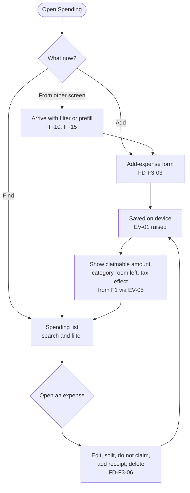
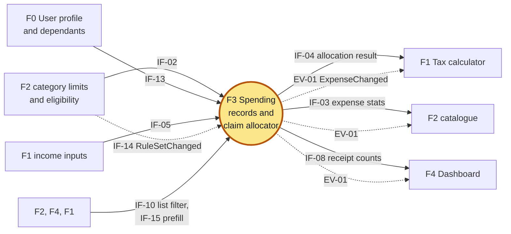
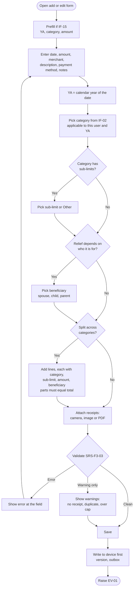
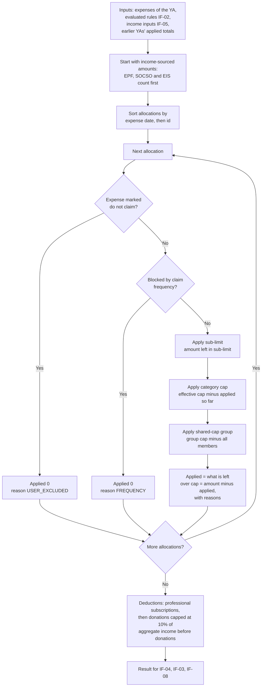
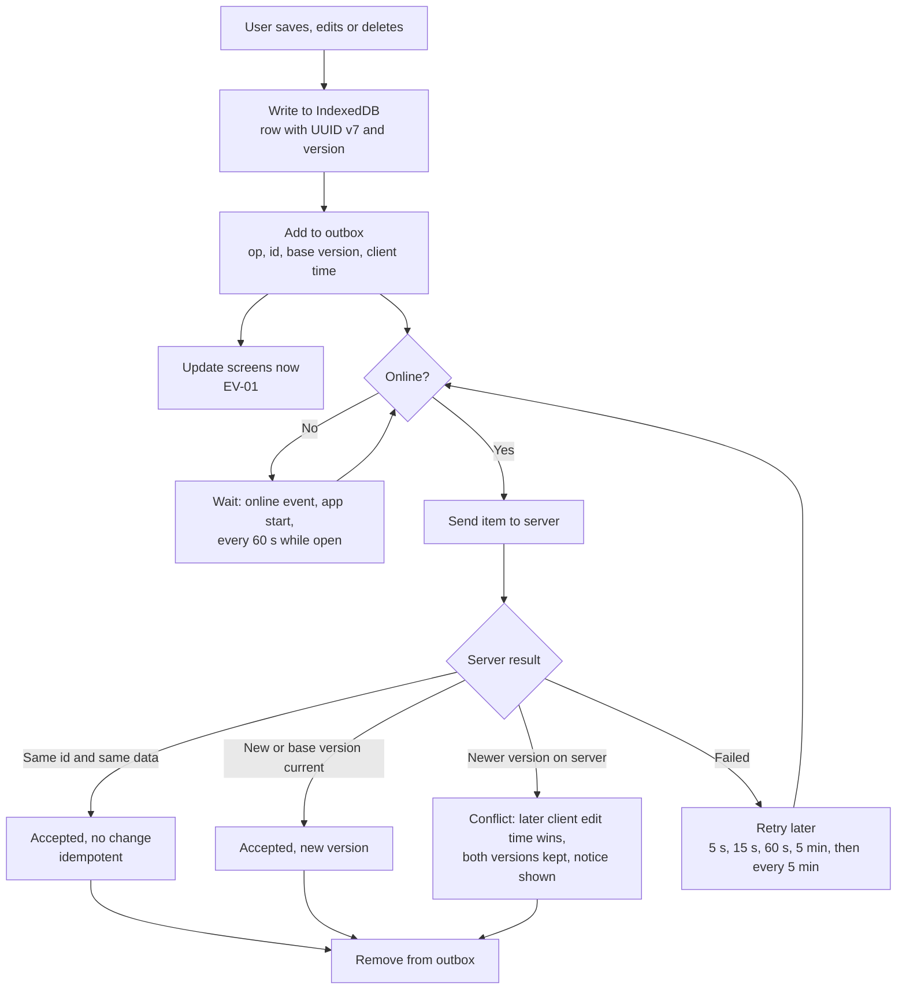
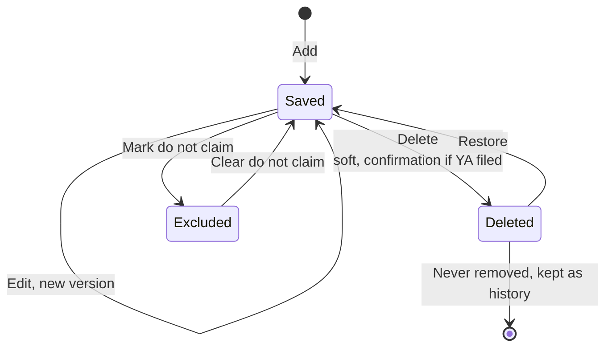
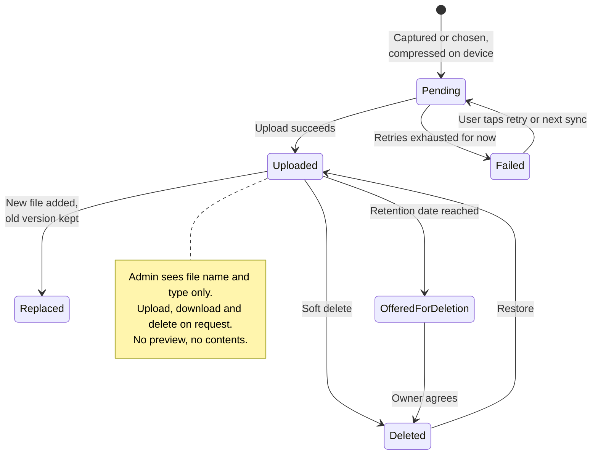
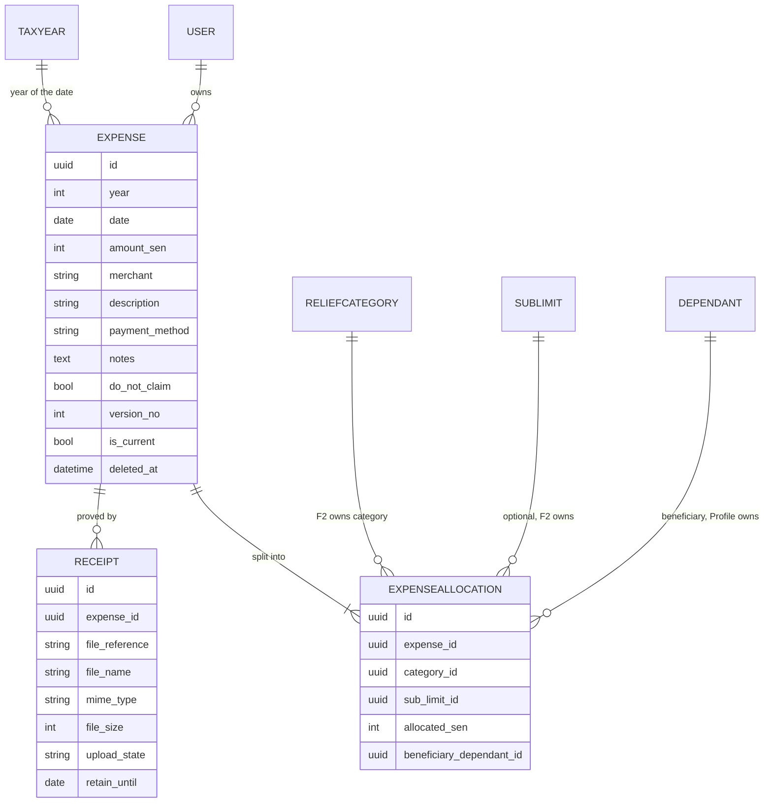
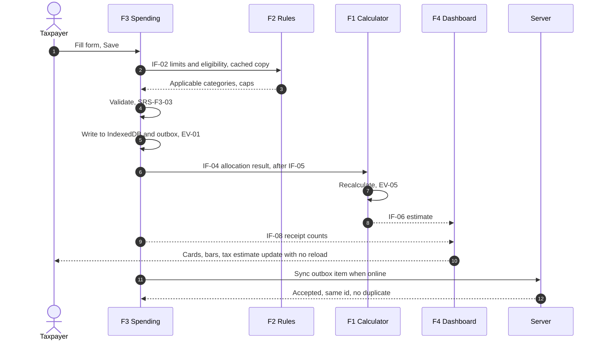

# URS and SRS: F3 Spending Records

| Item | Value |
| --- | --- |
| Product | Tax Relief Manager (TRM), Malaysia tax relief system (PWA) |
| Feature | F3 Spending records (PRD section 3.3, FR-3.1 to FR-3.7) |
| Document version | 0.5 (draft, for owner review) |
| Date | 2026-11-14 (first written 2026-11-13) |
| Source | PRD revision 37; owner prompt P-16 |
| Owner | Champs (product owner) |
| Change tracking | [URS_SRS_CHANGE_LOG.md](../registers/URS_SRS_CHANGE_LOG.md); work history in [HISTORY_LOG.md](../registers/HISTORY_LOG.md) |

## 0. Conventions shared by all six documents

@@CONVENTIONS@@

---

# Part A. User Requirements Specification (URS)

## A1. Purpose and scope

**Purpose.** F3 records each expense that may qualify for tax relief, with its receipt, and works out how much of it counts (the claimable amount) against the category's cap, sub-limits, shared caps and claim-frequency rules. F3 is the only feature that writes expenses and receipts. It owns the **claim allocator**, the single piece of logic that decides what counts, and F1 and F4 use its result.

**In scope (R1):** expense form with camera capture; validation and duplicate warning; claimable amount; split across categories; edit, soft delete, restore; search and filter; offline use and sync; receipt storage and 7-year retention; filed-YA protection; admin file support by name and type.

**Reserved (R2, R3, R4):** receipt rules engine (R2), bank and e-wallet import (R3), receipt OCR (R4). F3 leaves the receipt and expense fields they will fill.

**Out of scope:** reading receipts automatically; payment.

## A2. Users and roles

| User | What they do in F3 |
| --- | --- |
| Taxpayer | Adds, edits, deletes, restores, searches expenses and receipts |
| Admin | On request, uploads, downloads or deletes a user's files by file name and type. Never sees receipt contents, amounts, merchants or descriptions (PRD section 8). |
| System | Sync jobs; computed results use the SYSTEM user |

## A3. User requirements

| ID | The user must be able to | PRD source | Flow |
| --- | --- | --- | --- |
| URS-F3-01 | Record an expense with date, amount, category, merchant, description, payment method, notes and receipt (camera, image or PDF) | FR-3.1 | FD-F3-01, FD-F3-03 |
| URS-F3-02 | Pick only categories that apply to me, have the YA worked out from the date, and see the sub-limit choices of a category | FR-3.1, FR-3.2 | FD-F3-03 |
| URS-F3-03 | Be stopped by real errors and only warned about the rest: amount, date, eligibility; missing receipt; possible duplicate | FR-3.2 | FD-F3-03 |
| URS-F3-04 | See the actual spend and the claimable amount of each expense side by side, and why any part does not count | FR-3.3, BR-2, BR-3, BR-4 | FD-F3-04 |
| URS-F3-05 | Split one expense across categories so the parts add up to the total and nothing is claimed twice | FR-3.4, BR-8 | FD-F3-03 |
| URS-F3-06 | Edit, delete (without losing it), search and filter expenses by YA, category, date and receipt status | FR-3.5 | FD-F3-01, FD-F3-06 |
| URS-F3-07 | Add and edit expenses offline, and have them sync later without duplicates or lost edits | FR-3.6, NFR-2 | FD-F3-05 |
| URS-F3-08 | Be warned, and confirm, before deleting or changing anything that belongs to a filed YA | FR-3.7 | FD-F3-06 |
| URS-F3-09 | Keep each receipt for 7 years from the end of the YA, and see its upload state | NFR-3, NFR-8 | FD-F3-07 |
| URS-F3-10 | Mark an expense "do not claim" so it stays recorded but does not count | BR-2 | FD-F3-04 |
| URS-F3-11 | See, right after saving, what the expense did to the category's remaining room and the estimate | FR-3.x acceptance, FR-4 acceptance | FD-F3-01 |
| URS-F3-12 | See the history of every change to an expense or receipt | NFR-9 | FD-F3-08 |
| URS-F3-13 | Say who an expense is for (me, spouse, a child, a parent) where the relief depends on it | BR-11, section 2.3 | FD-F3-03 |
| URS-F3-14 | (Admin) Help with a user's files by file name and type, without opening any confidential data | PRD section 8 | FD-F3-07 |
| URS-F3-15 | Have my spending records and receipt files included in my data export and deleted when I delete my account | PRD sections 7 and 8, NFR-7, NFR-8 | FD-F5-09, FD-F5-10 |

## A4. Flow diagrams

**FD-F3-01. User flow in spending records**

**FD-F3-02. What F3 receives from and gives to other features**

**FD-F3-03. Add or edit an expense**

**FD-F3-04. Claim allocation: how much of an expense counts** (the allocator, SRS-F3-06 to SRS-F3-08)

**FD-F3-05. Offline capture and sync**

**FD-F3-06. Life of an expense**

**FD-F3-07. Life of a receipt, and the admin's file actions**

**FD-F3-08. Data held by F3 and the entities it connects to**

## A5. Relationship with other features

@@FD00@@

@@IFTABLE@@

@@OWNERSHIP@@

**A5.4 Inter-related data for F3**

| Data | Direction | Other feature | What F3 uses it for, or gives it for | Interface | If it is missing or late |
| --- | --- | --- | --- | --- | --- |
| Category limits, sub-limits, groups, frequency, documents, beneficiary rule | in | F2 | Category picker, validation, allocator | IF-02 | Form shows "Rules not loaded"; saving is blocked until rules are cached |
| Profile facts and dependants of the YA the expense falls in | in | F0 | Eligibility checks, beneficiary list | IF-13 | Profile Incomplete: F3 shows the gate and accepts no expense for that YA (SRS-F0-03) |
| Income inputs: total income, EPF, SOCSO and EIS amounts | in | F1 | Donation cap, shared caps, SOCSO cap | IF-05 | Allocator waits for the input; shows "Updating" |
| Allocation result | out | F1 | Spending reliefs and deductions in the tax chain | IF-04 | Not applicable |
| Expense statistics per category | out | F2 | Category detail | IF-03 | Not applicable |
| Receipt and expense counts | out | F4 | Missing-receipt counts and alerts | IF-08 | Not applicable |
| Entry points: list filter, prefilled form | in | F1, F2, F4 | Open the right list or form | IF-10, IF-15 | Not applicable |
| RuleSetChanged | in | F2 | Recompute claimable | IF-14 | Not applicable |
| ExpenseChanged | out | F1, F2, F4 | Refresh | EV-01 | Not applicable |
| Signed-in identity: user id, role | in | F5 | Decide whose expenses and files F3 reads and writes; admins only reach file support (SRS-F3-17) | IF-18 | Offline, the identity stored at the last sign-in is used until the session expires (SRS-F5-09) |
| Export part of the spending data and the receipt files | out | F5 | The user's data export | IF-19 | Not applicable |
| Erase request | in | F5 | Delete the user's expenses, allocations, receipts and stored files when the grace period ends | IF-20 | F5 repeats the request until F3 confirms (SRS-F5-16) |
| AccountStatusChanged, SessionEnded | in | F5 | Stop uploads and the outbox | EV-07, EV-08 | F3 learns on the next server call, which is refused with the same notice |

## A6. Assumptions and constraints

1. Claimable amounts are derived at read time and never stored (PRD section 5). Only the final estimate is saved, by F1.
2. Money is whole sen.
3. Receipts are private, encrypted storage; the admin never sees contents (NFR-6, PRD section 8).
4. The claim order rule is BR-2: expenses fill the cap in date order.

---

# Part B. System Requirements Specification (SRS)

## B1. Functional specifications

### B1.1 Recording an expense

| ID | Specification | Basis | URS | Flow | Test |
| --- | --- | --- | --- | --- | --- |
| SRS-F3-01 | **Expense form.** Fields: date (required, default today), amount in RM with up to 2 decimals (required), category (required), sub-limit (if the category has any), beneficiary (if required, SRS-F3-02), merchant (required, 1 to 100 characters), description (optional, up to 300), payment method (cash, debit or credit card, e-wallet, bank transfer, other; required), notes (optional, up to 1,000), "Do not claim" (switch, default off, DA-01), receipts (0 to 5 files, SRS-F3-05), split lines (SRS-F3-09). Buttons: Save, Save and add another, Cancel. After Save the screen shows: actual spend, claimable amount, category room left, and, when F1 has answered (EV-05), the change in tax payable. | FR-3.1, DA-01 | URS-F3-01, URS-F3-11 | FD-F3-03 | TC-F3-01, TC-F3-02 |
| SRS-F3-02 | **YA, category, sub-limit, beneficiary.** 1. YA = the calendar year of the date. If the profile of that YA is Incomplete, F3 shows the gate "Complete your profile for YA {y}" and accepts no expense for it (SRS-F0-03). 2. The category list comes from IF-02 for that YA: categories with amount source S, or I and S (SOCSO), that are applicable for this user, and not retired. 3. Categories that are not applicable are not offered; a user who needs one is told to update the profile (link). 4. When the chosen category has sub-limits, the user picks one or "Other" (counts only against the category cap). 5. A beneficiary is required when the category's beneficiary_rule is set: R08 (a parent), R23 (a child within the age limit), R24 (a child aged 2 or below), R07 (self, spouse or a child), R09 (the disabled person). The choices come from the profile of the YA the date falls in (IF-13). A dependant removed later (F0 SD-F0-13) stays on old expenses as "(removed)" and is not offered for new ones. The date is used to test age for the beneficiary on the rule's reference date (OI-F1-01). | FR-3.1, FR-3.2, BR-11, DA-15 | URS-F3-02, URS-F3-13 | FD-F3-03 | TC-F3-12, TC-F3-20 |
| SRS-F3-03 | **Validation.** **Errors (save is blocked):** amount not above RM 0.00, or above RM 99,999,999.99; date missing or invalid; date after today; date in a year with no rule set; the profile of that year is Incomplete (gate, SRS-F0-03); no category; category not eligible, meaning not applicable to the profile (message "Your profile says this does not apply. Update your profile.") or retired; beneficiary missing or not eligible (for example a child above the age limit); split parts not equal to the total; a required field missing; more than 5 receipts; a receipt of a type or size not allowed. **Warnings (user may save):** no receipt attached; possible duplicate (SRS-F3-04); the expense will not fully count (shows how much is over cap); the date is in a filed YA (asks to confirm, SRS-F3-11); the form was opened under a YA filter different from the date's YA ("This expense belongs to YA {year}"). Every message is shown at its field, not as a pop-up. | FR-3.2, SD-F3-01 | URS-F3-03 | FD-F3-03 | TC-F3-04, TC-F3-05, TC-F3-12, TC-F3-15, TC-F3-20 |
| SRS-F3-04 | **Duplicate detection.** Before saving, find another current, non-deleted expense of the same user with the same merchant (trimmed, case-insensitive), the same date and the same amount, excluding the one being edited. If found, warn with a link to the existing record; the user may "Save anyway" or "Cancel". The check runs on the device and, after sync, on the server (a server hit sets a "possible duplicate" mark on the later record and shows it in the list). | FR-3.2 | URS-F3-03 | FD-F3-03 | TC-F3-05 |
| SRS-F3-05 | **Receipts.** 1. Sources: camera capture, image (JPEG, PNG, HEIC, WebP) or PDF; up to 5 per expense. 2. Images are compressed on the device to at most 1,600 px on the long edge as JPEG at quality 80 (SD-F3-02); PDFs are not changed; each file at most 10 MB after compression. 3. Each file is a Receipt row with upload_state pending, uploaded or failed (DA-11), file_name, file_size and mime_type. A pending file counts as attached. 4. Upload runs in the background, with retries at 5 s, 15 s, 60 s, 5 min and then every 5 min until it succeeds; the user can tap retry. 5. Files go to private, encrypted object storage; file_reference is an opaque key. 6. retain_until = 31 December of the YA's year plus 7 years. When it passes, F3 offers deletion; it never deletes by itself. 7. Replacing a file adds a new version; the old file is kept until retain_until. 8. Deleting a receipt is a soft delete. | FR-3.1, NFR-3, NFR-8, DA-11, SD-F3-02 | URS-F3-09 | FD-F3-07 | TC-F3-13, TC-F3-17 |

### B1.2 Claim allocation

| ID | Specification | Basis | URS | Flow | Test |
| --- | --- | --- | --- | --- | --- |
| SRS-F3-06 | **Claim allocator (one implementation for F1, F3 and F4).** Input: user, YA, evaluated rules (IF-02), current non-deleted ExpenseAllocation rows with their expense, income inputs (IF-05), and applied totals of earlier YAs. Algorithm for relief categories, all in sen: 1. State starts empty: running amount per sub-limit, per category, per shared group. 2. Income-sourced amounts first (SRS-F3-07). 3. Sort allocations by expense date ascending, then allocation id (UUID v7, so creation order) (DA-02). 4. For each allocation with amount x: if its expense is do_not_claim, applied = 0 with reason USER_EXCLUDED; else if the category has no rule in the YA, applied = 0 with reason NO_RULE and the expense is listed under "Needs attention"; else if blocked by claim frequency (SRS-F3-08), applied = 0 with reason FREQUENCY; else: sub_ok = x if no sub-limit, otherwise min(x, sub-limit cap minus running sub-limit); cat_ok = min(sub_ok, effective cap minus running category); grp_ok = cat_ok if the category has no shared group, otherwise min(cat_ok, group cap minus running group). applied = grp_ok. Update running amounts: sub-limit by sub_ok, category by applied, group by applied. over cap = x minus applied, with a reason split: SUBLIMIT = x minus sub_ok, CATEGORY_CAP = sub_ok minus cat_ok, GROUP_CAP = cat_ok minus grp_ok. 5. Deductions: SRS-F3-07. 6. Output per allocation: applied, over cap with reasons; per category: expense count, actual total, applied total, over total; per group and per deduction: applied total. Editing an earlier expense can change later expenses' applied amounts; this is by design (BR-2). The allocator is a pure function and runs in under 100 ms for 2,000 allocations. | FR-3.3, BR-2, BR-3, BR-4, DA-02 | URS-F3-04, URS-F3-10 | FD-F3-04 | TC-F3-01, TC-F3-02, TC-F3-07, TC-F3-08, TC-F3-11 |
| SRS-F3-07 | **Income inputs, shared caps and deductions.** From IF-05, F3 gets total_income and prior_amounts per income-sourced category (R14 employee EPF, R18 SOCSO and EIS). 1. Before any expense, each prior amount is applied: first to the category's income sub-limit when it has one (R18 in YA 2027: MANDATORY 350), then to the category cap (R14: 4,000), then to the group cap. Additional voluntary EPF contributions are entered as expenses under R15, because LHDN counts them inside its RM 3,000 limit. Prior amounts of categories in one group are applied in code order. 2. Deductions: D02 professional subscriptions are applied in full (no cap). Aggregate income before donations = max(0, total_income minus D02 applied). The D01 cap = floor(aggregate income before donations x 10 / 100) in sen (cap_basis percent_of_aggregate, DA-05; OI-F3-02). Donations are applied in date order up to that cap; the rest is over cap with reason DONATION_CAP. 3. The allocator returns aggregate income before donations to F1 inside IF-04, so F1 and F3 use the same figure. | BR-3, BR-4, BR-7, DA-05, OI-F3-02 | URS-F3-04 | FD-F3-04 | TC-F3-08, TC-F3-09, TC-F3-22 |
| SRS-F3-08 | **Claim frequency.** F3 applies the configuration of SRS-F2-14. Applied totals of earlier YAs are produced by this same allocator, oldest YA first, each YA using only earlier YAs. once_every_n_ya: blocked when the category has applied > 0 in any of the previous n minus 1 YAs. once_in_period: blocked when an earlier YA inside the period has applied > 0. max_claim_years (m): blocked when the m YAs just before this one are all applied > 0. When the user saves an expense in a blocked category F3 warns: "Already claimed in YA {y}; this relief can be claimed once every {n} YAs." The expense is kept with applied 0 and reason FREQUENCY. | BR-5, DA-06 | URS-F3-04 | FD-F3-04 | TC-F3-10, TC-F3-18 |
| SRS-F3-09 | **Split.** One expense has one or more ExpenseAllocation lines. A single-category expense has exactly one line equal to the total. In split mode the user adds lines (category, sub-limit, beneficiary, amount). Rule: the sum of line amounts equals the expense amount to the sen; the form shows "RM {x} left to allocate" and blocks saving until it is 0.00. A category may appear once per expense. Editing the expense total in split mode clears the "left to allocate" check and asks the user to fix the lines. The same expense cannot be counted under two categories except through a split (BR-8). | FR-3.4, BR-8 | URS-F3-05 | FD-F3-03 | TC-F3-04 |

### B1.3 Edit, delete, search, offline

| ID | Specification | Basis | URS | Flow | Test |
| --- | --- | --- | --- | --- | --- |
| SRS-F3-10 | **Edit and versions.** Saving a change to an expense, its allocation lines or its receipts inserts a new version row (version_no + 1, is_current true, updated_by = acting user) and sets is_current false on the old row. Allocation lines and receipts are versioned with their own rows. Nothing is overwritten. | NFR-9, PRD section 5 | URS-F3-06, URS-F3-12 | FD-F3-06, FD-F3-08 | TC-F3-14 |
| SRS-F3-11 | **Soft delete, restore, filed-YA guard.** 1. Delete sets deleted_at and deleted_by on the current version. A deleted expense disappears from lists and allocation, and appears in "Recently deleted" with a Restore button (SD-F3-03). 2. If UserTaxYear.status for the expense's YA is filed (DA-12), delete, edit and receipt deletion each need an explicit confirmation: a checkbox "I understand this changes the records behind my filed return" and a Confirm button. 3. Receipts follow the same rules. 4. Restore is a versioned edit. | FR-3.5, FR-3.7, DA-12, SD-F3-03 | URS-F3-06, URS-F3-08 | FD-F3-06 | TC-F3-06 |
| SRS-F3-12 | **Search and filter.** List columns: date, merchant, category (with "split" mark), actual, applied, chips (receipt: has, missing, pending upload; over cap; do not claim; possible duplicate; waiting to sync). Filters, combined with AND: YA (default current YA), category (multi), date range, receipt status (has, missing, pending upload), claim status (fully counted, partly counted, nothing counted, do not claim), text (merchant, description, notes; case-insensitive substring). Sort: date (newest first by default), amount, applied. The footer shows, for the filtered set, total actual and total applied. The list loads 50 rows at a time. | FR-3.5 | URS-F3-06 | FD-F3-01 | TC-F3-19 |
| SRS-F3-13 | **Offline capture and sync.** 1. Every create, edit and delete is written to IndexedDB first, with an outbox item {operation, entity, id, base_version, payload, client_time}. 2. Screens, the allocator, F1 and F4 read local data, so a new record shows everywhere at once. 3. Sync starts on the browser online event, on app start and every 60 seconds while the app is open and online. 4. The server is idempotent: a create with an id it already has and the same payload is accepted with no change; an update whose base_version is the current version creates the next version; an update whose base_version is older is a conflict, and the version with the later client_time wins, while the losing version is kept as a non-current row marked conflict_loser, and the user sees "Your edit of {time} replaced a newer one" or "A newer edit from another device replaced yours" with a link to the history. 5. Failures retry at 5 s, 15 s, 60 s, 5 min, then every 5 min. 6. A status chip shows Synced, Pending n or Failed n. 7. Receipt uploads have their own queue (SRS-F3-05). 8. A record's id is a client-generated UUID v7 (DA-02). | FR-3.6, NFR-2, DA-02, SD-F3-04 | URS-F3-07 | FD-F3-05 | TC-F3-03, TC-F3-14, TC-F3-21 |

### B1.4 Outputs, entry points, audit, admin

| ID | Specification | Basis | URS | Flow | Test |
| --- | --- | --- | --- | --- | --- |
| SRS-F3-14 | **Outputs and events.** After every local write, F3 raises EV-01 (ya, expense ids). It recomputes when it hears EV-01, EV-02 (new IF-05), EV-03 (for the YA in the event) or EV-04. It provides: **IF-04** {ya, rule version, applied_by_category [category_id, applied_sen], deductions {donations_applied, prof_subs_applied, aggregate_before_donations}}; **IF-03** per category {expense_count, actual_total, applied_total, over_total, missing_receipt_count, pending_upload_count}; **IF-08** per category and in total {expenses_with_receipt, missing_receipt, pending_upload, expense_count}. A receipt counts as attached when it is uploaded or pending; failed counts as missing. IF-04 is sent to F1 whenever it is recomputed, and carries the rule version it used so F1 can discard a stale result. | IF-03, IF-04, IF-08, IF-14 | URS-F3-04, URS-F3-11 | FD-F3-02 | TC-F3-01, TC-F3-13 |
| SRS-F3-15 | **Entry points (IF-10, IF-15).** IF-10: the list opens with a filter {ya, category_id, receipt_status, claim_status}; the active filter is shown as removable chips. IF-15: the form opens with {ya, category_id, sub_limit_id, amount} filled; the user can change any field; the YA field is derived from the date, so a prefilled YA sets the date to 31 December of that YA when the YA has ended, to today when it is the current YA, and leaves the date empty with a notice when the YA has not started. The list also opens from the tax-year history of F0 for a chosen YA, with the same filter (IF-17). | IF-10, IF-15 | URS-F3-06, URS-F3-11 | FD-F3-01 | TC-F3-19 |
| SRS-F3-16 | **History view.** On any expense: a version list with version_no, who (user or SYSTEM), when, what changed (field, old, new), and conflict marks. Read only. Deleted and replaced receipts are listed with their dates. | NFR-9 | URS-F3-12 | FD-F3-08 | TC-F3-14 |
| SRS-F3-17 | **Admin file support.** An admin can open a user's file list showing only file name, mime type, file size and upload date (DA-11). The admin can upload a file to a user's expense, download a file, or delete a file, on request (the request is typed into a required "Reason" field). There is no preview, no thumbnail and no search inside files. The expense's amount, merchant, description and notes are not returned to the admin by the API. Download is delivered to the profile owner's account (the admin does not open it) until OI-F3-01 is answered. Each action is written to created_by or updated_by with the admin's id and kept in the version history. | PRD section 8, DA-11, OI-F3-01 | URS-F3-14 | FD-F3-07 | TC-F3-16 |
| SRS-F3-18 | **Identity, export and erase (links to F5).** 1. **Identity (IF-18).** F3 reads the signed-in user id and role. Every request is for the signed-in user's own expenses and files. An admin session reaches file names, types, sizes and dates only (SRS-F3-17). 2. **Export part (IF-19).** When F5 asks, F3 returns every Expense and ExpenseAllocation version (soft-deleted rows included, with version fields), every Receipt record, and the original stored file of every uploaded receipt, named "{expense_id}_{n}.{extension}". A receipt that is still pending upload on a device is listed as "not uploaded" and has no file. 3. **Erase (IF-20).** When F5 asks, F3 hard deletes the user's Expense, ExpenseAllocation and Receipt rows, deletes every stored file and every copy of it (compressed copies and thumbnails), and answers with the number of rows deleted per entity and the number of files deleted. After the erase a request for any of those files fails. The device cache and the upload queue are removed at the next sign-in. If the request names a YA (ya, SRS-F5-21), F3 deletes only the expenses dated in that YA, their allocations, receipts and stored files. 4. **Events.** On EV-07 with status disabled or deletion_pending, and on EV-08, F3 stops uploads and the outbox. Receipts waiting to upload stay on the device until the sign-out rules of SRS-F5-09 decide. | NFR-6, NFR-7, NFR-8, SD-F5-08, SD-F5-09 | URS-F3-15, URS-F5-08, URS-F5-09 | FD-F5-09, FD-F5-10 | TC-F3-23 |

## B2. Data specification

### B2.1 Fields F3 writes and reads

| Entity | F3 access | Fields | Notes |
| --- | --- | --- | --- |
| Expense | write | id (UUID v7), user_id, year (from date), date, amount_sen, merchant, description, payment_method, notes, do_not_claim (DA-01), possible_duplicate, version_no, is_current, conflict_loser, deleted_at, deleted_by, created_at, created_by, updated_at, updated_by | Claimable amount is not stored |
| ExpenseAllocation | write | id, expense_id, category_id, sub_limit_id, allocated_sen, beneficiary_dependant_id (DA-15), version fields, audit fields | |
| Receipt | write | id, expense_id, file_reference, file_name, mime_type, file_size, upload_state (DA-11), uploaded_at, retain_until, version fields, audit fields | |
| UserTaxYear | read | status | DA-12 |
| ReliefCategory, ReliefRule, SubLimit, RuleTier | read (IF-02) | evaluated per user | Owned by F2 |
| TaxpayerProfile, Dependant | read (IF-13) | the profile of the expense's YA | Owned by F0 |
| IncomeRecord (as IF-05) | read | total_income, prior amounts | Not read directly |

### B2.2 Data additions

@@DATA_ADDITIONS@@

### B2.3 Category codes

@@SEED@@

## B3. Specification details

**B3.1 Reason codes** shown beside an amount that does not fully count.

| Code | Shown as | When |
| --- | --- | --- |
| SUBLIMIT | "Over the {name} limit of RM {cap}" | Part is above the sub-limit |
| CATEGORY_CAP | "Over the category cap of RM {cap}" | Part is above the effective cap |
| GROUP_CAP | "Over the shared cap of RM {cap} with {group}" | Part is above the group cap |
| DONATION_CAP | "Over the donation limit of RM {cap}" | Part is above 10% of aggregate income |
| FREQUENCY | "Already claimed in YA {y}" | Claim frequency blocks it |
| USER_EXCLUDED | "You marked this do not claim" | do_not_claim is on |
| NO_RULE | "No rule for this category in YA {year}" | Category rule removed after the expense was saved |

**B3.2 Worked allocation (YA 2026, lifestyle R10, cap RM 2,500)**

| Expense (date, amount) | Running before (RM) | Applied (RM) | Over cap (RM) |
| --- | --- | --- | --- |
| 10 Jan, 2,000 | 0 | 2,000 | 0 |
| 15 Feb, 1,000 | 2,000 | 500 | 500, CATEGORY_CAP |

If the January expense is edited to RM 500, the February expense becomes applied RM 1,000, over cap RM 0.

**B3.3 Sequence of "add an expense" across features**

**SQ-F3-01. Adding an expense, until the dashboard shows it** (works from FD-F3-03, FD-F3-04, FD-F3-05)

## B4. Screen behaviour

| Screen | Content | States |
| --- | --- | --- |
| Add or edit spending | Fields of SRS-F3-01; category picker grouped like F2; sub-limit and beneficiary pickers; split lines with "left to allocate"; receipt tiles with state; result strip after saving | Offline: "Saved on this device, will sync". Rules not loaded: save disabled with reason. Filed YA: warning strip. Saving: button disabled, no double save |
| Spending list | Filter chips, search, rows (SRS-F3-12), footer totals, "Recently deleted" | Empty: "No expenses yet. Add your first." No result: "Nothing matches" and clear filters |
| Expense detail | Fields, allocation lines, receipts, reason chips, history (SRS-F3-16), actions Edit, Delete, Mark do not claim | Deleted: read-only with Restore |
| Admin file support | User search by account, file list by name and type (SRS-F3-17) | No contents shown anywhere |

Camera capture works on Android, iOS and desktop browsers that allow it; where it does not, the file picker is used. All fields are reachable one-handed on a 360 px screen (NFR-12).

## B5. Non-functional requirements that bind F3

| PRD ID | How it applies to F3 |
| --- | --- |
| NFR-2 | SRS-F3-13 |
| NFR-3 | SRS-F3-05 |
| NFR-5 | Allocator under 100 ms for 2,000 allocations; whole recalculation under 200 ms with F1 |
| NFR-6 | Encrypted storage; admin cannot read expense data or file contents; identity comes from F5 (SRS-F3-18) |
| NFR-7 | Export and erase of spending data and files: SRS-F3-18; no amounts or merchants in a log: SRS-F5-19 |
| NFR-8 | retain_until, offer deletion after 7 years |
| NFR-9 | SRS-F3-10, SRS-F3-16 |
| NFR-11 | Reason texts and labels in English and Bahasa Malaysia; amounts in RM; dates DD/MM/YYYY |
| NFR-12 | Accessible controls, no colour-only status |

## B6. Traceability matrix

| URS | SRS | Flow | PRD | Tests |
| --- | --- | --- | --- | --- |
| URS-F3-01 | SRS-F3-01 | FD-F3-03 | FR-3.1 | TC-F3-01, TC-F3-02 |
| URS-F3-02 | SRS-F3-02 | FD-F3-03 | FR-3.1, FR-3.2 | TC-F3-12, TC-F3-20 |
| URS-F3-03 | SRS-F3-03, SRS-F3-04 | FD-F3-03 | FR-3.2 | TC-F3-04, TC-F3-05, TC-F3-15 |
| URS-F3-04 | SRS-F3-06, SRS-F3-07, SRS-F3-08, SRS-F3-14 | FD-F3-04 | FR-3.3 | TC-F3-01, TC-F3-02, TC-F3-07 to TC-F3-11 |
| URS-F3-05 | SRS-F3-09 | FD-F3-03 | FR-3.4 | TC-F3-04 |
| URS-F3-06 | SRS-F3-10, SRS-F3-11, SRS-F3-12, SRS-F3-15 | FD-F3-01, FD-F3-06 | FR-3.5 | TC-F3-06, TC-F3-19 |
| URS-F3-07 | SRS-F3-13 | FD-F3-05 | FR-3.6 | TC-F3-03, TC-F3-14, TC-F3-21 |
| URS-F3-08 | SRS-F3-11 | FD-F3-06 | FR-3.7 | TC-F3-06 |
| URS-F3-09 | SRS-F3-05 | FD-F3-07 | NFR-3, NFR-8 | TC-F3-13, TC-F3-17 |
| URS-F3-10 | SRS-F3-01, SRS-F3-06 | FD-F3-04 | BR-2 | TC-F3-11 |
| URS-F3-11 | SRS-F3-01, SRS-F3-14, SRS-F3-15 | FD-F3-01 | FR-3 and FR-4 acceptance | TC-F3-03 |
| URS-F3-12 | SRS-F3-10, SRS-F3-16 | FD-F3-08 | NFR-9 | TC-F3-14 |
| URS-F3-13 | SRS-F3-02 | FD-F3-03 | BR-11 | TC-F3-12 |
| URS-F3-14 | SRS-F3-17 | FD-F3-07 | PRD section 8 | TC-F3-16 |
| URS-F3-15 | SRS-F3-18 | FD-F5-09, FD-F5-10 | PRD sections 7 and 8, NFR-7, NFR-8 | TC-F3-23 |

## B7. Test cases

Rules used by the tests are the YA 2026 values in the category table unless stated. "Applied" is the claimable amount.

| ID | Inputs | Expected | Checks |
| --- | --- | --- | --- |
| TC-F3-01 | One lifestyle (R10) expense of RM 3,000.00 | Actual 3,000.00; applied 2,500.00; over cap 500.00, CATEGORY_CAP; EV-01 raised; IF-04 shows R10 applied 2,500.00 | SRS-F3-06, SRS-F3-14 |
| TC-F3-02 | Medical (R07) with sub-limit VACC, vaccination RM 1,500.00 | Applied 1,000.00; over cap 500.00, SUBLIMIT; R07 category cap not reached | SRS-F3-06 |
| TC-F3-03 | Network off; add an expense; then network on | Expense and dashboard update at once; outbox shows Pending 1; after sync exactly one row on the server; chip shows Synced | SRS-F3-13, SRS-F3-14 |
| TC-F3-04 | Expense RM 1,000.00 split R10 600.00 and R11 400.00; then R10 600.00 and R11 300.00 | First saves; second is blocked with "RM 100.00 left to allocate" | SRS-F3-09, SRS-F3-03 |
| TC-F3-05 | Second expense with same merchant (any case), date and amount | Warning with link to the first; Save anyway works; record gets possible_duplicate | SRS-F3-04 |
| TC-F3-06 | YA 2026 marked filed; delete an expense dated in 2026 | Confirmation with checkbox is required; after confirming the expense is soft-deleted and appears in Recently deleted | SRS-F3-11 |
| TC-F3-07 | R10: 10 Jan RM 2,000.00 and 15 Feb RM 1,000.00; then edit January to RM 500.00 | Before: Jan 2,000.00, Feb 500.00 applied. After: Jan 500.00, Feb 1,000.00 applied | SRS-F3-06 |
| TC-F3-08 | Group GRP-INS-EPF cap 7,000; R14 cap 4,000; R15 cap 3,000; EPF prior 7,920.00 from IF-05; life insurance (R15) RM 3,500.00. Second case: EPF prior 2,000.00 and insurance RM 6,000.00 | First case: EPF applied 4,000.00; insurance applied 3,000.00, CATEGORY_CAP 500.00; combined 7,000.00. Second case: EPF 2,000.00; insurance 3,000.00, CATEGORY_CAP 3,000.00; combined 5,000.00 | SRS-F3-07 |
| TC-F3-09 | Total income 72,000.00; donations RM 10,000.00; then again with professional subscriptions RM 2,000.00 | Cap 7,200.00, applied 7,200.00, over 2,800.00; with subscriptions: aggregate before donations 70,000.00, cap 7,000.00, applied 7,000.00 | SRS-F3-07 |
| TC-F3-10 | R24 breastfeeding RM 1,000.00 applied in YA 2025; then RM 800.00 in YA 2026; then RM 800.00 in YA 2027 | YA 2026: applied 0.00, FREQUENCY, warning shown. YA 2027: applied 800.00 | SRS-F3-08 |
| TC-F3-11 | R10 expense RM 3,000.00 with do not claim on | Applied 0.00, USER_EXCLUDED; actual 3,000.00 shown; category room unchanged | SRS-F3-06 |
| TC-F3-12 | R23 childcare for a child aged 14 in YA 2026 (limit 12) | Error: beneficiary not eligible. Child aged 12: saves | SRS-F3-02, SRS-F3-03 |
| TC-F3-13 | Expense with no receipt; then add a receipt that is still uploading | First: warning, counted as missing in IF-08. After attach: pending counts as attached; when uploaded, state Uploaded | SRS-F3-05, SRS-F3-14 |
| TC-F3-14 | Same expense edited on two devices while offline; the later client time was on device B | After both sync: version of device B is current; device A's version kept as conflict_loser; both notices shown; history lists both | SRS-F3-13, SRS-F3-16 |
| TC-F3-15 | Date tomorrow | Error "Date is in the future" | SRS-F3-03 |
| TC-F3-16 | Admin opens a user's file list | Only file name, type, size and date are returned; no amounts or merchants; a download goes to the owner's account; the action appears in the version history with the admin's id | SRS-F3-17 |
| TC-F3-17 | Receipt for an expense dated 10 Jun 2026 | retain_until 31/12/2033 | SRS-F3-05 |
| TC-F3-18 | R06 home loan interest claimed in YA 2025, 2026 and 2027; expense in YA 2028 | YA 2028 applied 0.00, FREQUENCY (3 consecutive YAs used) | SRS-F3-08 |
| TC-F3-19 | Open the list from F4 with filter receipt_status = missing | Only expenses without a receipt; filter chip visible and removable | SRS-F3-12, SRS-F3-15 |
| TC-F3-20 | Profile with no children; try R23 | R23 not offered; if forced through IF-15, error "Your profile says this does not apply" with link | SRS-F3-02, SRS-F3-03 |
| TC-F3-21 | The same create item is sent twice (retry after a lost reply) | One row; second reply is "accepted, no change" | SRS-F3-13 |
| TC-F3-22 | YA 2027 R18: SOCSO prior 504.00 from IF-05; voluntary Lindung expense RM 200.00 with sub-limit VOLUNTARY | Prior applied 350.00 (MANDATORY sub-limit); expense applied 150.00 (VOLUNTARY sub-limit 150, category room 500 minus 350); over 50.00, SUBLIMIT | SRS-F3-07 |
| TC-F3-23 | Aisyah has 12 expenses and 9 receipts (8 uploaded, 1 pending on a phone); one expense was deleted earlier; she exports, then deletes her account | The export part holds all 12 expenses with their versions (the deleted one included), 9 receipt records, 8 files named {expense_id}_{n}.{extension}, and the pending receipt listed as "not uploaded". After the grace period F3 deletes the rows and the 8 files, returns the counts, and a fetch of any of the files fails; the admin file list for Aisyah is empty | SRS-F3-18, SRS-F3-17 |

## B8. Specification decisions and open items

**Specification decisions (SD). Need the owner's yes or no.**

| ID | Decision | Why |
| --- | --- | --- |
| SD-F3-01 | The error and warning split in SRS-F3-03, including blocking a category that the profile says does not apply and a date in the future | PRD lists the checks but not which block |
| SD-F3-02 | Up to 5 receipts per expense; images compressed to 1,600 px long edge, JPEG 80; at most 10 MB; background retries 5 s to 5 min | PRD says "compressed" and "retried" without numbers |
| SD-F3-03 | "Recently deleted" list with Restore | A soft delete needs a way back |
| SD-F3-04 | Conflict rule: later client edit time wins, loser kept as conflict_loser | NFR-2 says "last edit time per record" but not what happens to the loser |

**Open items (OI).**

| ID | Question | Proposed default until answered | Who |
| --- | --- | --- | --- |
| OI-F3-01 | PRD role table lets an admin "upload, download or delete a user's files, by file name and type only" yet says admins never open receipt contents. Does "download" mean the admin receives the file? | Download is delivered to the owner's account, not opened by the admin | Owner |
| OI-F3-02 | Donation cap base: LHDN's limit is 10% of aggregate income. Is that before donations and after professional subscriptions, as drafted? | Total income minus professional subscriptions | Owner, from LHDN |
| OI-F3-03 | SSPN net savings (R19) is "deposits minus withdrawals". An expense amount must be above zero, so withdrawals cannot be recorded | Withdrawals are not recorded in R1; the user enters the net deposit | Owner |
| OI-F3-04 | Zakat paid is captured in F1's income record (PRD data model), so a zakat receipt cannot be attached | Keep in F1; add a receipt link later if wanted | Owner |
